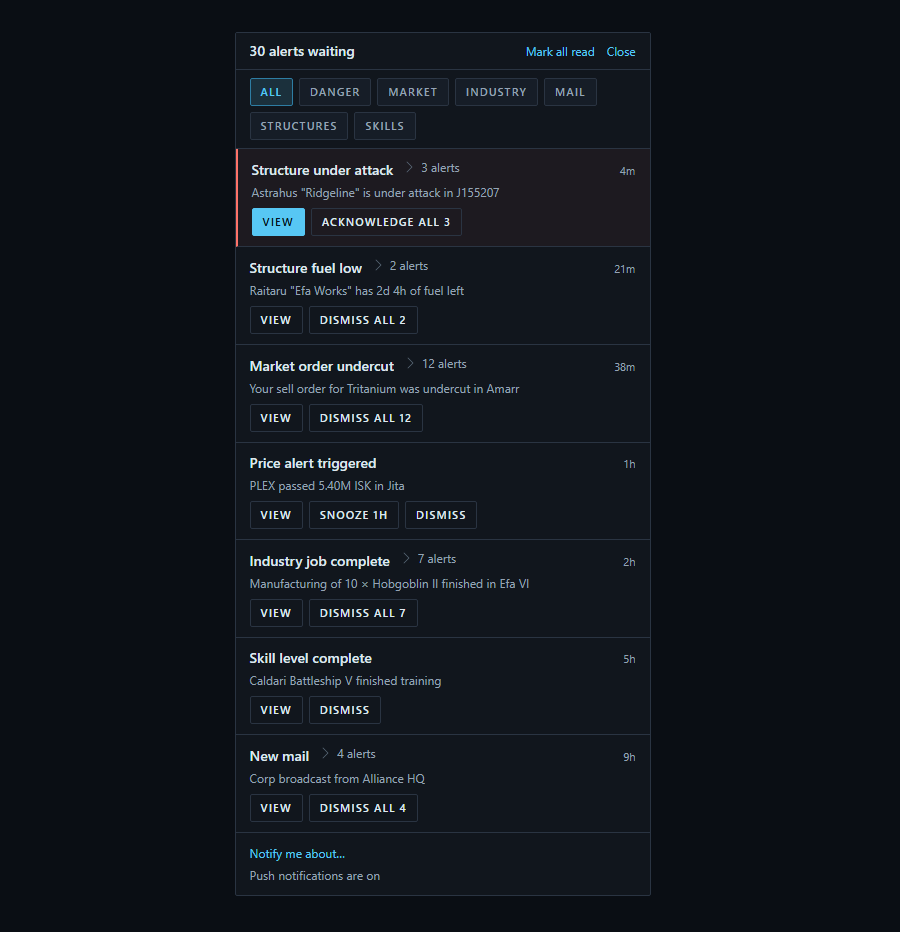
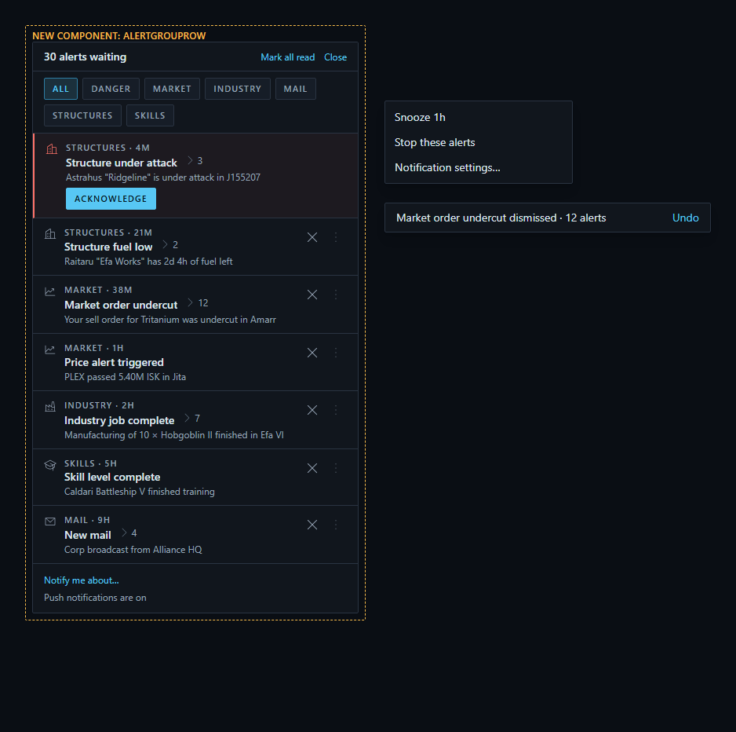
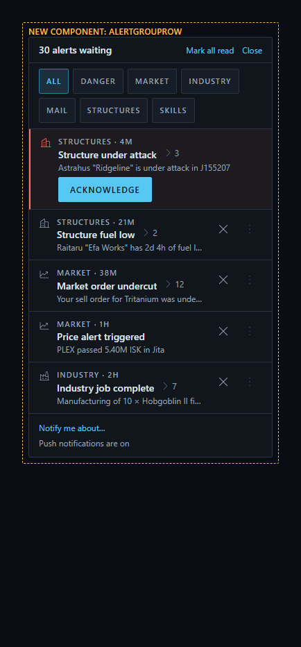

# Alerts panel (bell popover) — today vs proposed

Stories: `src/mockups/AlertsPanel.stories.tsx` (`mockups-alertspanel--today`,
`--proposed`, `--proposed-phone`).
Research and sources: [`docs/design/alerts-panel-ux-research.md`](../../alerts-panel-ux-research.md).

| Today | Proposed |
|---|---|
|  |  |
| Seven group rows carry fifteen full-size buttons between them. Nothing but the critical row's red edge tells the types apart, and the row itself is not a target. | The row is the target. A topic glyph and a dim eyebrow separate the types; a small `×` dismisses in one tap and the `⋮` beside it holds Snooze, Stop these alerts and Notification settings…; the panel is ~120px shorter at the same content. |

Phone sheet:

## What changed

| | Today | Proposed |
|---|---|---|
| **View** | A `Button` on every row | The row click. A single-fire group goes to `alertViewPath`; a group of many **expands**, and each fire inside it keeps its own link — tap the group, then tap the one you want |
| **Expanding a group** | A separate caret + "N alerts" toggle | The row click does it; the caret and count become the expand-state cue |
| **Dismiss** | A `Button` on every row | A plain `×` `IconButton`, visible at rest, first in the trailing cluster. The row slides out toward the inline start (left, in English), `Collapse` takes its height, and an Undo toast holds the write |
| **Dismiss on a phone** | The same `Button` | The same `×`, plus a swipe toward the inline start (left, in English). The app has no row swipe today — this is new, and the `×` is the non-gesture path WCAG 2.5.1 / 2.5.7 require |
| **Stop this type** | Not here — Settings › Notifications, found by typing the type name into that page's search | `⋮` → **Stop these alerts**, one tap, for every character on the account |
| **Settings for this type** | Not here | `⋮` → **Notification settings…**, deep-linked via `?search=` (`NotificationsPanel.tsx:100`) — see the caveat below |
| **Telling types apart** | Nothing, except the critical row's left border | Leading nav glyph (`NavMarket`, `NavIndustry`, `NavMail`, `NavCorp`, `NavSkills`) + dim topic eyebrow. Severity treatment is **unchanged** — critical only |
| **The row menu** | None — the row carries buttons instead | `⋮`, plus right-click with a pointer and touch-and-hold on touch — §6c already assigns the hold to "the row's or tile's menu", and it is what lets the `⋮` dim |
| **Danger rows** | `View` + `Acknowledge all N` | Row click still views; a visible worded **Acknowledge** stays, and the row gets **no `×`, no `⋮` and no swipe** |

## Notes for whoever builds this

- **The `×` is visible at rest; only the `⋮` dims.** §6c forbids a cue hover
  carries alone. The `⋮` earns the Magnifier exception (DESIGN.md:1053) —
  reduced opacity at rest with a pointer, full on `group-hover` /
  `focus-within`, **always full on touch and `hover:none`** — because its menu
  has two other doors: right-click with a pointer, touch and hold on touch.
  Dismiss has none, so its `×` cannot hide. The screenshots show the resting
  state. This needs a new §6c row in the same PR.
- **`Icon.Close`, not a checkmark.** `Icon.Done` / `Icon.Select` are the same
  Phosphor `Check`, and in an `IconButton` it already means *pick this*
  (`BlueprintAcquisitionModal`, `CorpAssets`). `FireRow` in this very panel
  already dismisses with `Icon.Close`, and the panel header closes with the
  word "Close", so there is no competing `×` here. Research §3e.
- **Undo delays the write, it does not reverse it — and the mechanism exists.**
  There is no undismiss path, and `mergeFeedRecord` takes the later
  `dismissedAt` on sync, so a cleared field comes back. Use
  `useDeferredCommits` (hides the row, defers the write to the end of the
  toast, caps at 3, commits on `pagehide`) with `ToastStack`, passing
  `dismissFeedEntriesAndSync` as the `commit`. Research §4a.
- **Motion and focus.** The row slides toward the inline start (left, in
  English), then `Collapse`'s 220ms takes its height so the rows below glide
  up; under `prefers-reduced-motion: reduce` neither happens. Move focus to
  the next row's `×`, the previous one if it was last, and the panel heading
  when the list empties.
- **The swipe is part of this, not a nice-to-have.** The app has no row swipe
  today (`useSheetSwipe` is vertical, for a sheet's own dismiss) and §6c's
  gesture table has no entry for one. The row travels toward the inline start
  (left, in English), matching the `×`, over a **neutral** track uncovered at
  the inline end — never `danger`, which in this panel means critical severity.
  `touch-action: pan-y` and a horizontal threshold, so it does not fight the
  `sheet-full`'s own down-swipe or the scroller; never on a critical row. It
  must not ship without the `×` (WCAG 2.5.1 / 2.5.7). The shared hook and the
  §6c gesture row can be their own ticket. Research §3f.
- **"Stop these alerts" is account-wide** (pilot's call, 2026-10-28): it turns
  the type off for every character on the account, not only the group's, and the
  toast says so. The mute functions are per character
  (`withEventChannelToggled(value, characterId, …)`), so loop the account's
  characters. It should also clear the fires already listed, under the same
  Undo. Research §4c.
- **Leave one-tap mute off critical types** — which is why a danger row has no
  `⋮` at all (one item is under §6c's two-action minimum), and no `×` or swipe
  either: its worded Acknowledge is the only way to clear it.
- **The settings deep link only works for app events today.**
  `filterNotificationEvents` matches event labels only, and
  `NotificationEventList` passes `showEveTypes={!searching}`, so an active
  search hides the EVE types. Research §4b has the two fixes; option 1 (teach
  the search EVE type labels) also fixes the pilot's manual workaround.
- **Nesting:** a whole-row target plus Acknowledge plus `×` and `⋮` cannot nest
  inside one link. Use the cover-button pattern §6c names for the Character
  switcher.
- **Check the resting `⋮` against WCAG 1.4.11** (3:1 non-text contrast). If 45%
  opacity does not clear it on `bg-panel`, raise it — a control that fails
  contrast at rest is hidden at rest.
- The menu and the toast are drawn flat beside the panel in the Proposed story
  so they appear in the screenshot; the build uses `RowActionsMenu` /
  `RowMoreActions` and `ToastStack`.

New components in these mockups: `AlertGroupRow`. Everything else is an
existing primitive.

First draft mockup; sample data. The ticket's Agent Brief text wins over the
picture where they differ.
