# Appraisal: live-price progress

Source: `src/mockups/AppraisalLivePrices.stories.tsx` (`mockups-appraisal-live-prices--*`). Sample data; the ticket text wins over the picture. Issue #5591.

The page frame (header with Refresh, paste card, result table) is a stand-in built from the real primitives, not the live page, so "today" is that frame without any live status. Only three things are new: the status line plus thin bar (`ProgressBar` xs, existing primitive), the per-row mark for cached or failed rows, and the same line over Compare Hubs while the other four hubs load. Finished state: "Live prices · checked 14 s ago", bar gone. A failed row stays on its Fuzzwork price and keeps its mark after the run. Refresh is today's header icon button (disabled while rows load, as on today's page). No new component, so no dashed labels (they would distort the footprint being judged).

Reference ideas (Mobbin): Deel's Documents table (count text beside a thin bar, "76/248 workers"), folk's import dialog ("0% complete" under a bar) and its "Job running" spinner chip in the page header. Used: the count beside a thin bar (A, C), and the quiet header chip placement (B, C). Nothing found that marks per-row staleness; marks follow DESIGN.md's rule that colour never carries meaning alone (a word or icon with sr text).

| Story | 1440 | 390 |
|---|---|---|
| `today` | 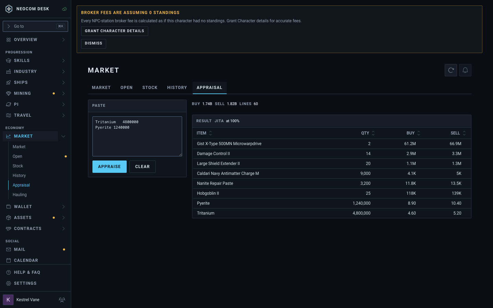 |  |
| `a-progress` | 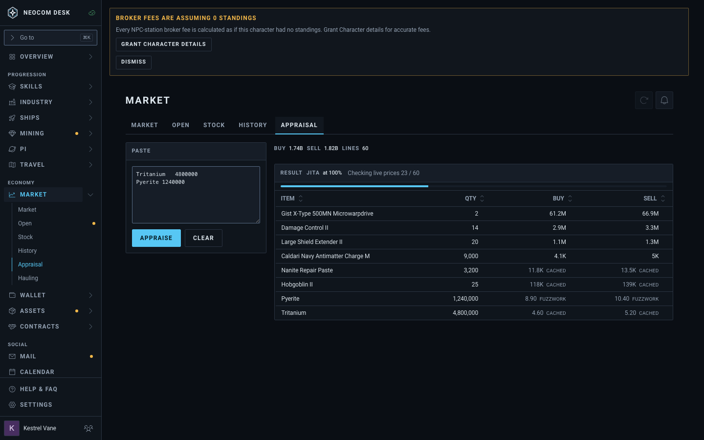 | 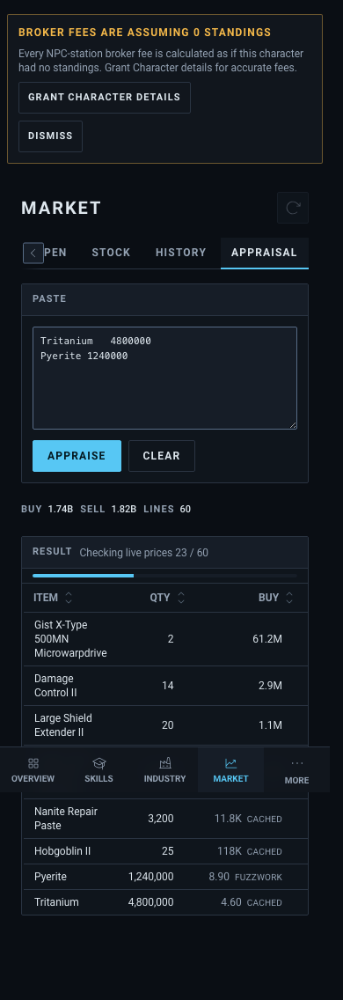 |
| `a-done` | 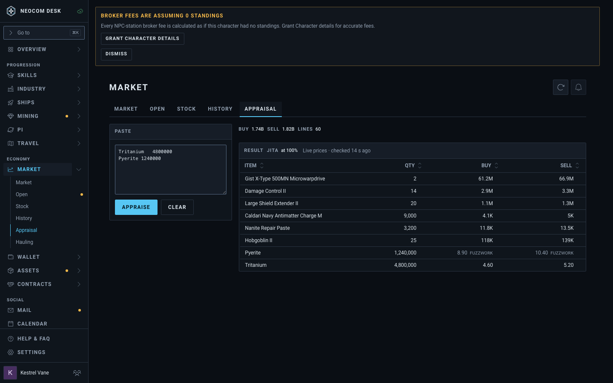 |  |
| `a-compare` | 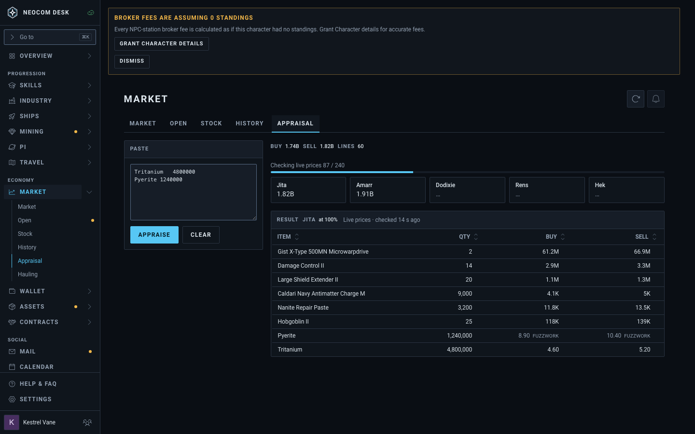 | 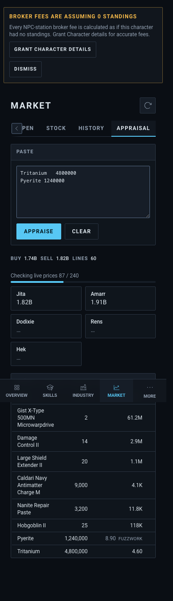 |
| `b-progress` | 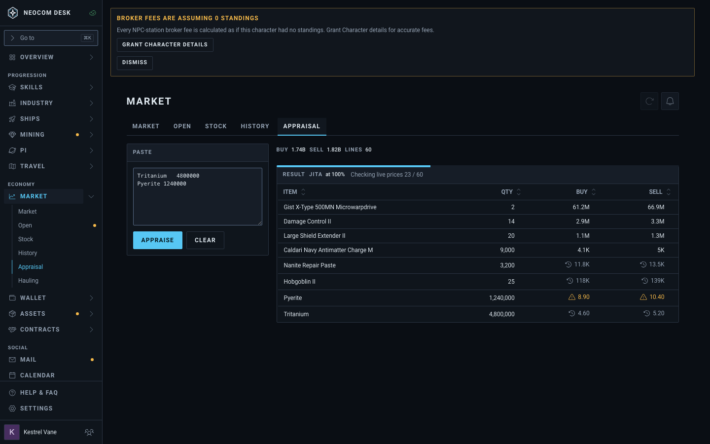 | 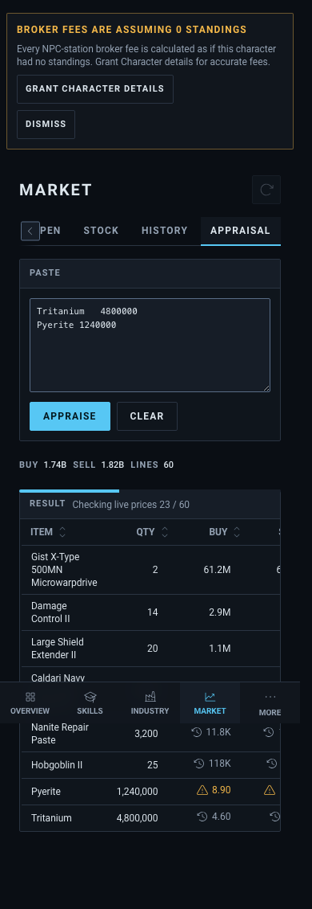 |
| `b-done` |  | 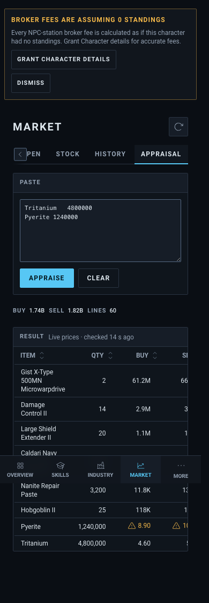 |
| `b-compare` | 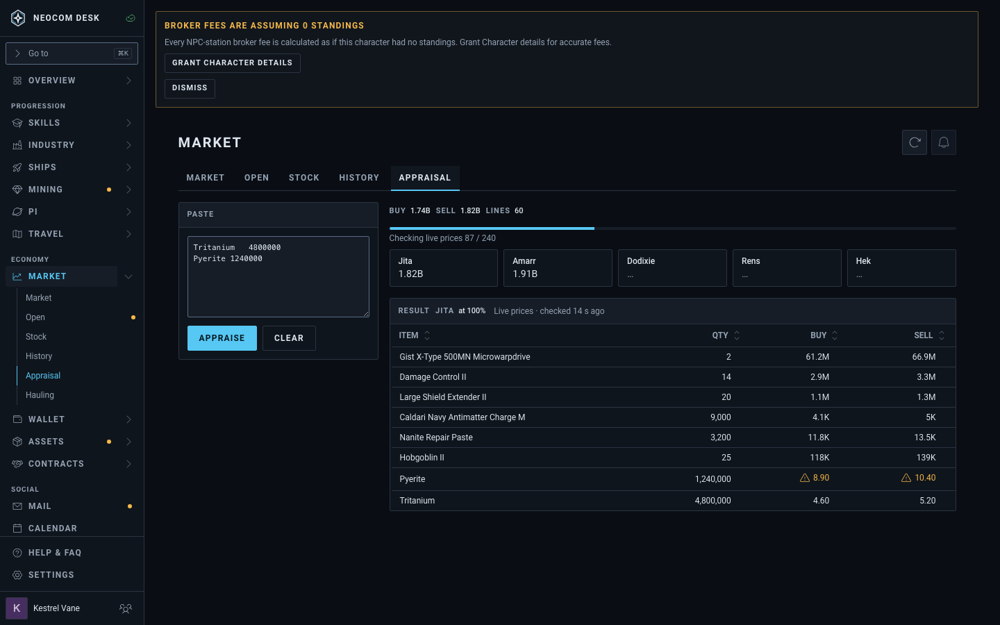 | 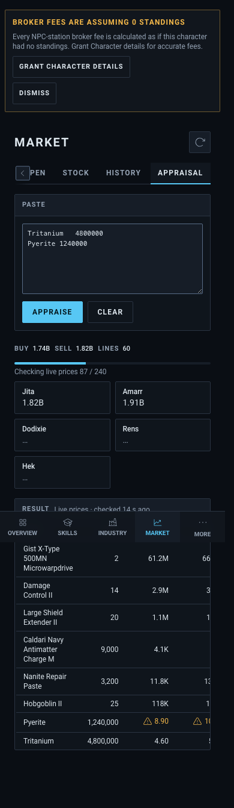 |
| `c-progress` | 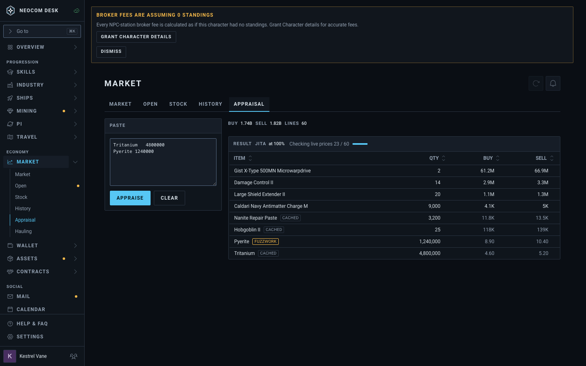 | 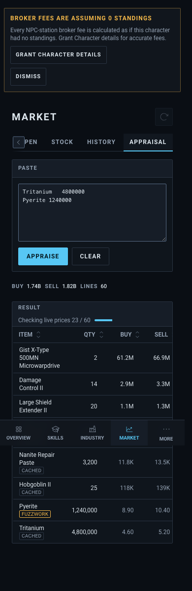 |
| `c-done` |  | 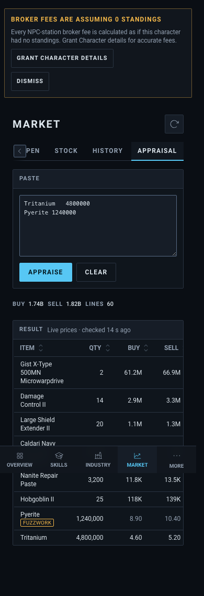 |
| `c-compare` | 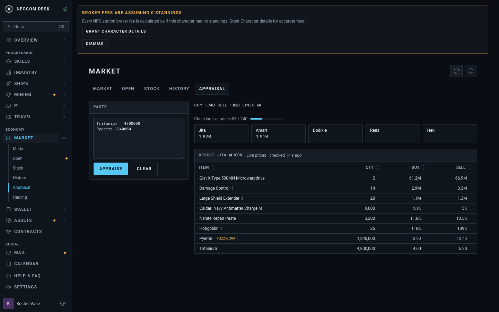 | 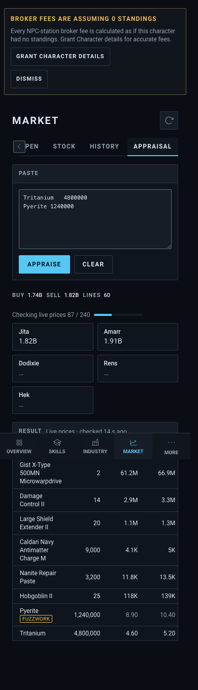 |

## A: bar on its own strip, word beside the price

- Pro: bar is full width and easy to read; "cached" / "FUZZWORK" are plain words, no legend needed.
- Con: adds a row (about 28px) to the header while loading, so the table jumps up when it goes; words crowd the price columns on a phone.

## B: bar on the card's top edge, icon marks

- Pro: smallest footprint, no layout shift at all; the bar is chrome, not content. Marks are a clock (cached) and a warning triangle (Fuzzwork), word in tooltip/sr text.
- Con: icons need learning and are not self-explanatory without hover; the top-edge bar is easy to miss; Compare Hubs bar floats above the cards.

## C: inline short bar after the text, pill in Item cell

- Pro: one header line, no shift; pills read as words and sit in the Item column so price columns stay clean (best on phone, the pill wraps under the name).
- Con: short bar (96px) shows progress coarsely; pills add visual noise on a long mostly-cached list.

## Recommendation

C's header (inline text plus short bar, one line, no layout shift) with A's mark (a dim word beside the price, not a pill): words carry meaning, price columns align, nothing jumps. If the owner wants the least visual weight, B.
