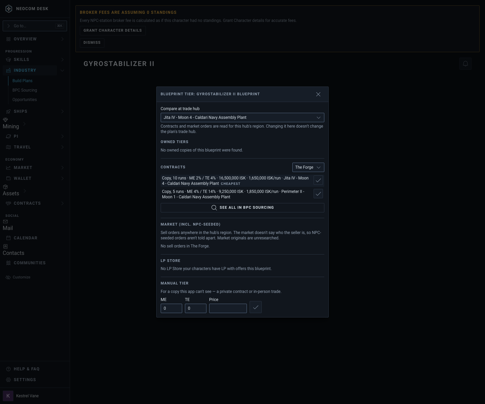
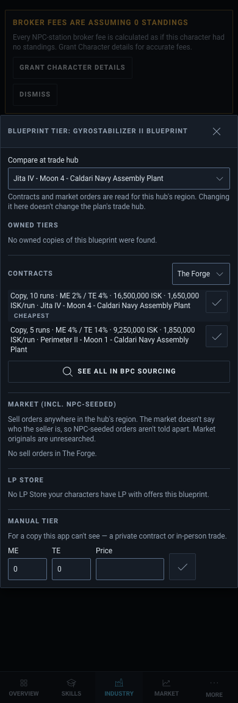
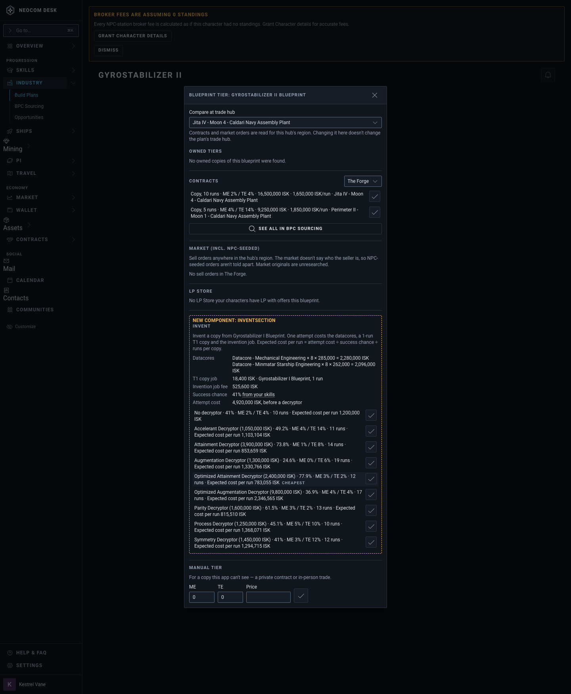
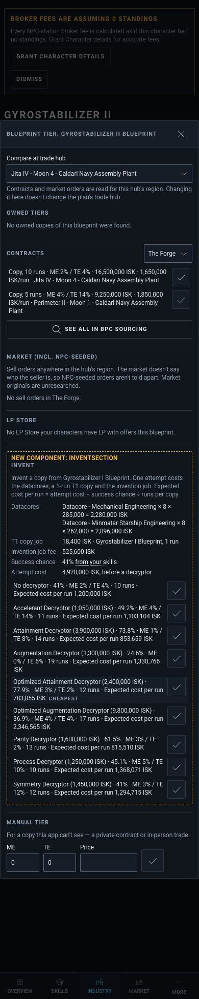

# Blueprint Acquisition: Invent as a source (T9b)

Source: `src/mockups/BlueprintAcquisitionInvent.stories.tsx` (`mockups-blueprintacquisitioninvent--proposed`, `--proposed-phone`; today: `--today`, `--today-phone`). Sample data; the ticket text wins over the picture.

New component: `InventSection` (dashed, labelled). The rest is the existing modal, drawn from its real parts (Modal, Select, IconButton, the same section and row classes) over sample sections. Market and LP Store show their real empty lines, as they do for most T2 blueprints.

The section sits between LP Store and Manual tier. It lists the cost of one attempt (datacores as name × qty × price, the 1-run T1 copy job, the invention job fee), the success chance "41% from your skills" (tooltip names the skills), then one row per decryptor choice ("No decryptor" plus each decryptor), each with chance, ME/TE, runs and "Expected cost per run". The cheapest row is marked and picked automatically; each row's check button is "Use this blueprint", the override. With no decryptor the expected cost is 1,200,000 ISK/run (4,920,000 ÷ 41% ÷ 10 runs); Optimized Attainment comes out cheapest at 783,055 ISK/run, below the cheapest contract (1,650,000 ISK/run).

| | 1440 | 390 |
|---|---|---|
| Today (`--today`) |  |  |
| Proposed |  |  |
