# Collector books: Moon owners tab and moon owner page

Spec: #4504 (UI tickets #4512, #4513, #4514, #4520). Sample data, all names invented; the ticket text and the spec win over the picture. Dashed amber boxes mark pieces that are not existing components. No screen says "feeder" or "Collector": the accounting corporation's tab is **Moon owners**, a moon owner sees **the accounting corporation**.

The story source is not in the tree (mockup stories are deleted once chosen): it is on the throwaway branch `research/collector-books-mockups`, `src/mockups/CollectorBooks.stories.tsx`. Chosen: **List A** (one sortable table) for the accounting side and **Page B** (plain statement first) for the moon owner. The other layouts were rejected and are not exported.

## Accounting corporation (`/corp/moons`, fourth tab)

| Screen | 1440 | 390 |
|---|---|---|
| Moon owners table (List A) | 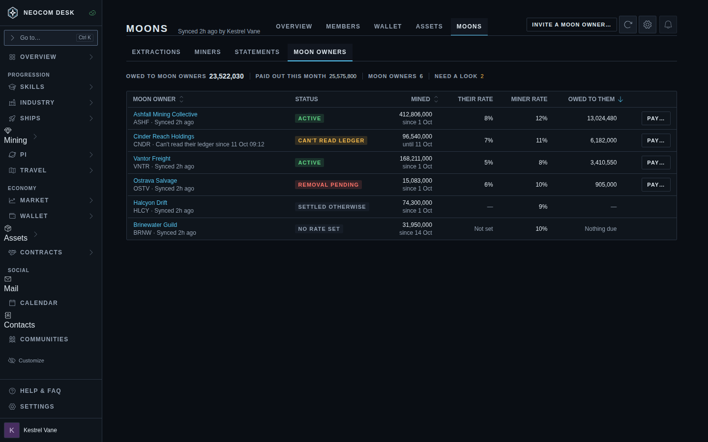 | 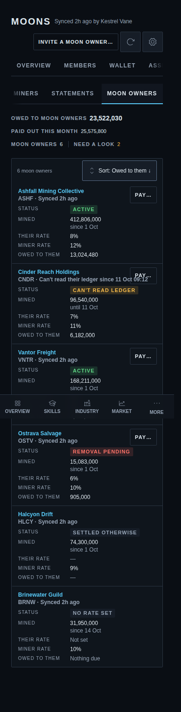 |
| No moons of its own: no Extractions tab | 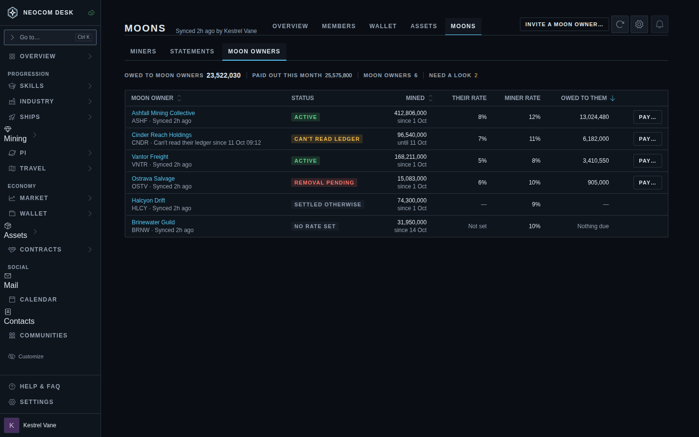 | |
| One moon owner | 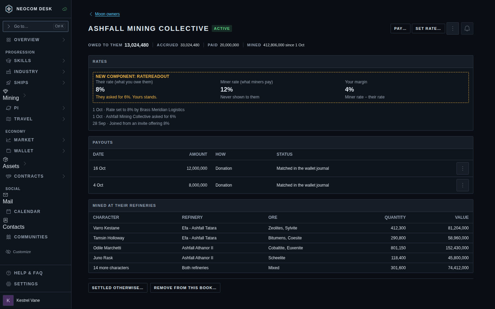 | 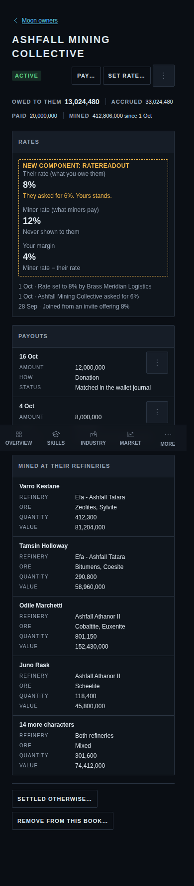 |
| Pay (Settle up shell) | 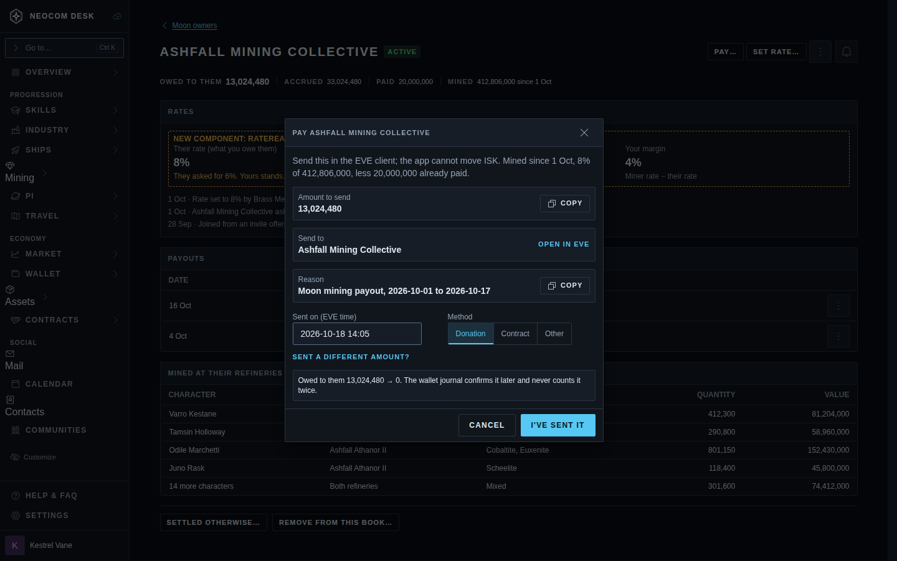 | 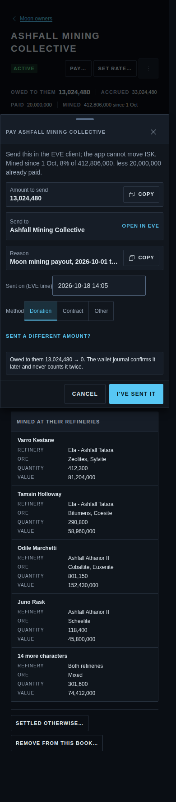 |
| Start a removal | 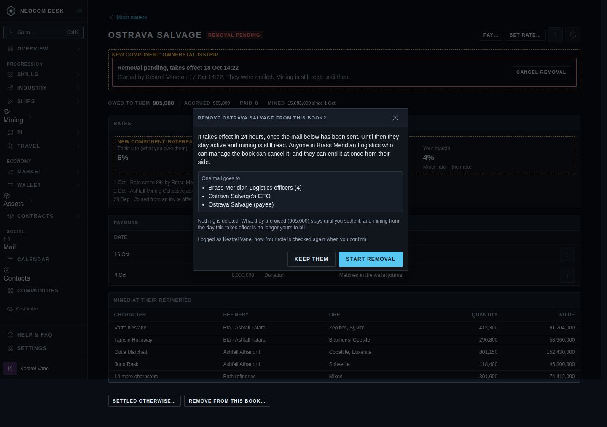 | |
| Removal pending | 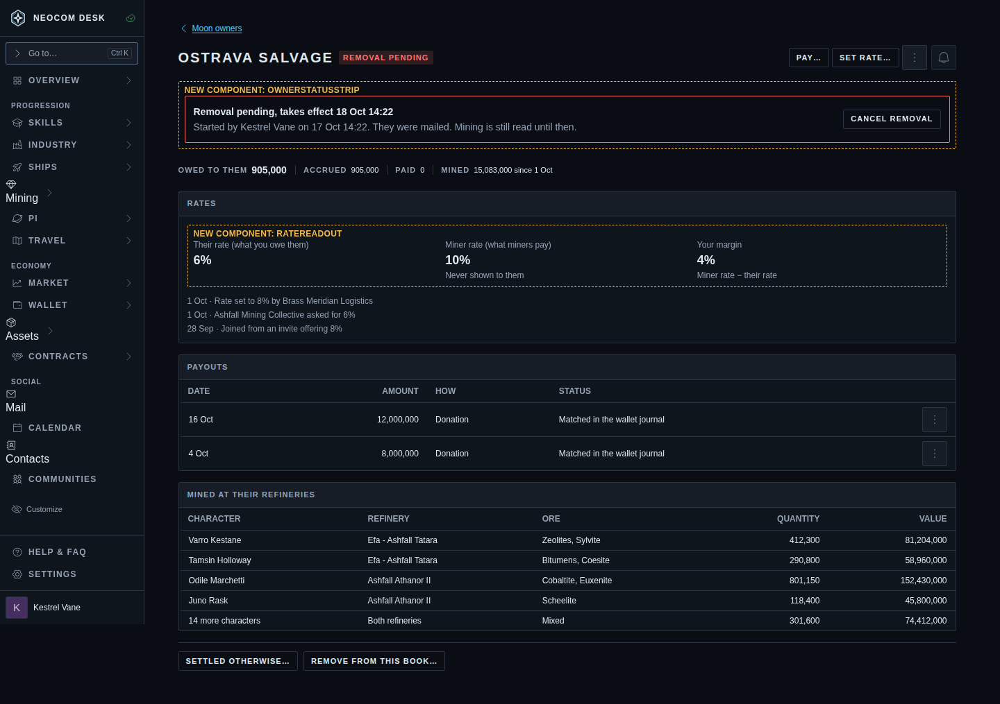 | |

## Moon owner (Moons page of a corporation with no book of its own)

| Screen | 1440 |
|---|---|
| Page B: plain statement first | 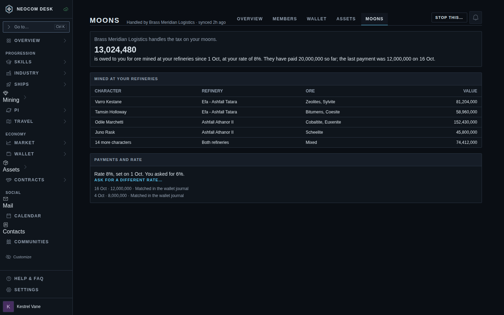 |
| Stale ledger and a pending removal | 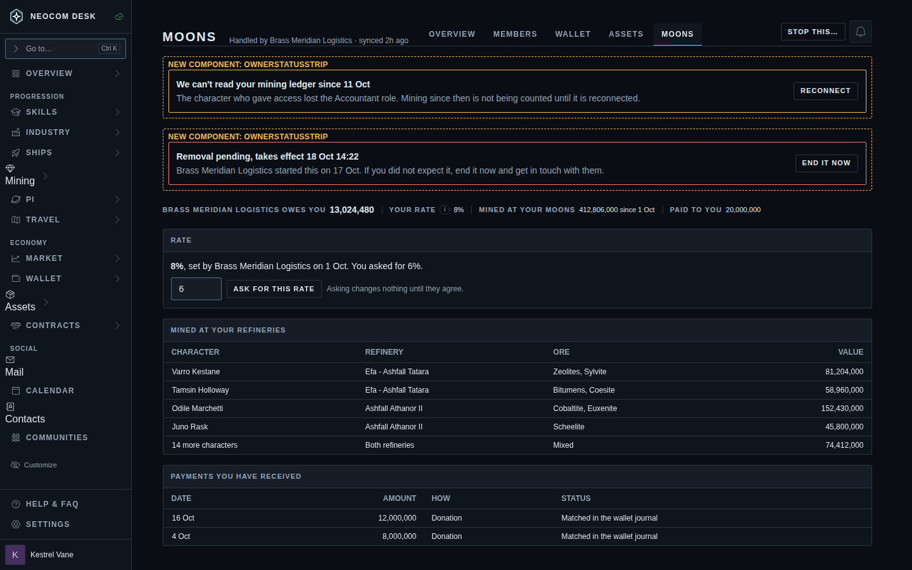 |
| Settled otherwise | 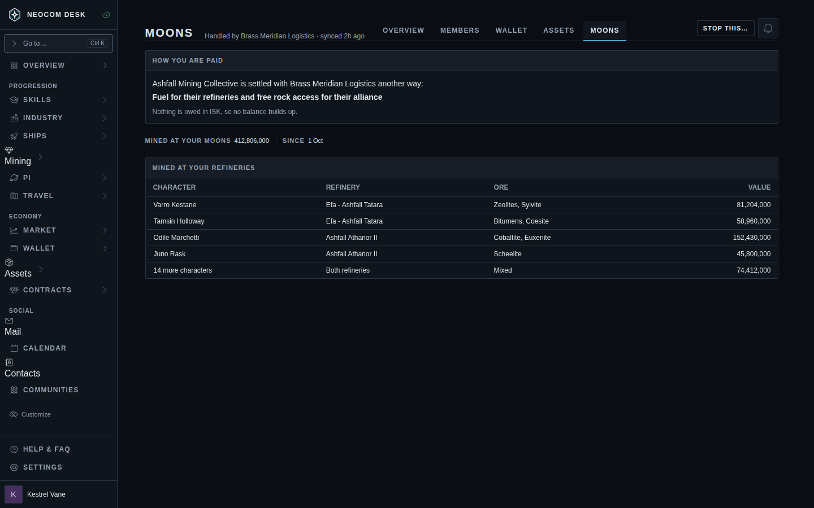 |
| After leaving | 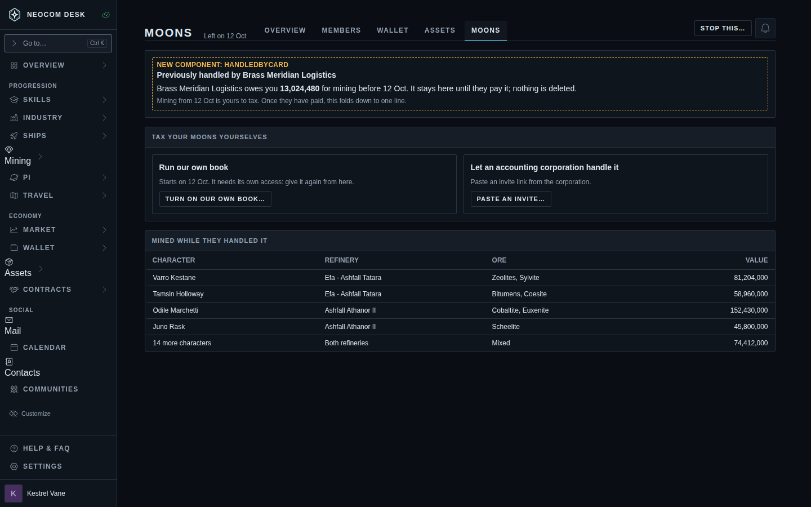 |

There is no phone screenshot of Page B: stack its sections in the same order. The attention, settled-otherwise and after-leaving states are drawn on the ledger-first layout; apply them to Page B's statement-first order.
