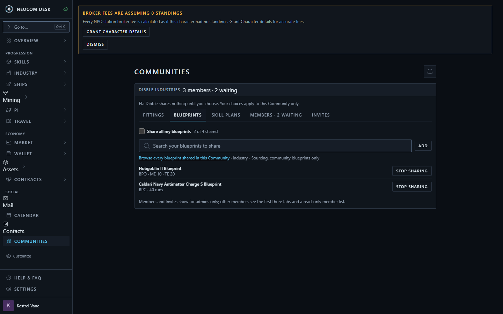
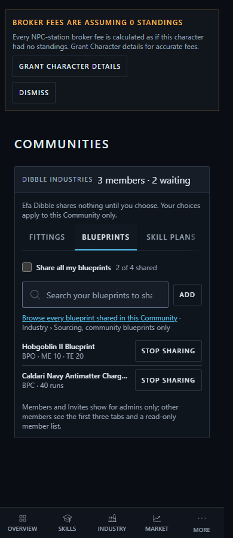

# Communities: what I share, members, invites

Chosen: **Option A, one flat tab row** (Fittings, Blueprints, Skill plans, then Members and Invites for admins). Story: `mockups-communities--option-a-tabs`. First draft; sample data.

| Proposed, desktop | Proposed, phone |
|---|---|
|  |  |

Rules:
- Fittings and Blueprints: "Share all" on lists every entry and each can be revoked; off, entries are added one at a time by search.
- Skill plans: no share-all; each plan is added and removed by hand.
- Blueprints link to Sourcing (community only); plans and fittings link to community browse views.
- Members: pending requests (Accept / Decline) when "Approve new members" is on, then the member list.
