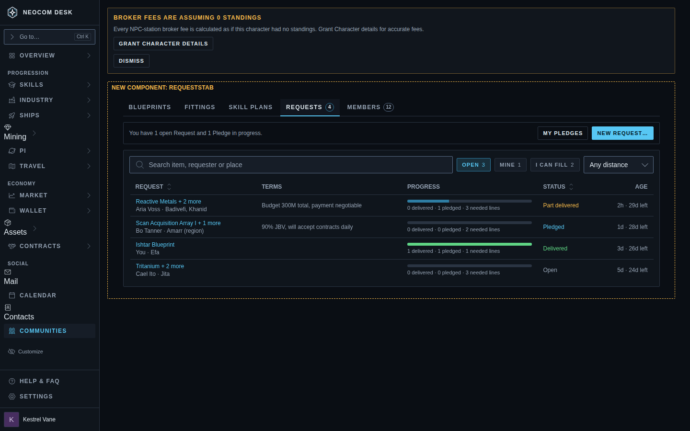
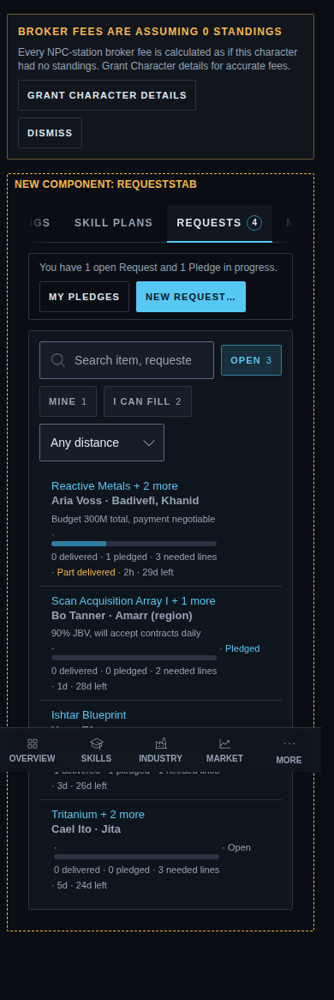
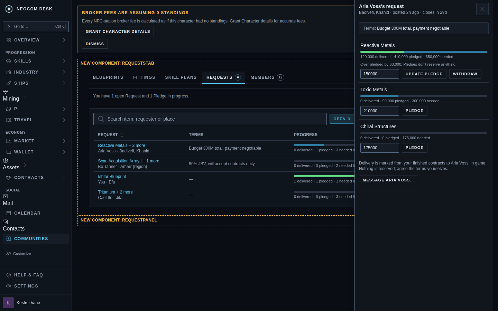
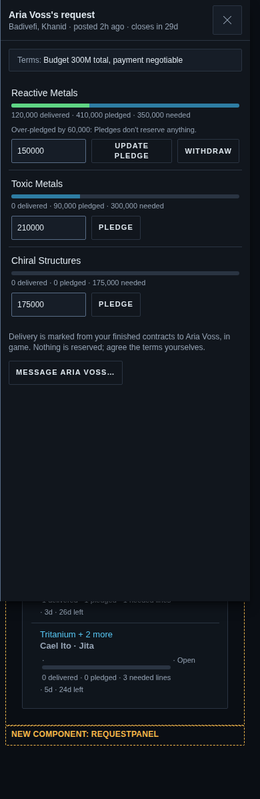
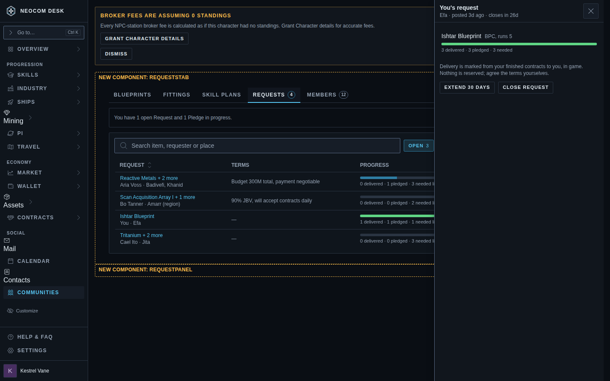
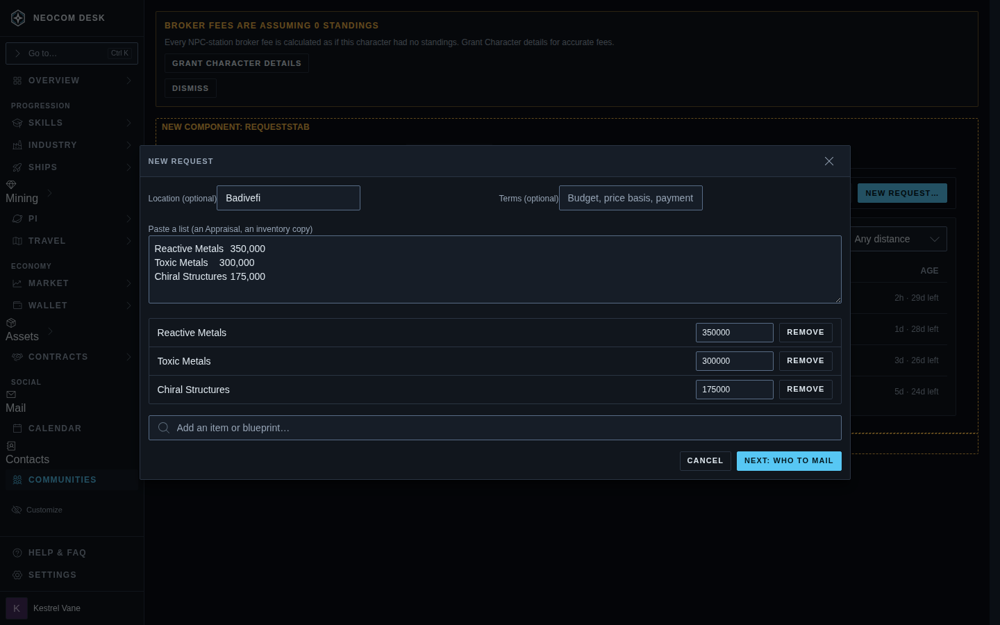
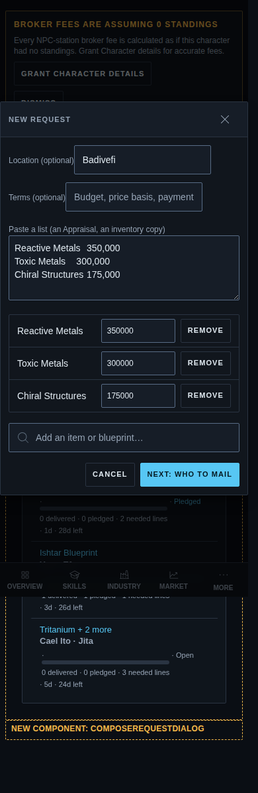
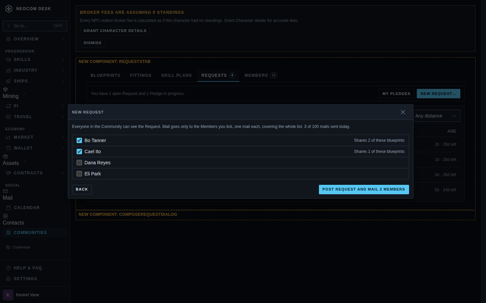
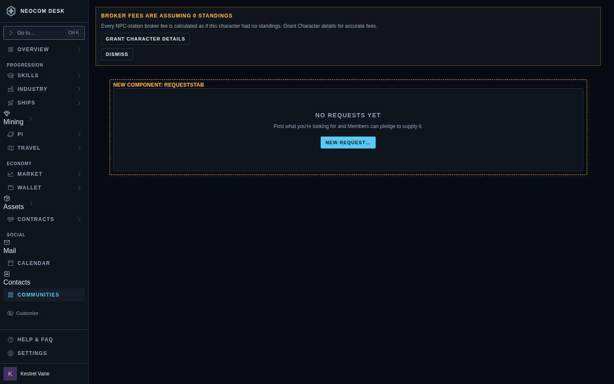

# Community Requests (Requests tab)

Source: `src/mockups/CommunityRequests.stories.tsx` (`mockups-communityrequests--*`). Sample data. **The ticket's Agent Brief wins over the picture where they differ**, but a ticket that builds any of these screens implements them as shown: same layout, same primitives, same wording of controls. Scope: `docs/context/decisions/20261014-221403-community-requests-a-non-locking-board-of-requests.md`, ADR 0021.

New components (dashed, labelled in the pictures): `RequestsTab`, `PledgeBar` (delivered / pledged / needed as one stacked bar with the figures printed beside it, never colour alone), `RequestPanel`, `PledgeRow` (a line with its inline quantity field and Pledge button), `ComposeRequestDialog`. Everything else is an existing `src/components/ui` primitive: `Tabs`, `FilterChip`, `SearchInput`, `NativeSelect`, `DataTable` (dense phone cards), `SlideOver`, `Modal`, `TextInput`, `TextArea`, `Checkbox`, `EmptyState`.

The board counts **lines** ("1 delivered · 2 pledged · 3 needed lines"), never summed units: ore and BPC copies do not add. Units appear per line in the side panel.

| Screen | 1440 | 390 |
|---|---|---|
| Board: Requests tab, filters, table |  |  |
| Side panel, as a Member: inline quantity + Pledge, over-pledge note, Message |  |  |
| Side panel, as the requester: Extend, Close request, no Pledge controls |  | |
| Compose, step 1: location, terms, pasted list, lines, add an item |  |  |
| Compose, step 2: who to mail, day's mail count |  | |
| Empty state |  | |

Not shown, specified in the ticket text: My pledges slide-out (the same shape as My sharing), the loading and failed states (as the other Community tabs), and the Message button's behaviour (opens an in-game mail).

## Deviations in the first build (issue #3807)

The Requests tab, board, read-only side panel, compose step 1 and the empty state are built (`pages-communities--requests-*` stories). Where they differ from the pictures:

- **Not built, by scope (other tickets):** Pledge controls and the over-pledge note (#3808), the delivery note and Message button, the "My pledges" button and the "and 1 Pledge in progress" half of the strip (#3808), the "I can fill" chip and the distance select (#3811), compose step 2 and the mail count (#3810). The strip reads "You have N open Requests." and carries only New request….
- **Compose button:** step 1 ended in **Post request** (posted without mail) where the picture has "Next: who to mail"; #3810 replaced it with the picture's button (see below).
- **Statuses and bars:** with no Pledges yet every Request is Open and every bar is empty. Closed and Expired exist as statuses (Mine lists a closed Request so it can be reopened) and are not pictured.
- **Panel title:** the requester sees "Your request" (the picture's "You's request" is the sample name run through the template).
- **Panel for a Member:** only the terms and each line's progress, no controls. The requester's panel reads Reopen request when closed.
- **Added to compose:** a blueprint line gets a Blueprint copy / Original (loan) select and, for a copy, optional Runs, ME and TE fields on a second row (the scope decision lets a BPC line carry them; the picture has no entry point). A line is typed by name: a type name ending "Blueprint".
- **Pasted list** is the proportional font like the picture, not monospace; unrecognised pasted names are listed under the box.
- **Compose labels** sit above their fields (the compose PNGs show them beside); two fields side by side at md, one column on a phone.
- **Search results** list under the add box as a plain list of buttons.
- **Search placeholder** ends in "…" (the i18n convention test requires it).
- **Column header** Age has no default sort (rows arrive newest first); Request, Status and Age sort.

## Deviations in the Request filters build (issue #3811)

The I can fill chip, the Distance select and the Message button are built (`pages-communities--requests-board`, `-can-fill`, `-nearby`, `-no-location-grant`, `-panel-as-member`). Where they differ from the pictures:

- **Filter row:** chips and select are the pictured controls in the pictured order (`FilterChip` Open, Mine, I can fill with the pictured tooltip; `NativeSelect` Any distance, Within 5, 10, 20 jumps). On a phone the select sits beside Mine and I can fill on the second row where the picture wraps it to a third, because the chips are narrower in the sample (counts of one digit).
- **Disabled and failed states** are not pictured: Distance is disabled with a line under the row saying why (the location Permission is missing, with the Grant link, or the pilot's location is unknown); I can fill is disabled with a tooltip when the Member's shared blueprints could not be read. Under a limit, a line says how many Requests with no place the app can measure from are left out.
- **Location is picked in compose** (a suggestion list under the field, a line saying whether the text can be measured); the compose pictures have a plain field.
- **Message button:** at the foot of the panel as pictured, with the Pledge note above it (#3808) but no delivery sentence (#3809) and, without the Open in EVE Permission, a line with the Grant link beside it. The label ends in an ellipsis as pictured.
- **Sample data:** the second Request's place is "Domain (region)", not the picture's "Amarr (region)", since Amarr is a system and the board reads a region by its real name. I can fill counts 1, not 2: the sample pilot shares one blueprint a Request asks for.

## Deviations in the Pledges build (issue #3808)

Built: Pledge / Update pledge / Withdraw with the inline quantity field per line, the over-pledge note, stacked bars and board progress and status from real Pledges, the strip's "and 1 Pledge in progress" half with **My pledges**, and the My pledges slide-out. Panel and board match the pictures at 1440 and 390 (the 390 row keeps Update pledge, wrapped to two lines, and Withdraw on one row as pictured). Where they differ:

- **Delivery note** is built by #3809 (see its section below); the Message button is #3811's. The panel's note reads only "Nothing is reserved; agree the terms yourselves."; #3809 adds the "Delivery is marked from your finished contracts" sentence.
- **Stale Pledge** (not pictured): after 14 days with nothing delivered the line is greyed (60% opacity) and says "No delivery in 14 days, so this Pledge is greyed out. Update it or withdraw it." in words, so it never rests on colour alone. The clock is the Pledge document's last write.
- **Withdraw** is hidden once something is delivered on that Pledge (the record of delivery would be lost); the picture's sample has none delivered by the viewer.
- **My pledges slide-out** is not pictured. Each row names the item and the requester, prints "N pledged · N delivered", and has an Open request button that closes the slide-out and opens the Request's panel; stale rows are greyed with the same wording. Open request is the one control, so a row click does nothing extra.
- **Default quantity** is the Member's own Pledge, else what is still uncovered, else (nothing uncovered) the whole `needed`; the story leaves the field empty when covered.
- **Stale grey-out** applies to the viewer's own Pledge only (the panel shows aggregates for everyone else).
- **Quantity field validation:** a non-whole or zero value shows "Enter a whole number above 0." and disables the button.
- **Sample names** in the story differ from the pictures (the story's fixture names are Ilvara Nokk and friends, as in #3807).
## Deviations in compose step 2 (issue #3810)

Built as `pages-communities--requests-compose-recipients` (and `-phone`); the shape is the picture's: intro line with the day's count, a bordered list of label rows (checkbox, name, "Shares N of these blueprints" at the right, 44px touch rows), Back on the left, "Post request and mail N Members" on the right. Where it differs:

- **Sample data:** the story shows the sample Community's eight other Members, not four; the two sharing a matching blueprint are pre-ticked.
- **Matching:** "Shares N of these blueprints" counts the Request's blueprint lines the Member shares (a copy line is met by a copy or an original; an original line only by a shared original). Plain item lines match nobody, so a Request of only items pre-ticks nobody. Sharers come first, then the rest by name.
- **Nobody ticked:** the button reads "Post request" and posts without mail (the picture only shows the ticked case).
- **Not pictured, added:** a permission note (Grant permission) with the boxes disabled while the Character lacks the send-mail permission; a one-line note when more are ticked than the day has mails left, or none are left; a warning when what Members share could not be read.
- **After posting with mail:** the dialog stays open and lists each recipient with a text result (Mailed, refused, not confirmed, daily limit), then Done. Not pictured.
- **Nav badge:** the Communities item carries a count of new Requests (the rail's existing badge, `NavItem`); it has no picture.

## Deviations in the cleanup build (issue #3812): the admin's removal

Not pictured; added to the panel screen for the Community admin only (decision `20261015-005522-community-request-admin-removal-and-expiry-grace.md`, story `pages-communities--requests-panel-as-admin`, with a `-phone` twin).

- **Side panel:** below the Message button, a **Pledges on this request** list (name, "N lines", **Remove…** with the Pledger's name in its accessible label), then **Remove request…** as a danger button, each behind a `ConfirmDialog` naming what goes. Names come from the Members list; a Pledger who has since left reads "Former Member". A failed removal keeps the dialog open with the shared "That did not work. Try again." line. The panel for the requester and for a plain Member, and the whole board, are as pictured: there is no row menu (one action does not earn a ⋮, DESIGN.md §6c).

## Deviations in Ask to copy (issue #3813)

Compose opens as pictured (`compose-lines`, `compose-recipients`), as stories `pages-communities--ask-to-copy-compose`, `-compose-phone`, `-recipients` and `-pick-community`, where the page behind is the Communities page (the real thing opens over BPC Sourcing). Where it differs from the pictures:

- **Pre-filled line:** one line, "Rifter Blueprint" as a Blueprint copy, quantity 1, Runs/ME/TE empty; location and terms empty. The pictures show a pasted pile.
- **Step 2:** the holder is ticked, with any Member sharing a matching blueprint, as in the picture.
- **Community choice (not pictured):** when the holder shares the blueprint in several Communities, a small dialog (select and Continue) comes first. One Community goes straight to compose.
- **Roster failure (not pictured):** a dialog with the failure in words and Close.
- **Ask to copy row** (`ask-to-copy-row-1440.png`, `-390.png`; story `bpccontracts-communityoffercell--rows`): the Item cell of a Community Offer row, "ask <name> to copy…" as an accent inline link beside the community chip (ask, a copy's "from <name>", a reaction formula's plain text, a stale library). The cell is its own component (`CommunityOfferCell`) so it can be pictured: a whole BPC Sourcing page story needs the contracts snapshot (Firestore), the SDE and an ESI character, which is too large a fixture. The mockup itself has no BPC Sourcing screen.

## Deviations in the delivery build (issue #3809)

Built: the delivery sentence in the Member's panel (as pictured: "Delivery is marked from your finished contracts to <name>, in game. Nothing is reserved; agree the terms yourselves."), the delivered segment of the bar fed by real deliveries, the BPC attribute flag and the manual marker (`pages-communities--requests-panel-delivery`, `-delivery-phone`, `-no-contracts-grant`). Where they differ from the pictures:

- **Replaces #3808's note:** the panel's single note is now the delivery sentence; the old "Nothing is reserved…" line alone is gone.
- **Your own delivered figure** (not pictured): a Pledged line with a delivery prints "You delivered 40,000 of 175,000" under the bar, with "(manual)" after it when the figure is a typed amount.
- **BPC flag** (not pictured): under that line, in words and the warning tone, "Counted, but not as asked: runs 5, asked 10." Shown to the Pledger only: contract contents never reach Firestore, so the requester's panel cannot show it (the requester opens the contract in game). The ticket's example "ME 8, asked 10" is not possible: ESI's personal contract items carry runs and the copy marker but no ME or TE, so only runs is compared.
- **Delivered amount** (not pictured): each Pledged line gets a small number field and **Save delivered** under its Pledge controls, always (a direct trade or any hand-over outside a contract can be recorded). Without the Contracts Permission, a line after the sentence also says delivery can't be marked, with the usual Grant link (not an error). The field is a bare `TextInput` with the placeholder "Delivered…" and a screen-reader label naming the item. Saving 0 clears it.
- **Quiet notes** (not pictured): unreadable contracts, an unsaved delivery and a Request closed or expired since the Pledge each get one dim line, never an error banner.
- **Board:** no new control; the bar and the line counts read the stored deliveries.

Delete this folder and the story when the last ticket that links it closes.
