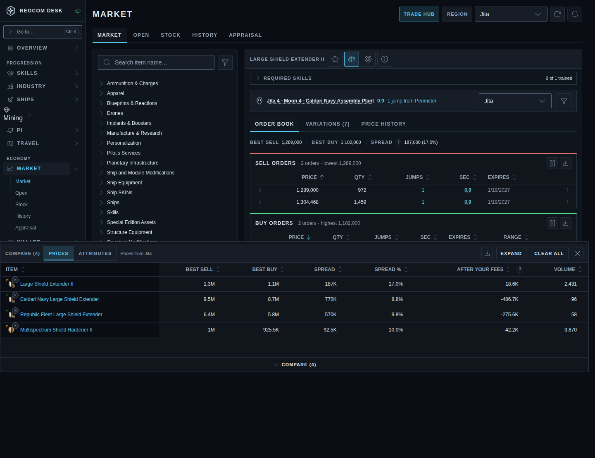
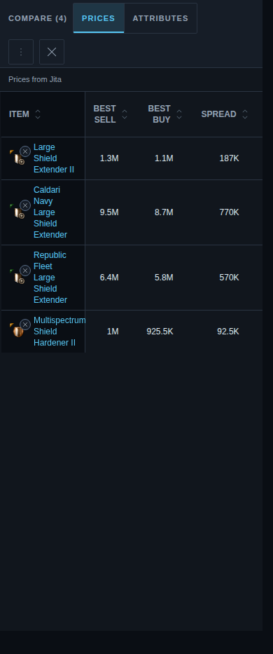
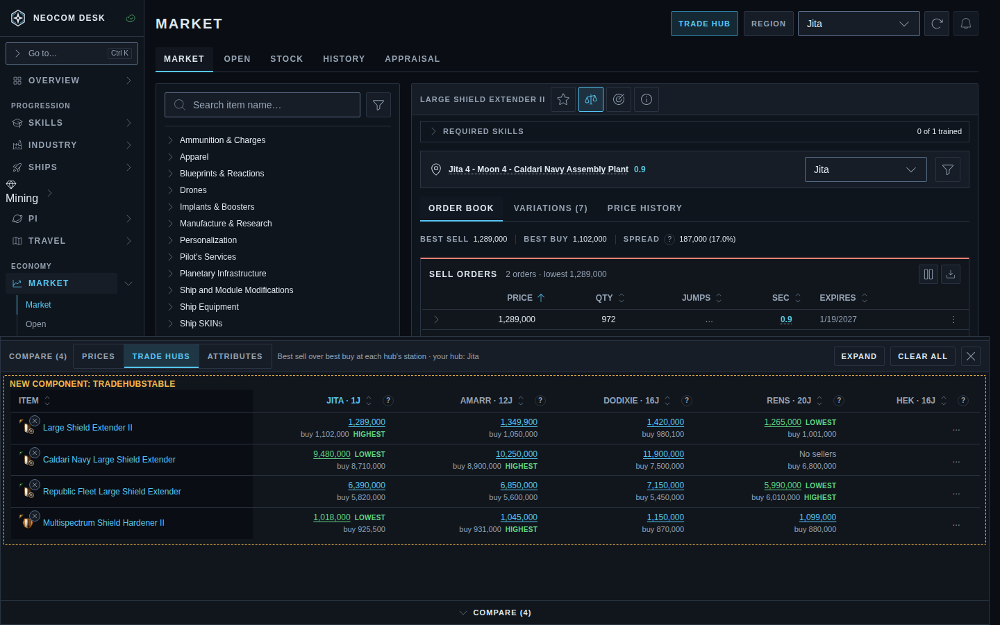
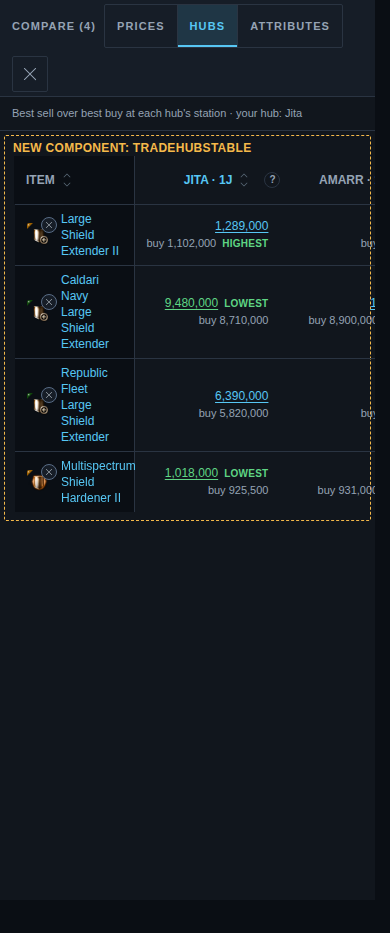
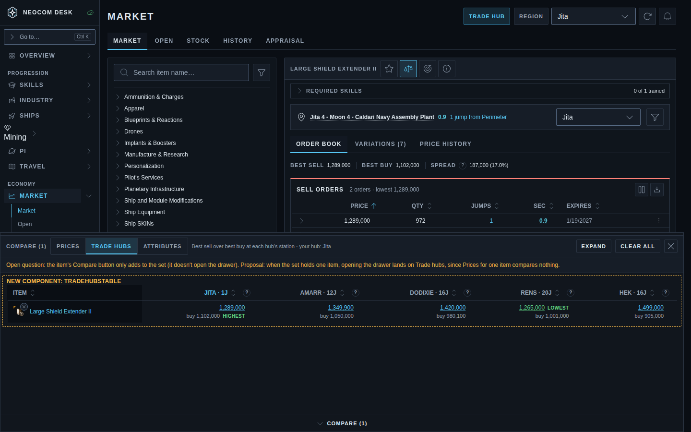

# Market › Compare drawer: Trade hubs view (issue #4696)

Source: `src/mockups/CompareTradeHubs.stories.tsx` (`mockups-compare-trade-hubs--*`). The page around the drawer is the real Market Browser with sample books (`compareTradeHubsFixtures.ts`). The data is sample data, and the ticket text wins over the picture.

New component: `TradeHubsTable`, a `DataTable` with one `TradeHubCell` per hub. The drawer chrome, the segmented view switch (now three options) and the phone sheet are today's.

| | 1440 | 390 |
|---|---|---|
| Today (Prices, priced at one hub) |  |  |
| Proposed (Trade hubs), **chosen** |  |  |
| Open question: one item in the set |  | |

## What the proposal shows

**Chosen (Shawn):** the desktop view as shown; a table at every width; own hub highlighted.

- **Layout.** Rows are Compare Set items and columns are the five Trade Hubs in `TRADE_HUBS` order. Each cell shows best sell, with `buy <best buy>` dim beneath it, as exact market figures. Compact "1.3M" figures hid the hub differences that are the point of this view.
- **Cell link.** The best-sell figure is the cell's one link (DESIGN §6c figure link: accent, solid underline). It opens the Market browser at that item and hub.
- **Row highlights.** The row's lowest sell and highest buy are green and carry the words LOWEST / HIGHEST, so colour isn't the only cue. A hub that's still loading is left out of that comparison.
- **Hub headers, own hub highlighted (chosen).** Each reads `Amarr · 12j` (jumps from the pilot), with the full wording in the header tooltip. The pilot's own Market hub has an accent header and is named in the drawer subtitle ("your hub: Jita").
- **Empty and loading cells.** "No sellers" when a hub has buy orders only; `buy —` when it has no buy orders; `…` while a hub's books load (Hek in the desktop shot).
- **Phone (chosen): a table at every width.** Like today's Prices view (`responsive="table"`), the full-screen sheet keeps the table and scrolls sideways with the item column pinned. The view switch says "Hubs" because "Trade hubs" pushes Attributes off a 390px header.
- **Open question.** The item's Compare button only adds to the set. The proposal is that with one item in the set, opening the drawer lands on Trade hubs, since Prices for a single item compares nothing.
