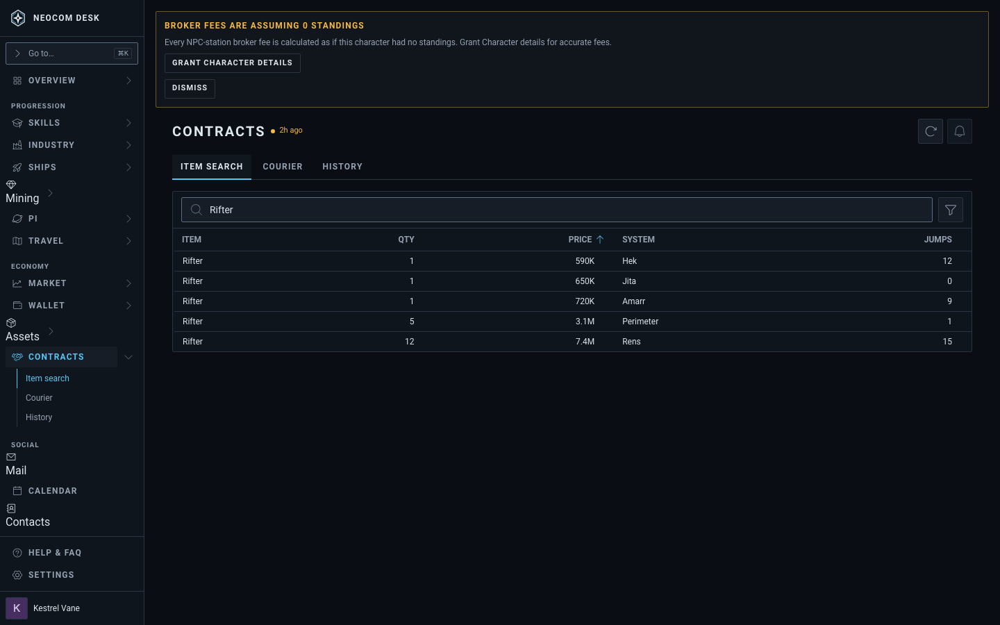
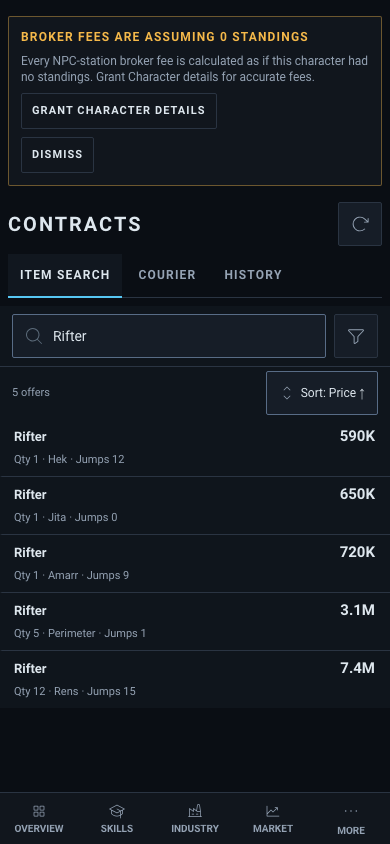
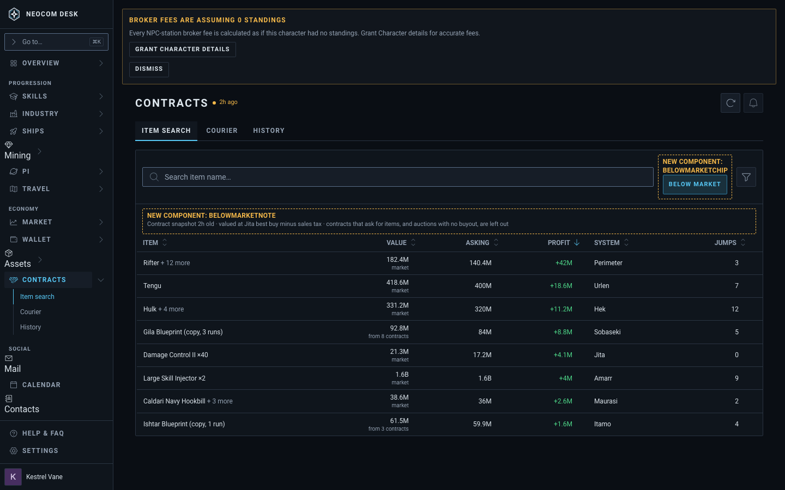
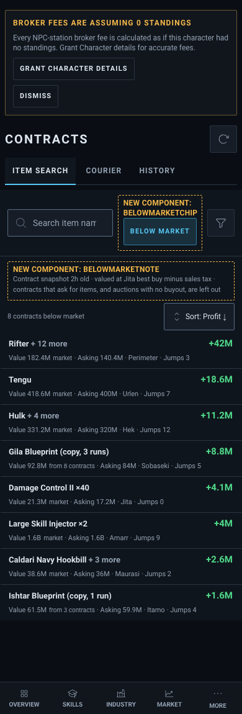

# Contracts › Item search: Below market (T6b)

Source: `src/mockups/ContractsBelowMarket.stories.tsx` (`mockups-contractsbelowmarket--proposed`, `--proposed-phone`; today: `--today`, `--today-phone`). Sample data; the ticket text wins over the picture.

New components: `BelowMarketChip` and `BelowMarketNote` (dashed, labelled). The page is composed from its real parts (PageHeader, Tabs, Panel, FilterBar, DataTable); the live panel needs the contract snapshot, which Storybook does not have.

With "Below market" on, the table has one row per contract: Item ("Rifter + 12 more"), Value (with its source under it: "market" or "from 8 contracts"), Asking, Profit, System, Jumps, sorted by Profit, largest first. A dim line under the bar gives the snapshot age (the header's age badge is hidden on a phone) and what is left out. On a phone, dense two-line cards: Profit in the corner, "Value … market · Asking … · System · Jumps" on the second line.

Chip placement: in the filter bar's `actions` slot beside the search box, not behind the funnel (DESIGN §4b). Like the column picker it acts at once and changes the table's columns and rows, so it is a view control, and it stays one tap away on a phone.

| | 1440 | 390 |
|---|---|---|
| Today (`--today`, a "Rifter" search) |  |  |
| Proposed |  |  |
