# Corp data export (issue #4946)

Stories: `src/mockups/CorpDataExport.stories.tsx` (`mockups/CorpDataExport`). Sample data; the ticket text wins over the picture.

**Chosen (maintainer, 2026-10-24):** Delete dialog variant **A** (Download the book in the dialog, Delete stays usable; B is not built). Format: **one .xlsx**, a sheet per record type. SRP: the same Download SRP data button also goes in the **Queue tab header** (not mocked), so an Accountant who works the Queue can export; the Settings panel stays for Directors.

New components (dashed, labelled): `ExportFirst` (Delete dialog), `ExportBookSection` (book settings › Access), `SrpExportPanel` (SRP Settings). Each is a heading, a hint, one `Button` with `Icon.Download` and a dim line listing the sheets. Everything else is the real `Modal`, `Tabs`, `AutomaticSyncSection`, `DeleteBookSection` and the real `/corp/srp` Settings page.

## Delete the book?

Two variants to pick from. Both keep today's ticker check.

- **A**: an "Export first" block in the dialog. Delete works as today once the ticker is typed.
- **B**: Export first is step 1. Delete stays `aria-disabled`, with "Download the book first, then delete." beside it, until the export has downloaded from this dialog. Then the file name shows and Delete goes live.

| | 1440 | 390 |
|---|---|---|
| Today (`delete-today`) | 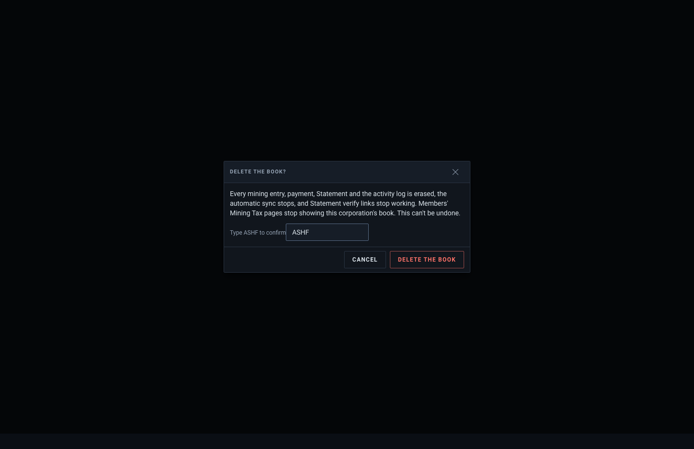 |  |
| A (`delete-export-a`) | 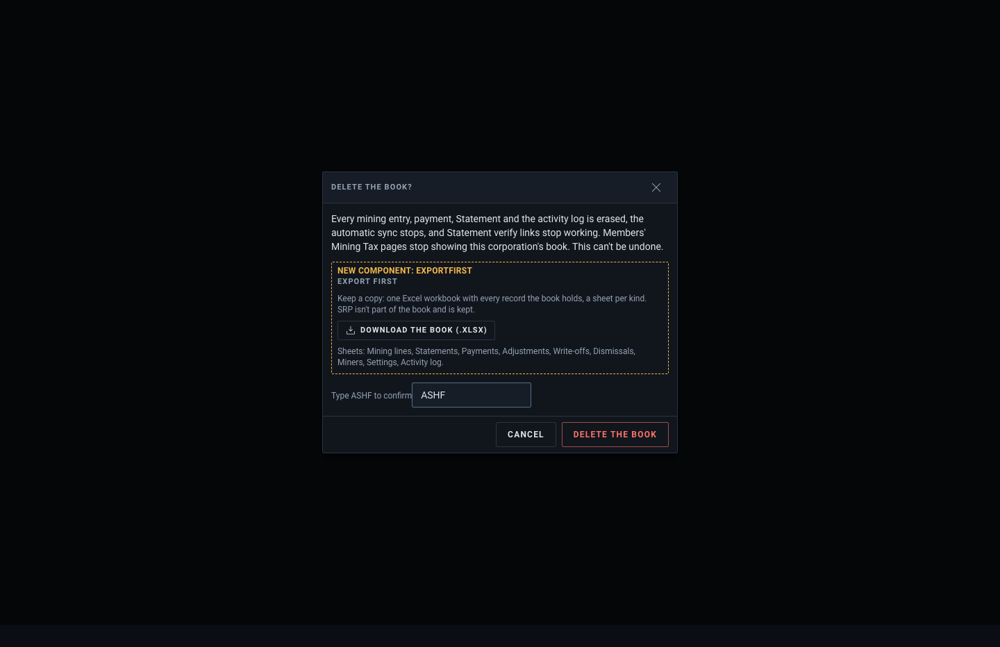 |  |
| B, before download (`delete-export-b`) | 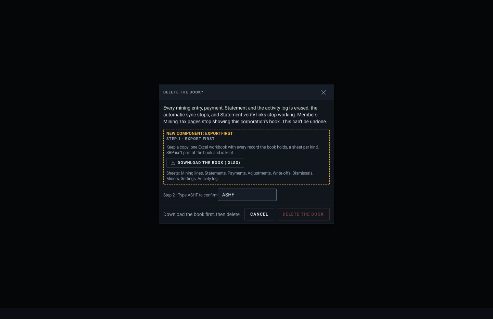 | 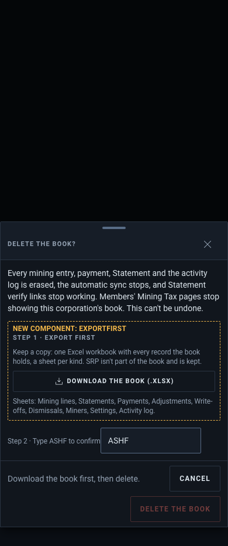 |
| B, after download (`delete-export-b-done`) | 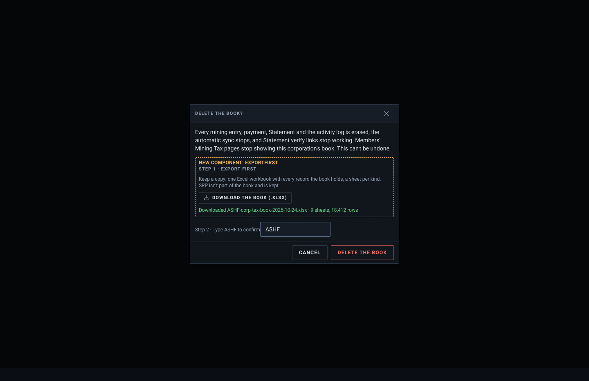 |  |

**Proposed: A.**
- A browser can't confirm that a download finished, only that it started. B's "downloaded" really means "pressed", so its gate guards less than it looks.
- B makes an officer who already exported from settings export again.
- The typed ticker is already the friction. A puts the offer at the moment of decision and leaves the choice with the officer.

Pick B if a hard stop matters more than those costs.

## Book settings › Access

A standing "Export the book" section above "Delete the book", visible to anyone who can open the settings.

| | 1440 | 390 |
|---|---|---|
| Today (`corp-booksettingsdialog--access`) | 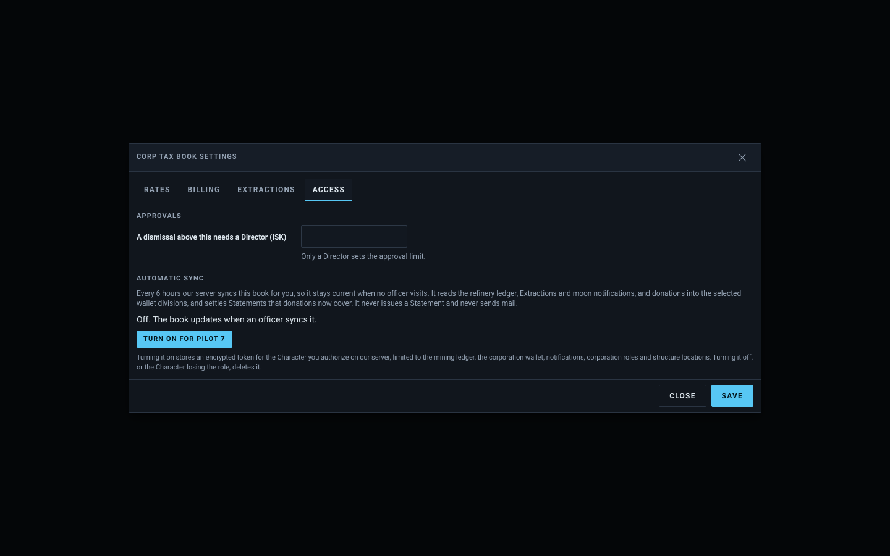 | 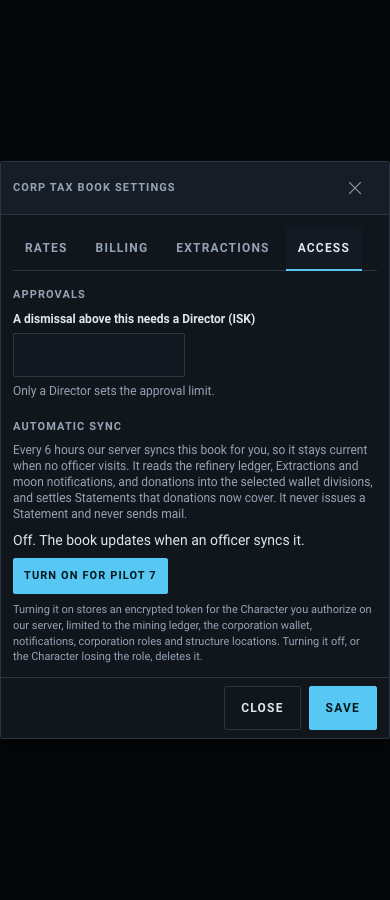 |
| Proposed (`book-settings-export`) | 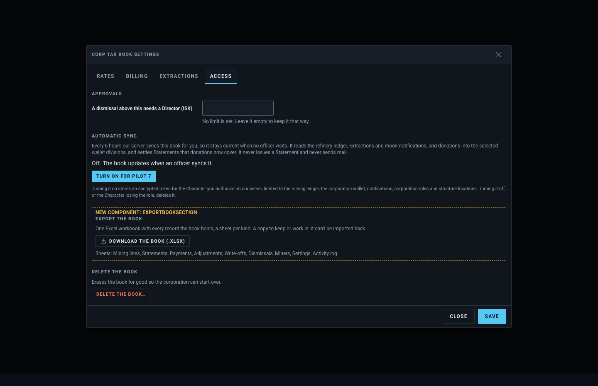 | 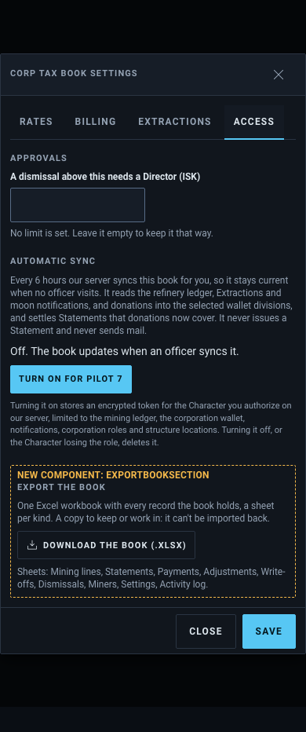 |

The phone PNG shows the sheet's first screen. Delete the book sits below Export inside the sheet's scroll.

## SRP Settings

An Export panel after Claims, laid out like the editor's own fields.

| | 1440 | 390 |
|---|---|---|
| Today (`pages-corpsrp--configured`) | 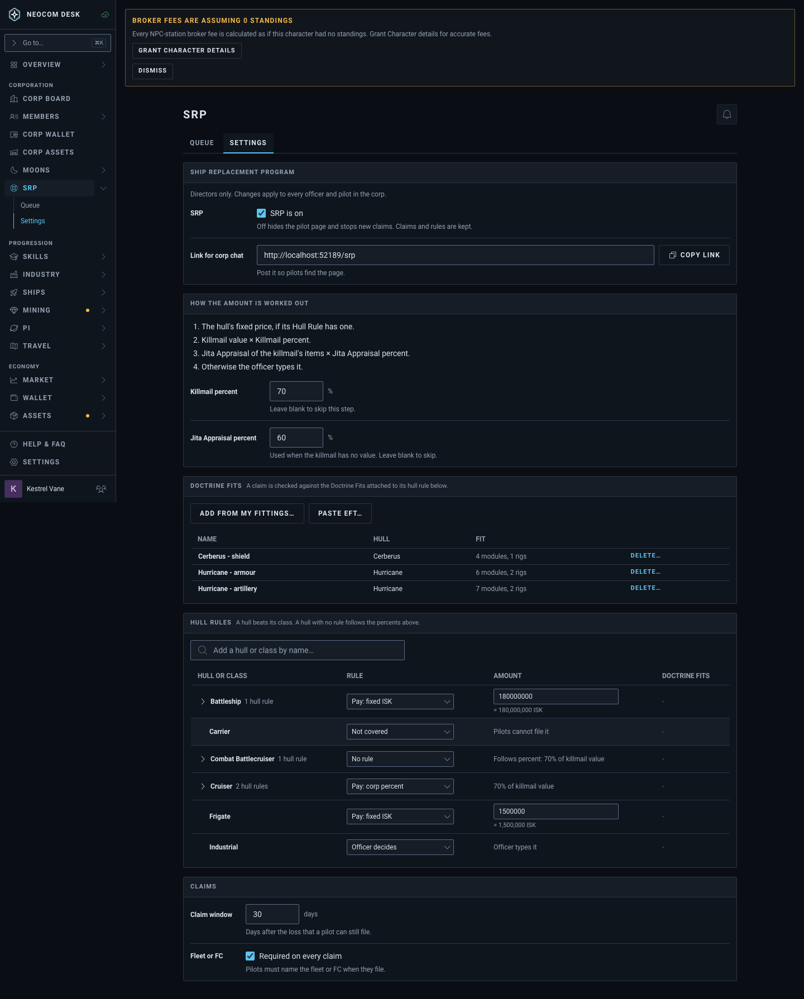 | 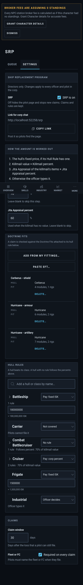 |
| Proposed (`srp-settings-export`) | 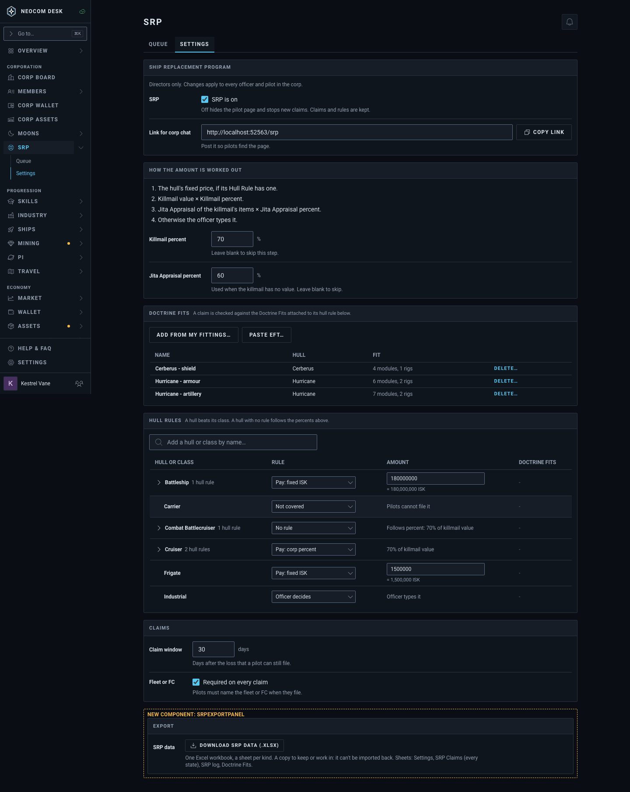 | 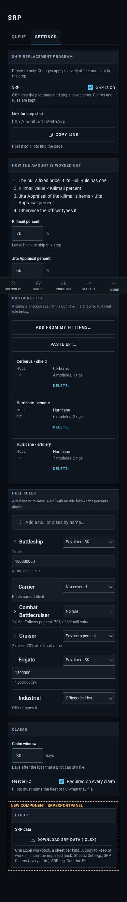 |

In the full-page phone PNG, the phone tab bar is drawn mid-page. That's how the screenshot captures it, not part of the layout.

**Access question for the maintainer.** SRP Settings is Director-only: an Accountant who works the Queue sees "Directors only" there. With Export only in Settings, an officer who can read every claim can't export them. The issue's rule is the same access as the pages, so the build should either also put the button on the Queue tab's header or accept Directors only.

## Format

**Proposed: one Excel workbook (.xlsx), one sheet per record type.**
- Book sheets: Mining lines, Statements, Payments, Adjustments, Write-offs, Dismissals, Miners, Settings, Activity log.
- SRP sheets: Settings, SRP Claims (every state), SRP log, Doctrine Fits.

Why .xlsx:
- **It matches what every table already exports.** The "every table exports" decision (`20260929-085650`) already chose xlsx as the answer to CSV importer problems: no import dialog, and ESI timestamps arrive as real date cells.
- **One file opens anywhere.** Excel, LibreOffice and Google Sheets (with every tab) open it, on a phone too. A `.zip` needs unzipping first, which is clumsy on a phone, and Sheets can't open it at all.
- **It's cheap to build.** The in-house writer on `fflate` is single-sheet today, so this needs a small multi-sheet extension and no new dependency.
- **JSON adds nothing here.** There is no import back (out of scope), so it would only make a copy people can't read.

**Alternative: a .zip of CSVs, one per record type.** It's the better pick for scripts or databases, and each CSV would follow today's CSV rules. Offering it as well would turn each button into the existing download menu: Download Excel (.xlsx) / Download CSVs (.zip), the same shape as the table export button.

## Behaviour notes for the build

- The export needs the server, so each button goes under `NeedsConnection`.
- While the file is built, the button uses `loading`. A success line then names the file and the row count (`ActionResult`, the "after download" frame).
- One format means a plain download button, not a ⋮ or menu (decision `20260929-142526`). There is no "…" in the label: it downloads straight away.

First draft mockup; sample data.
