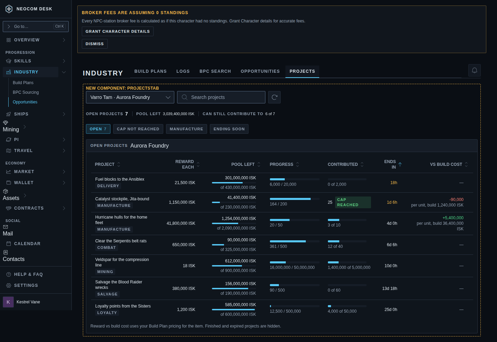
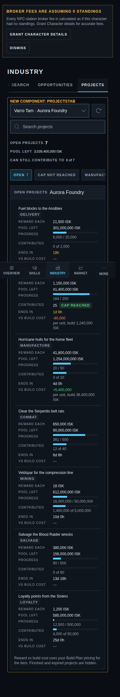

# Corp Projects tab (issue #4530)

First draft mockup; sample data. The ticket's Agent Brief text wins over the picture where they differ.

Story: `src/mockups/CorpProjects.stories.tsx` (`mockups-corpprojects--populated`, `--populated-phone`). Delete the story and this folder when #4530 closes.

**Decision: Industry › Projects, the fifth tab.** Not under Corp: the Corp pages are role-gated and hidden from line members, and the projects endpoints need no corp role.

**The tab is hidden unless it has something to show.** It is listed only when the Character has granted the projects permission and the last read returned at least one open project. A Character with no corporation, no permission, or no open projects sees the Industry strip as it is today (four tabs). So there is no empty state and no grant banner in this tab; the permission is granted from Settings › Permissions. If the last open project finishes while the tab is open, the page falls back to the first Industry tab.

| State | Desktop (1440) | Phone (390) |
|---|---|---|
| Populated: summary strip, filter chips, sortable table |  |  |

## What the mockup fixes

- **Header:** the Industry `PageHeader` with its tab strip gains **Projects** last. Data age (`DataAgeBadge`) sits beside the title like the other ESI-backed tabs.
- **Controls row:** a Character select (Character · corporation; lists only Characters whose corporation has open projects), `SearchInput`, refresh `IconButton`. One row at every width; on a phone the search wraps under the select.
- **Summary strip:** `StatChips` — Open projects (emphasis), Pool left, Can still contribute to (n of m).
- **Chips:** Open (default on, with count), Cap not reached, Manufacture, Ending soon. They narrow the list; no funnel needed for four chips.
- **Table (`DataTable`, read-only):** Project (name + type `Pill`), Reward each, Pool left (amount + `ProgressBar` of remaining/initial + "of initial"), Progress (`ProgressBar` + current / desired), Contributed (bar + "n of cap", or a success `Pill` "Cap reached"), Ends in (amber under 48 h), Vs build cost (`IskDelta` per unit plus the build cost; "—" for every non-manufacture type). Default sort: Ends in, soonest first. Per DESIGN §6c a read-only table has no row click, no ⋮, no export.
- **Phone:** stacked cards, the project name as the card title, one label/value line per column.

## Mobbin references (patterns, not copies)

- [Cake Equity, Raise details](https://mobbin.com/screens/95bb6887-1fdc-41c4-a6a9-c868eeec2bc5) — a summary strip of figures above the table.
- [Dub, Bounties](https://mobbin.com/screens/afa4ebaa-5f41-4394-8cb5-d77f9df0d287) — dates, reward and "n of m completed" together on one card.
- [Whop, Content Rewards](https://mobbin.com/screens/a0b8f4a7-ffb6-4015-9ac2-ea69abb44c49) — a pool as a bar with spent / budget printed beside it.
- [Shopee, streaming tasks](https://mobbin.com/screens/23153738-3d25-4796-852f-62c9000036c7) — an "Ends at" chip on each task with progress under it.
- [Jira Cloud, All Work](https://mobbin.com/screens/4a793cc6-c40e-46ae-a569-21bdd4c53c2d) — a compact two-line row with a status chip and a date.

## Known drift between the picture and the build

- The amber "Broker fees are assuming 0 standings" banner at the top is the Storybook shell fixture, not part of this feature.
- The Progress column is not hidden on a phone: `phoneHidden` is inert in the stacked layout (DESIGN §4a).
- The dashed "New component" frame is a mockup label and does not ship.
