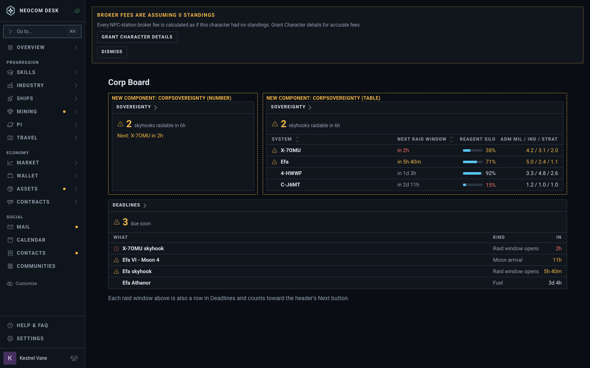
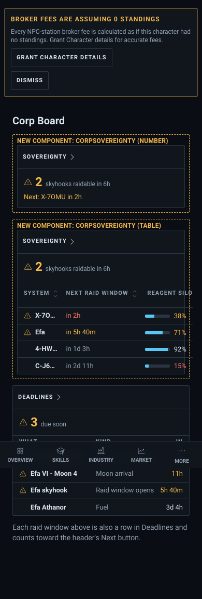
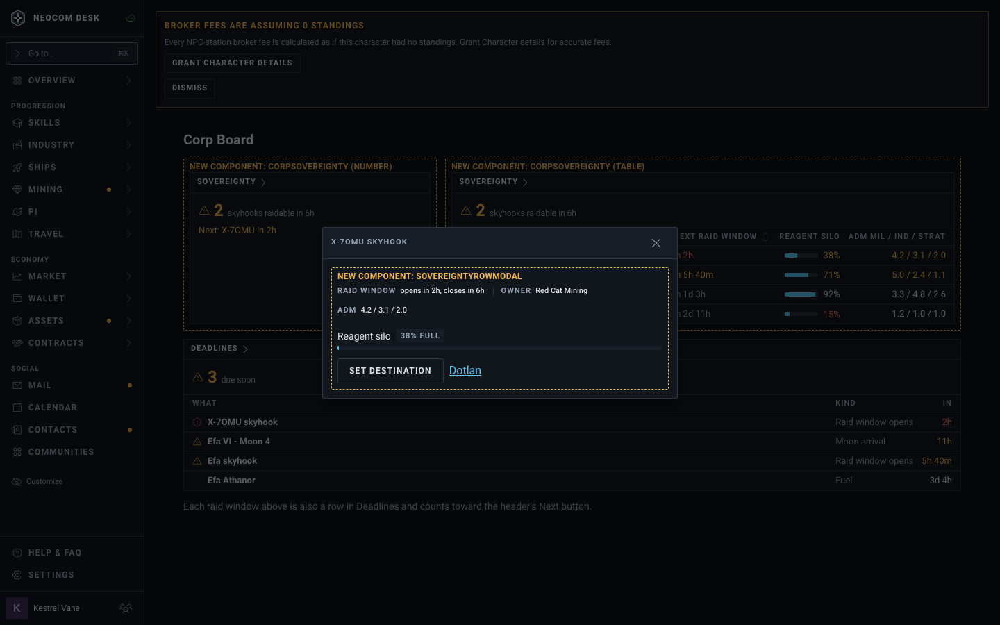
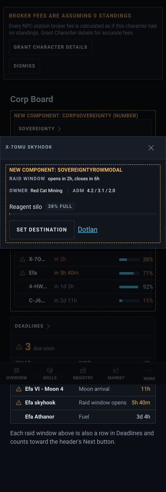

# Corp sovereignty widget (issue #4775)

First draft mockup; sample data. The ticket's text wins over the picture where they differ.

Story: `src/mockups/CorpSovereignty.stories.tsx` (`mockups-corpsovereignty--board`, `--board-phone`, `--row-modal`, `--row-modal-phone`). Delete the story and this folder when #4775 closes.

| State | Desktop (1440) | Phone (390) |
|---|---|---|
| Corp Board: Number and Table views, raid windows in Deadlines |  |  |
| Row modal |  |  |

## What the mockup fixes

- **Number view:** "2 skyhooks raidable in 6h", with the next raid under it.
- **Table view:** System, Next raid window, Reagent silo (bar plus percent), ADM Mil / Ind / Strat. ADM drops first on a narrow box.
- **Row modal:** raid window, owner, ADM, silo level, Set destination (ESI write, dimmed offline per §6c), Dotlan link.
- **Raid windows:** every window is also a row in the existing Deadlines widget, so it counts toward the header's Next button.

## Not decided by the mockup

- Which role or scope reads a corp's skyhooks, and whether the raidable list is public.
- Mercenary dens: not drawn; widget or own widget is open.

## Known drift between the picture and the build

- The amber "Broker fees" banner is the Storybook shell fixture.
- The stand-in kind `corpServices` only supplies the widget shell; the real kind is `corpSovereignty`.
- The dashed "New component" frames are mockup labels and do not ship.
- The phone modal shows as a centred dialog here; the build uses the sheet placement.
