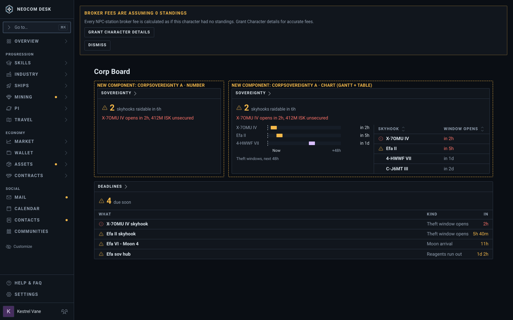
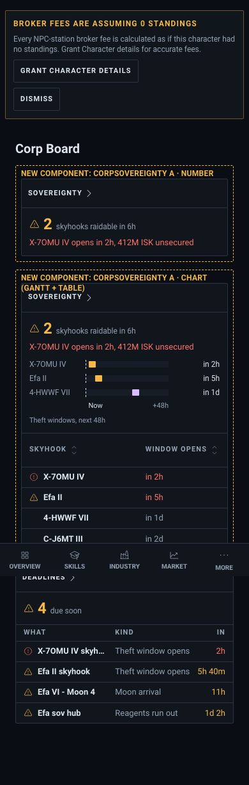
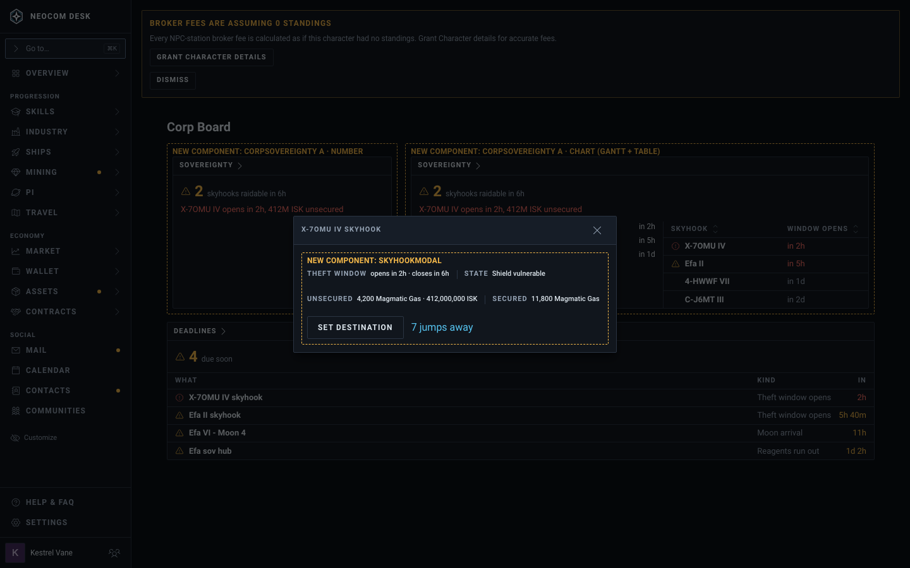
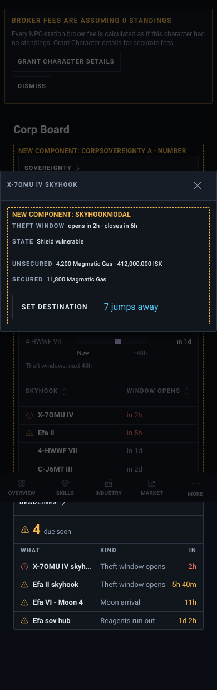
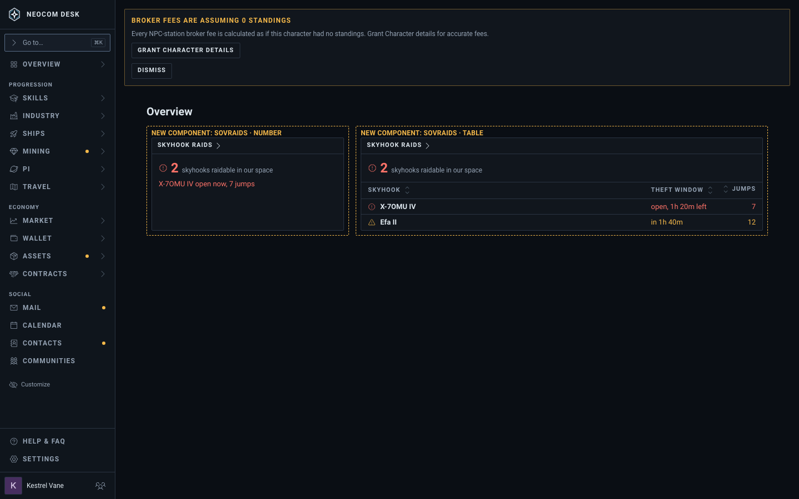
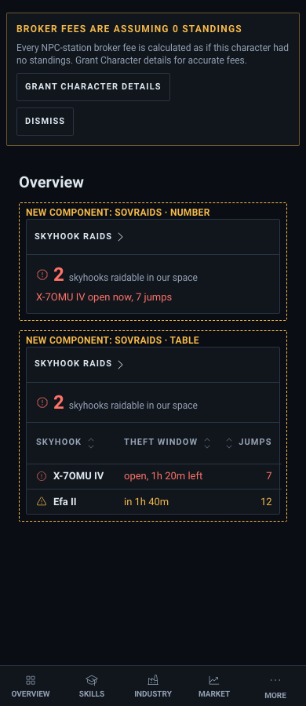
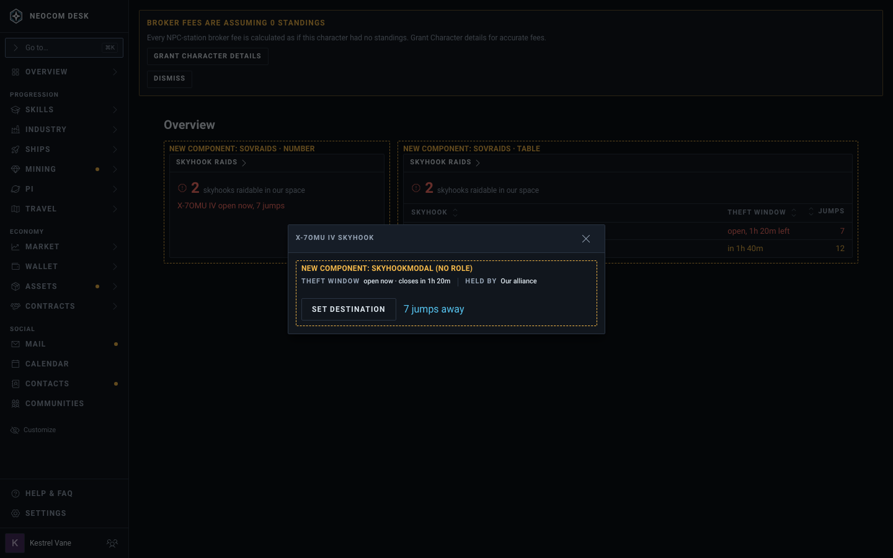
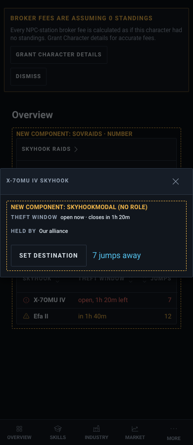

# Sovereignty widgets (issues #4775, #4798)

Chosen 2026-10-23: Option A (raid clock), two tiers. Sample data. The ticket's text wins over the picture where they differ.

Story: `src/mockups/CorpSovereignty.stories.tsx` (`mockups-corpsovereignty--option-a-raid-clock`, `--option-a-modal`, `--member-tier`, `--member-tier-modal`, plus `-phone` variants of the boards). Delete the story and this folder when both issues close.

## The two tiers

| Tier | Where | Who | Data |
|---|---|---|---|
| Station_Manager (#4775) | Corp Board, `corpSovereignty` | Station_Manager role | Every corp skyhook's next theft window (48h ahead), unsecured stock as ISK, hub fuel to Deadlines |
| Member (#4798) | Overview, `sovRaids` | Any Character in a sov-holding alliance | Public: skyhooks in our space raidable now or soon, jumps |

| State | Desktop (1440) | Phone (390) |
|---|---|---|
| Corp Board: Number, and Chart (Gantt of theft windows + table); raid windows and hub fuel in Deadlines |  |  |
| Corp Board row modal |  |  |
| Overview member tier: Number and Table |  |  |
| Member row modal |  |  |

The row modal's jump count is a `JumpsLink` to Route Safety ("7 jumps away"), not an external map.

**Dropped: Option B** (one row per system with hub fuel, next raid, upgrades). A system can hold several skyhooks and B showed only the next one. Git history keeps it.

## What ESI actually gives (OpenAPI, compatibility date 2026-05-19)

- `GET /corporations/{id}/structures/skyhooks/{id}`: Station_Manager role, `esi-structures.read_corporation.v1`. `theft_vulnerability {start, end}`, `reagents[] {secured_stock, unsecured_stock}`, `state`. No silo capacity, so no "% full": the widget shows the unsecured stock, which is what a raider can take.
- `GET /corporations/{id}/structures/sovereignty-hubs/{id}`: same role and scope. `reagent_bay.reagents[] {amount, burning_per_hour}` gives a fuel clock; `upgrades[] {power_state}`; `vulnerability_window`.
- `GET /skyhooks/raidable`: public, no role. Only skyhooks raidable now or "shortly" (system, planet, window), so no 48h look-ahead and no stock.
- `GET /sovereignty/systems`: public. Each system's alliance, holding corp, ADM and Military / Industry / Strategic levels, and the hub's vulnerability window.
- Mercenary dens are character routes (`/characters/{id}/structures/mercenary-dens`), so they stay out of these widgets.

## Known drift between the picture and the build

- The amber "Broker fees" banner is the Storybook shell fixture.
- The stand-in kind `corpServices` only supplies the widget shell; the real kinds are `corpSovereignty` and `sovRaids`.
- The Corp Board Chart view at Large drops the Unsecured column from its side table; the build keeps it (priority over Window opens).
- The dashed "New component" frames are mockup labels and do not ship.
