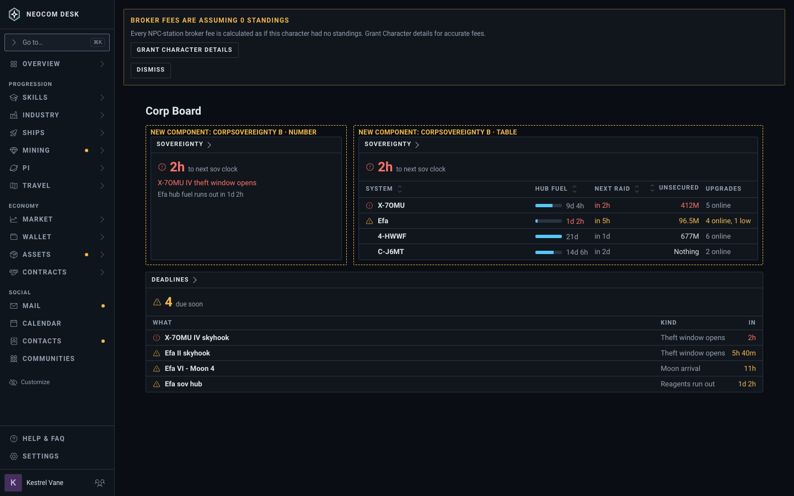
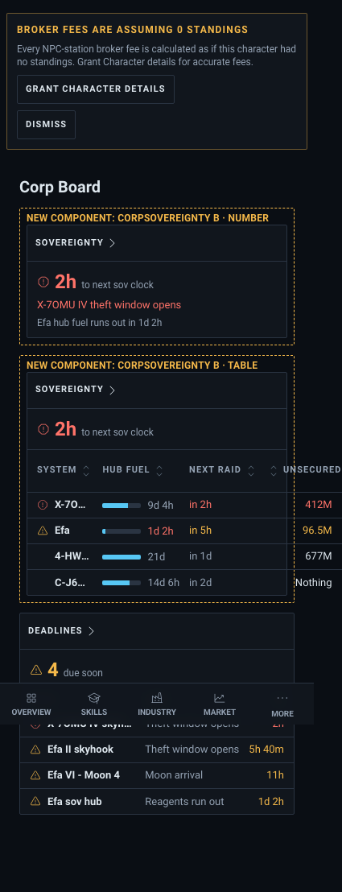
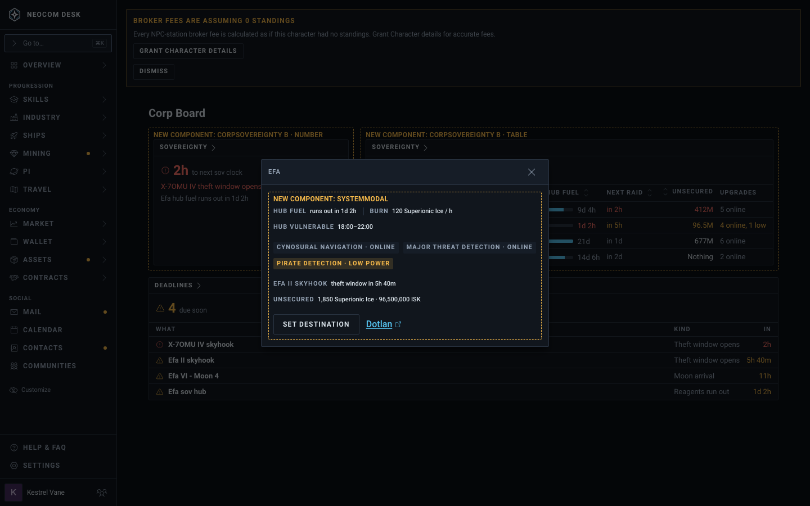
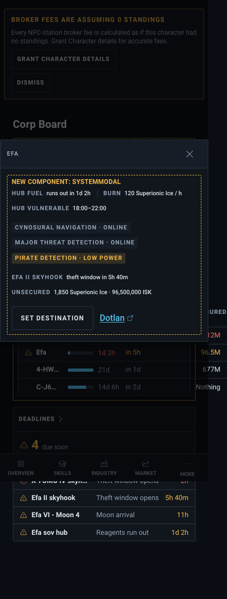

# Corp sovereignty widget (issue #4775)

Two options; sample data. The ticket's text wins over the picture where they differ.

Story: `src/mockups/CorpSovereignty.stories.tsx` (`mockups-corpsovereignty--option-a-raid-clock`, `--option-b-per-system`, `--option-a-modal`, `--option-b-modal`, plus `-phone` variants of the boards). Delete the story and this folder when #4775 closes.

## What ESI actually gives (OpenAPI, compatibility date 2026-05-19)

- `GET /corporations/{id}/structures/skyhooks/{id}`: Station_Manager role, `esi-structures.read_corporation.v1`. `theft_vulnerability {start, end}`, `reagents[] {secured_stock, unsecured_stock}`, `state`. No silo capacity, so no "% full": the widget shows the unsecured stock, which is what a raider can take.
- `GET /corporations/{id}/structures/sovereignty-hubs/{id}`: same role and scope. `reagent_bay.reagents[] {amount, burning_per_hour}` gives a fuel clock; `upgrades[] {power_state}`; `vulnerability_window`.
- `GET /skyhooks/raidable`: public.
- Mercenary dens are character routes (`/characters/{id}/structures/mercenary-dens`), so they stay out of a corp widget.

## Options

| Option | Desktop (1440) | Phone (390) |
|---|---|---|
| A. Raid clock: one row per skyhook, Gantt of theft windows |  |  |
| A. Row modal |  |  |
| B. Per system: hub fuel, next raid, unsecured, upgrades |  |  |
| B. Row modal |  |  |

In both, every theft window and every hub's fuel clock is also a row in Deadlines and counts toward the header's Next button.

## Known drift between the picture and the build

- The amber "Broker fees" banner is the Storybook shell fixture.
- The stand-in kind `corpServices` only supplies the widget shell; the real kind is `corpSovereignty`.
- A's Chart view at Large drops the Unsecured column from its side table; the build keeps it (priority over Window opens).
- The dashed "New component" frames are mockup labels and do not ship.
