# Corp Tax Book: merged option (Final)

Issue #4056 (epic #4055). Source: `src/mockups/CorpTaxBookFinal.stories.tsx` (data in `corpTaxBookFixtures.ts`). Story ids are `mockups-corptaxbookfinal--<step>`, with `-phone` for the 390 variant. Built on option A with C's timeline, Needs you cards and Statement run, B's mail preview (now a dialog) and B's verify layout. Sample data; the ticket text wins over the picture.

New components (dashed, labelled): ExtractionTimeline, NeedsYouQueue, StatementRun, StatementMailPreview, MailQueueChip (with its phone percent badge), CorpBookDiff, CorpBookSyncNote. The personal tab is today's Tax tab (real `OwedBalances` card, same columns and row detail) with new `StatusPill` values.

| Step | 1440 | 390 |
|---|---|---|
| 1 · Extractions: chunk timeline, then the table; a row opens the moon page |  |  |
| 2 · Moon detail page |  |  |
| 3 · Miners: Needs you cards above the table |  |  |
| 4 · Miner detail page |  |  |
| 5 · Mark paid / not tax / dismiss (dialogs) | 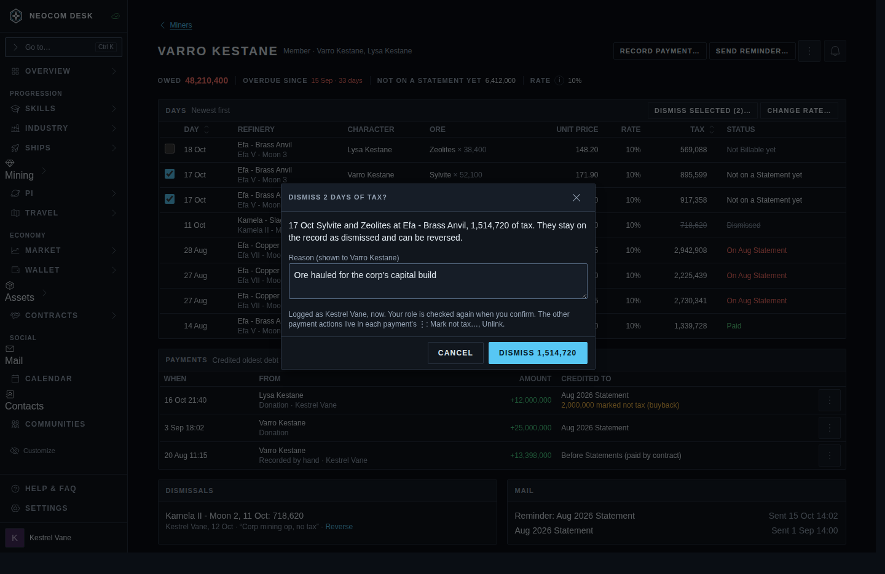 | 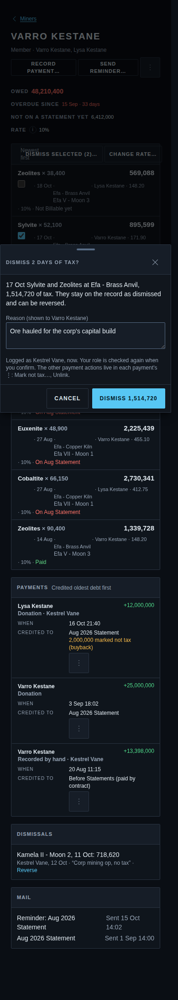 |
| 6 · Statements: run at Check | 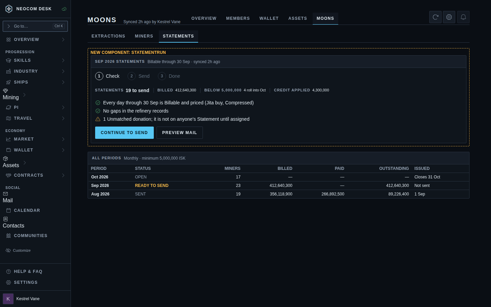 | 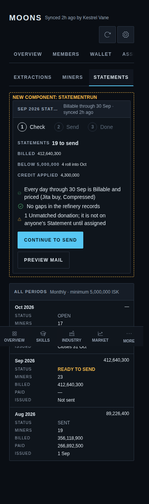 |
| 7 · Preview mail (dialog) | 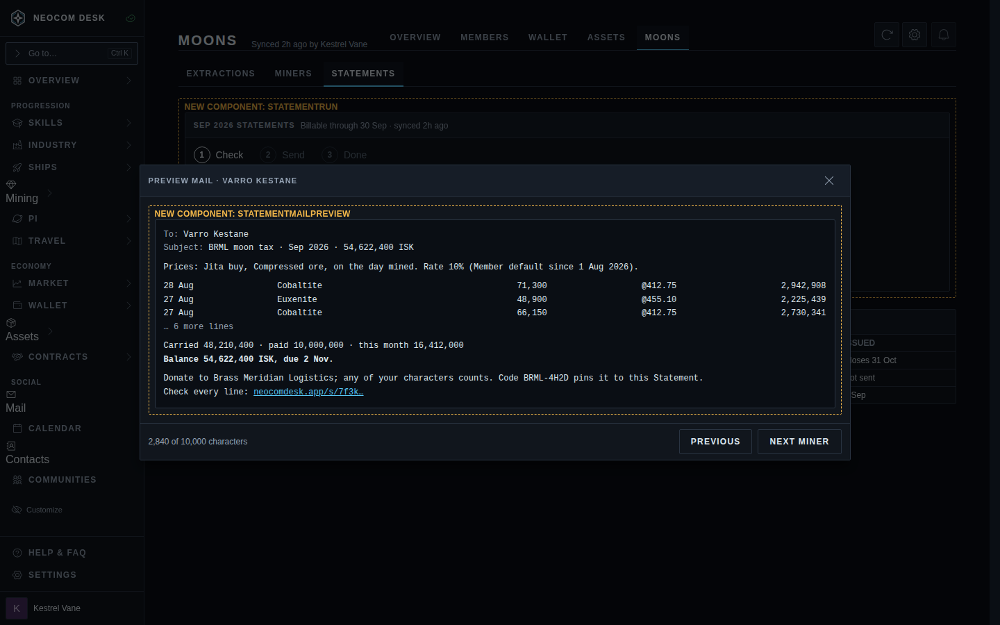 | 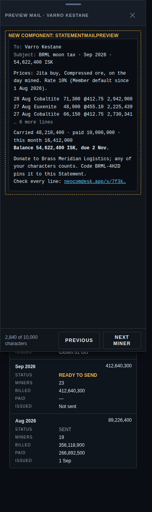 |
| 8 · Send, mail-limit notice | 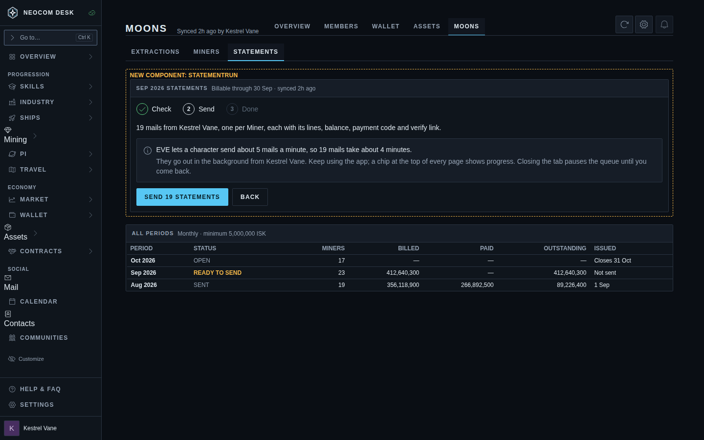 | 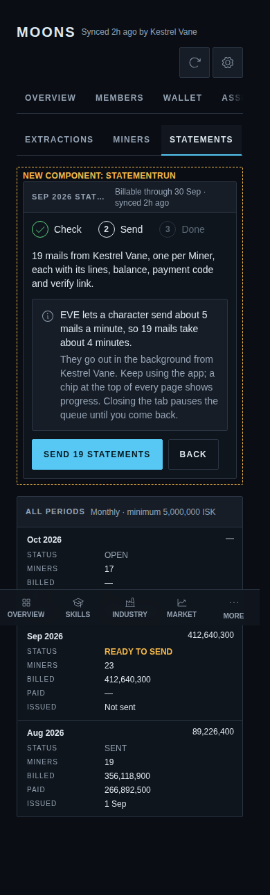 |
| 9 · Progress chip (phone: icon + % badge) | 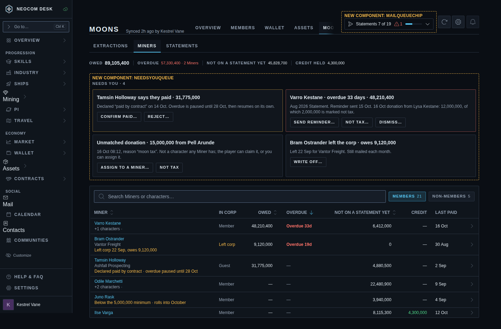 | 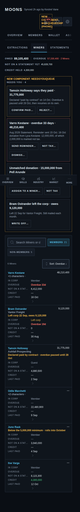 |
| 10 · Queue popover / sheet | 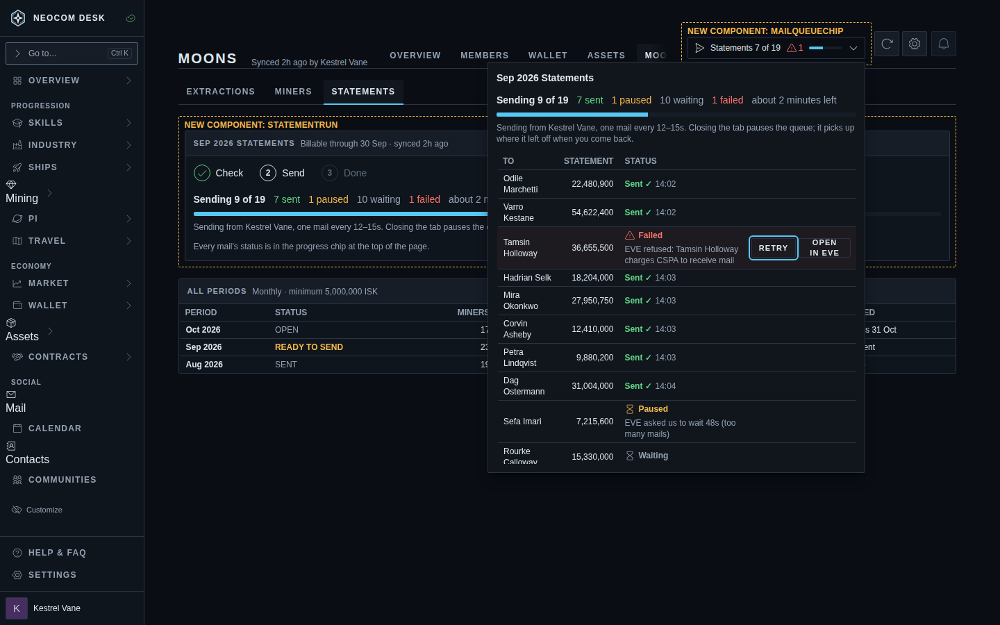 | 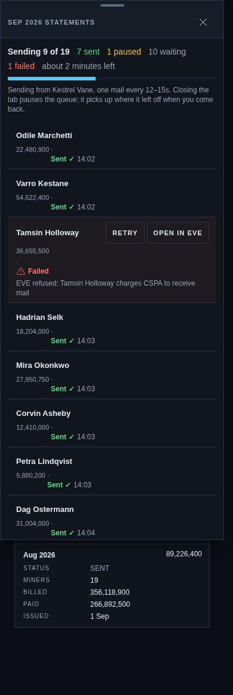 |
| 11 · Queue done | 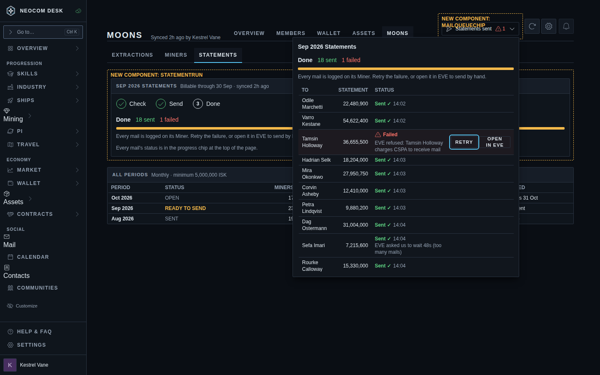 | 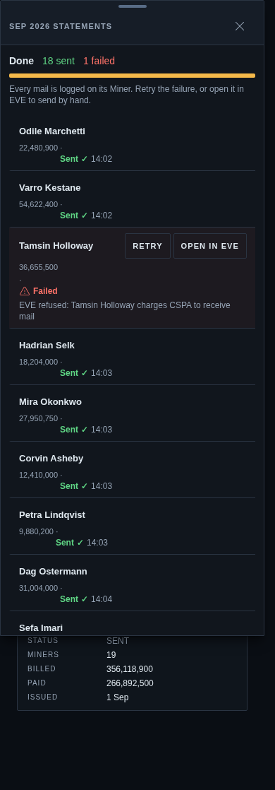 |
| 12 · Member Tax tab (today's page + corp states) | 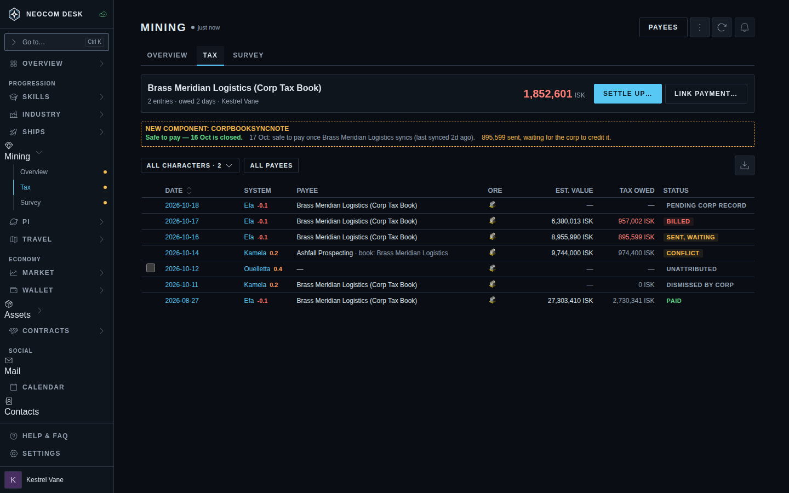 | 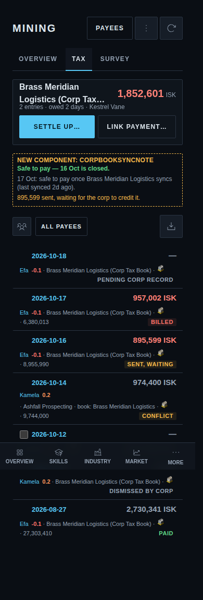 |
| 13 · Row detail | 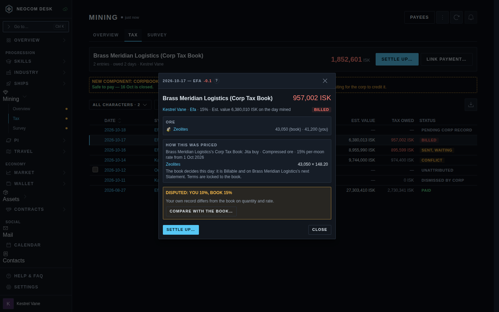 | 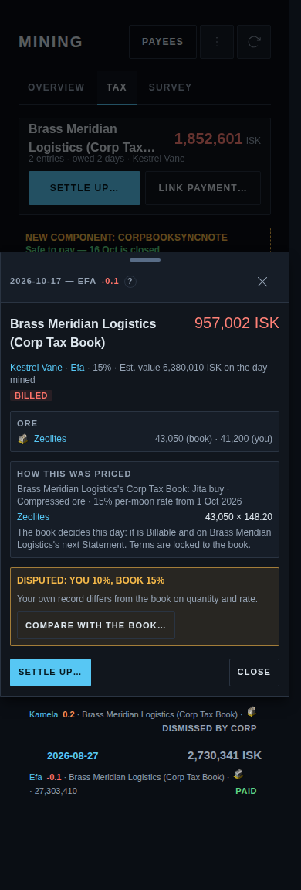 |
| 14 · Compare with the book (dialog) | 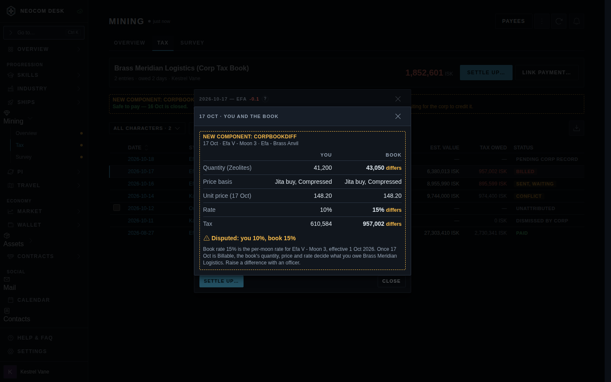 | 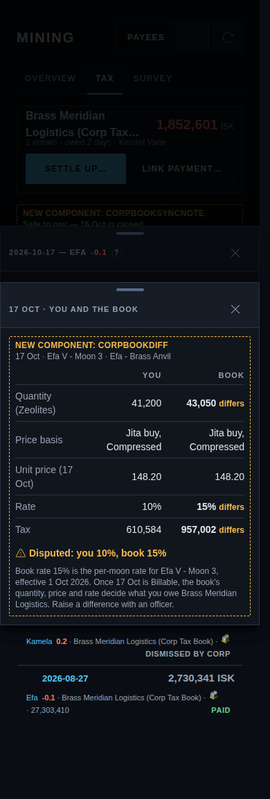 |
| 15 · Guest verify page | 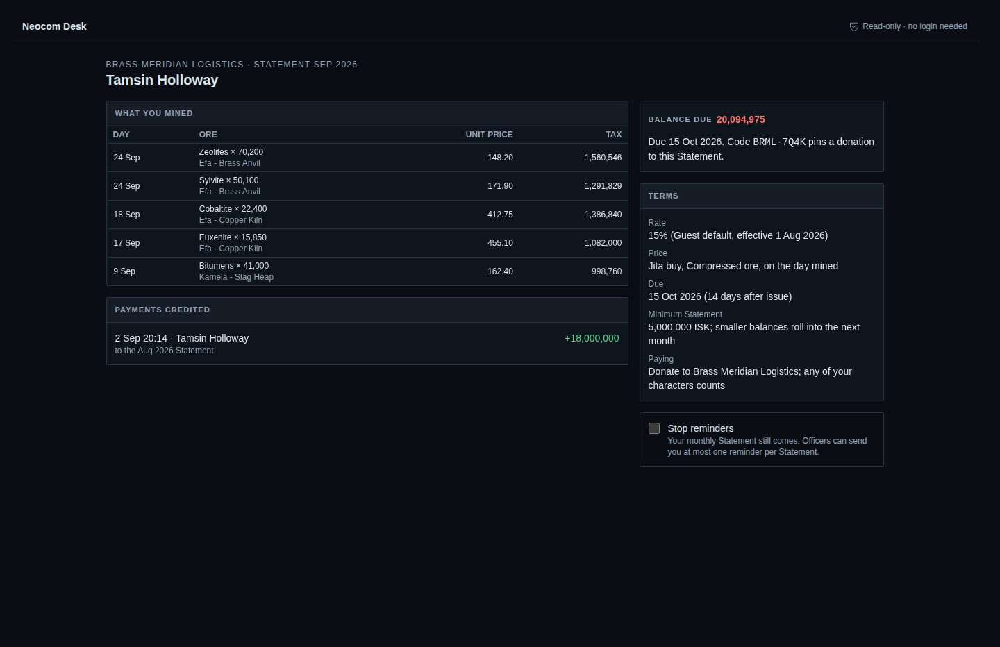 | 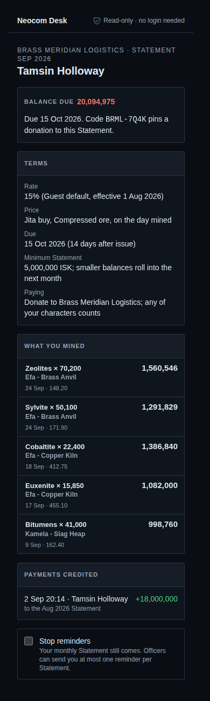 |
