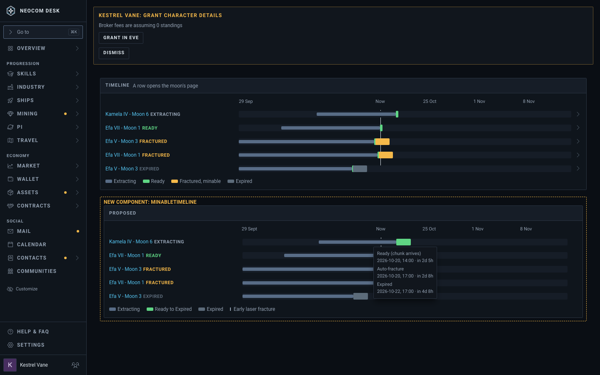

# Extraction auto-fracture bar (#6297)

Story `mockups/ExtractionAutofracture` (`src/mockups/ExtractionAutofracture.stories.tsx`): `mixed` (the book's own rows), `states` (one row per state), each with a phone story. Each stacks Today (the real `ExtractionTimeline`) over Proposed. First draft, sample data.

## Decision (Shawn)

- Ready stays green. No amber swap, no `StateWord` change.
- Today's green bar stretches from Ready (chunk arrival) to Expired as ONE bar. Expired rows are grey, as today.
- Early laser fracture: the green start does not move. A thin tick inside the bar marks the actual laser time, and the tooltip names it.
- A tooltip on the bar (hover, focus, long-press on touch; the bar is a tab stop) lists Ready (chunk arrives), Auto-fracture and Expired, each with local date and time and "in 2d 5h" while still ahead. If a laser fired, the Auto-fracture line becomes "Fractured (laser)" with the actual time.
- No forecast dashes. The Overview widget stays a table.

## What the engine draws

Fracture is Ready + ~3 h (`natural_decay_time`), Expired is fracture + 48 h (up to 96 h per structure, `extraction.ts`). So the bar is about 51 h, roughly 2 days, not 3. The mockup draws what the engine says. If the real field life is longer, change `DEFAULT_EXPIRY_HOURS`, not the drawing.

Today the timeline draws Ready to fracture in green and fracture to Expired in amber ("Fractured, minable"); the proposal merges both into the green bar and drops the amber.

## Screens

1440: `mixed-1440.png`, `states-1440.png` (tooltip open on the pulled chunk, with time left). 390: `mixed-390.png` (tooltip on the early-laser chunk), `states-390.png`.

## Notes for the build

- Tooltip body is a node (three date blocks), the §6c exception for content the reader needs; the Tooltip primitive's `max-w-56` forces one date block per line pair. Dates use `formatLocalDateTime` and `formatCountdown`.
- The span is about 4% of the 47-day axis. It reads; keep the axis.
- Legend: replace Ready / Fractured, minable with "Ready to Expired".
- Screenshots show the tooltip by hovering the bar; stories only mark the row (`data-open-tip`) and focus it.
