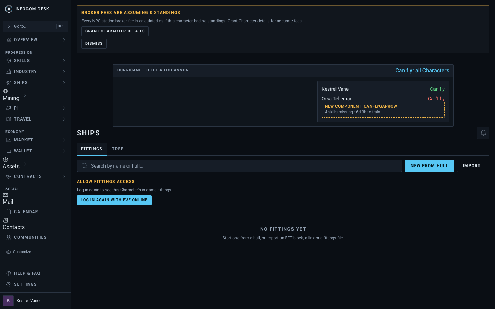
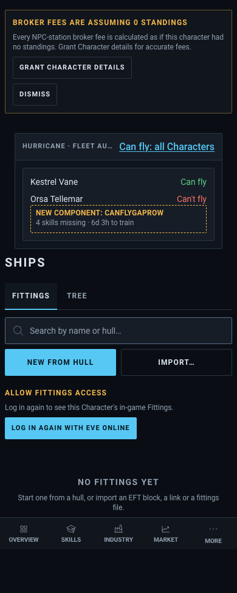

# Fittings: Can fly for every Character, with what each one is missing

Issue: #3910. Source: `src/mockups/FittingCanFlyByCharacter.stories.tsx` (`mockups-fittingcanflybycharacter--proposed`). Sample data; the ticket text wins over the picture.

New component: `CanFlyGapRow` (missing-skill count and training time under a Character that can't fly). The trigger is the existing inline link and the list is the existing Fitting Compare popover's list, here opened from a saved Fitting's header. Today's Fittings page renders under the proposal.

| | 1440 | 390 |
|---|---|---|
| Proposed |  |  |
