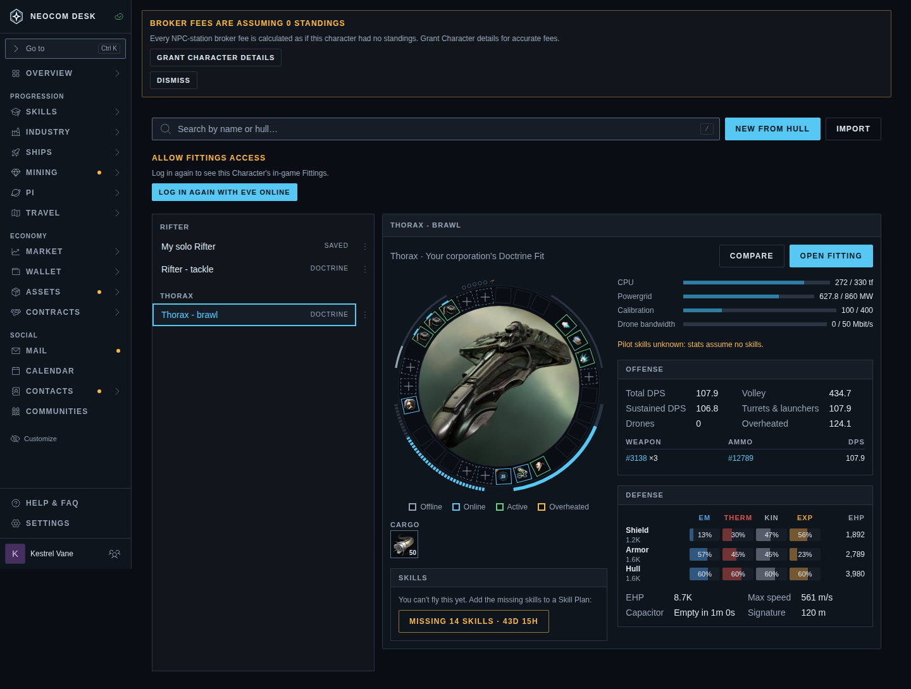
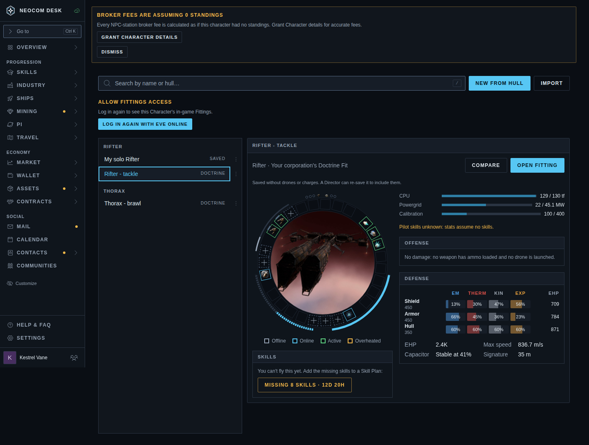
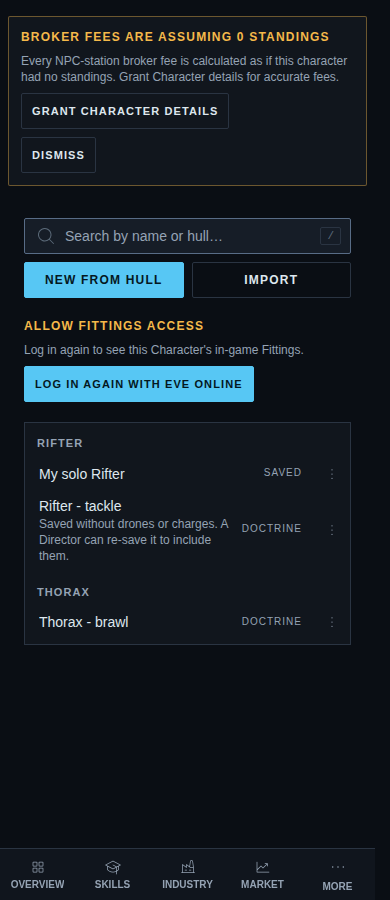

# Doctrine Fits in the Fittings library (issue #6202)

Story `mockups-fittingsdoctrine--*` (`src/mockups/FittingsDoctrine.stories.tsx`): the real Fittings Start list with the corp's Doctrine Fits answered by the backend stand-in. Sample data.

| Story | Screenshot |
|---|---|
| Doctrine rows beside a Saved Fitting; the whole-fit Thorax previewed (charges, drones, cargo) |  |
| A Doctrine Fit saved before the change: modules and rigs only, with the re-save note |  |
| Phone: no preview pane, so the older fit's row carries the note |  |
