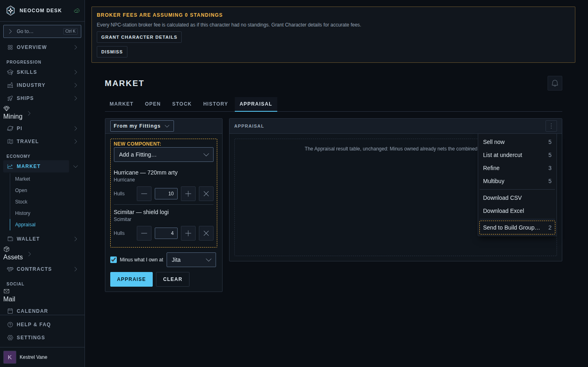
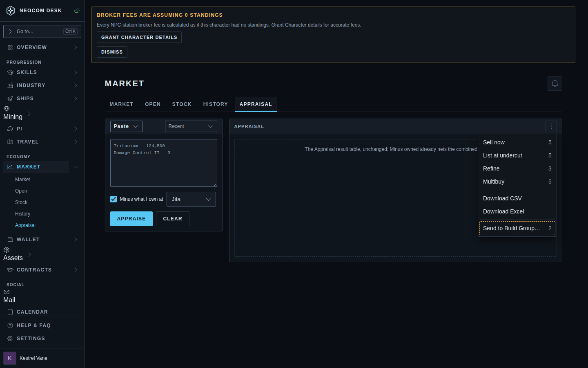
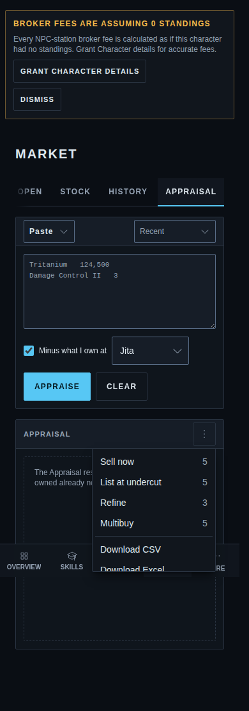
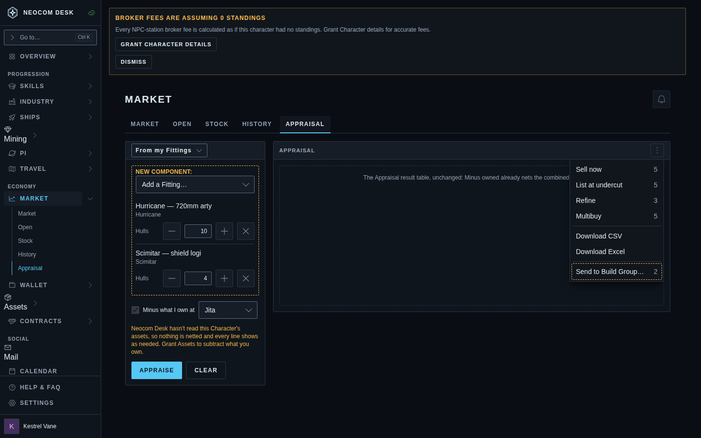
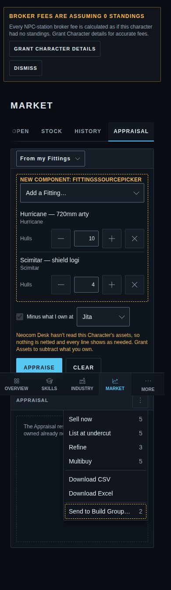
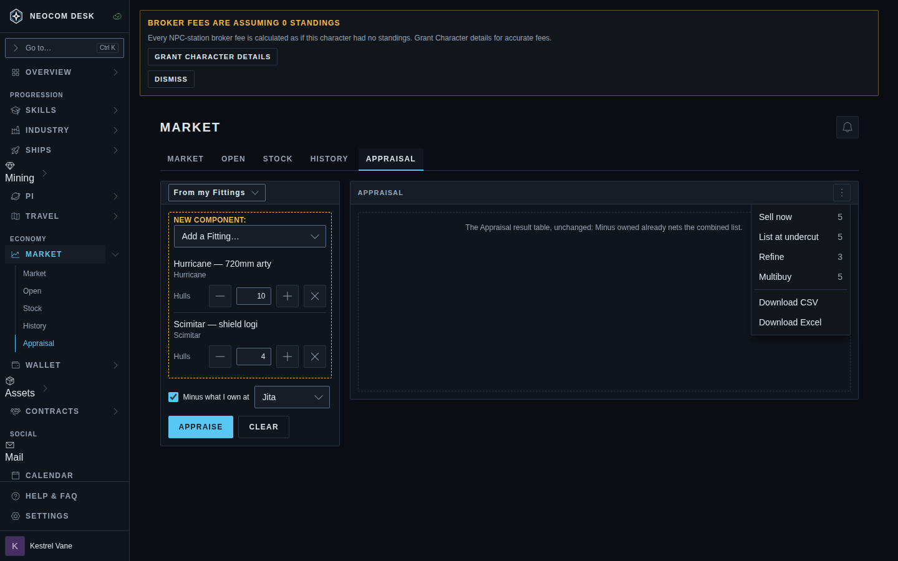
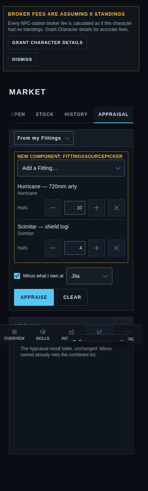

# Appraisal: From my Fittings

Source: `src/mockups/FittingsRestock.stories.tsx` (`mockups-fittingsrestock--proposed`). Sample data; the ticket text wins over the picture. Issue #4550.

Only the input card changes; the result table is the existing Appraisal's and is drawn as a dashed placeholder. The one result-side addition is the dashed "Send to Build Group…" entry in the actions menu.

New component: `FittingsSourcePicker` (the Fittings list with hull-count steppers). The title select is the existing `Select` in the card title.

| Story | 1440 | 390 |
|---|---|---|
| `proposed`: From my Fittings, menu open |  |  |
| `paste-source`: Paste, Recent returns |  |  |
| `no-assets`: no Assets read, existing grant note |  |  |
| `nothing-buildable`: no Send to Build Group entry |  |  |

The phone shots clip the bottom of the open menu; the desktop shots show it in full.
