# Improve counts what you own (#5150)

Source: `src/mockups/ImproveOwnedStock.stories.tsx` (`mockups-improveownedstock--*`). Sample data. Every story has a `-phone` twin (390). Run `npm run storybook`, or `npm run ui:shot -- mockups-improveownedstock--<story>`.

## Chosen (2026-10-25)

- **Q1:** inside Search settings. The Search settings header becomes two lines, the label with its caret and then the summary under it. The summary names the place ("minus owned at Jita IV-4"), so the counted place shows without opening the settings.
- **Q2:** Appraisal's sentence with the place picker: "Count what I own at [Jita IV-4]". It edits the one shared pick.
- **Q3:** the note replaces the cost line.

Stories `chosen`, `chosen-open` (and their `-phone` twins).

| Settings closed | Settings open |
|---|---|
| 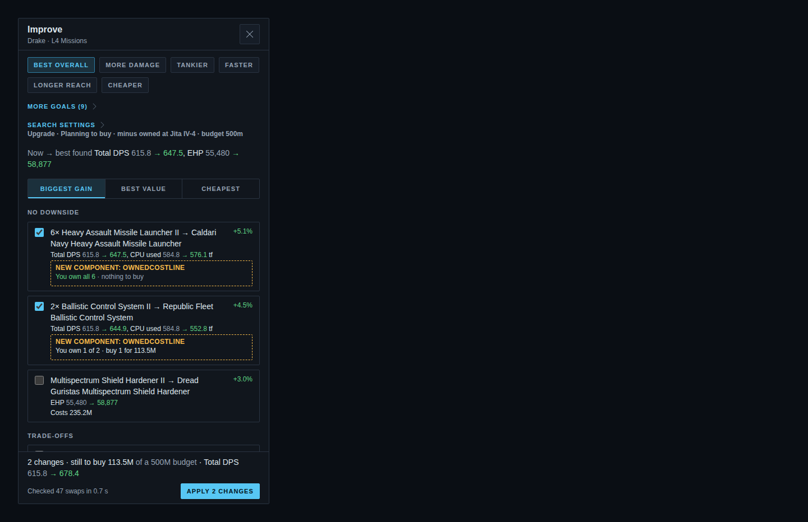 | 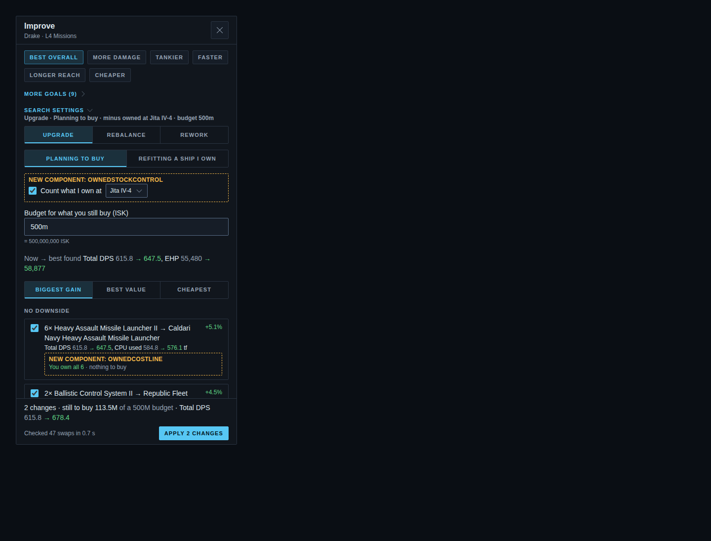 |
| 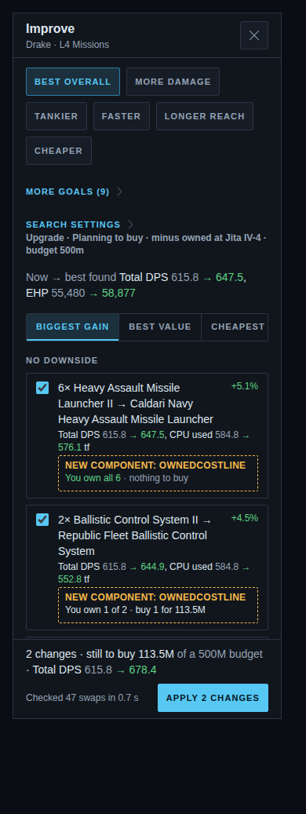 | 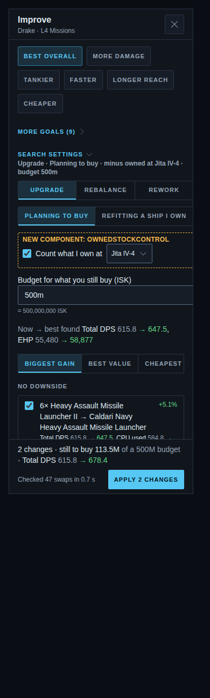 |

## The questions as reviewed

The base is today's drawer after a Planning search on a Drake, with two rows ticked: the launcher swap (all 6 owned) and the Ballistic Control swap (1 of 2 owned). The base picks are Q1 B, Q2 A and Q3 A, so the base picture serves all three. The selection summary reads "still to buy … of a 500M budget" in every story.

## Q1: where does "Count what I own" go?

| A: inside Search settings (`q-1-in-settings`) | B: above the results, always visible (`q-1-top`, base) |
|---|---|
| 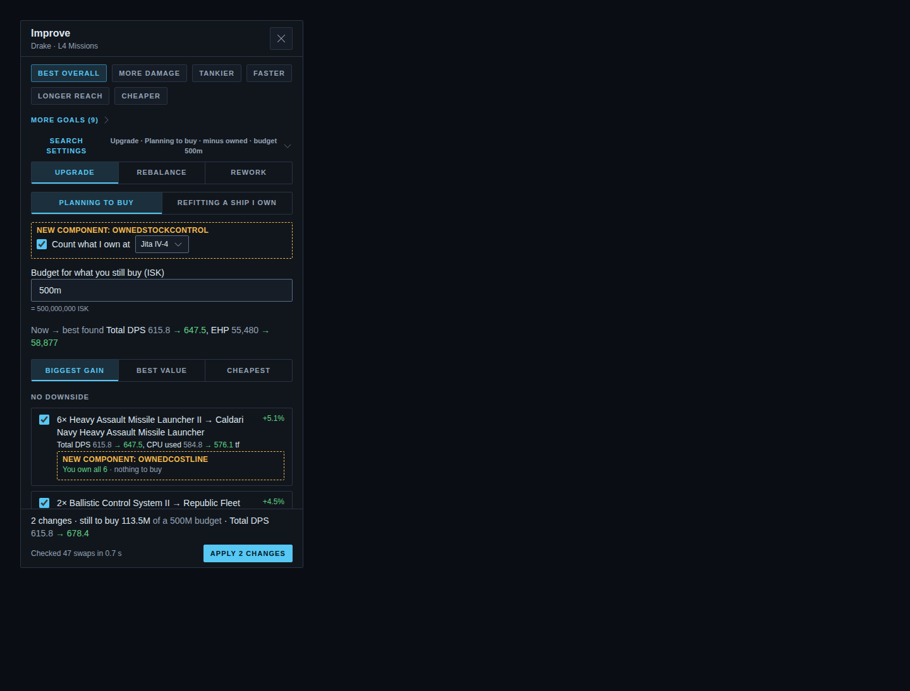 | 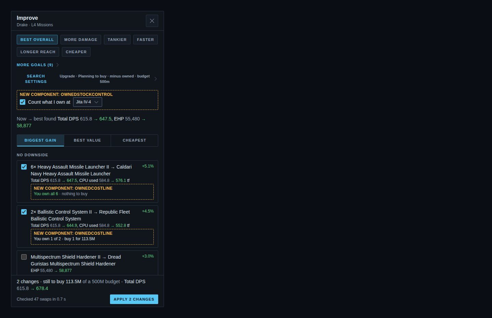 |
| 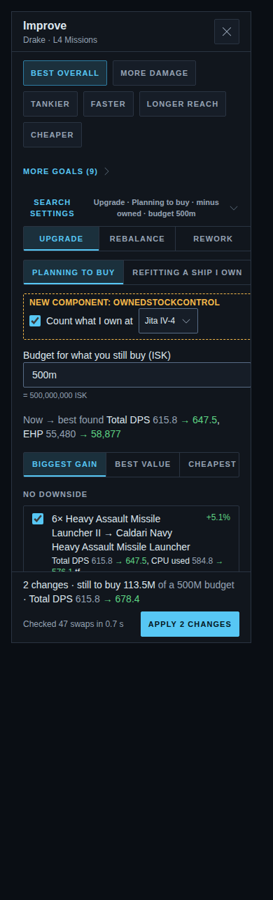 | 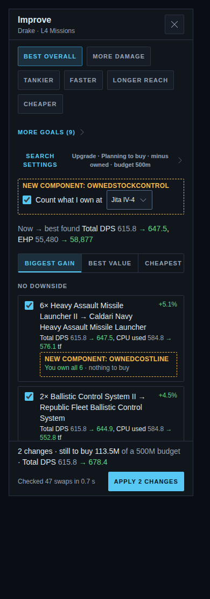 |

A keeps the drawer calm. The settings summary line gains "minus owned", but the place shows only when the settings are open. B shows which place is counted on every search, at the cost of one line above the results.

## Q2: how is the place shown?

| A: Appraisal's sentence with the picker (`q-2-picker`, base) | B: a sentence naming the setting (`q-2-text`) |
|---|---|
|  | 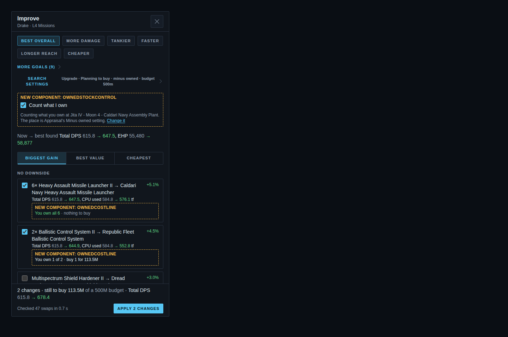 |
|  | 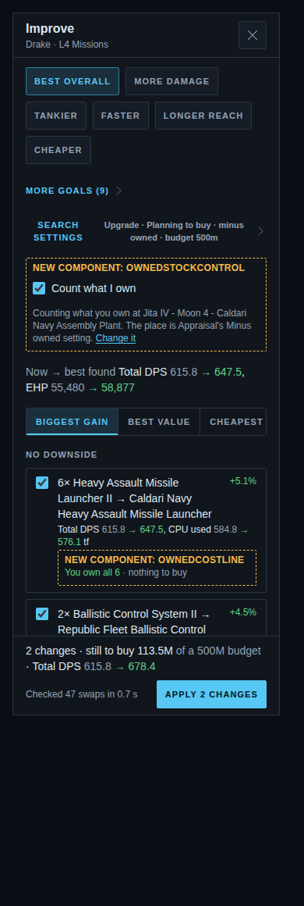 |

A reuses Appraisal's "Minus what I own at [place]" pattern, and the picker edits the one shared pick, so Appraisal and the export change too. B is closer to the ticket's wording: "Counting what you own at …", plus a link to Appraisal's Minus owned setting. Changing the place then means leaving the drawer.

## Q3: the row note

| A: replaces the cost line (`q-3-replace`, base) | B: a Pill beside the cost (`q-3-beside`) |
|---|---|
|  | 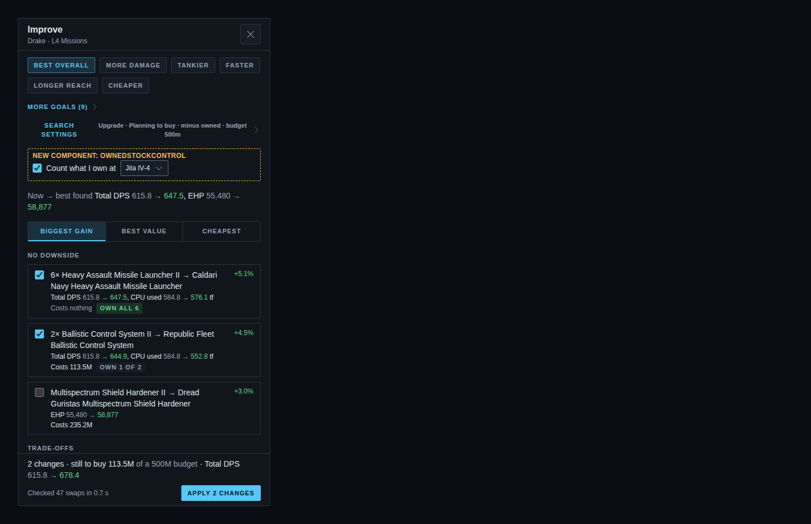 |
|  | 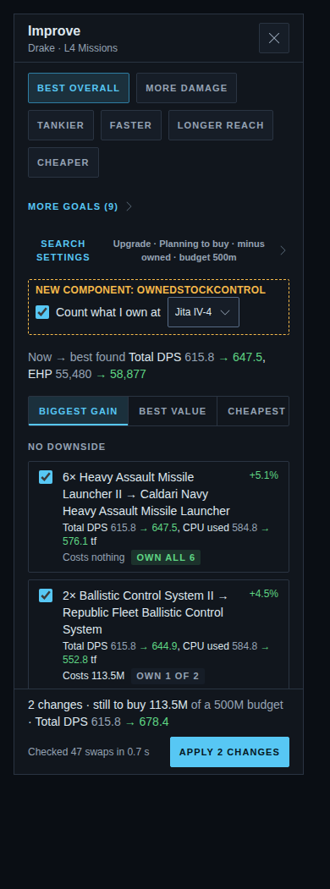 |

A: "You own 1 of 2 · buy 1 for 113.5M", or "You own all 6 · nothing to buy". B: "Costs 113.5M" next to an "OWN 1 OF 2" Pill, or "Costs nothing" next to "OWN ALL 6".

## Nothing owned at the place

| With the picker (`none-here-top`) | With the sentence (`none-here-text`) |
|---|---|
| 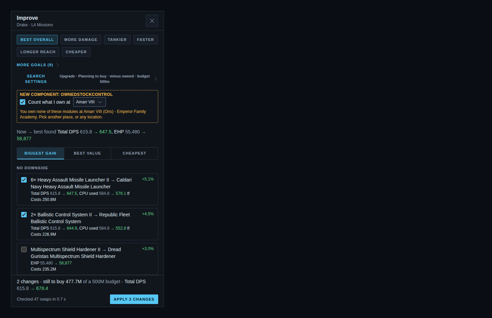 | 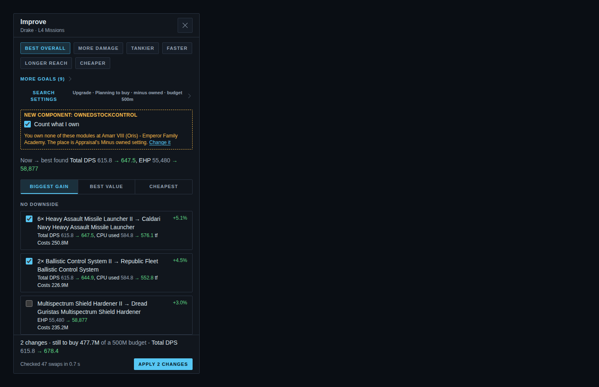 |

A warning line says so, and every row is priced in full. Without the assets scope the control is absent, as in today's drawer.

New components: `OwnedStockControl`, `OwnedCostLine`. The ticket's Agent Brief wins over the picture where the two differ.
