# Items board: flag overpriced and padded item contracts (issue #4773)

Source: `src/mockups/ItemContractFlags.stories.tsx` (`mockups-item-contract-flags--*`). The shell, page header, tabs, `FilterBar`, filter chips and `DataTable` are the real ones with today's Items columns. The rows are sample data (`itemContractFlagsFixtures.ts`), and the ticket text wins over the picture.

New components: `ContractFlagNote` (one sentence in the slide-over), and the second row in Settings (`Flag item contracts at`, a `ChipRow`). The price-cell marker is `BaitFlag`'s look with contract wording; "Hide overpriced" is a `FilterChip` in the existing funnel.

| | 1440 | 390 |
|---|---|---|
| Today (Damage Control II) |  | 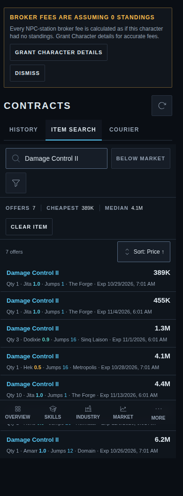 |
| Proposed: markers on the price cell | 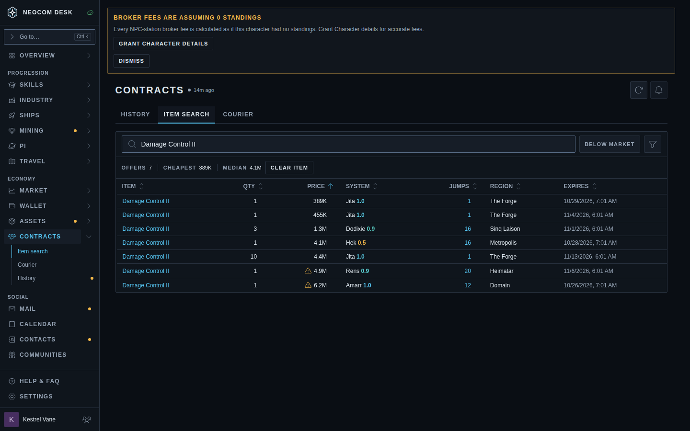 | 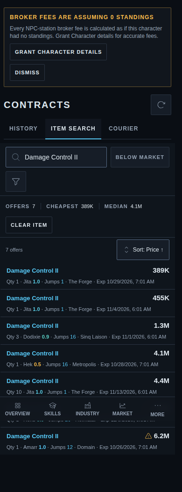 |
| Funnel open: Hide overpriced | 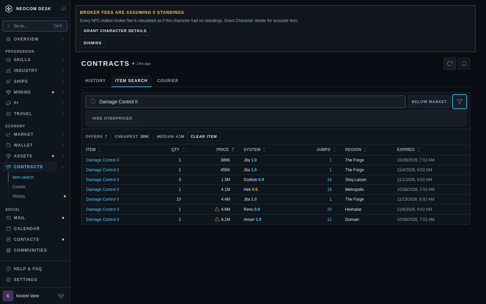 | 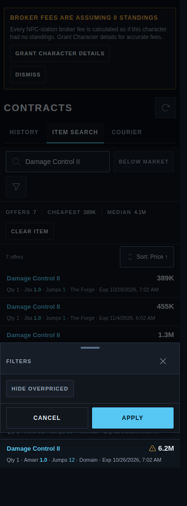 |
| Hide overpriced on: "2 overpriced contracts hidden" | 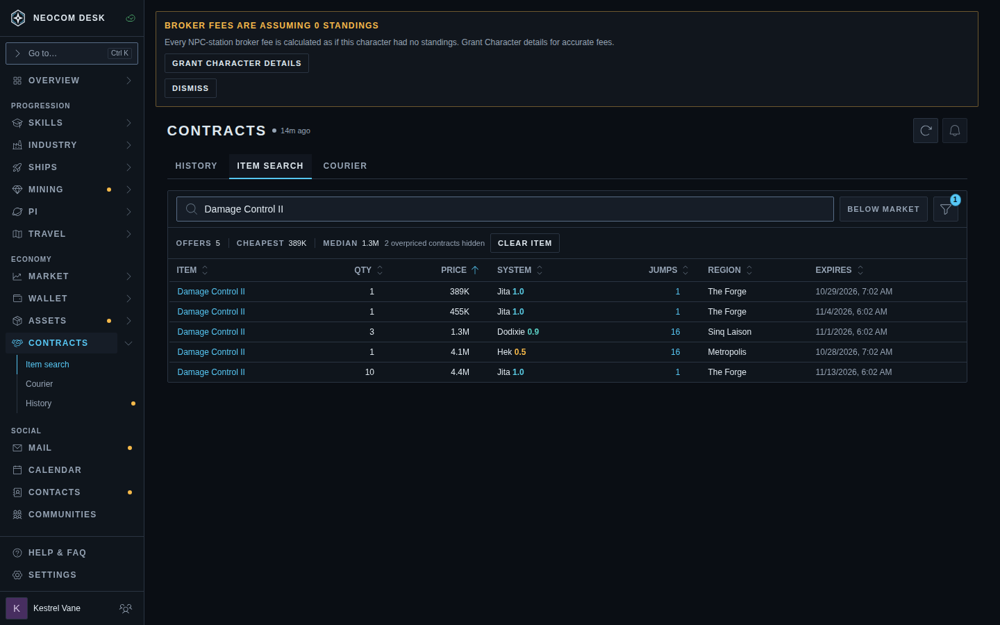 | 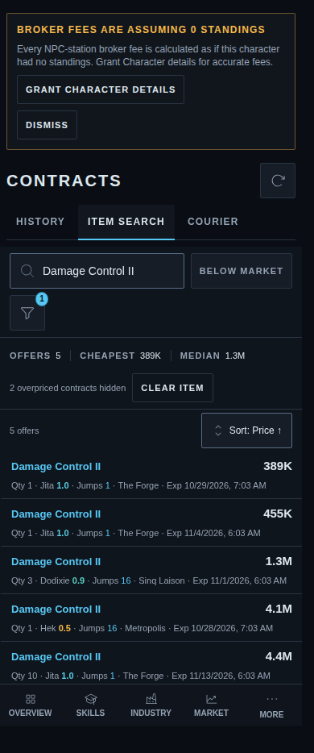 |
| Blueprint search: copy above original | 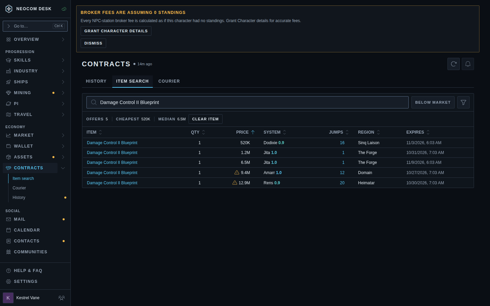 | 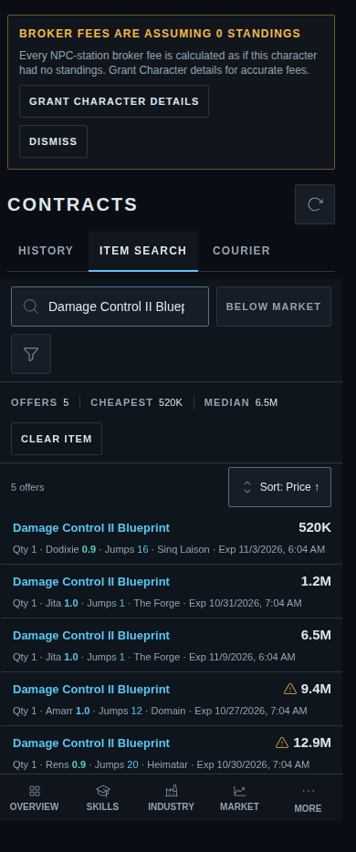 |
| Slide-over: 15 times the hub sell | 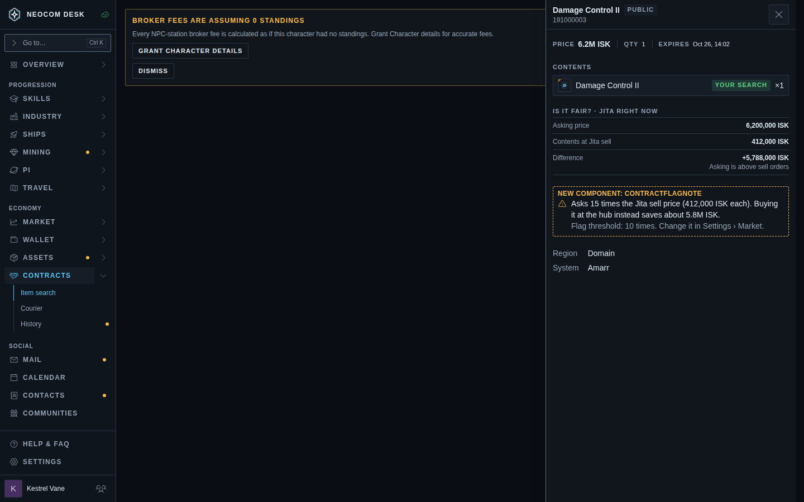 | 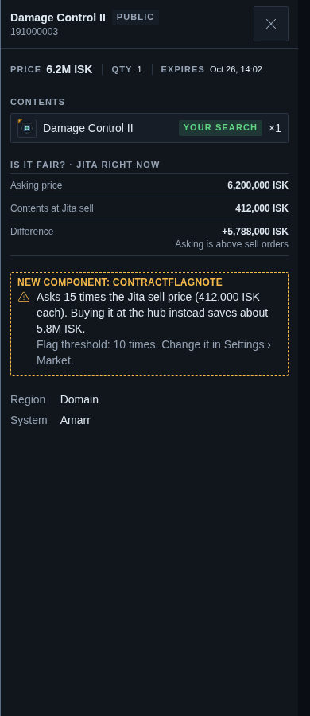 |
| Slide-over: copy above original | 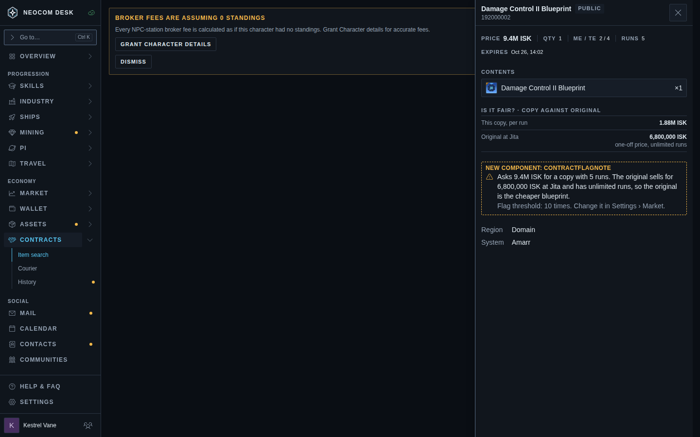 | |
| Slide-over: padded bundle | 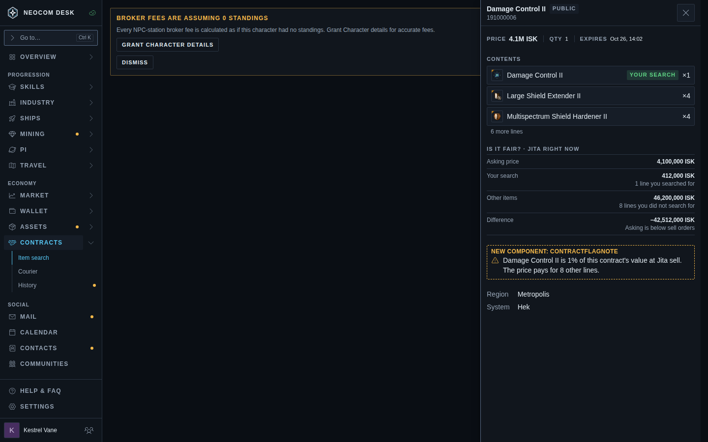 | 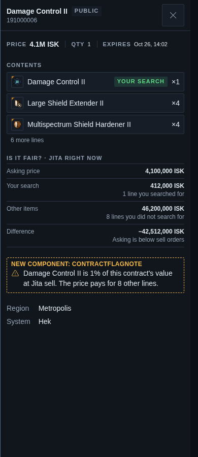 |
| Option: "9 lines" hint on a bundle row | 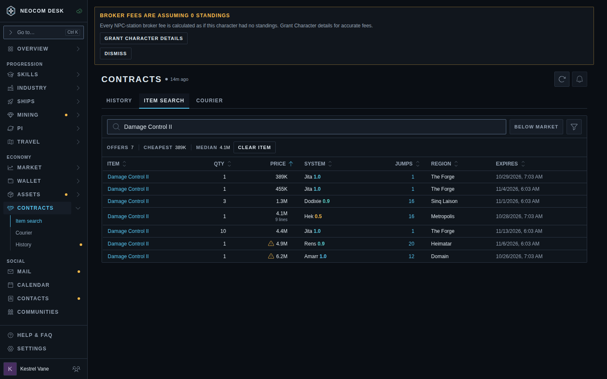 | |
| Settings › Market: the multiple | 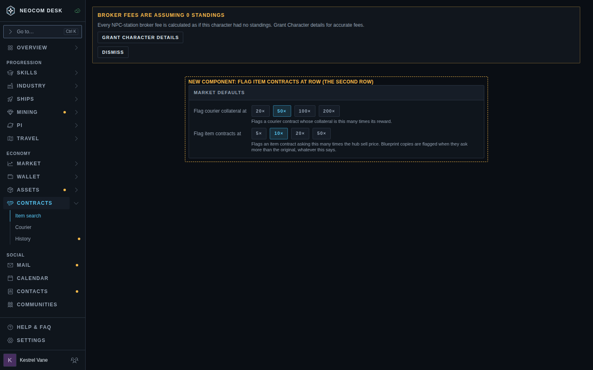 | |

## What the proposal shows

- **Signals 1 and 2 are row markers.** The `Warn` glyph before the price, in `text-warning`, with the sentence as tooltip and accessible name. No new column, and no new card line below `sm`: on a phone the glyph sits before the price on the card's title line.
- **A contract with other lines is never flagged on its row.** Its one price pays for all of them, so "6.2M against a 412K item" says nothing about a contract that also holds eight other lines. The snapshot has one row per contract and type, so the line count *is* known at row level (the tally `bpcRowsFromContractOffers` already makes). The value split is not: it needs the other lines priced.
- **Signal 3 is modal only.** The slide-over states the searched line's share of the contract's value ("1% of this contract's value at Jita sell. The price pays for 8 other lines."). The optional "9 lines" hint under the price (`BundleHint`) is the most the row can say without pricing the other lines.
- **Hide overpriced** lives in the existing filter funnel, like Market Browser's Hide bait sells, so the toolbar gains no control. It hides 1 and 2 only. With it on, the funnel trigger shows a count of 1 and the stat strip prints "2 overpriced contracts hidden".
- **Threshold.** One setting, `Flag item contracts at` (5, 10, 20, 50 times; default 10, Market Browser's factor), beside the courier collateral row in Settings › Market. Synced, preset-only, like `useCourierCollateralRatio`. Copies are flagged against the original's price whatever it says.
- **Copy against original** compares the asking price with the original's hub price, and says that the original has unlimited runs.
