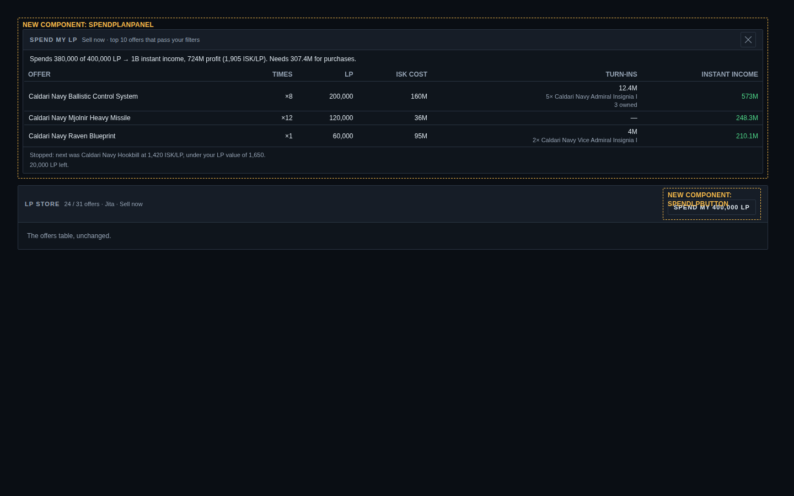
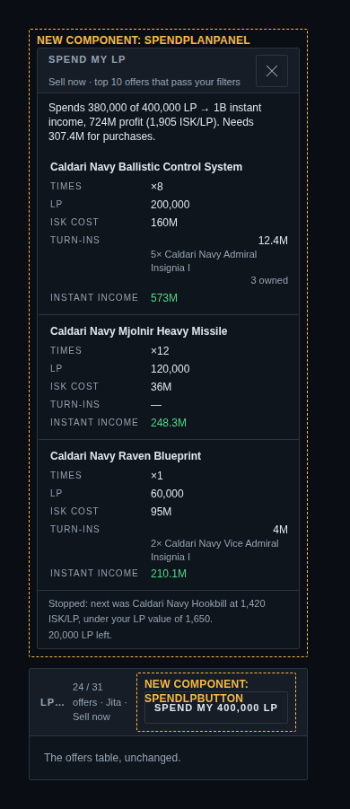
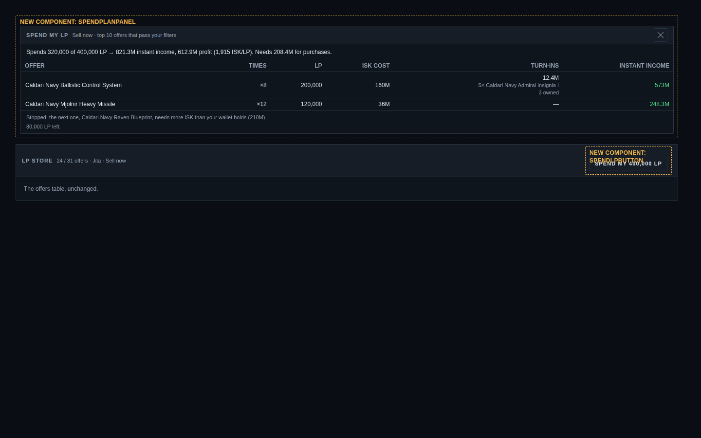
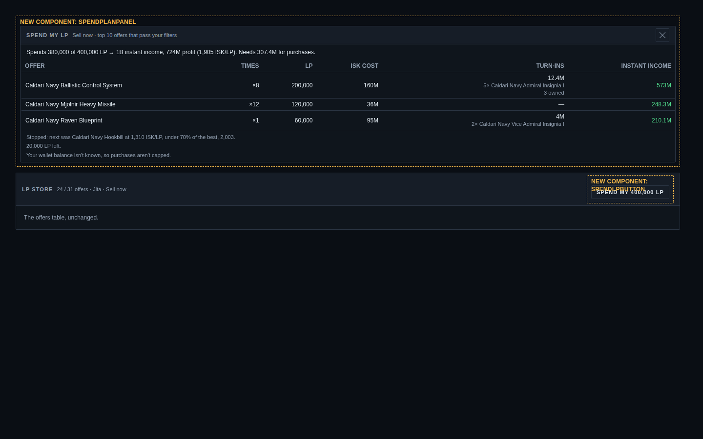
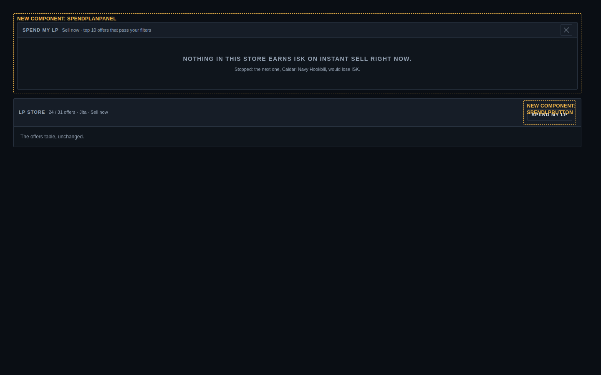

# LP Store › Spend my LP (issue #6199)

Source: `src/mockups/LpStoreSpendPlan.stories.tsx` (`mockups-lpstorespendplan--*`). Sample data, rendered with the real `SpendPlanPanel` and `SpendLpButton`; the ticket text wins over the picture.

New components: `SpendLpButton` (beside the offers list's actions menu) and `SpendPlanPanel` (opens above the offers on press).

| State | Screenshot |
|---|---|
| Populated, stopped at the pilot's LP Value |  |
| Same, phone (390) |  |
| Stopped at the wallet |  |
| Stopped under 70% of the best (no LP Value, no market rate), wallet unknown |  |
| Nothing profitable |  |
| 0 LP: button aria-disabled, reason in a tooltip |  |
