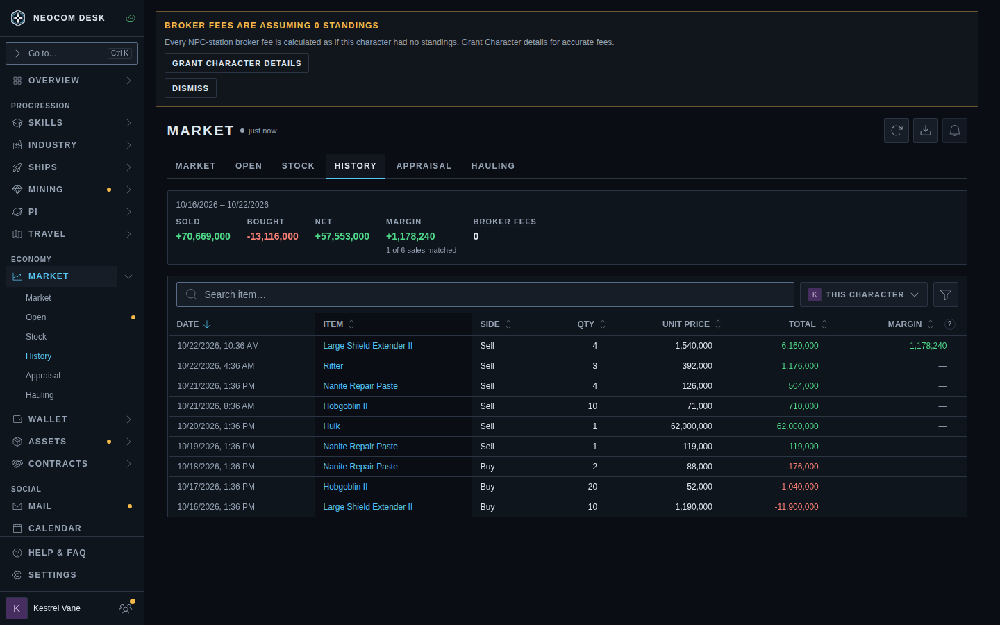
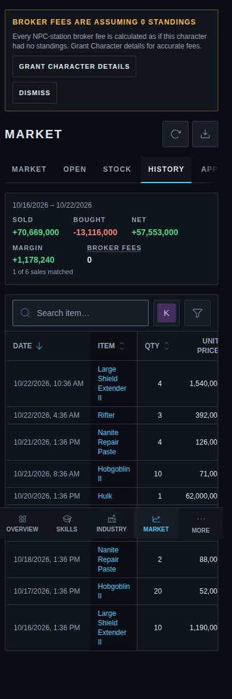
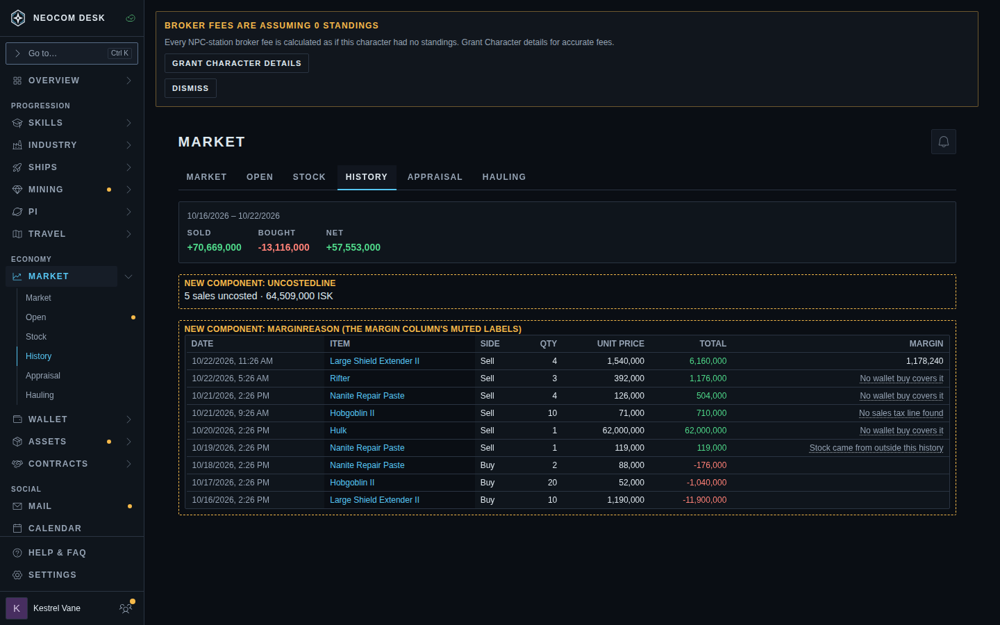
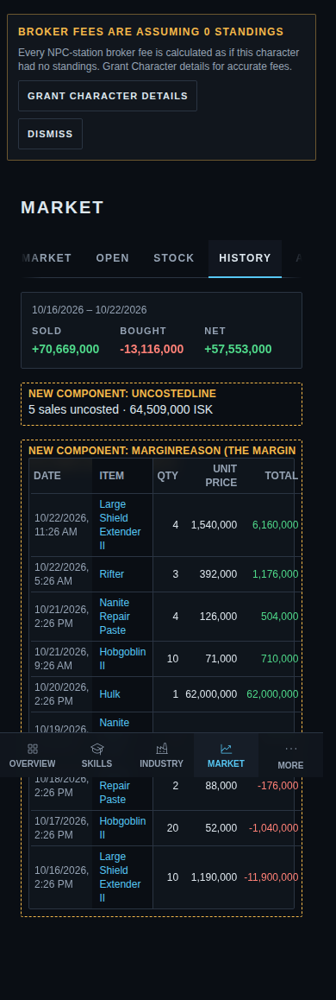

# Transactions: why a sale has no margin (#4736)

Source: `src/mockups/TransactionMarginReason.stories.tsx` (`mockups-transaction-margin-reason--proposed`). Sample data; the ticket text wins over the picture.

Today is the real Market › History page. Proposed is a copy of its table (the real page cannot show a reason until the engine reports one), so it has fewer columns than the shipped table.

New components: `MarginReason` (the muted label replacing the dash, with the explanation on hover/focus; dashed frame marks the Margin column), `UncostedLine` (sits inside the totals strip once built, drawn under it here).

| | 1440 | 390 |
|---|---|---|
| Today |  |  |
| Proposed |  |  |

Sample sales and the reason each gets (same rules as the realized-margin engine):

- Large Shield Extender II: bought earlier, tax found: a margin, unchanged.
- Rifter, Hulk (built, never bought): "No wallet buy covers it".
- Nanite Repair Paste, 4 units (sold more than were bought): "No wallet buy covers it".
- Nanite Repair Paste, 1 unit (covered, but the sale above outran the buys, so the engine drops this one too): "Stock came from outside this history".
- Hobgoblin II (covered, tax line missing): "No sales tax line found".

Phone: the Margin column is desktop-only today (`phoneHidden`), so the phone shows no reasons. Only the "5 sales uncosted · 64,509,000 ISK" line is new there. Say so in review if you want reasons on the phone too.

Phone date: the Date cell stacks date over time below `sm`, one line from `sm` up, with tighter column padding, so the table fits 390px. This is the Wallet journal's existing pattern (`splitTimestamp`), no new component. Today's table lets the date push the other columns off screen; the ticket should apply this to the real table too.
