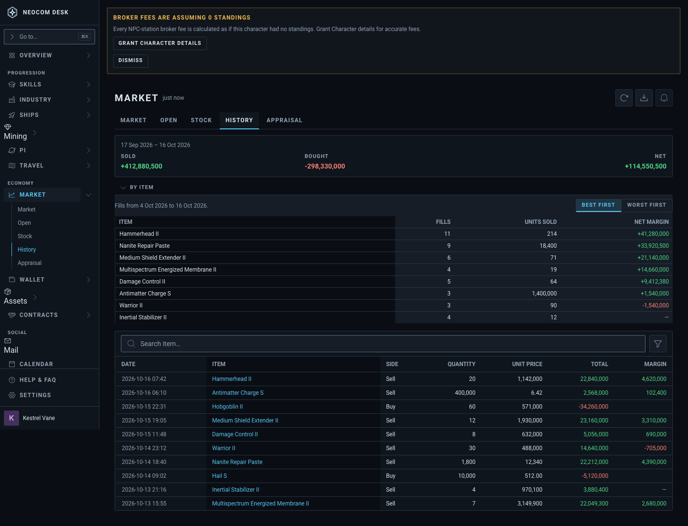
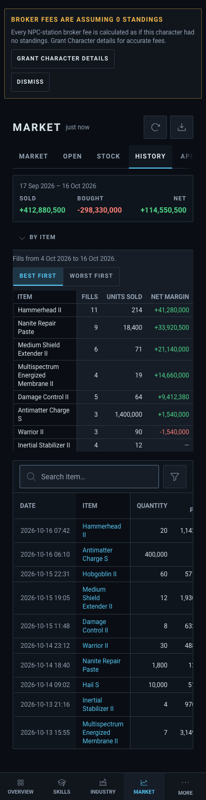
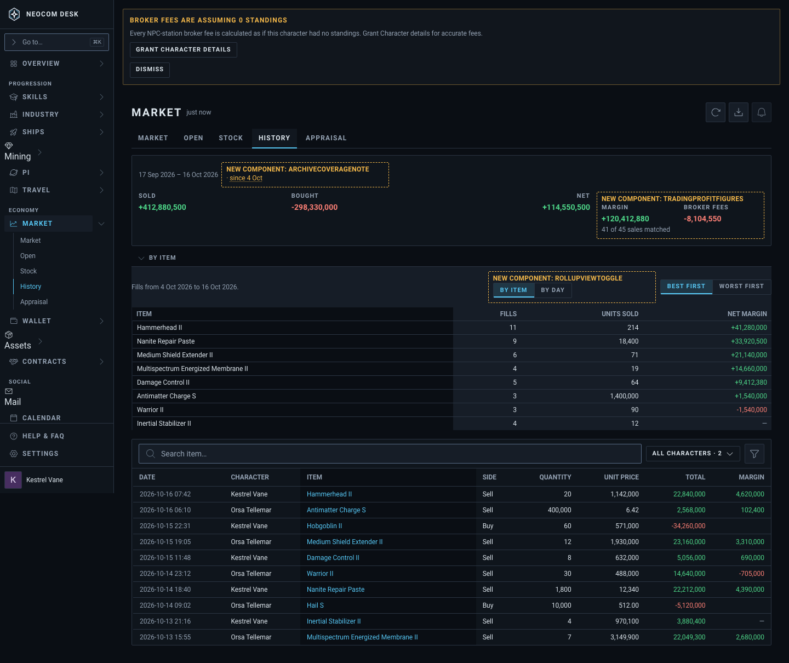
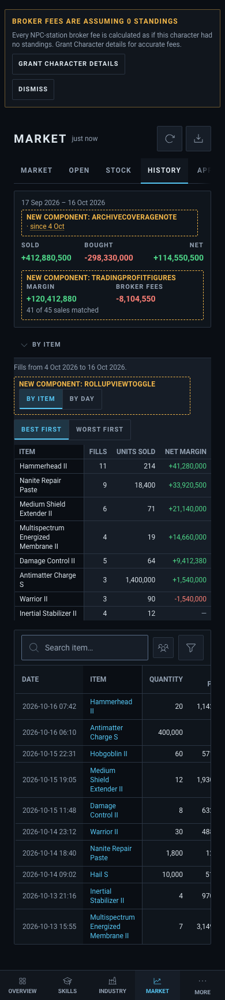
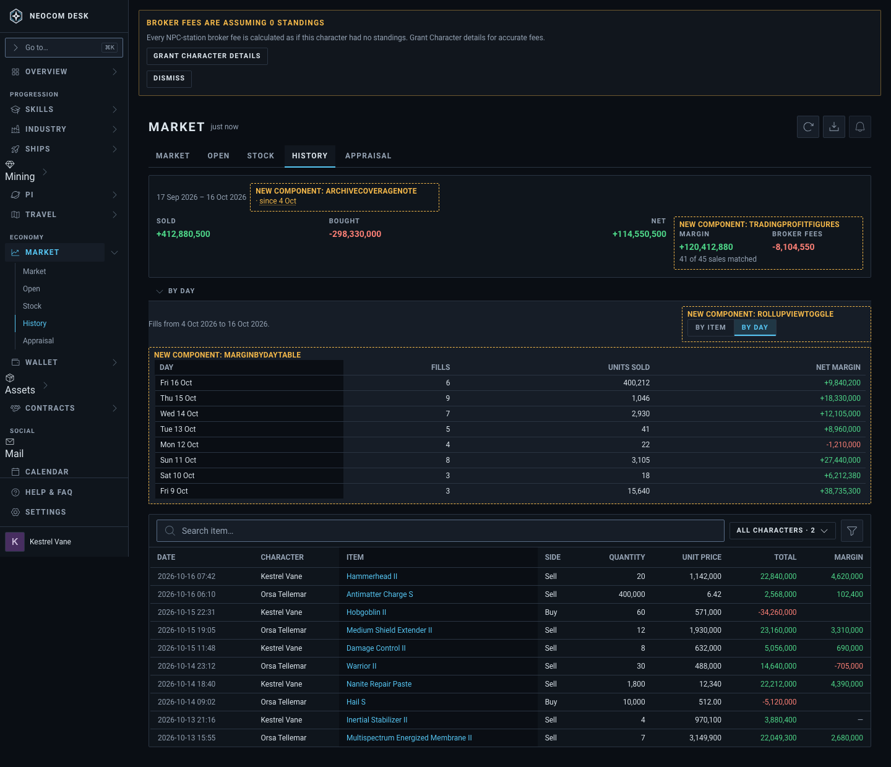

# Market › History: trading profit

Source: `src/mockups/MarketHistoryTradingProfit.stories.tsx` (`mockups-markethistorytradingprofit--proposed`, `--proposed-by-day`, `--proposed-phone`). Sample data; the ticket text wins over the picture.

New components: `TradingProfitFigures` (Margin and Broker fees in the strip), `ArchiveCoverageNote` ("since 4 Oct"), `RollupViewToggle` (By item | By day), `MarginByDayTable`. The Character filter is the existing `CharacterFilterControl`, new to this page (History has none today). Everything else is `src/components/ui` primitives and the page's own strip and rollup markup.

"Today" is the same page rebuilt with the sample fills (`--today`): no seeded History page story exists.

| | 1440 | 390 |
|---|---|---|
| Today (`--today`) |  |  |
| Proposed, By item |  |  |
| Proposed, By day |  | |
