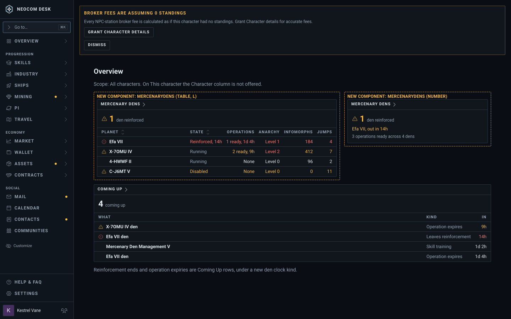
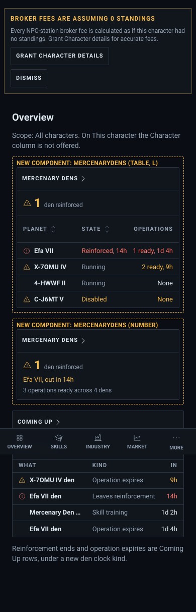
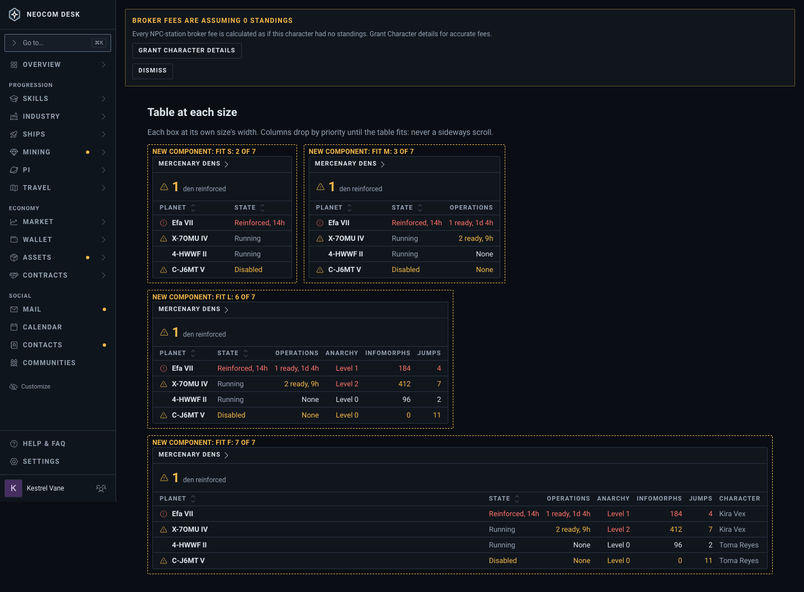
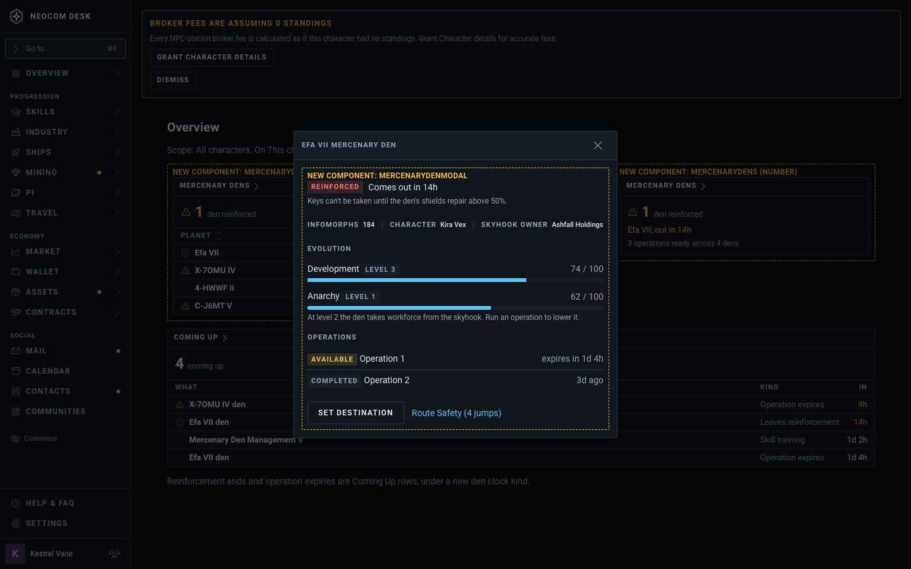
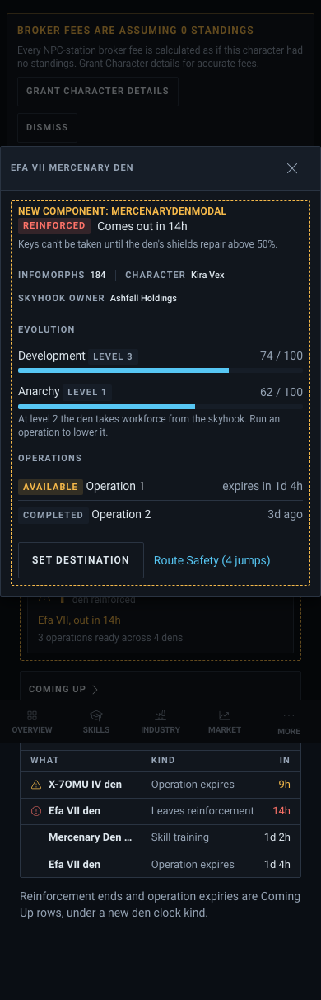

# Mercenary Dens widget (issue #4791)

First draft mockup; sample data. The ticket's text wins over the picture where they differ.

Story: `src/mockups/MercenaryDens.stories.tsx` (`mockups-mercenarydens--overview-placement`, `--overview-placement-phone`, `--table-sizes`, `--modal-detailed`, `--modal-detailed-phone`). Delete the story and this folder when #4791 closes.

## Decided (Shawn, 2026-10-23)

- **Player Overview, not the Corp Board.** ESI serves dens per character only (no corp route, no corp role), so the widget follows the header's This character / All characters scope. Den clocks feed the header's Next button (the Calendar's merged clocks are a follow-up ticket).
- **Detailed row modal** (the Compact option is dropped).
- **The table never scrolls sideways**, at any widget size or screen width.

| State | Desktop (1440) | Phone (390) |
|---|---|---|
| Overview: Table (L), Number (S), Coming Up beside it |  |  |
| Table at S, M, L, Full |  | (every size is full width on a phone: see the Overview) |
| Detailed row modal |  |  |

## Table: width-fit columns

The table keeps the columns that fit its own box and drops the rest by priority. Planet always stays; then, kept longest first: State, Operations, Anarchy, Infomorphs, Jumps, Character.

| Box | About | Columns |
|---|---|---|
| S | 270px | Planet, State |
| M | 360px | + Operations |
| L | 550px | + Anarchy, Infomorphs, Jumps |
| Full | 1120px | + Character |
| Phone, any size | 350px | Planet, State, Operations |

Counts are for a 1440 desktop. The build measures the box, so it holds at every width.

**Build note:** today's widget table can't do this. `visibleColumns` gives S 2 columns, M 4 and L all, and `hideNarrow` hides a column under 28rem. An L widget at 1024 or on a phone would still scroll sideways. The build adds width-fit to `TableBody`: measure the box (ResizeObserver) and drop by `priority` until the row fits. Make it opt-in on the `TableModel` so other widgets don't change.

Character shows only on All characters. State text stays short ("Reinforced, 14h") so it fits next to Planet.

## Row modal (Detailed)

- **Title:** planet, then "mercenary den".
- **State:** a pill and the reinforcement countdown. When it is reinforced, a line says keys can't be taken until shields repair above 50%.
- **Readouts:** infomorphs, character, skyhook owner.
- **Evolution:** Development and Anarchy, each a level and a 0–100 bar. The Anarchy note says level 2 takes skyhook workforce and an operation lowers it.
- **Operations:** state pill and expiry (or "ago" once done).
- **Actions:** Set destination (ESI write, dimmed offline per §6c) and Route Safety with jumps from the Current System. No Dotlan link (#4775 ruling).
- Opens from a row click, so names in the row are plain text (§6c restraint). Needs the row-open hook from #4774 (open).

## Number view

Reinforced dens first ("1 den reinforced", the next one under it), with ready operations as a note.

## ESI facts (verified against the 2026-05-19 compatibility-date OpenAPI spec)

- `GET /characters/{id}/structures/mercenary-dens` returns `[{id, planet_id}]`. Scope `esi-structures.read_character.v1`, cache 1h.
- `GET /characters/{id}/structures/mercenary-dens/{den_id}` returns, with the same scope and cache:
  - `state`: Running, Paused (e.g. reinforced) or Disabled (skills lost).
  - `infomorphs.amount`.
  - `evolution.development` and `.anarchy`: `level` Level0–Level4, `amount` 0–100.
  - `reinforcement_timer.end` (optional).
  - `skyhook.{id, planet_id, corporation_id}`.
- `GET /characters/{id}/mercenary-tactical-operations` and `/{op_id}` return `state` (Available, Started, Completed, Expired, Removed), `expires`, `mercenary_den_id` and `dungeon_type_id`. Scope `esi-activities.read_character.v1`, cache 5m.
- Notifications exist: `MercenaryDenAttacked`, `MercenaryDenNewMTO`, `MercenaryDenReinforced`.
- **ESI does not send:**
  - storage capacity or fill
  - production rate
  - shield or armor percent
  - last emptied
  - attacker
  - den name
  - system id (planet only, so it needs a universe lookup)
  - any corp-wide list
- **Both scopes join the login set** in the default-on `planets` Permission, not an opt-in group. A Character that logged in before gets the widget's Grant access state until it logs in again.
- Den detail is an hour-old read, so countdowns under an hour say "Under 1h".

## Game facts behind the columns (EVE University wiki, Revenant notes)

- One den per temperate-planet skyhook, up to 5 per character (Mercenary Den Management skill).
- A den is reinforced once: a 24h timer with a 6h random window. Keys can't be taken until shields repair above 50%.
- A destroyed den drops about half its keys, so players are told to empty dens often.
- Anarchy rises over time. At level 2 the den takes workforce from the skyhook. Operations lower it.

## Built (PR for #4791) and still open

- **Built:** the widget (Number and Table), width-fit columns, den clocks in the header's Next. Rows link to Route Safety for now.
- **Open:** the Detailed row modal waits on the row-open hook in #4774. Den timers on the Calendar's merged clocks are their own ticket.

- Whether to read the den notifications for alerts (own ticket later).

## Borrowed from Mobbin

- **Modal:** [Quicken item modal](https://mobbin.com/screens/9e37d040-add1-4db0-9ccf-5b3cdfda3516) (status pill by the title, history list) and [Gumloop detail panel](https://mobbin.com/screens/9e26963f-4fec-414c-bcea-cf8c993b2959) (a labelled progress bar among readouts).
- **Table:** [Fresha form requests](https://mobbin.com/screens/d59eca09-4329-4287-a79b-7abacf974d54): status carried by a toned cell, not an extra column.

## Known drift between the picture and the build

- **Fixed counts:** the size story picks each column count by hand for 1440. The build measures.
- **Row tint:** a critical row tints every cell after the first, so Efa VII's "Level 1" and "184" read as alarms. That is the shipped shell's styling.
- **Stand-in kinds:** `planetary` and `comingUp` only supply the widget shell. The real kind is new.
- **Mockup labels:** the dashed "New component" frames do not ship.
- **Phone modal:** it shows as a centred dialog here. The build uses the sheet placement.
- **Banner:** the amber shell banner is the Storybook fixture.
