# Moon owners: miner links, refinery page, Archive

First draft mockup; sample data, all names invented. Issue #6298. Story source: `src/mockups/MoonOwnerArchive.stories.tsx` (title `mockups/MoonOwnerArchive`). Dashed amber boxes mark pieces that are not existing components. The shell's "Grant character details" banner in the shots is sample noise, not part of the proposal. The ticket's text wins over the picture where they differ. The Moons page is #6299 and not designed here; the station page only links to it.

Today (`MoonOwnerPage`): 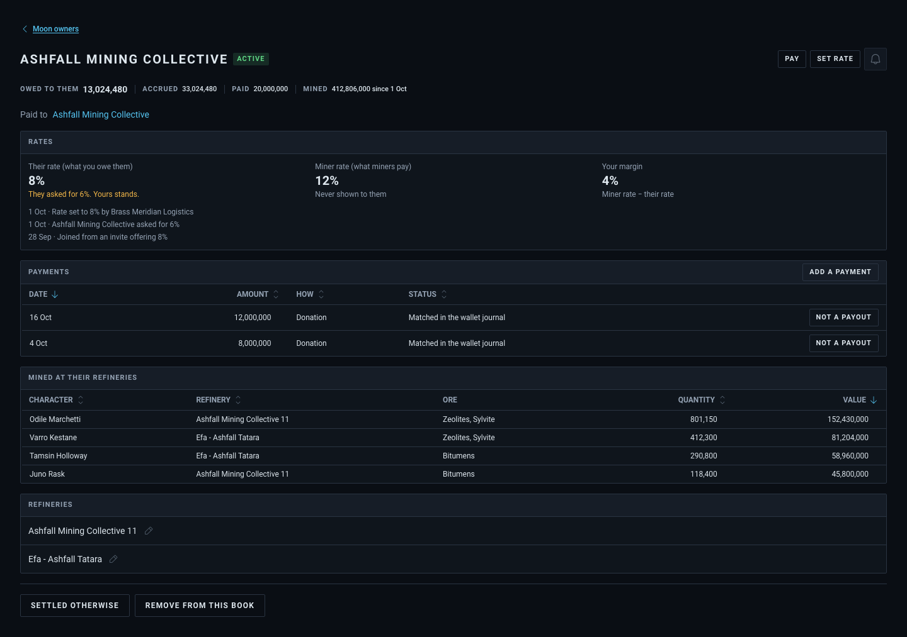 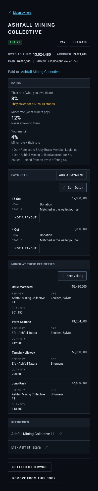

## Today vs proposed

| Area | Today | Proposed |
|---|---|---|
| Miner in "Mined at their refineries" | Plain text, dead end | Accent entity link to Miner detail (A), or whole row navigates with a trailing caret (B) |
| Refinery row | Name + faint pencil; nothing opens | Name is an accent link to the refinery's page; pencil stays; one dim meta line (moon, Extractions, last mined) |
| Refinery page | None | Header (name, pencil, Archive), facts strip (moon link, Extractions, last Extraction, mined), Extractions table, Mining history by month |
| Gone refinery | Stays in the list forever | Amber hint pill; Archive on its page (A) or also on the row (B) |
| Archived | None | Collapsible "Archived (N)" under Refineries: when, who, why, Restore. Archived page keeps everything readable with a Restore button |

## Decisions
- **Miner link: A, name link.** §6c Entities: a clickable entity name is accent at rest; a column is all links or none; secondary cells (refinery, ore) stay text. The Mined rows have no other action, so the name may be the link. It goes to Miner detail (a page override of Show info, as on Miners tab rows), not Show info.
  B (row navigates + caret) is §6c-valid too but the caret floats mid-card on a phone and the table has no other reason to be clickable.
- **Refinery rows: name link + pencil kept.** Moving rename into the page costs a click for the common edit. A row-wide link with caret was rejected: the pencil would sit inside a link, and a caret beside a control cluster is redundant (§6c).
- **No ⋮ anywhere.** The row's actions are Rename (visible pencil, duplicate) and Archive: not two real actions, so §6c says no menu.
- **Archive control placement (real choice).**
  - **A (recommended): Archive lives on the refinery page header.** Ghost button normally, accent when the offer rule fires, with a hint strip saying why. The list row only carries the amber pill. One home, no extra control per row, and the confirm can name what stays.
  - B: also a text action "Archive" on the offered row. Faster for a clean-up pass over several gone refineries, but it adds a control to rows that mostly never need it, and a mis-tap hazard next to the pencil on a phone.
- **Confirm is plain.** One dialog: "It leaves the list... Extractions, mining rows, labels and Late notices stay. Restore any time." No typed confirmation: it is reversible.
- **Archived section.** Collapsed by default when it has rows; officers who can edit always see it, even at 0, with one line of advice (so Restore has a home). A viewer who cannot edit sees it only when non-empty. Archived refinery page: banner + Restore replaces Archive.
- **Archived refineries leave the default list and the Mined table's refinery filter, but their mining rows still count in every figure.** Archive hides; never deletes.

## Archive-offer rule (pick one, write it in `docs/context/decisions/`)
Archive by hand is always allowed for an officer from the refinery page. The rule only decides when the page *offers* it (amber pill, hint strip, accent button).

| Option | Offers when | For | Against |
|---|---|---|---|
| R1 | ESI shows the structure gone (not found / absent from the corp's structures) | Precise | Needs the structure read; with the names grant missing it never fires |
| R2 | No Extraction and no mining for N days (60) | Works from the book's own data | A paused Athanor looks gone; false offers |
| **R3 (pick)** | R1, or R2 with N = 60 | Covers both: "Gone in the game" when ESI says so, "No Extraction in 71 days" otherwise | Two pill wordings |

## New components
- `StationDetail`: a refinery's own page (builds from Panel, StatChip(s), DataTable, Pill).
- `ArchivedSection`: CollapsiblePanel + rows with Restore.
- `OfferPill`: amber Pill with the reason.

Existing primitives used: PageHeader, Panel, DataTable, CollapsiblePanel, Pill, StatChip(s), IconButton, ConfirmDialog, entityLinkClassName.

## Open questions
- If a refinery is archived and mining shows up there again, auto-restore or leave it archived?
- Thresholds: 60 days idle OK? Does an archived refinery still show in Pop sharing and the Calendar? (Proposal: no pops are shown for it.)
- Route of the refinery page and the Moons page link target (#6299).

## Screens
| View | 1440 | 390 |
|---|---|---|
| Miner link A: name link (recommended) | 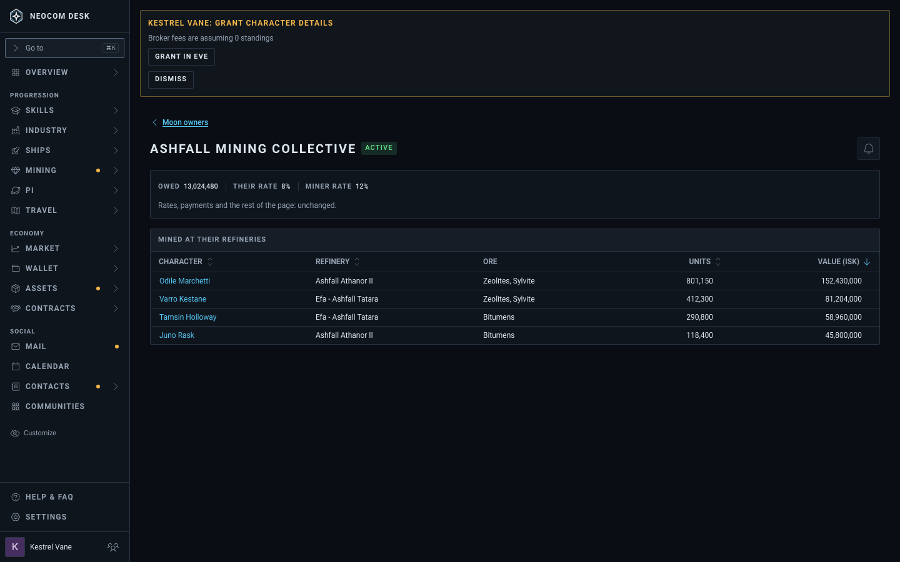 | 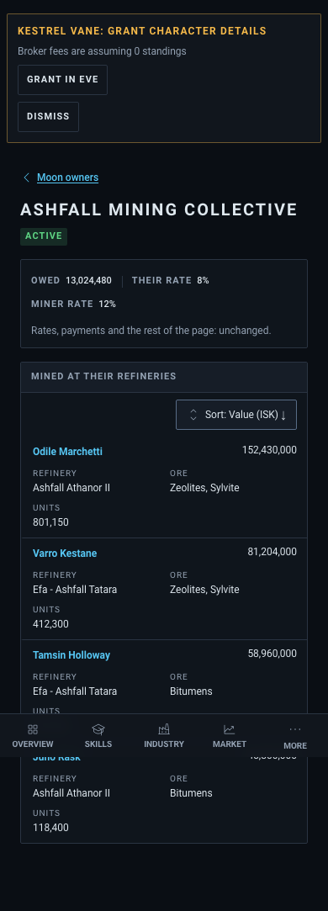 |
| Miner link B: row + caret | 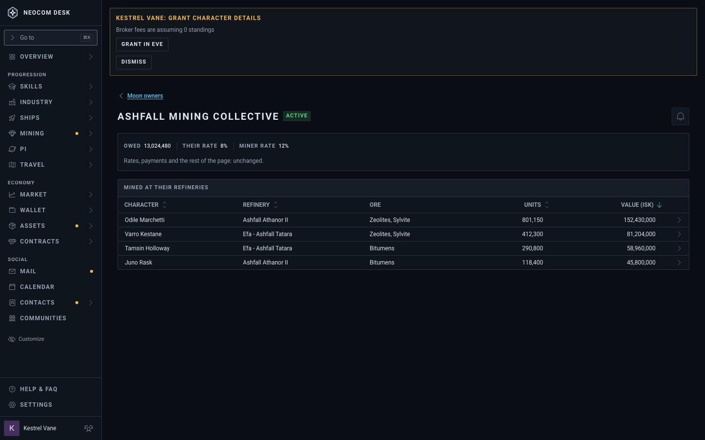 | 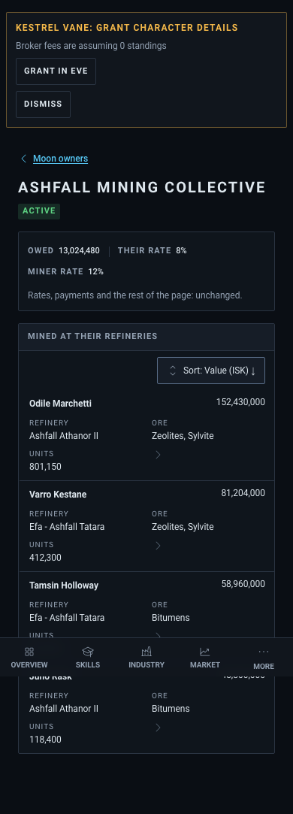 |
| Refineries A: detail-only Archive (recommended) | 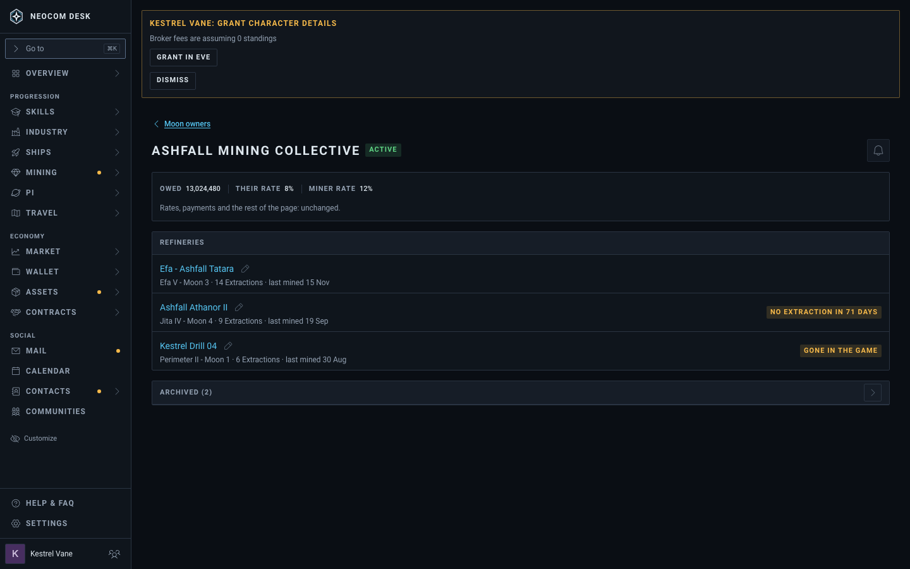 | 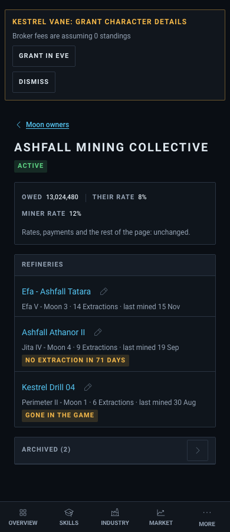 |
| Refineries B: row Archive action | 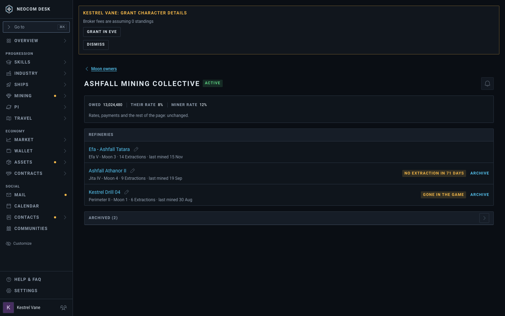 | 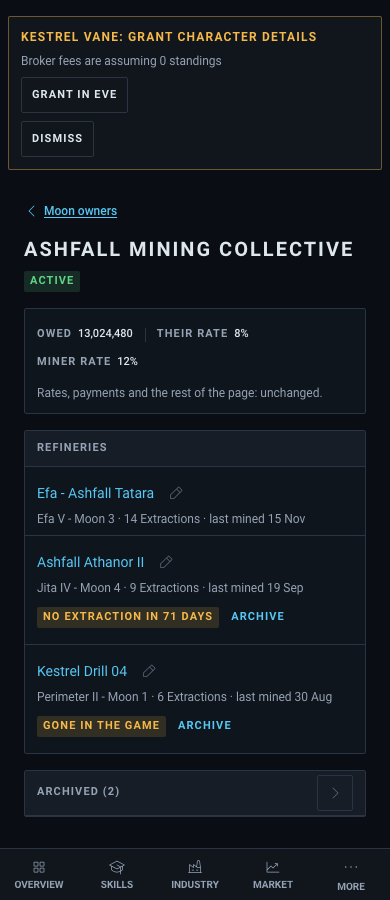 |
| Refinery page | 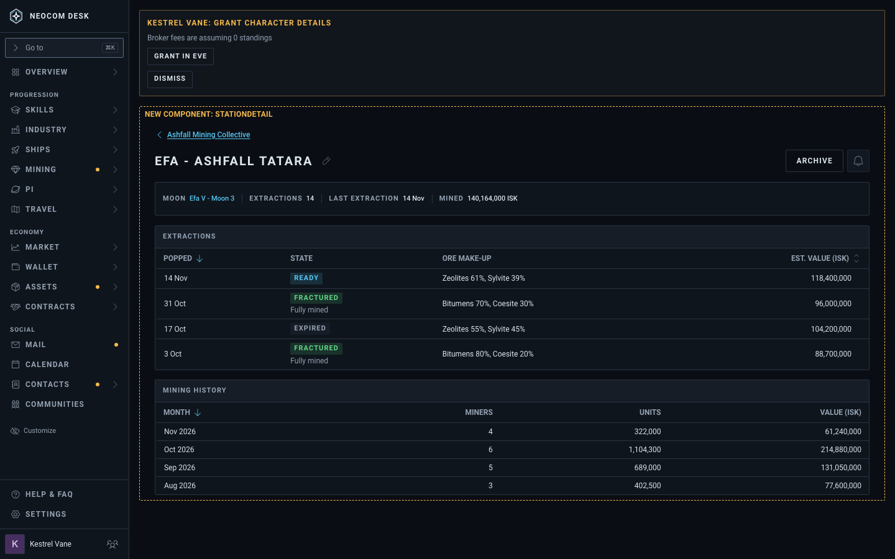 | 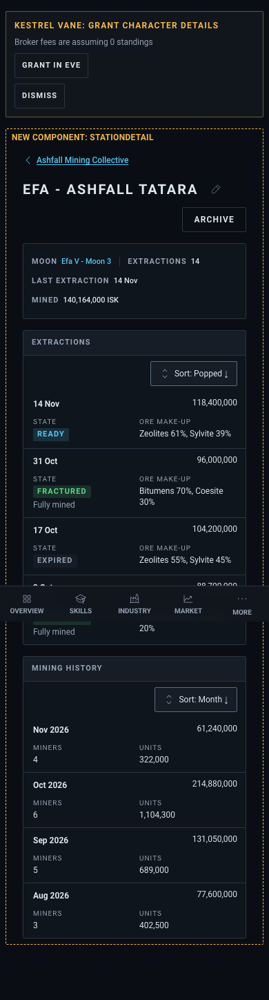 |
| Refinery page, offered | 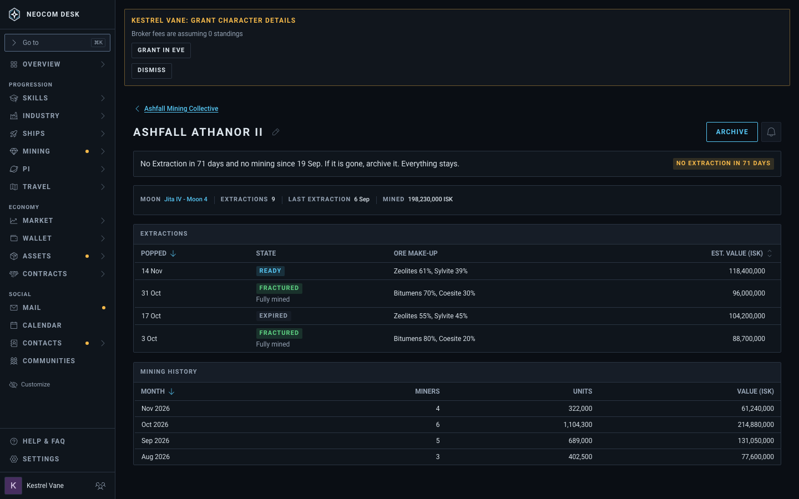 | 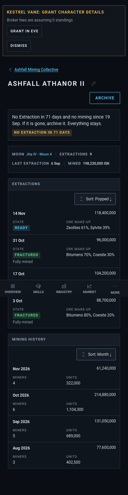 |
| Archive confirm | 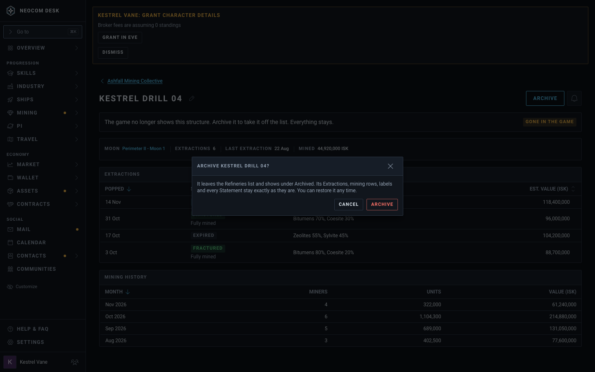 | 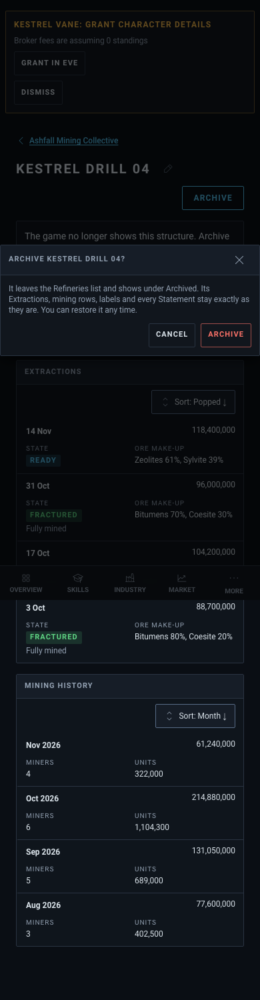 |
| Archived section open | 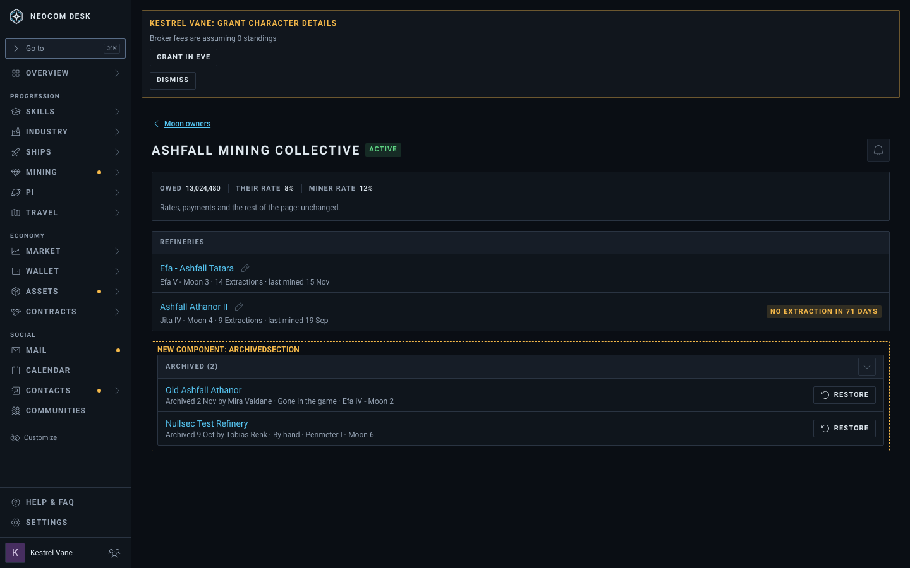 | 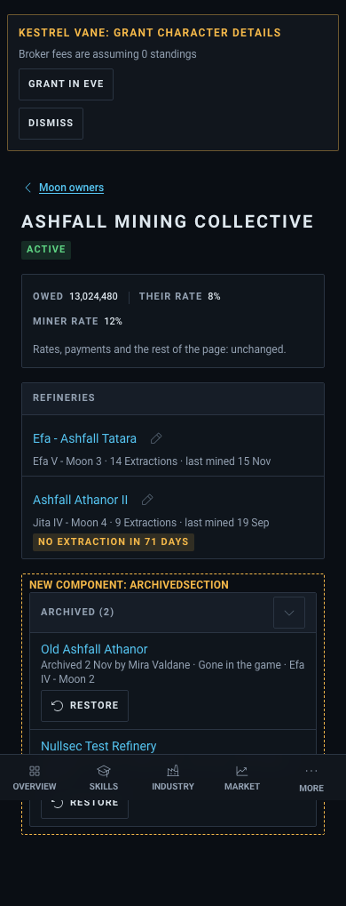 |
| Archived empty | 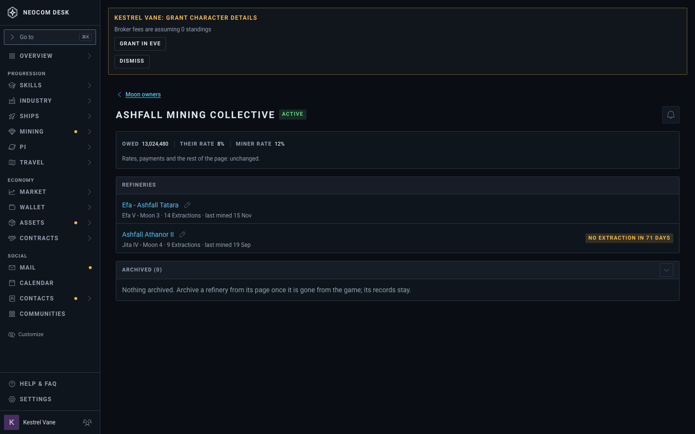 | 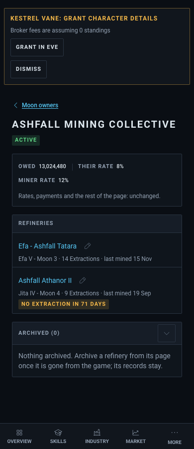 |
| Archived refinery page | 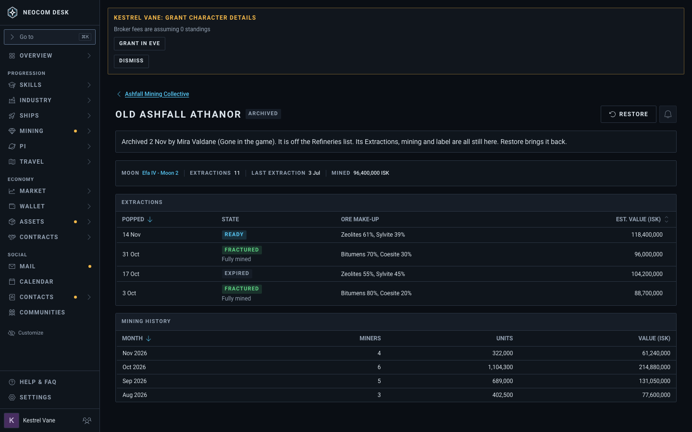 | 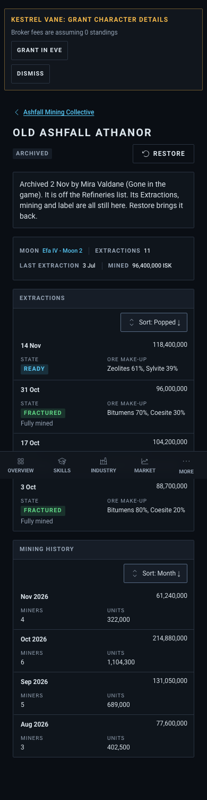 |
