# Moons: Add my other corps

First draft mockup; sample data, all names invented. Story source: `src/mockups/MoonsAddCorps.stories.tsx` (title `mockups/MoonsAddCorps`). Dashed amber boxes mark pieces that are not existing components. Use these to check the build against, and to walk a non-technical CEO through the flow.

**The job:** a CEO who owns many alt corps (one per Athanor, to dodge war decs) gets every corp's moons into the main corp's tax book: no invite links, no switching characters. Each corp is a moon owner of the main book; corps whose CEO character is on his account are marked **Yours** (no owner rate, no payouts).

**Decisions behind the screens**
- Entry: an **Add my other corps** button on the Moons page, plus a one-time "New corp found" banner. Never auto-connects. **Don't ask again** hides a corp; it comes back from **Hidden corps**.
- The picker lists every corp where an account character is CEO, nothing ticked. The app cannot see moons before a sign-in, and asks for no extra permissions.
- One combined confirm, one **How far back?** for the whole batch (From today by default, up to 30 days; EVE keeps about 30). Older mining is out of scope.
- One EVE sign-in per corp, run as a guided sequence ("Corp 4 of 12"). A failed sign-in is skipped and never blocks the rest.
- Statuses: Ready, Connected, Needs sign-in, Needs a role, Has its own book (fix: Move it into this book), Gone quiet (fix: Remove; keeps past records).
- Held for later: corp switcher and an "All my corps" view.

New components: `NewCorpBanner`, `PickCorps`, `ConfirmBatch`, `SignInSequence`, `CorpStatusList`, `HiddenCorps`.

| Step | 1440 | 390 |
|---|---|---|
| Entry: header button and New corp found banner | 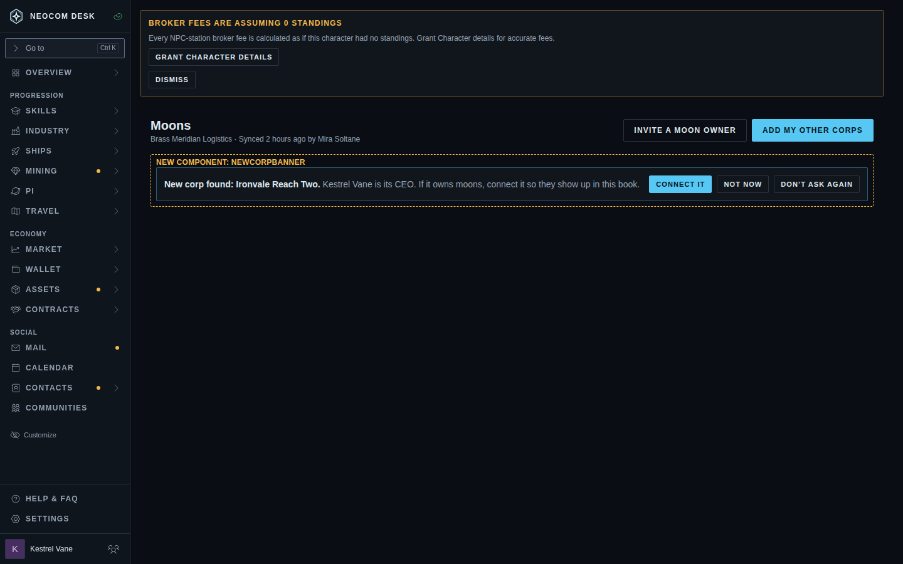 | 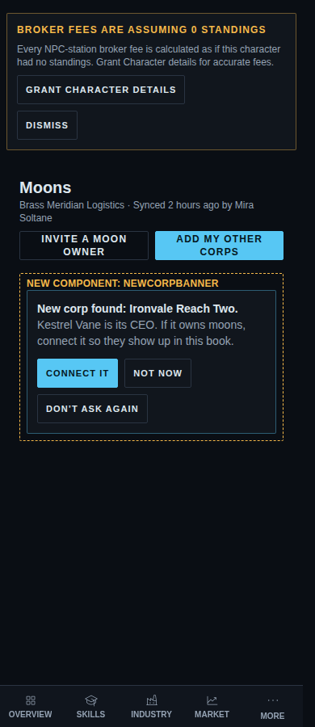 |
| 1. Pick corps (two hidden) | 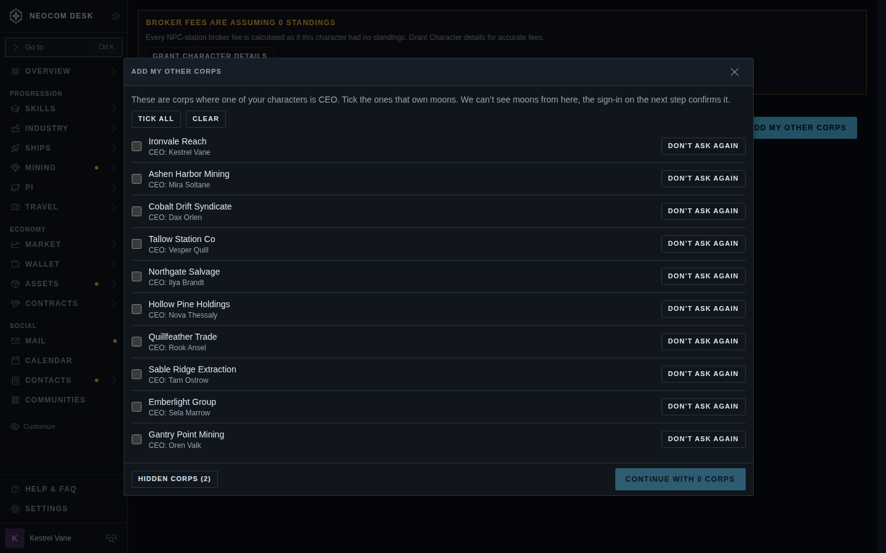 | 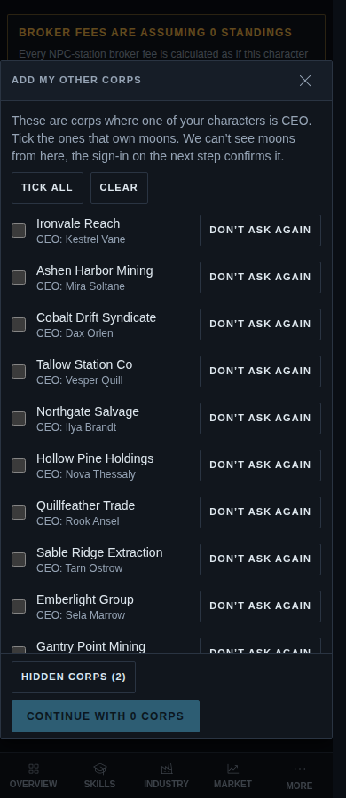 |
| 1. Pick corps, ten ticked | 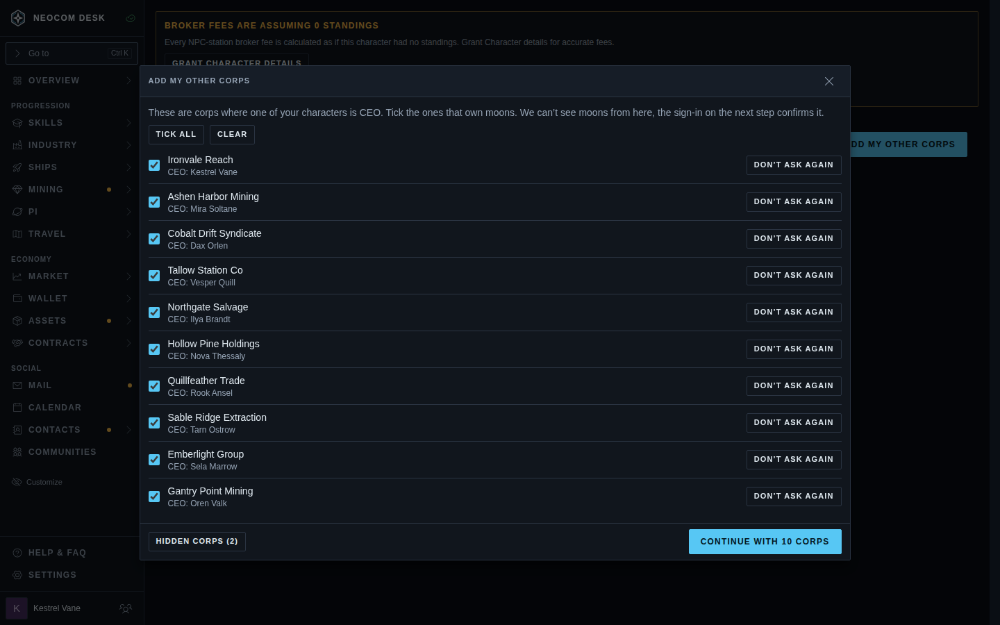 | 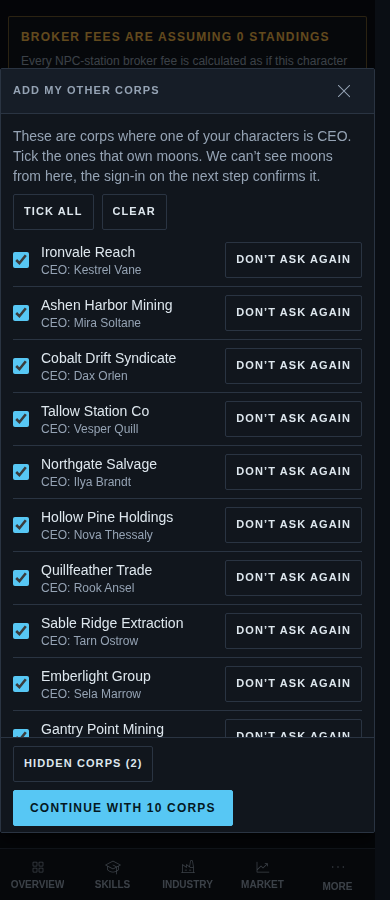 |
| 2. One confirm, How far back | 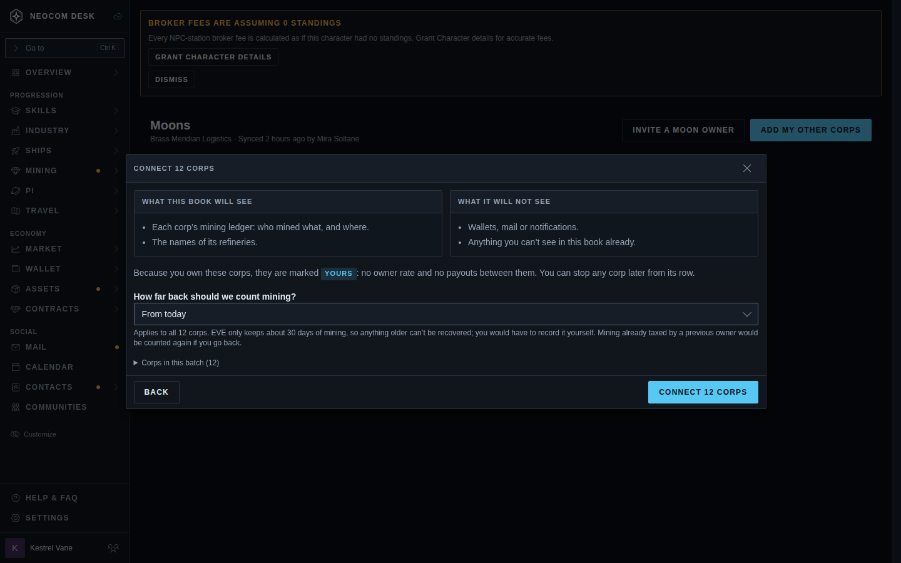 | 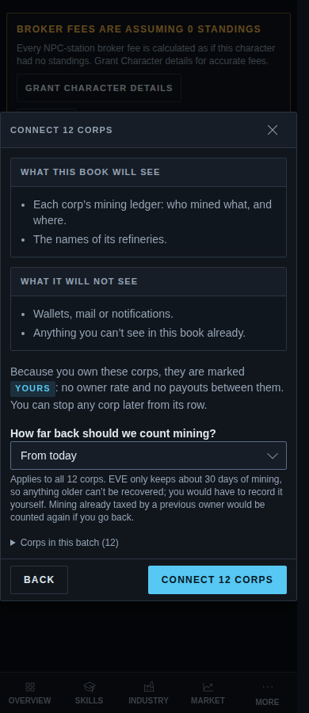 |
| 3. Guided sign-in, corp 4 of 12 | 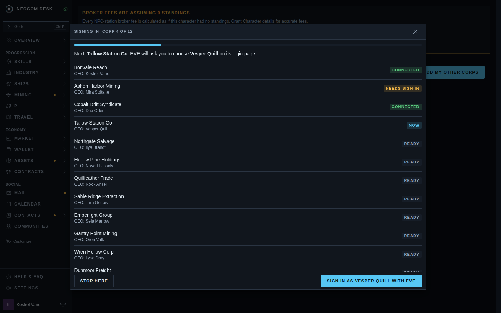 | 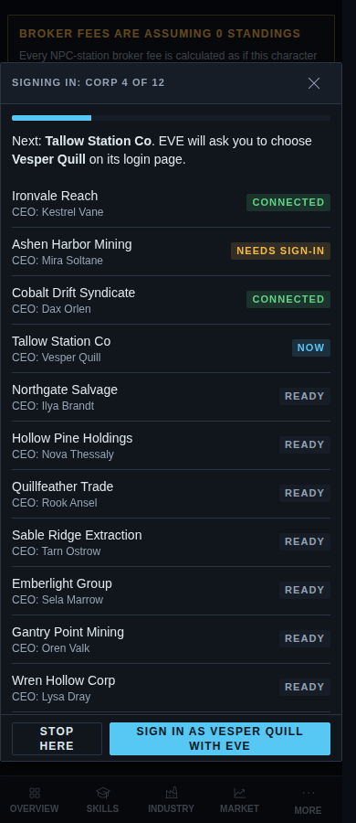 |
| 4. Result: Needs you, then Moon owners with Yours | 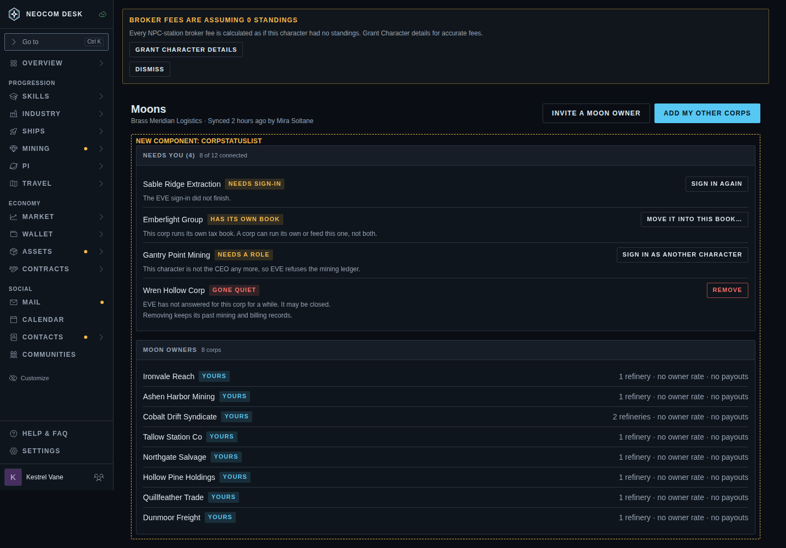 | 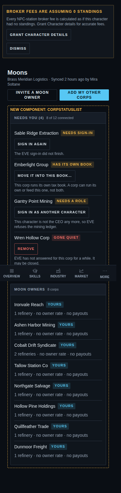 |
| Hidden corps | 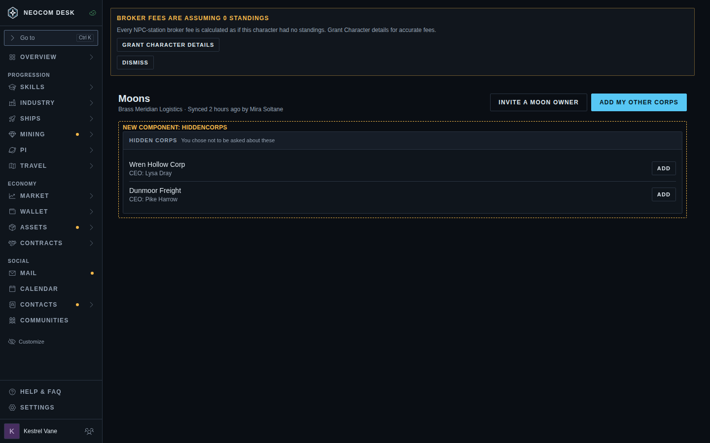 | 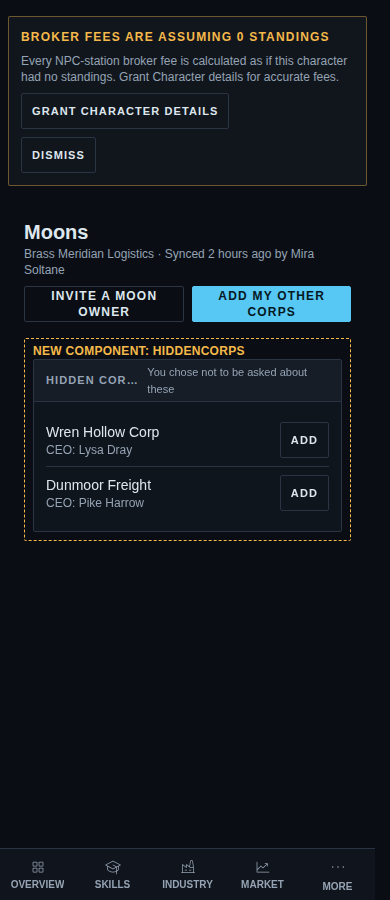 |
