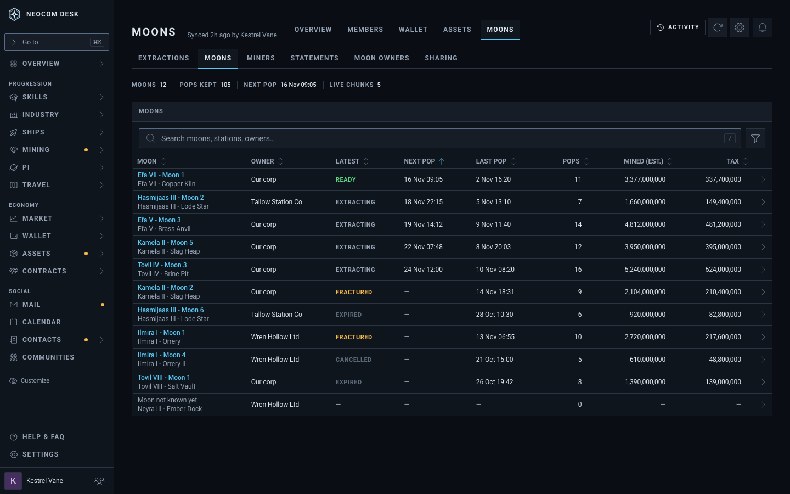
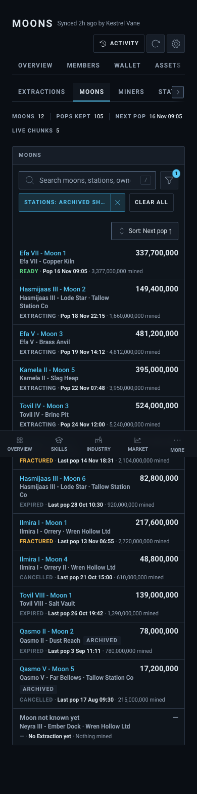
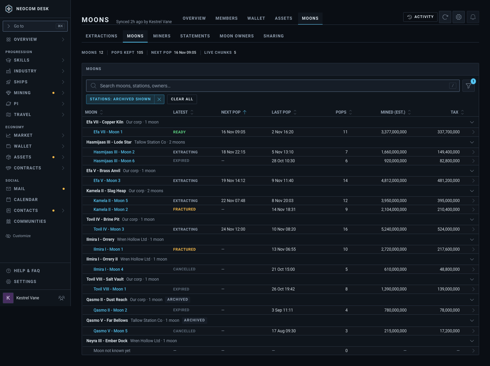
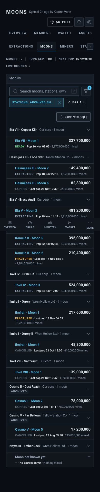
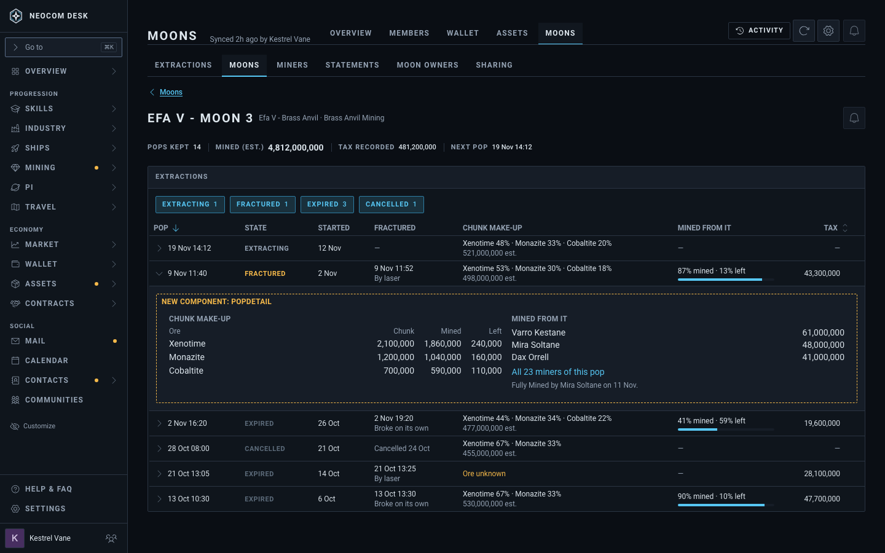
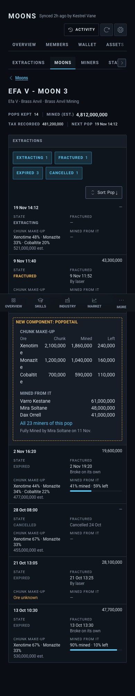
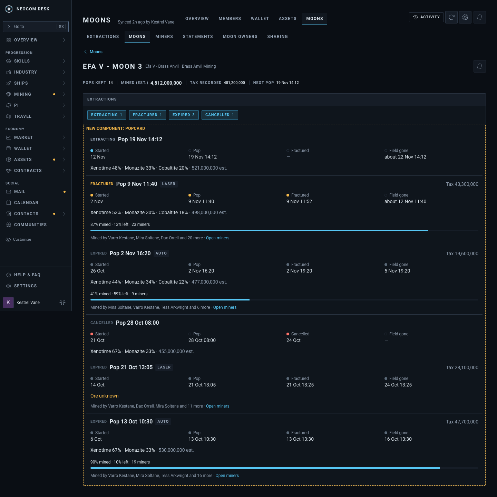
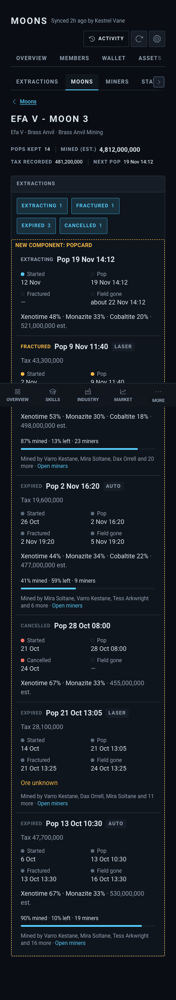
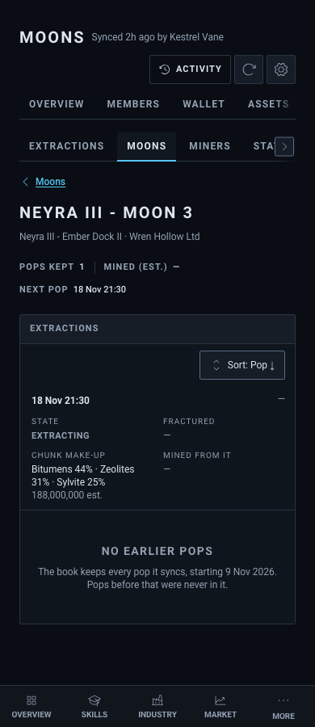

# Moons: all-moons page

First draft mockup; sample data, names invented. Issue #6299. Stories: `src/mockups/MoonsAllMoons.stories.tsx` (title `mockups/MoonsAllMoons`; ids `mockups-moonsallmoons--list-a`, `list-b`, `list-a-archived`, `moon-a`, `moon-b`, `empty-history-story`, `links-in`, each with a `-phone` twin). The ticket's text wins over the picture where they differ.

**The job:** one list of every moon the book knows (own corp, moon owners, archived stations). Opening a moon shows every Extraction the book ever synced, future and past, with start, pop, fracture time, chunk make-up and what was mined from it.

## Today vs proposed

| | Today | Proposed |
|---|---|---|
| All moons | No list. A moon exists only as one Extraction's page. The Extractions tab lists pops, not moons. | New **Moons** tab after Extractions: one row per moon (list A or B). |
| Moon page | `/corp/moons/extractions/:id` shows one pop, with earlier cycles folded in a closed "Past" section (state, est., mined %, tax, miners). | `/corp/moons/moons/:id`: every pop in one list, newest first. A row opens to its chunk make-up vs mined per ore and who mined it. |
| Past pops | Fractured date only; no start, pop or fracture method; cancelled and unknown-ore cycles are hard to read. | Start, pop, fracture time and how (laser or broke on its own), field gone, cancelled date, make-up, mined %. |
| Archived stations, moon owners | Not reachable. | Owner filter and an **Archived stations** chip (hidden by default). |
| Empty history | A closed Past section reading "no other cycles". | One live pop plus the reason nothing earlier exists. |

| View | 1440 | 390 |
|---|---|---|
| List A: flat sortable table |  |  |
| List A, Archived stations on, plus a refinery with no Extraction yet |  |  |
| List B: folded under refinery |  |  |
| Moon A: table, Fully Mined pop opened |  |  |
| Moon B: one card per pop with its own timeline |  |  |
| Empty history |  |  |
| Links in: Extractions rows and Moon owner page |  |  |

## Decisions

- **Own tab, not a mode of Extractions.** The Extractions tab answers "what is popping"; this answers "what do we know about this moon". A tab is one more entry in the existing `Tabs` (no new primitive).
- **A moon row's click opens the moon page** (a real link ending in the trailing caret, §6c). The name is the accent handle, no ⋮ (no two real actions to hold). The page's crumb is a labelled "Moons", never a bare chevron.
- **Reuse `MoonDetail`**: its header facts, Fully Mined panel, Who mined it and Survey link move onto the moon page; its closed "Past" section becomes the Extractions list. The old `/extractions/:id` URL redirects to the moon page with that pop opened (keeps shared links and the pop-sharing links alive).
- **Archived stations** are a filter chip, default off, with a count. Their rows carry an Archived pill.
- **A refinery with no Extraction yet** shows as "Moon not known yet" (decision 20261115-173527: a moon is known from its first Extraction). Its page, if opened, would show the refinery only.
- **Empty history** says why: the book keeps every pop from its start (`Pops before that were never in it`). No action button: nothing to do.
- **State chips** (Extracting, Fractured, Expired, Cancelled, with counts) hide when a moon has one pop.
- **Phone:** the list uses dense cards (Tax in the corner; owner, last pop and pop count drop to the moon page); moon A uses labelled two-column cards; moon B stays cards.
- **Data:** the list reads the server read models (#5247) one row per moon; a moon page reads that moon's pops only. Nothing loads the full ledger.

## Links in (§6c Entities)

Moon names in other lists link here. §6c says a name inside a row with its own click is not a second link, so:

- **Moon owner page** (moons table has no row click): the name is a real `<a href>` to the moon page.
- **Extractions tab** (row click): the row now opens the moon page with that pop opened. The name stays the accent handle.
- **Sharing tab, Miner pages, Statements:** a moon name that stands alone is a real link; inside a row with its own click it is not.

This is a recorded page override: add to the Entities table or a scope decision at build time.

## Variants and recommendation

**List** (real choice: how a moon is found)
- **A, flat table (recommended).** Station under the name, Owner column, sortable by next pop or mined. Scales to hundreds of moons, exports, and "every moon in one list" is literal. Weak spot: a refinery's moons sit apart unless sorted by name.
- **B, folded under refinery.** Good when a refinery holds many moons; here most hold one, so the folds add rows and lose the Owner column. Folds are open by default.

**Opened moon** (real choice: how a pop is read)
- **A, table with expandable rows (recommended).** Same shape as every other book table, sortable, compact at 57+ pops, make-up and miners one tap away, matches today's MoonDetail tables.
- **B, card per pop with Started / Pop / Fractured / Field gone timeline.** Reads best for 5 to 10 pops and shows the lifecycle at a glance; runs long at scale (one card each, ~200px) and cannot sort.

**Recommended pick:** List A + Moon A.

## New components

- **PopDetail** (Moon A): the expanded row, two columns: chunk make-up vs mined vs left per ore, and the top miners with a link to all of them.
- **PopCard** (Moon B only): the card with its four-step timeline.
- **StationHeader** (List B only): the DataTable group header for a refinery.
- A **Moons** tab and an **Archived stations** chip are existing `Tabs` and `FilterChip` items. Everything else: PageHeader, StatChips, FilterBar, DataTable, Panel, ProgressBar, EmptyState, Pill.

## Open questions

1. Is "Pops kept" the right chip and name for a moon's pop count, or should it read "Extractions" (the Glossary term)? Player-facing text above says "pop" as the Extractions tab does.
2. Should the old extraction URL redirect to the moon page (proposed) or stay as a separate page?
3. Tab position: after Extractions (shown) or last?
4. Should a moon owner (Feeder) see this page for their own moons, or officers only? Not designed here.
