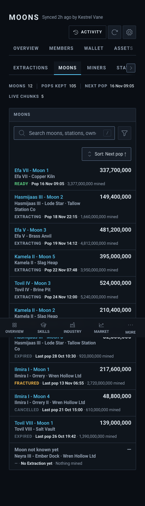
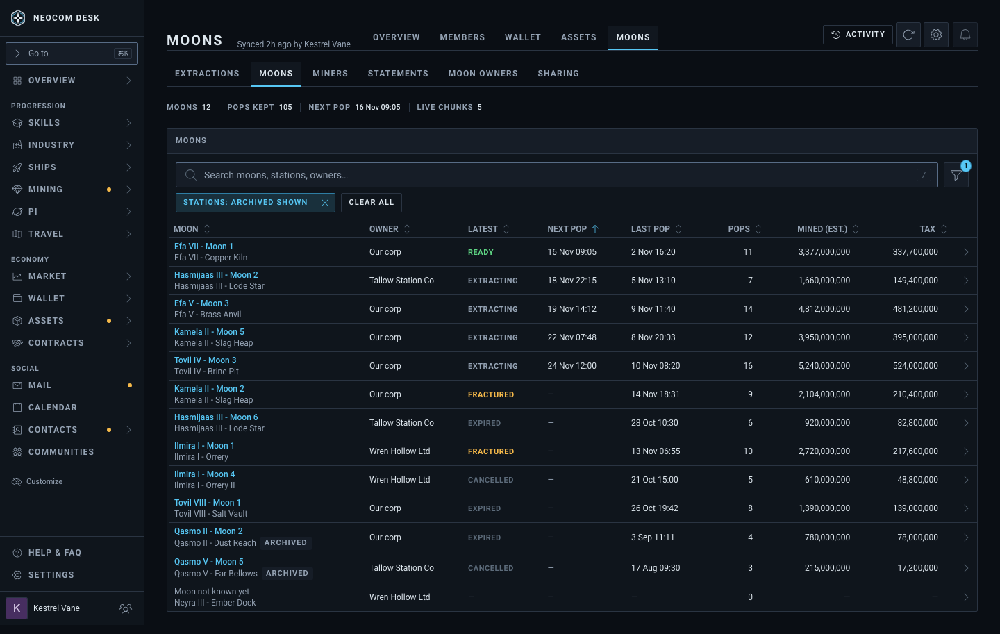
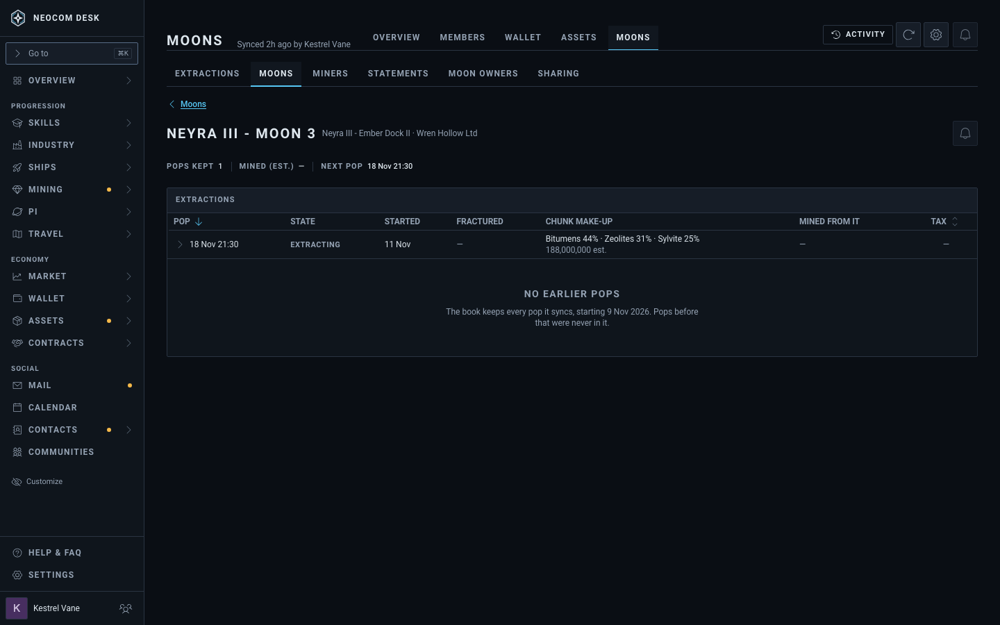
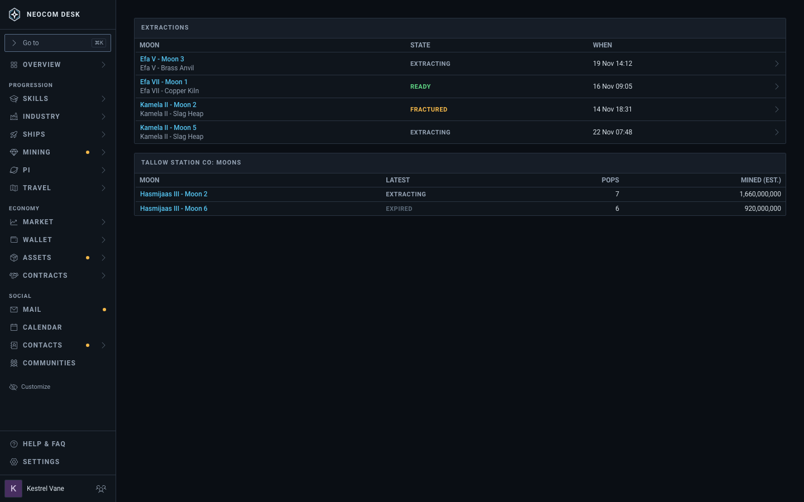
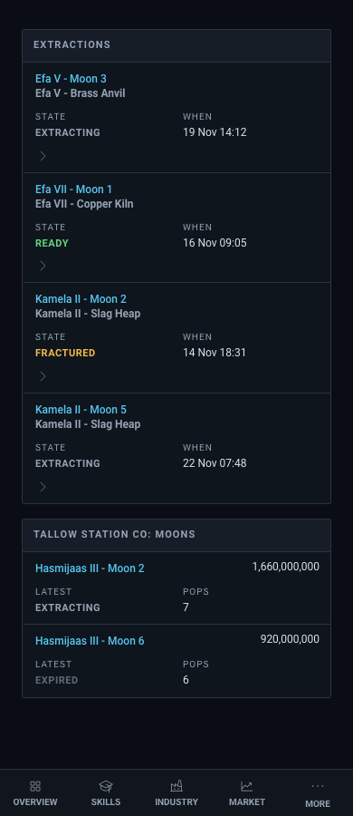

# Moons: all-moons page

Chosen by Shawn (issue #6299): **List A + Moon A**, with the changes below. Sample data, names invented. Stories: `src/mockups/MoonsAllMoons.stories.tsx` (title `mockups/MoonsAllMoons`; ids `mockups-moonsallmoons--list-a`, `list-a-archived`, `moon-a`, `empty-history-story`, `links-in`, each with a `-phone` twin). The ticket's text wins over the picture where they differ.

**The job:** one list of every moon the book knows (own corp, moon owners, archived stations). Opening a moon shows every Extraction the book ever synced, future and past, with start, pop, fracture time, chunk make-up and what was mined from it.

## Today vs proposed

| | Today | Proposed |
|---|---|---|
| All moons | No list. A moon exists only as one Extraction's page. The Extractions tab lists Extractions, not moons. | New **Moons** tab after Extractions: one row per moon. |
| Moon page | `/corp/moons/extractions/:id` shows one Extraction, with earlier cycles folded in a closed "Past" section. | `/corp/moons/moons/:id`: every Extraction in one table, newest first. A row opens that Extraction's own page (unchanged). |
| Past Extractions | Fractured date only; no start or fracture method; cancelled and unknown-ore cycles are hard to read. | Start, pop time, fracture time and how (laser or broke on its own), cancelled date, make-up, mined %, tax. |
| Archived stations, moon owners | Not reachable. | Owner filter and an **Archived stations** chip (hidden by default). |
| Empty history | A closed Past section reading "no other cycles". | The one live Extraction plus the reason nothing earlier exists. |

| View | 1440 | 390 |
|---|---|---|
| Moons list |  |  |
| Moons list, Archived stations on, plus a refinery with no Extraction yet |  |  |
| Opened moon with Extractions history |  |  |
| Empty history |  |  |
| Links in: Extractions rows and Moon owner page |  |  |

## Decisions

- **Own tab, not a mode of Extractions.** The Extractions tab answers "what is popping"; this answers "what do we know about this moon". One more entry in the existing `Tabs`.
- **List: one flat sortable table**, station under the moon name, Owner column. A moon row's click opens the moon page (real link ending in the trailing caret, §6c). No ⋮ (no two real actions).
- **Opened moon: a table of Extractions; rows do not expand.** A row click goes to the existing `/corp/moons/extractions/:id` page, trailing caret on the row. Make-up and mined % are columns. The crumb is a labelled "Moons".
- **`/extractions/:id` stays a separate page.** No redirect to the moon page, and no "Extraction opened" behaviour on it.
- **Archived stations** are a filter chip, default off, with a count; rows carry an Archived pill.
- **A refinery with no Extraction yet** shows as "Moon not known yet" (decision 20261115-173527: a moon is known from its first Extraction).
- **Empty history** says why: the book keeps every Extraction it syncs from its start. No action button.
- **State chips** (Extracting, Fractured, Expired, Cancelled, with counts) hide when a moon has one Extraction.
- **Phone:** the list uses dense cards (Tax in the corner; owner, last pop and Extraction count drop to the moon page); the moon's table uses labelled two-column cards.
- **Data:** the list reads the server read models (#5247), one row per moon; a moon page reads that moon's Extractions only. No full-ledger load.
- **Wording:** "Extractions" (Glossary term) for counts, columns and headings. "Pop time" and "Next/Last pop" stay for the Pop Time.

## Links in (§6c Entities)

Moon names in other lists link to the moon page:

- **Moon owner page** (moons table, no row click): the name is a real `<a href>` to the moon page.
- **Extractions tab** (row click): the row still opens that Extraction's page, and its moon name is a real link to the moon page. This is a recorded exception to "a row's primary action beats name links inside it"; add it to §6c's Overrides table or a scope decision at build time.
- **Sharing tab, Miner pages, Late notices:** a moon name that stands alone is a real link; inside a row with its own click it follows the Extractions-tab pattern.

## New components

None. A **Moons** tab and an **Archived stations** chip are existing `Tabs` and `FilterChip` items. Everything else: PageHeader, StatChips, FilterBar, DataTable, Panel, ProgressBar, EmptyState, Pill.

## Open questions

1. Tab position: after Extractions (shown) or last?
2. Should a Feeder see this page for its own moons, or officers only? Not designed here.
