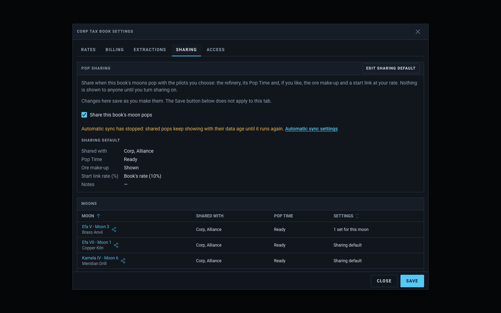
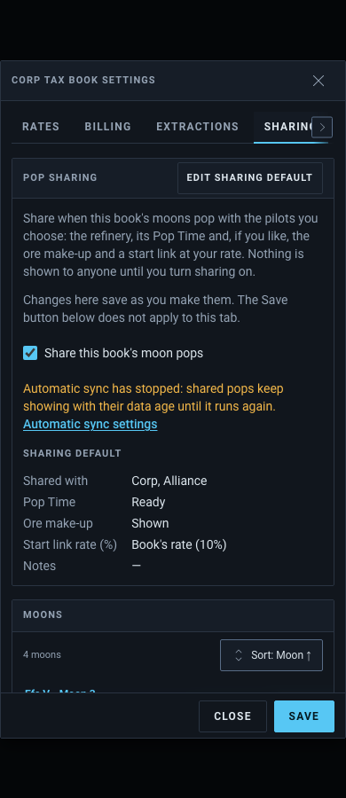
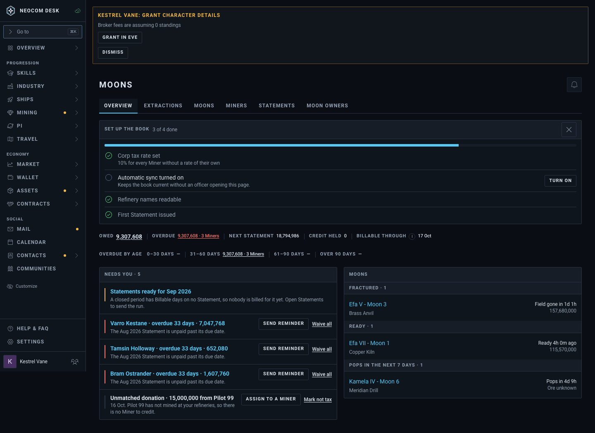
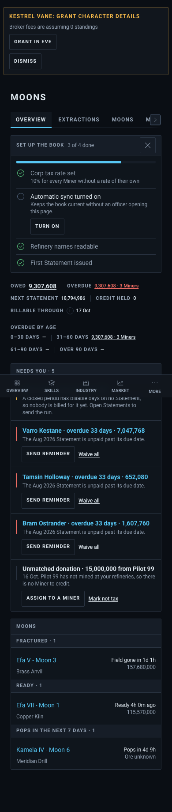
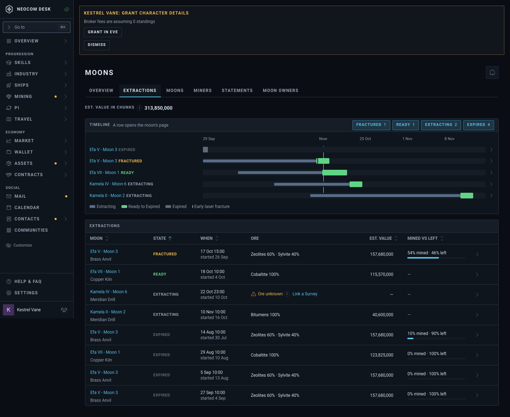
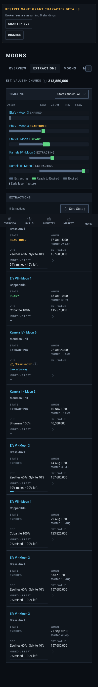

# Moons: Sharing in Moon settings, page layout (issue #6304)

Shawn delegated the design. Chosen by the agent; screenshots are the real components (Storybook), not a mockup.

## Chosen

- **Sharing is the fifth Moon settings tab** (Rates, Billing, Extractions, Sharing, Access). The long moons table scrolls inside the modal; the footer stays. The tab says it saves apart from Save.
- **Moons page keeps its layout.** Tabs drop to six. No new column.

## Layout options weighed (no mockup built)

| Option | Fixes | Verdict |
|---|---|---|
| Overview in two columns | Wide empty space on 1440 | Already so: Needs you and Pops sit side by side from `lg`. Nothing to add. |
| Extractions, Miners, Moons in two columns | Wide tables | Rejected: these are tables, they stay tables (a second column would squeeze them and break sorting). |
| Move Activity or health strip to a side column | Header clutter | Rejected: one extra persistent element for no task gain; Activity is one press in the header. |

## Implemented

| | 1440 | 390 |
|---|---|---|
| Moon settings, Sharing tab |  |  |
| Overview, no Sharing tab |  |  |
| Extractions, no Sharing tab |  |  |
