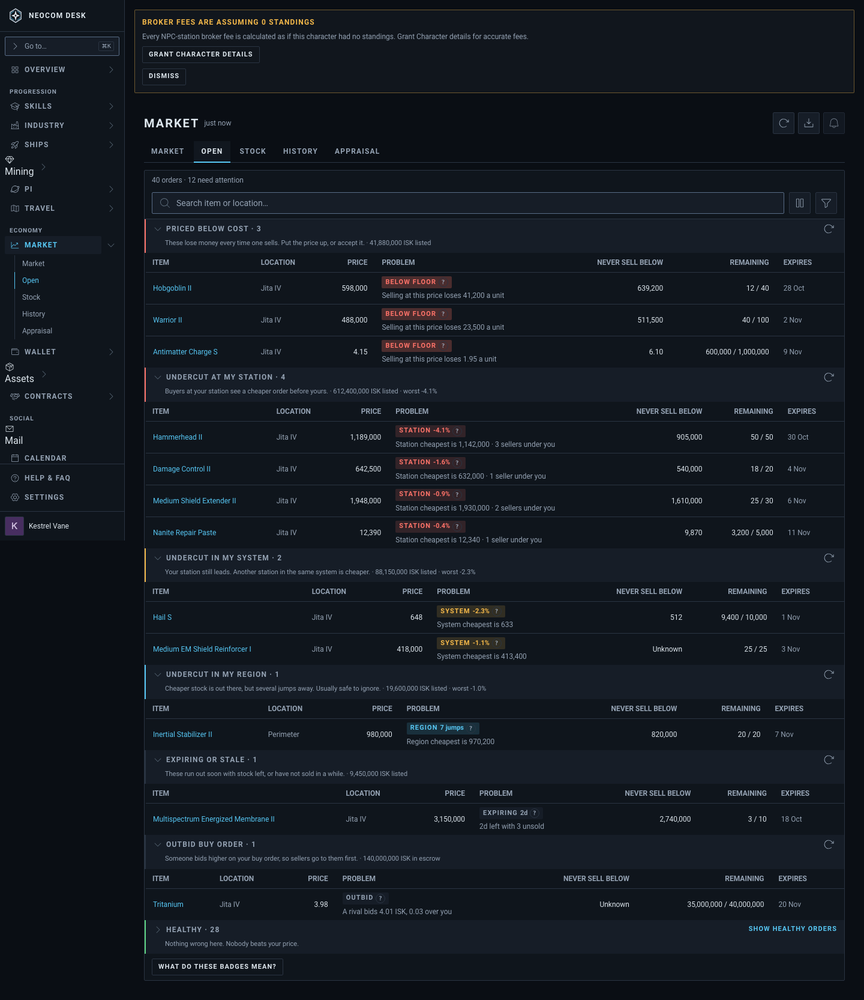
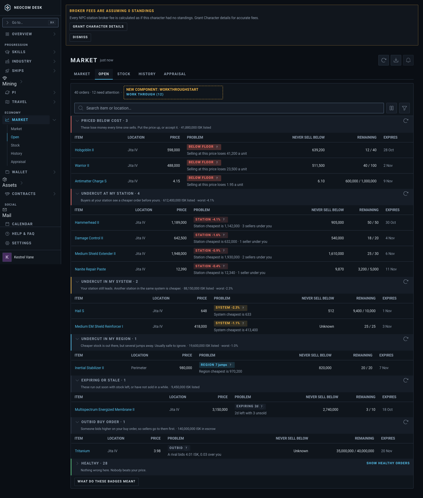
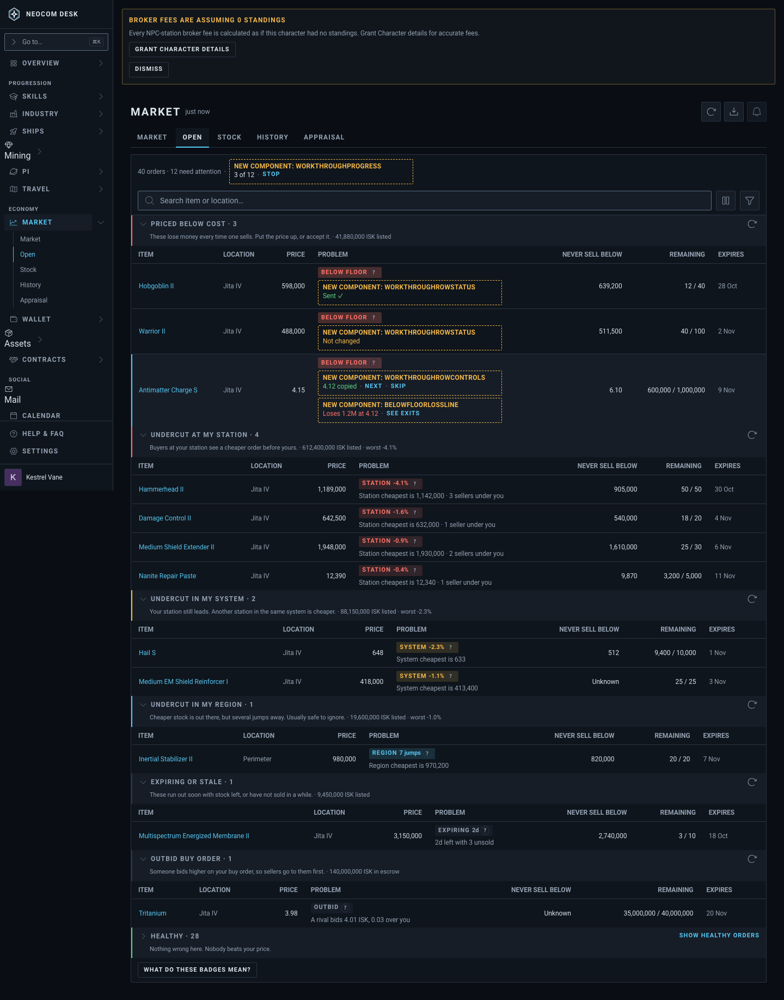
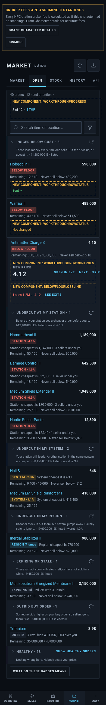

# Market › Open Orders: work-through mode

Source: `src/mockups/OpenOrdersWorkThrough.stories.tsx` (`mockups-openordersworkthrough--proposed-idle`, `--proposed-running`, `--proposed-running-phone`). Sample data; the ticket text wins over the picture.

New components: `WorkThroughStart`, `WorkThroughProgress`, `WorkThroughRowControls`, `WorkThroughRowStatus`, `BelowFloorLossLine` (dashed, labelled). Everything else is `src/components/ui` primitives, `OrderProblemBadge`, and the page's own group-header and phone-row markup.

"Today" is the same page rebuilt with the sample rows (`--today`): no seeded Open Orders page story exists.

| | 1440 | 390 |
|---|---|---|
| Today (`--today`) |  | |
| Proposed, idle: "Work through (12)" ends the summary line |  | |
| Proposed, running at 3 of 12 |  |  |
