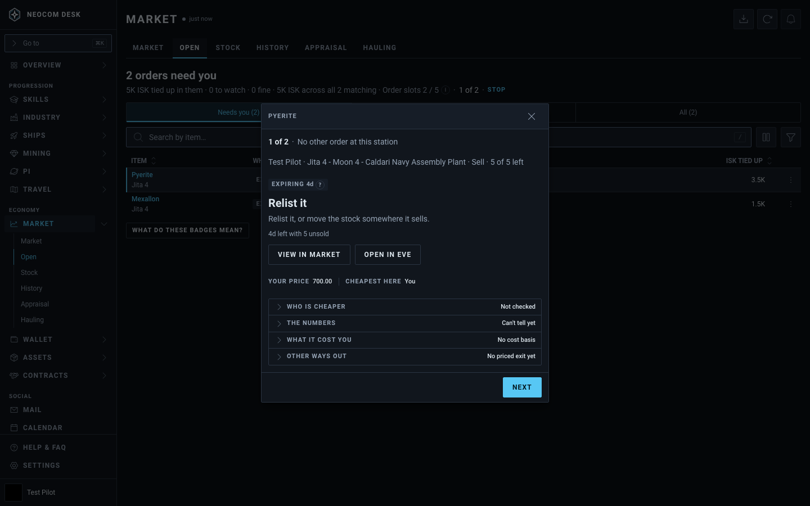
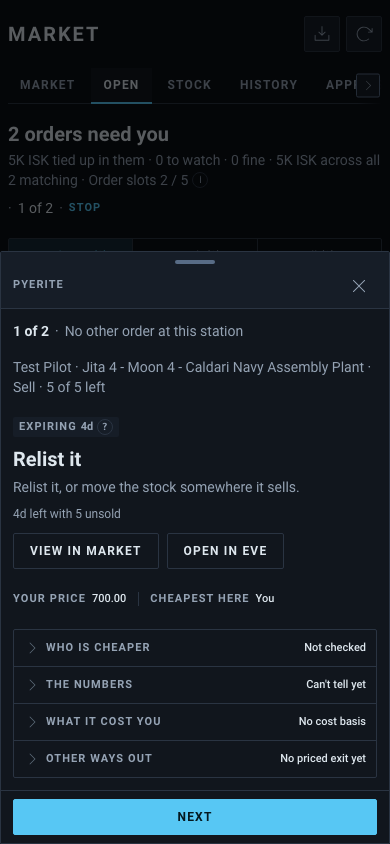
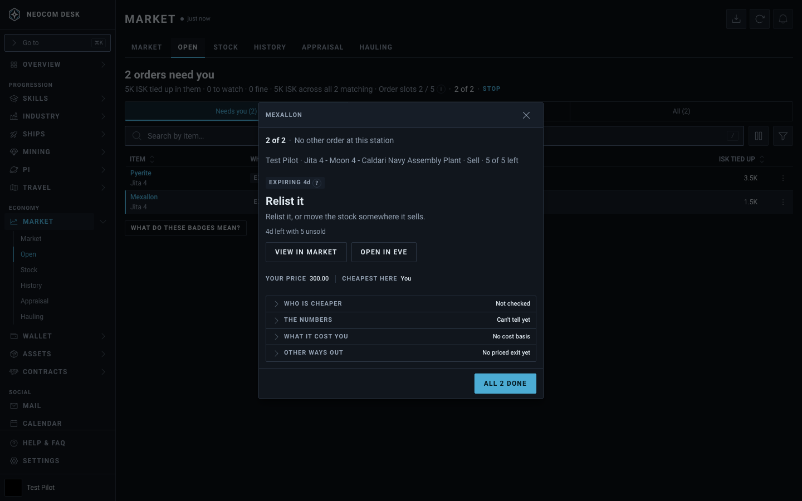
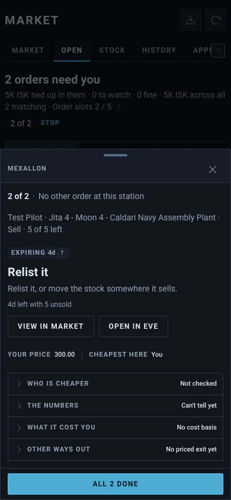
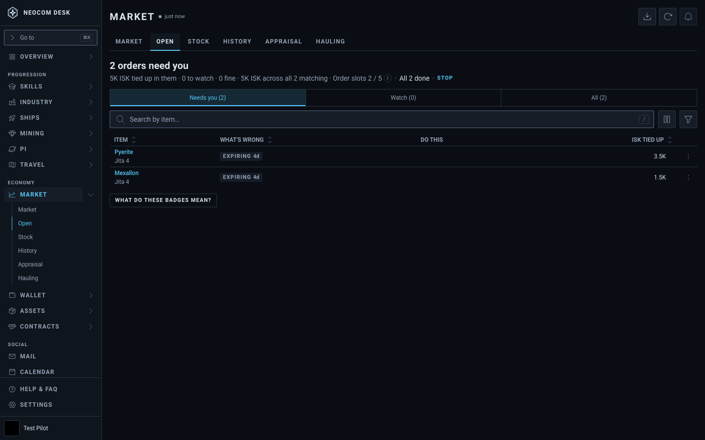
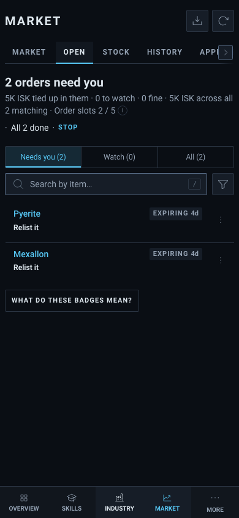
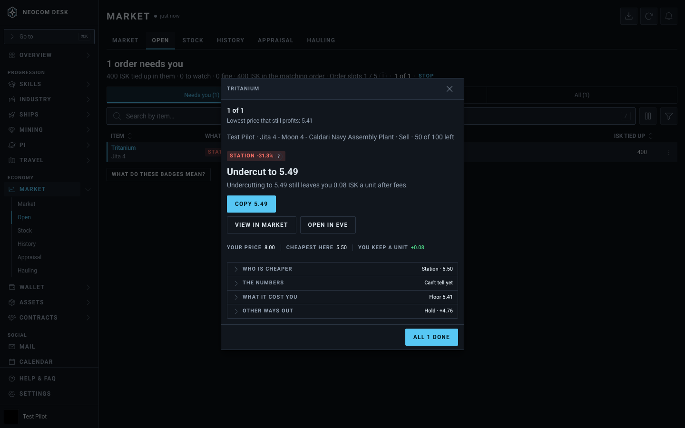
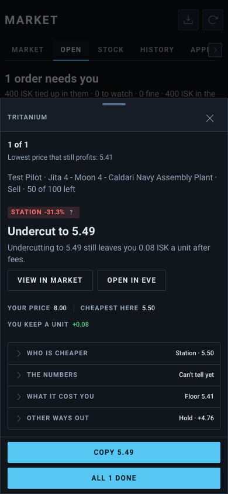

# Open Orders work-through in the order modal (#6311)

Real app screenshots, seeded with two expiring orders. `*-first`: order 1 of 2. `*-last`: order 2 of 2, the button reads "All 2 done". `*-done`: modal closed, headline reads "All 2 done".

| | 1440 | 390 |
|---|---|---|
| First |  |  |
| Last |  |  |
| Done |  |  |
| Undercut, with a cost basis (bought at 3.00, rival at 5.50): Copy 5.49 and the lowest profitable price 5.41 |  |  |
