# Market › Open Orders: three calmer forms

The Open Orders page and its Order Detail modal show too much at once. Today
the page has a header and hint line for each problem group, seven columns and
a sentence plus a copy button in every row. The modal opens 64rem wide, also on
a phone, with five sections of equal weight. Each form below picks one job for
the eye: what is wrong, what price to type, then everything else on request.

Nothing is deleted. Every field from today's row and modal has a home in each
form, often folded. Each story file's JSDoc lists "Where it went". Sample data;
a ticket's text wins over the picture.

Sources: `src/mockups/OpenOrdersFormA.stories.tsx`, `…FormB…`, `…FormC…`, with
shared sample orders in `src/mockups/openOrdersSample.ts`, and today's Market
header and tabs in `src/mockups/OpenOrdersChrome.tsx`, so the forms differ only
in the proposal. "Today" is the real page, seeded through the e2e fixture
routes: 1 Character and 12 orders. The forms use 2 Characters and 17 orders, so
compare layout, not density.

## The three forms

| | Page | Detail | Phone detail |
|---|---|---|---|
| **A. Fix list** | Headline "5 orders need you". Needs you / Watch / All switch. One flat 4-column table: Item, What's wrong, Do this (copyable price), ISK tied up. Healthy orders fold into one line. | Narrow centered modal. Big verdict + Copy button, 3 facts, then 4 folded sections with a one-line answer each. | Bottom sheet, Copy pinned to the bottom |
| **B. Clean table + side panel** | Stat chips, problem filter chips with counts, one flat 5-column table (Item, Status, Price vs cheapest, Remaining bar, Expires). | Side panel; the page stays live and the row stays highlighted. Big new price, then tabs: Overview / Competition / Cost & exits. | Full-height sheet with the same tabs |
| **C. Triage inbox** | Fix now / Watch / Fine tiles. Cards grouped by urgency; each card says the action in one big line ("Undercut to 4,479,900"). Fine folds away. | Centered modal in 3 numbered steps: What's wrong → What to do → Why (folded). | Full-height sheet, Copy pinned to the bottom |

## Today vs proposed

| | Page 1440 | Page 390 | Detail 1440 | Detail 390 |
|---|---|---|---|---|
| Today | 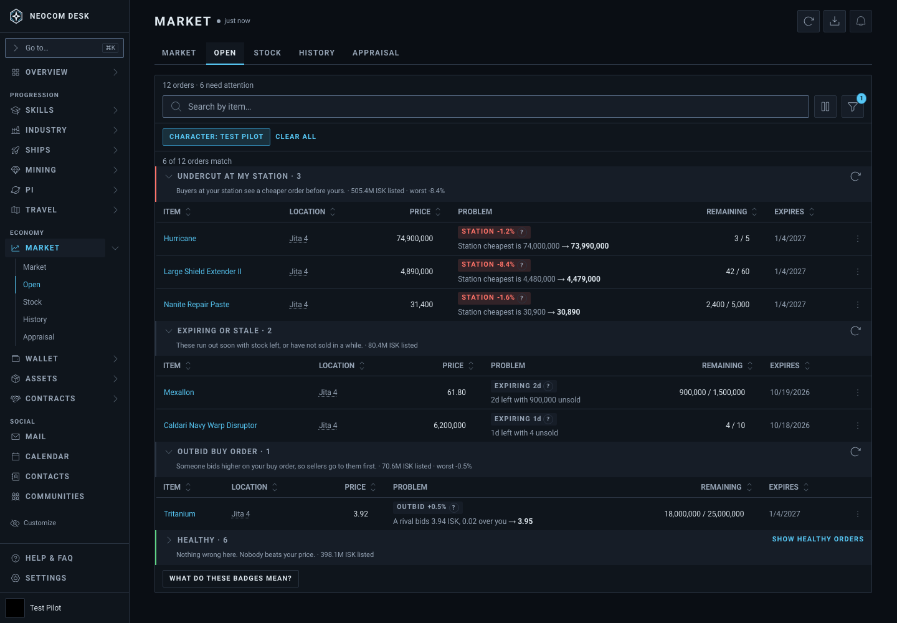 | 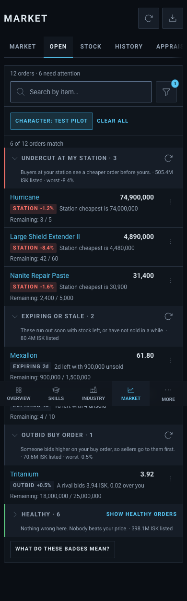 | 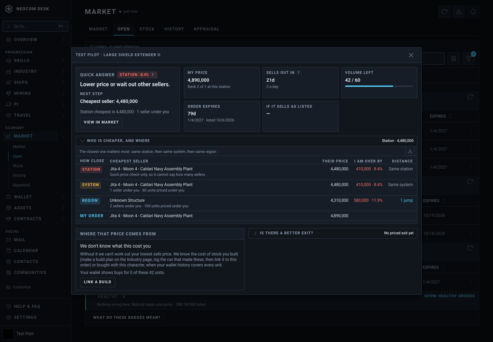 | 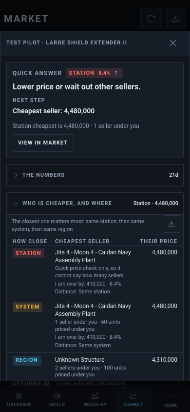 |
| A. Fix list | 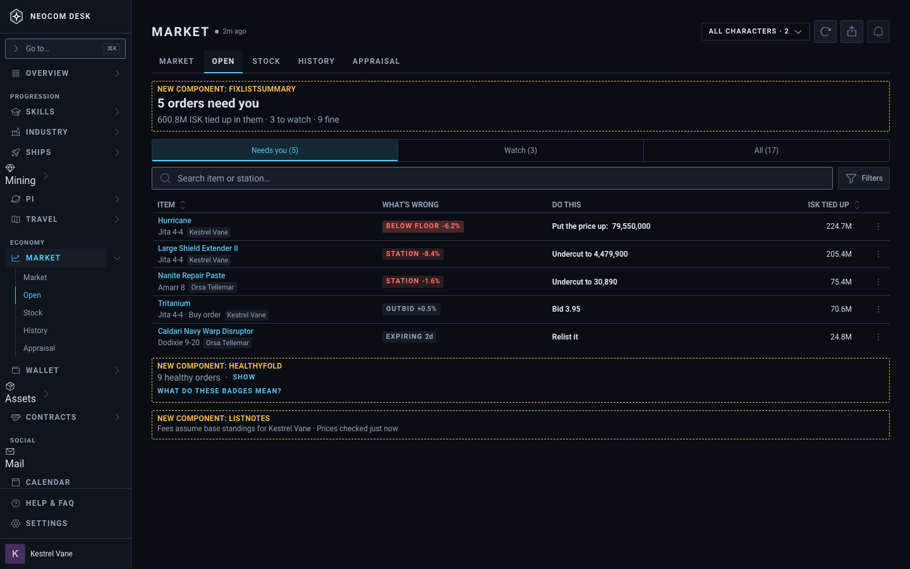 | 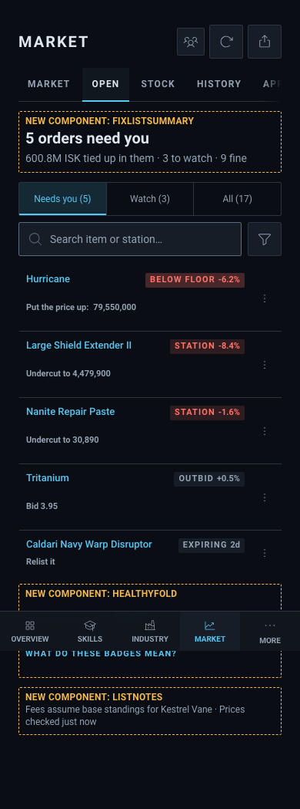 | 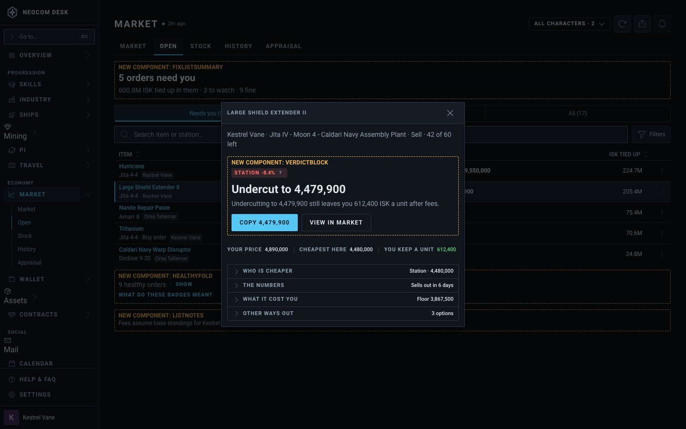 | 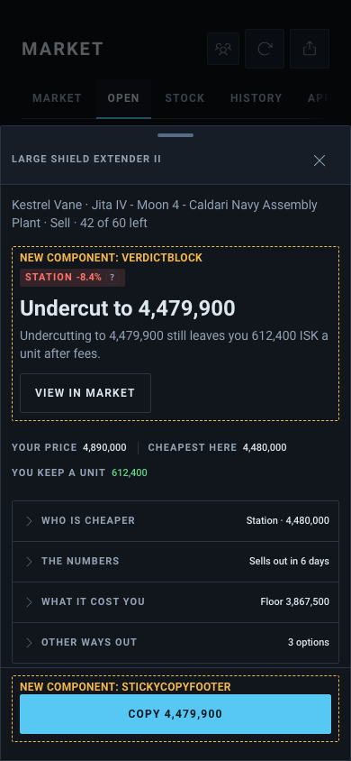 |
| B. Table + panel | 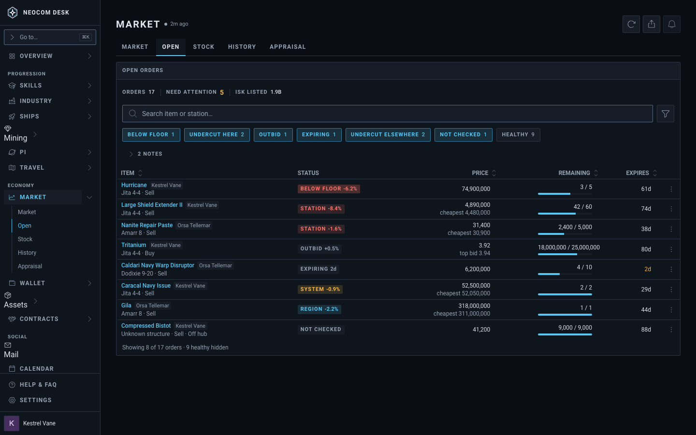 | 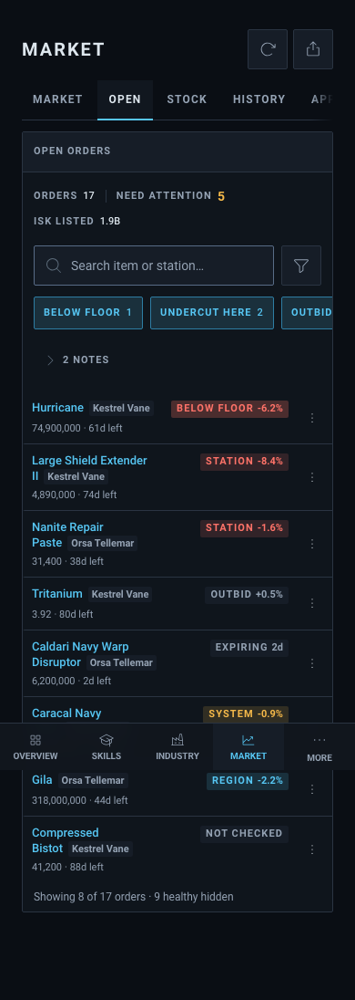 | 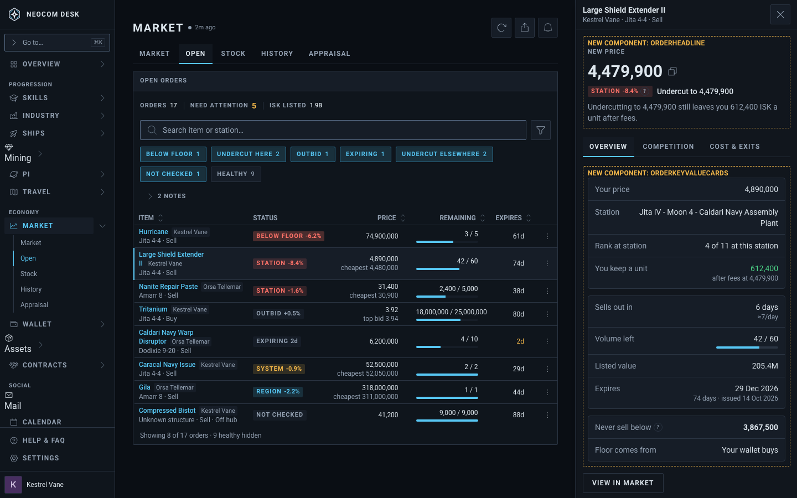 | 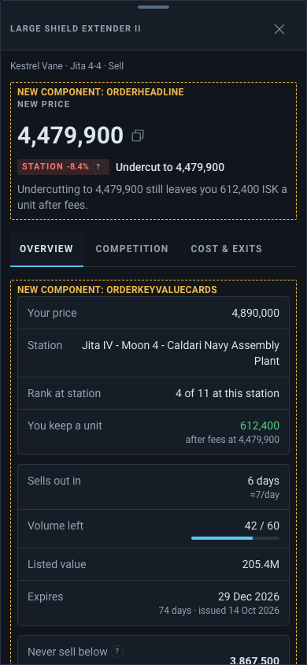 |
| C. Triage inbox | 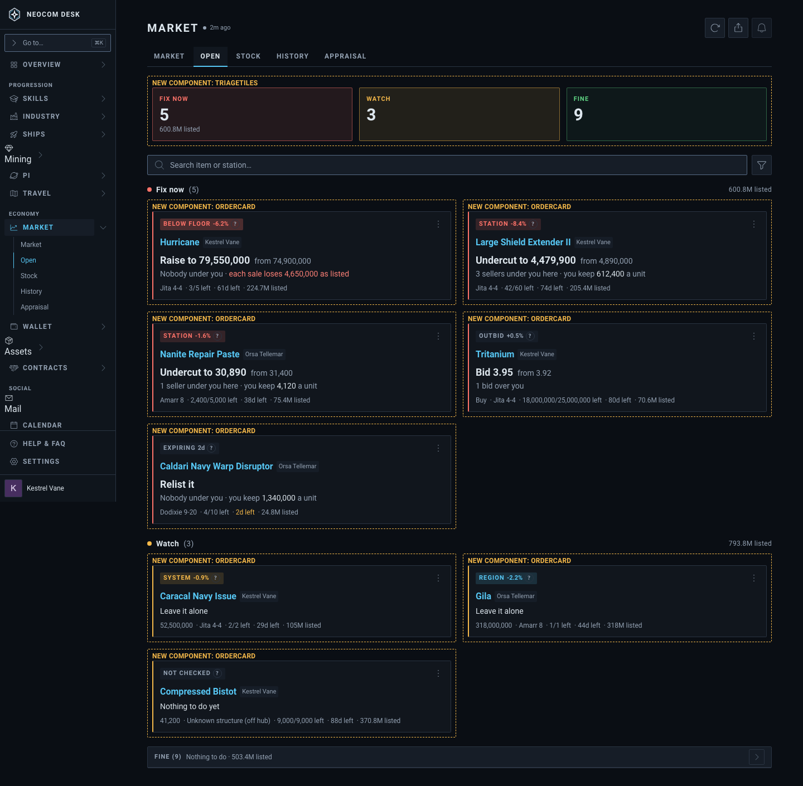 | 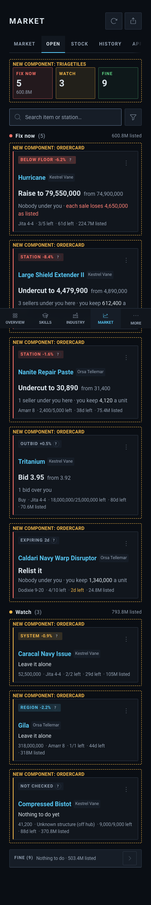 | 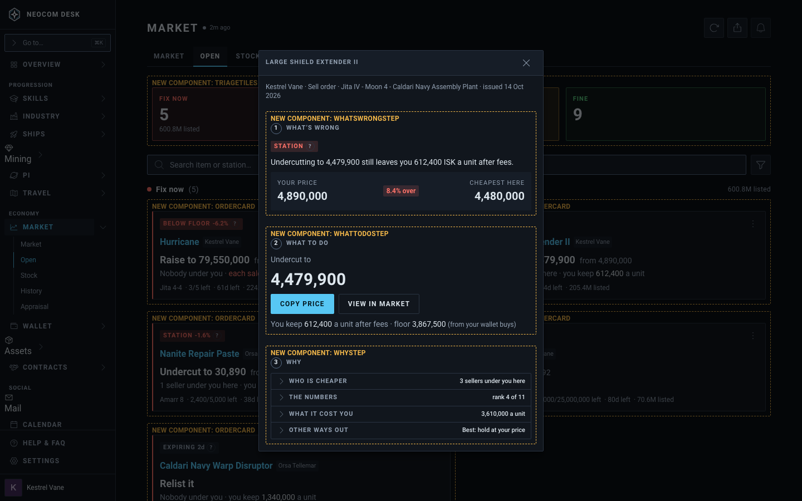 | 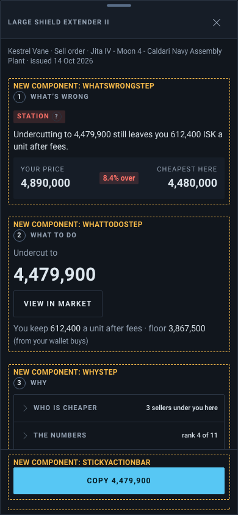 |

Laptop (768) shots: `form-*/page-768.png`, `form-*/detail-768.png`.

## Open points per form

- **A:** the phone card's second line sits low, because `CopyablePrice` keeps
  its 44px touch target.
- **B:** at 768 the side panel covers the Status, Price and Expires columns.
  Room for both comes only from `xl`. The desktop filter-chip row goes against
  DESIGN.md §4b, which keeps that row for phones. Chip labels ("Undercut here")
  and pill labels ("Station") differ.
- **C:** the desktop table becomes cards, against the rule that a table stays a
  table. The cards need a keyboard path. Outbid and Expiring pills stay neutral
  grey, as the real badge colours them; the card's left bar carries the urgency.

## Patterns from Mobbin

- [Coinbase order management](https://mobbin.com/screens/e8bc99dd-2b98-4b12-95b3-5ca277255b09) and [Airwallex limit orders](https://mobbin.com/screens/c8f4246b-e31c-4ad1-98a3-db3ff20ac970): a plain table under filter pills (A, B).
- [Revolut Business FX orders](https://mobbin.com/screens/398fb121-3147-464b-8e97-13fa14b8fe08): a list plus a right panel with a headline figure and grouped key-value cards (B).
- [DoorDash Dasher summary](https://mobbin.com/screens/ad3159d1-75e2-4cd3-a495-6a645d158838) and [inDrive order sheet](https://mobbin.com/screens/3e6110fe-6a5b-4a0c-8bab-accdc256ac25): one big number and one action in a bottom sheet (A, C phone detail).
- [Deliveroo orders](https://mobbin.com/screens/0f2c8c42-ceca-4dee-9d60-31144ace5eaa) and [talabat orders](https://mobbin.com/screens/dc389c20-f77b-4bb3-9dd8-ae52517fe5b2): cards grouped by status, each with a status tag and one action (C).
- [SHEIN order information](https://mobbin.com/screens/9fad4ce1-2ba2-442d-a071-aa75d996c58a): secondary details folded under one headline total (A, C "Why").
