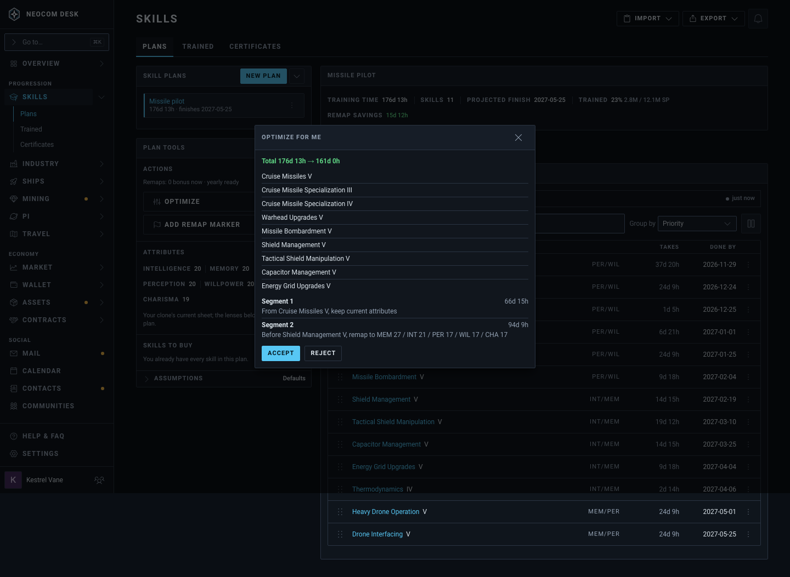
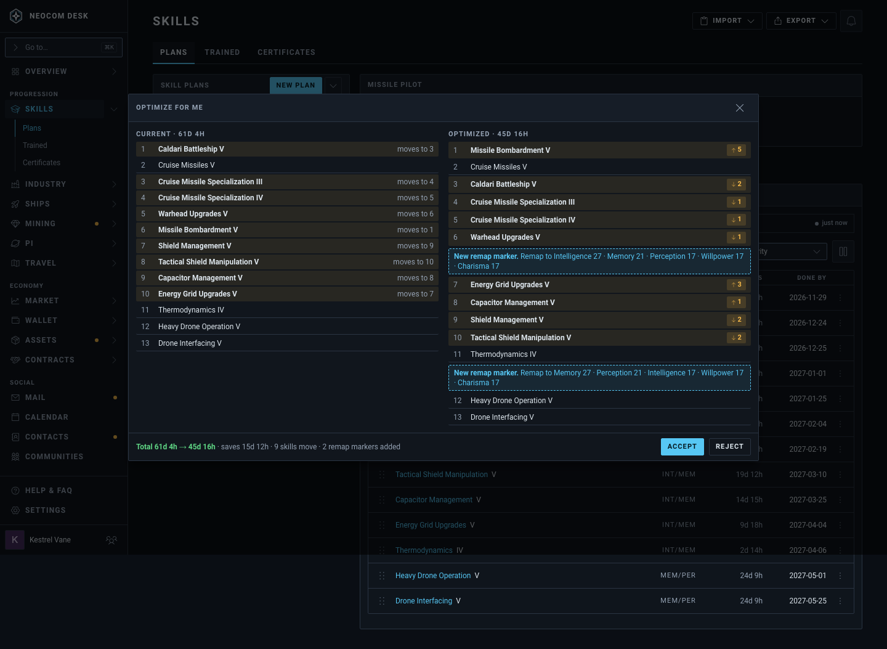
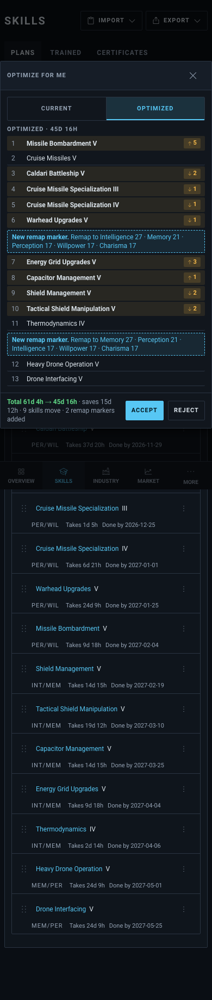

# Optimize for me: compare the new plan with the current one (issue #4793)

Source: `src/mockups/OptimizeCompare.stories.tsx` (`mockups-optimizecompare--*`). The page behind is the real Plan editor with sample data (`optimizeCompareFixtures.ts`). The ticket text wins over the picture.

New components: none. A wide `Modal` with two lists, `Pill`s and a `SegmentedControl` on a phone.

| | 1440 | 390 |
|---|---|---|
| Today |  | |
| Proposed, **chosen** |  |  |

## What it shows

- Current and Optimized side by side, rows numbered.
- A skill that moves is tinted on both sides: "moves to N" on the left, "↑n / ↓n" on the right.
- A new Remap Marker is a dashed accent row in the Optimized list.
- The foot keeps the totals, the saving, the counts and Accept / Reject.
- On a phone a Current / Optimized switch shows one list at a time, Optimized first.

Researched on Mobbin: Semrush "Review your content", Mistral AI "Review your changes", Linear and Plane version compare, Figma "Compare changes".
