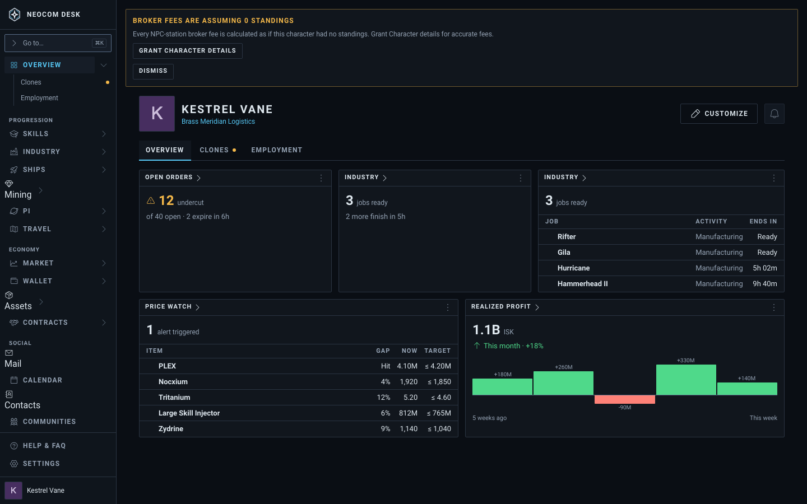
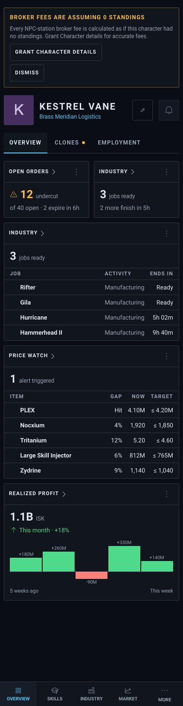
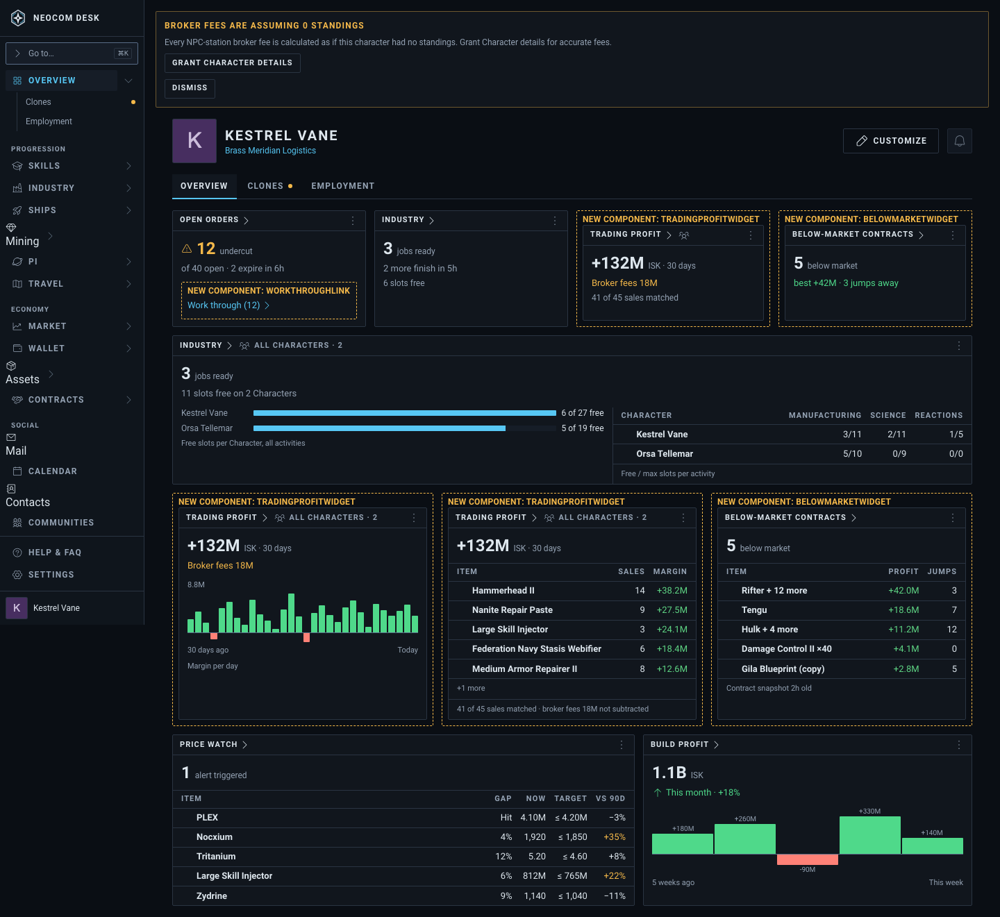
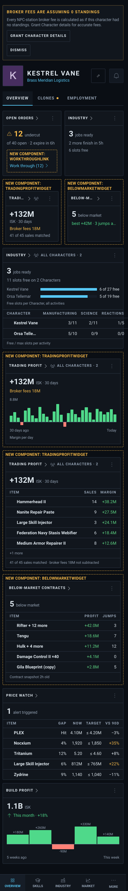

# Overview: market and industry widgets (T1, T4, T6b, T7, T8)

Source: `src/mockups/OverviewMarketIndustryWidgets.stories.tsx` (`mockups-overviewmarketindustrywidgets--proposed`, `--proposed-phone`; today: `--today`, `--today-phone`). Each tile is the real `Widget` frame drawing sample figures (the Gallery's preview path). Sample data; the ticket text wins over the picture.

New components: `WorkThroughLink`, `TradingProfitWidget`, `BelowMarketWidget` (dashed, labelled). The changes to existing widgets are data on their bodies, not new components:

- Open orders, Number view: "Work through (12)" link with a trailing caret (DESIGN §6c allows no typed arrow), opens Open Orders with the queue started (T1).
- Industry, Number view: a "6 slots free" line. Chart view on All characters: free slots per Character as bars, beside a Character · Manufacturing · Science · Reactions table of free/max (T4).
- Trading profit (new kind), All characters, 30 days: Number "+132M · 30 days / Broker fees 18M / 41 of 45 sales matched", Chart of margin per day, Table of Item · Sales · Margin (T8).
- Below-market contracts (new kind), header Character, no range: Number "5 below market · best +42M · 3 jumps away" and a Table (T6b).
- Price watch, Table view: a "vs 90d" column, amber at +20% or more (T7).
- "Realized profit" renamed "Build profit" (kind id unchanged) (T8).

Stand-ins: a frame only draws a kind it knows, and the "All characters" readout only a kind that sums across Characters. So Trading profit and the All-characters Industry tile use the `miningYield` frame, Below-market contracts the `contracts` frame, each with its title set.

| | 1440 | 390 |
|---|---|---|
| Today (`--today`) |  |  |
| Proposed |  |  |
