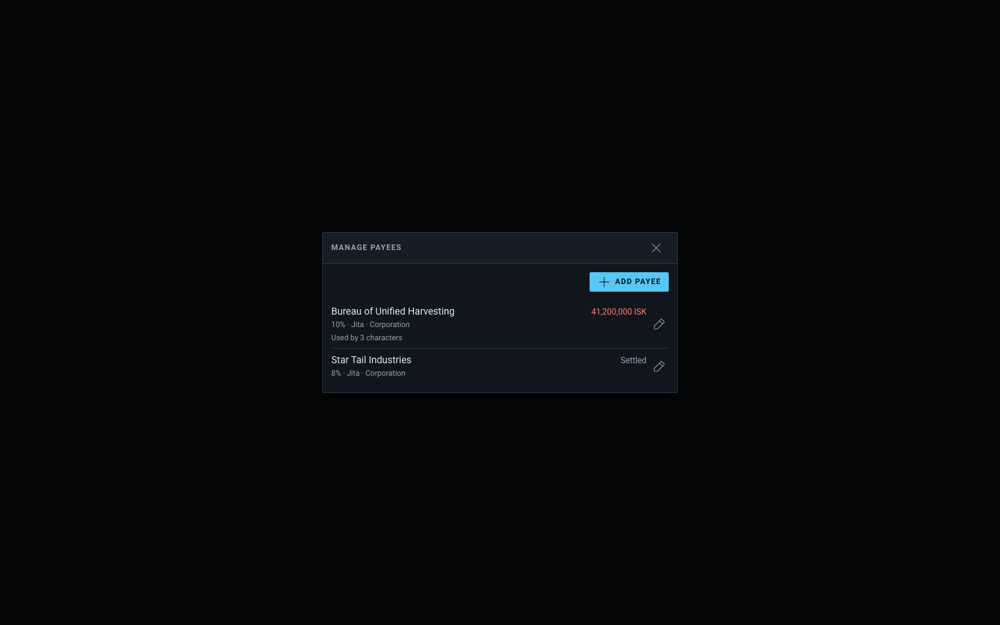
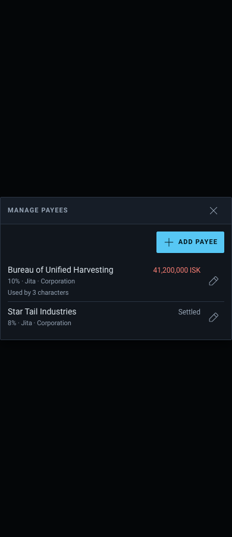
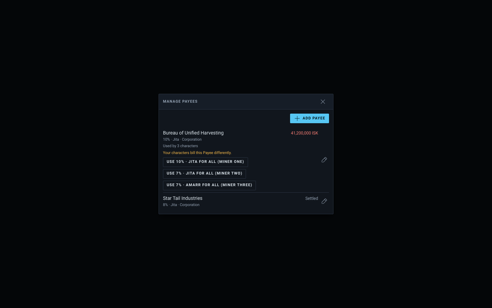
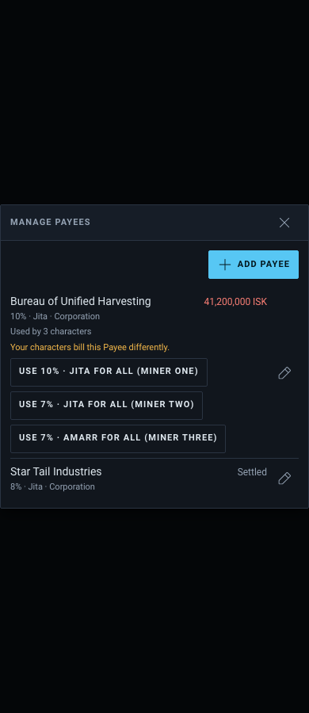

# One Payee per corporation or player (#6308)

Chosen by the agent: Manage Payees lists a recipient once. A merged row says "Used by N characters"; when the records bill differently, one button per distinct terms ("Use 7% · Amarr for all (Miner Three)") copies the pilot's pick to every record. Same row everywhere on the phone, buttons wrap. Why: the pick is explicit (nothing dropped silently), and the same button is the way to merge duplicates that already exist.

Stories: `mockups-payeeoneperentity--grouped`, `--terms-differ`, `--terms-differ-phone`. These render the real `PayeeManagerDialog`, so the PNGs in `implemented/` are of what shipped.

| State | 1440 | 390 |
|---|---|---|
| Grouped |  |  |
| Terms differ |  |  |
