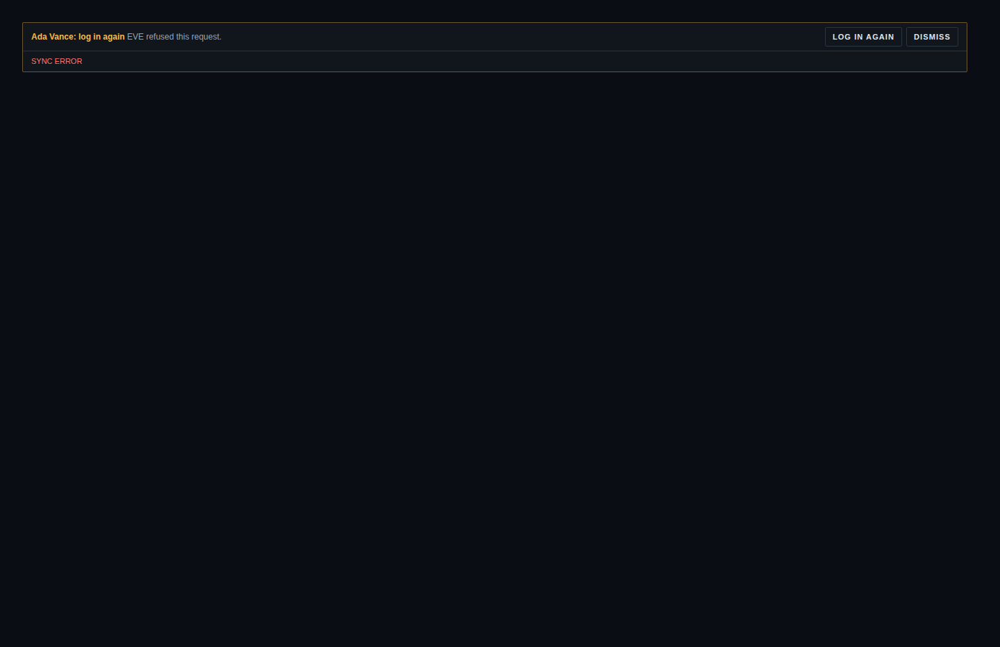
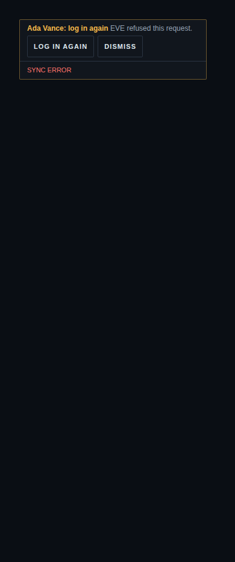

# Phone status strip (#6560)

Re-login prompt, missing-role notice and "Sync error" are rows of one strip (`ShellStatusStrip`) instead of a stacked card each. Story: `app-shellstatusstrip--relogin-and-sync-error`.

| 1440 | 390 |
|---|---|
|  |  |
