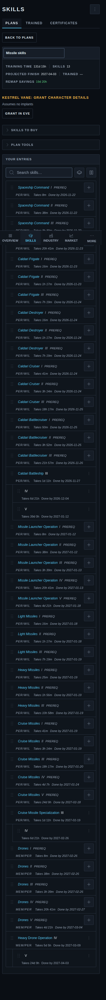
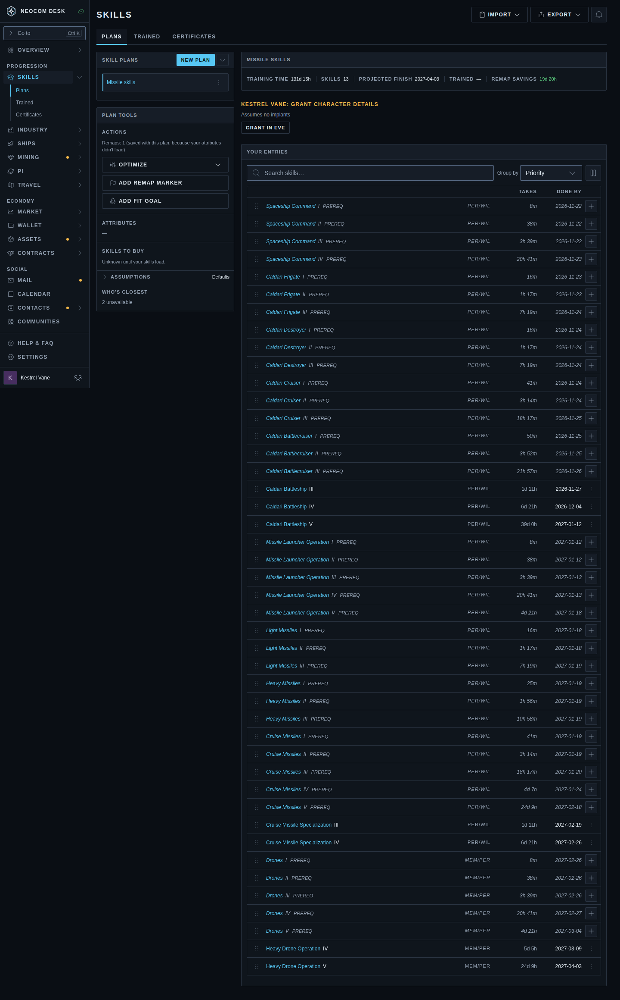

# Plan Editor on a phone (#6562)

Story: `mockups-planeditorphone--proposed` (real editor, sample plan).

Scope per Shawn's review: reordering stays drag-only with the grip kept on touch (no Move controls). Two changes only.

1. Consecutive levels of one skill fold into a group below `md`: the first row names the skill, later rows show just the level, indented under a rule. Each level keeps its own grip, time and ⋮ (one row per level is unchanged in the data). Attribute pair and priority show once, on the first row. Dimmed prereq rows are not grouped.
2. Below 40rem Import and Export fold into one header ⋮ (`HeaderMoreMenu`): From skill queue, From text or file, Export to clipboard, Export table. From 40rem up the two buttons stay.

Implemented (real app):

| Phone 390 | Desktop 1440 (unchanged) |
|---|---|
|  |  |
