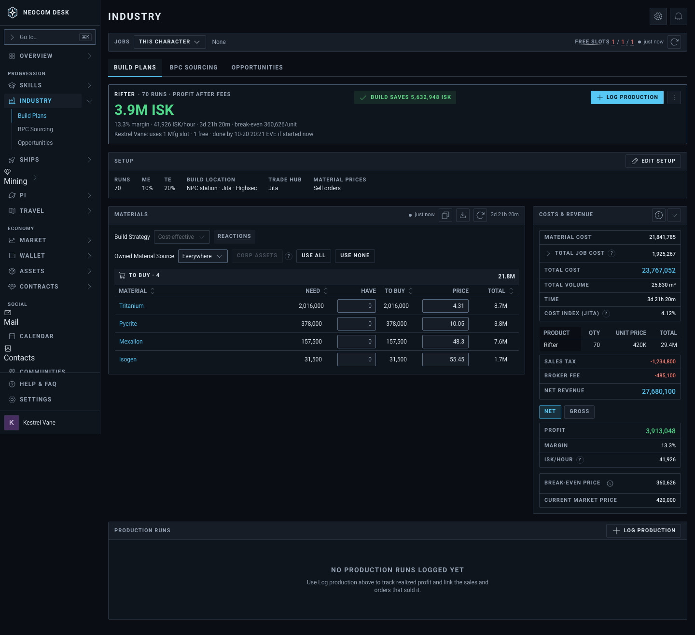
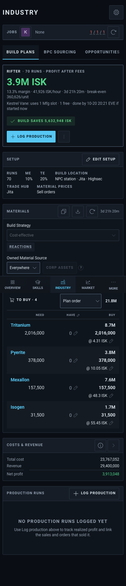
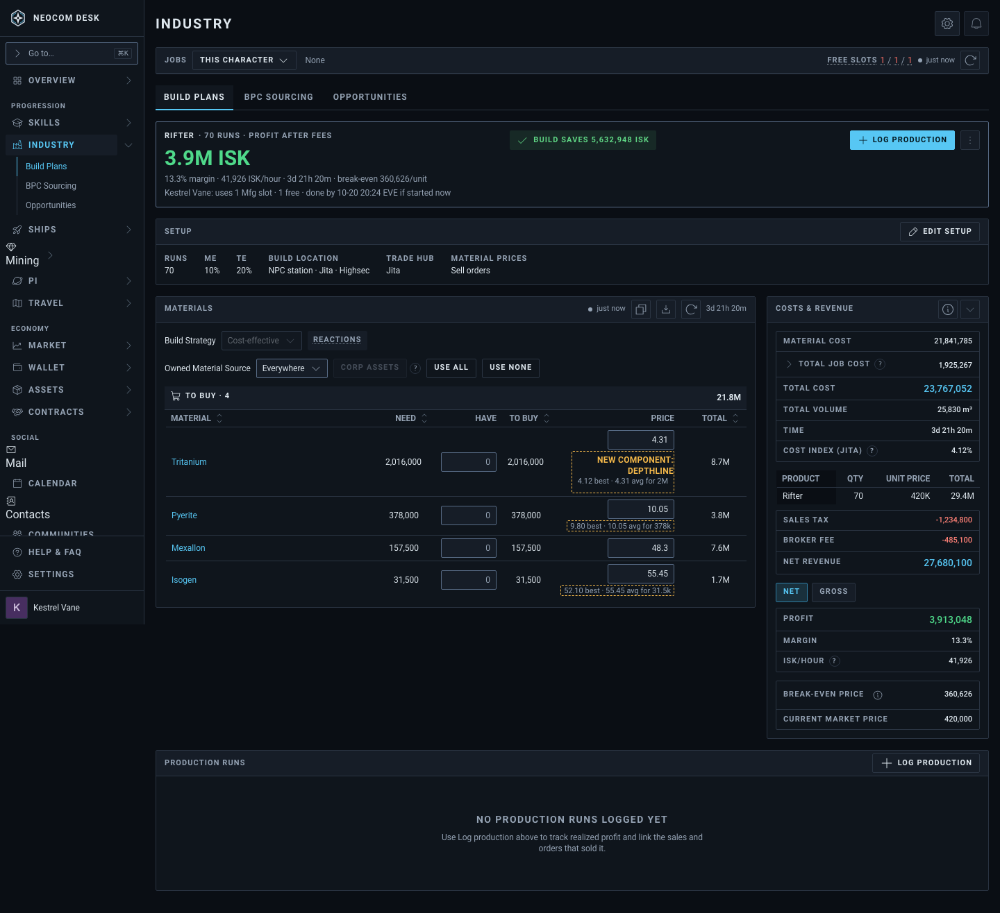
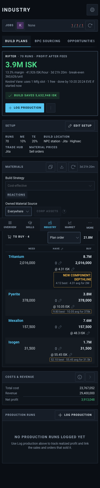
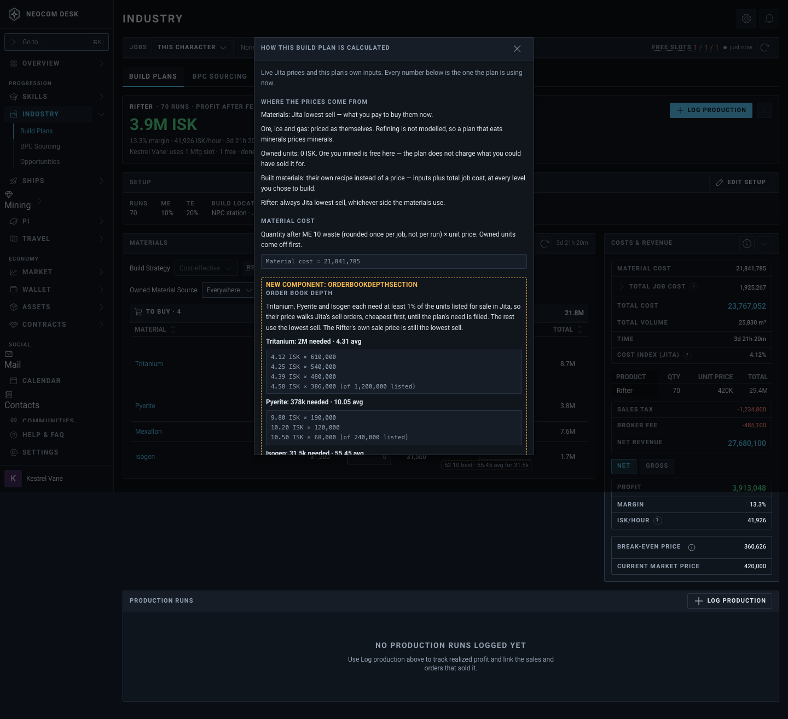
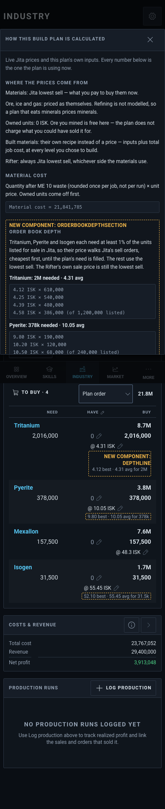

# Build Plan: order-book depth pricing for materials (T5)

Source: `src/mockups/PlanOrderBookDepth.stories.tsx` (`mockups-planorderbookdepth--proposed`, `--breakdown`). Sample data: a 70-run Rifter plan. Tritanium, Pyerite and Isogen need at least 1% of Jita's listed sell units, so they walk the book; Mexallon stays on top-of-book. The ticket text wins over the picture.

New components: `DepthLine` (the Price cell's second line, "4.12 best · 4.31 avg for 2M"; only the first is labelled, the rest carry the dashed outline; the Price column is widened to fit it) and `OrderBookDepthSection` (the Calculation Breakdown's list of book levels per walked row). Everything else is the real plan page.

| | 1440 | 390 |
|---|---|---|
| Today (`--today`) |  |  |
| Proposed: Price cell second line |  |  |
| Calculation Breakdown: Order book depth |  |  |
