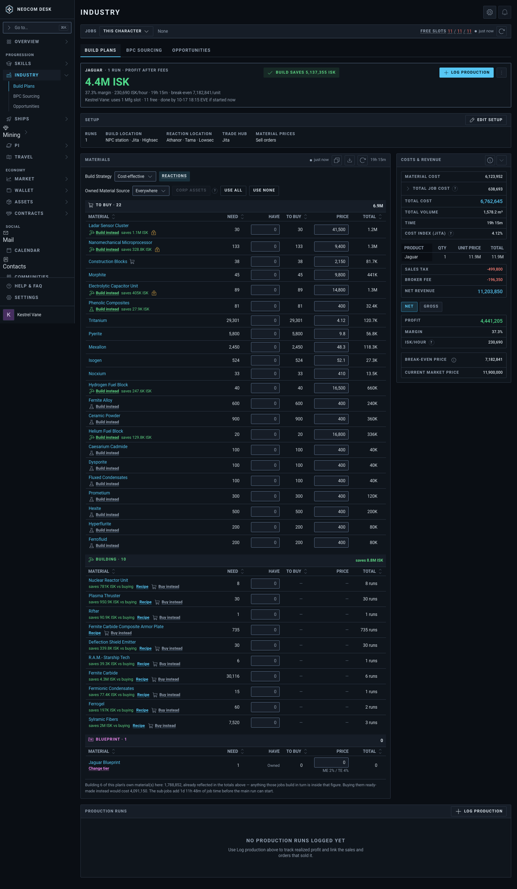
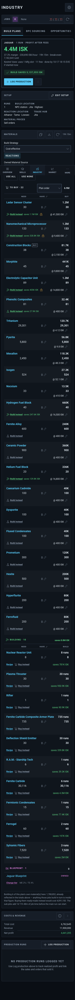
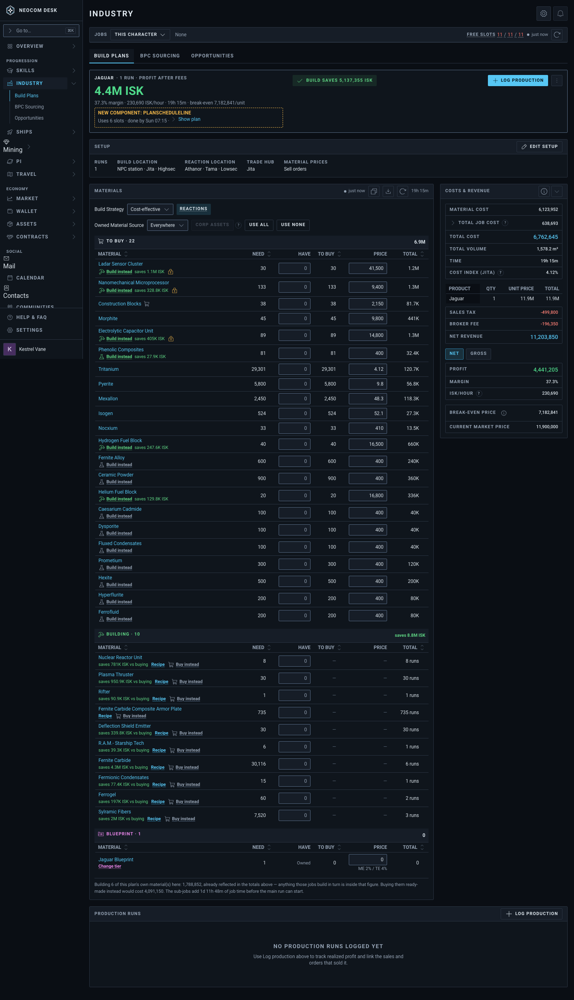
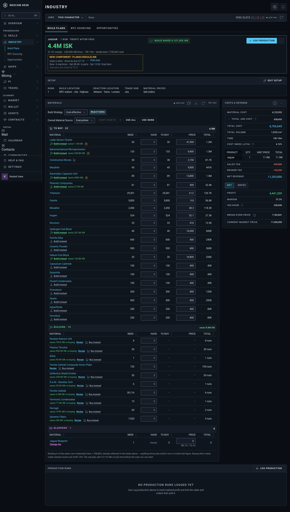
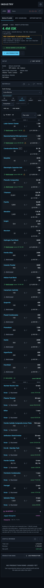

# Build Plan: slot-aware "done by" (T4, plan and group slot line)

Source: `src/mockups/PlanSlotSchedule.stories.tsx` (`mockups-planslotschedule--proposed`, `--expanded`). Sample data: a 1-run Jaguar plan building its hull, R.A.M. and four components, with four composites reacted (Include Reactions). Times are relative to when the story was shot. The ticket text wins over the picture.

New component: `PlanScheduleLine` (dashed, labelled). It replaces today's `PlanSlotLine` text in the plan hero; a Build Group's `GroupSlotLine` reads the same. Everything else is the real plan page.

| | 1440 | 390 |
|---|---|---|
| Today (`--today`) |  |  |
| Proposed: "Uses 6 slots · done by … · Show plan" |  |  |
| Show plan open: waves + "Sub-jobs are timed at TE 0" |  |  |
