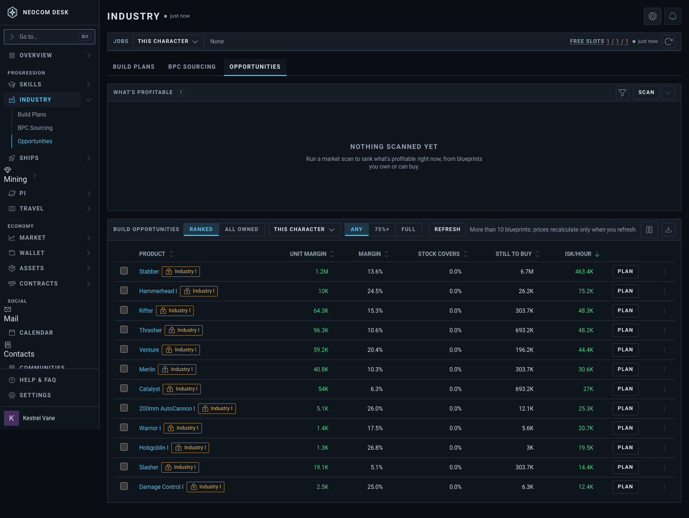
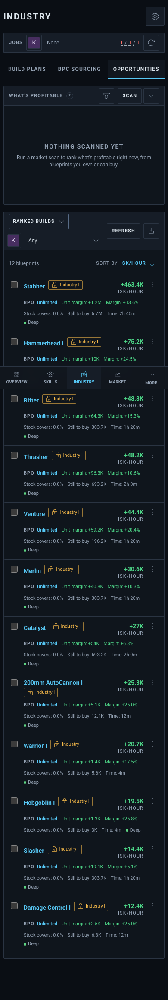
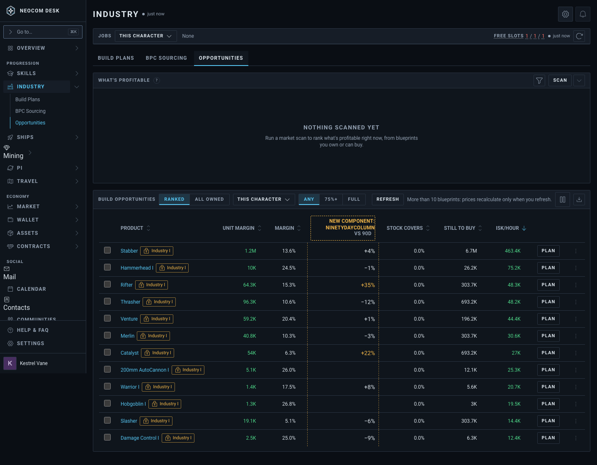
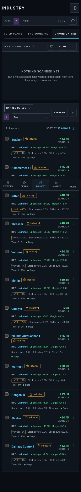
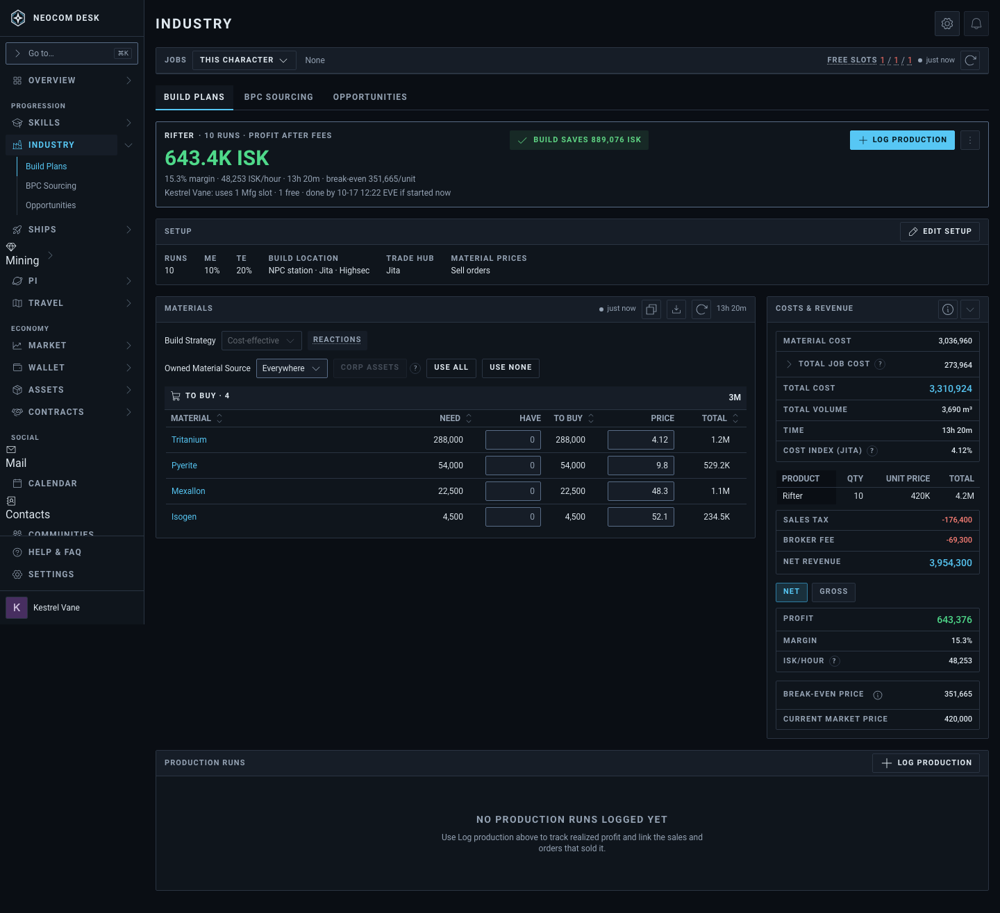
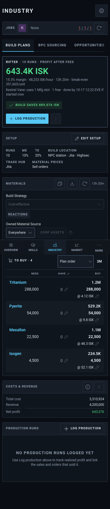
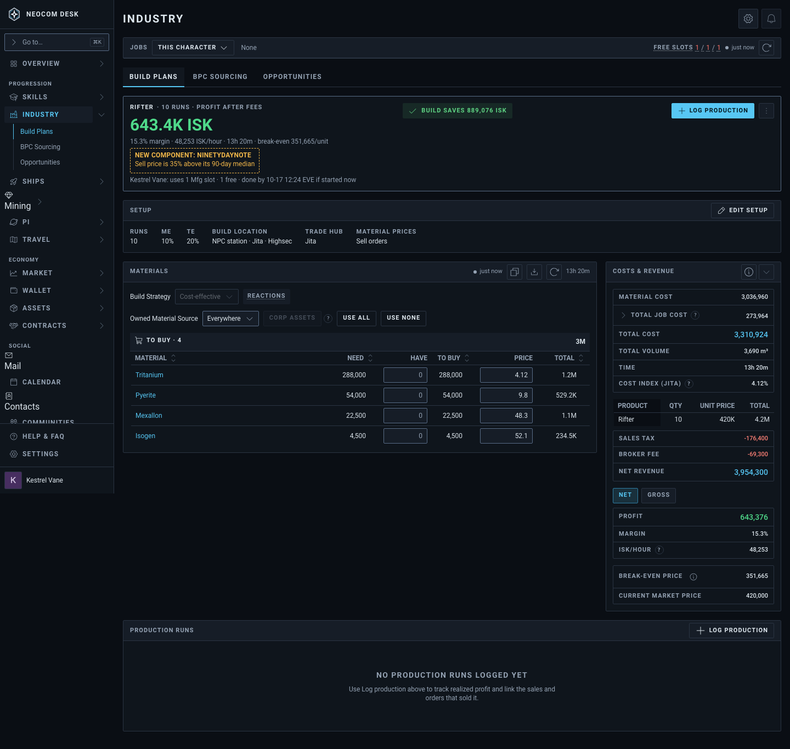
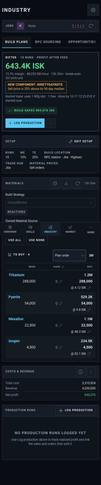

# Opportunities and Build Plan: price vs 90-day median (T7)

Source: `src/mockups/PriceVsNinetyDay.stories.tsx` (`mockups-pricevsninetyday--table`, `--plan-note`). Sample data. The ticket text wins over the picture.

The table shown is Ranked Build Opportunities (twelve owned blueprints). Market-Wide gets the same "vs 90d" column; it only fills after a market-wide Scan, which the story fixtures cannot drive, so its panel shows "Nothing scanned yet".

New components: `NinetyDayColumn` ("vs 90d" after Margin: "+35%" amber from +20%, "−12%", blank when too few traded days; on a phone card it is a "vs 90d: +35%" readout after Margin, left out when blank) and `NinetyDayNote` (amber "Sell price is 35% above its 90-day median" closing the plan hero's qualifier line). Everything else is the real Industry pages.

| | 1440 | 390 |
|---|---|---|
| Today: Build Opportunities (`--today-table`) |  |  |
| Proposed: vs 90d column |  |  |
| Today: plan hero (`--today-plan`) |  |  |
| Proposed: 90-day note |  |  |
