# Optimize queue: remap advice from the skill queue

Source: `src/mockups/QueueRemap.stories.tsx` (`mockups-queueremap--*`). Issue #4701. Sample data; the ticket text wins over the picture.

**Chosen flow (Shawn, 2026-10-21):** pressing **Optimize queue** in the Skill Plan panel on `/skills/plans` does the following in one press:

1. Makes a new plan from the in-game skill queue.
2. Runs the optimizer (`placeRemaps`). It leaves out the level training now, the way the Plan editor's "Trains first in game" does.
3. Places the resulting remaps as Remap Markers.
4. Opens that plan in the Plan editor.

There is no advice modal in between.

The real Skills › Plans page and Plan editor render against a sample missile pilot (`src/mockups/queueRemapFixtures.ts`). The queue is a Perception/Willpower block, then Intelligence/Memory, then two Memory/Perception drone skills, on an even 20/20/20/20/19 sheet. Every figure is the planner's own. The toast's savings equal the new plan's Remap savings to the hour (15d 12h on the ready sample).

New components: none. The button is an existing `Button` with the Optimize button's icon, and the landing note is the existing `Toast`.

## Decisions

- **Label: "Optimize queue", no "…".** One press does the whole job and asks for nothing more, so §6c's "…" (more input or a confirmation follows) doesn't apply. It names its object (the queue), so it reads apart from the Plan editor's Optimize menu, which acts on a plan.
- **Placement: its own line, right-aligned under New plan.** It fits beside New plan only while there are no plans. Once All plans… takes the left of that row, the row has no room on desktop (20rem column) or at 390, and wrapping pushed New plan onto the second line. One fixed spot keeps the panel's existing row untouched in every state.
- **Landing: an Undo toast** (DESIGN "a write the app makes on the pilot's behalf announces itself with the same Undo `Toast`, naming what it did"). The editor raises it after the route change, because an action toast closes on route change. For example: `Made "Skill queue · 2026-10-21": remap before Shield Management V saves 15d 12h.` Undo deletes the plan and returns to Plans. The savings figure (plan header and Plan tools) and the marker row are visible on landing at 1440. At 390 the savings show on landing and the marker row is a scroll down (`landing-390-full`).
- **Plan name: "Skill queue · <date>".** A second press on the same day adds " (2)" and so on, rather than overwriting.
- **Empty queue:** the button stays visible and focusable, `aria-disabled`, with the tooltip "Your skill queue is empty: nothing to optimize." (DESIGN: a disabled control with a reason uses `aria-disabled` plus a tooltip). The queue panel's own empty state is the visible text.
- **Already optimal** (no remap saves a meaningful amount, `MIN_MEANINGFUL_SAVINGS_SECONDS`): no plan is made. A plan identical to the queue with nothing placed would only be clutter. A plain toast on the Plans page says why and expires on its own.
- **Remap on cooldown:** the marker is placed where the optimizer puts it with the yearly remap held to its cooldown date (`timedRemap`), here before Heavy Drone Operation V. The toast adds "It waits for your yearly remap on <date>." The new plan shows the same savings.
- **Bonus remap:** both remaps are placed as two markers, and the toast says "2 remaps save …".

## Today

| Story | 1440 | 390 |
|---|---|---|
| `today`: Skills › Plans, no remap entry | 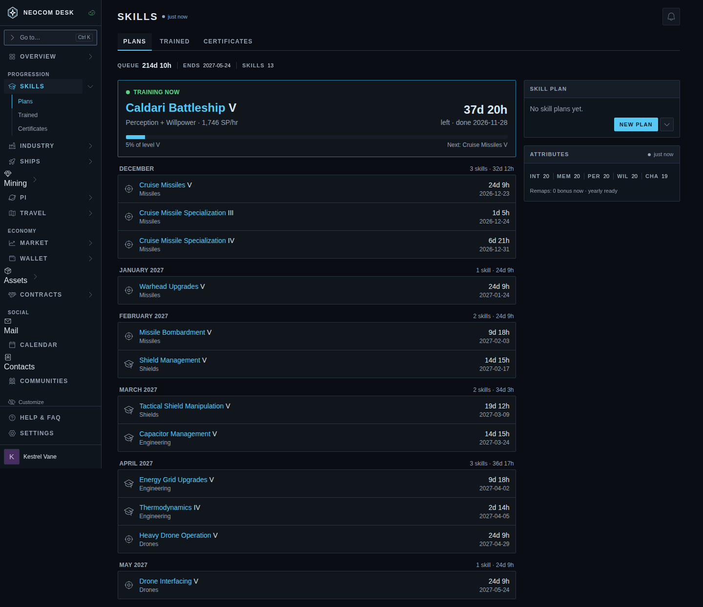 | 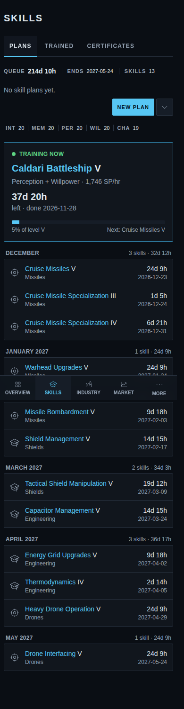 |
| `today-plan-optimize`: today's path, the queue imported into a plan with Optimize open | 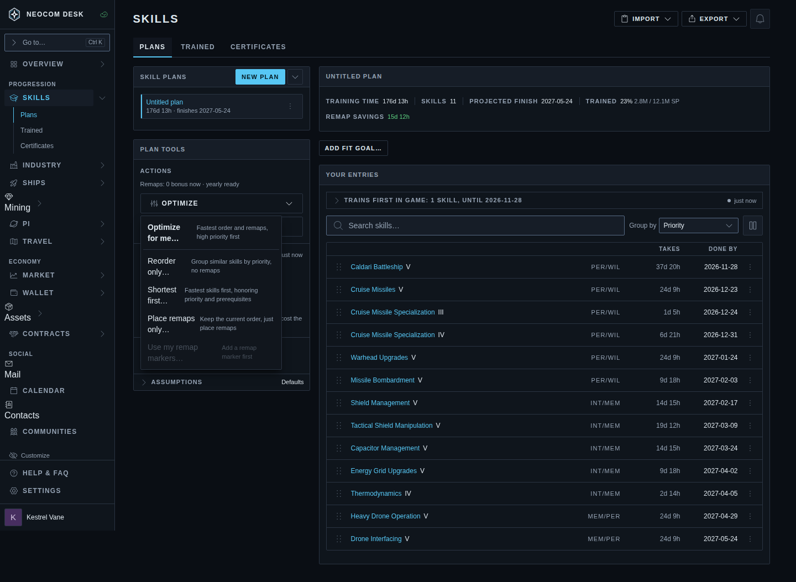 | |

## Proposed

| Story | 1440 | 390 |
|---|---|---|
| `button`: no plans yet | 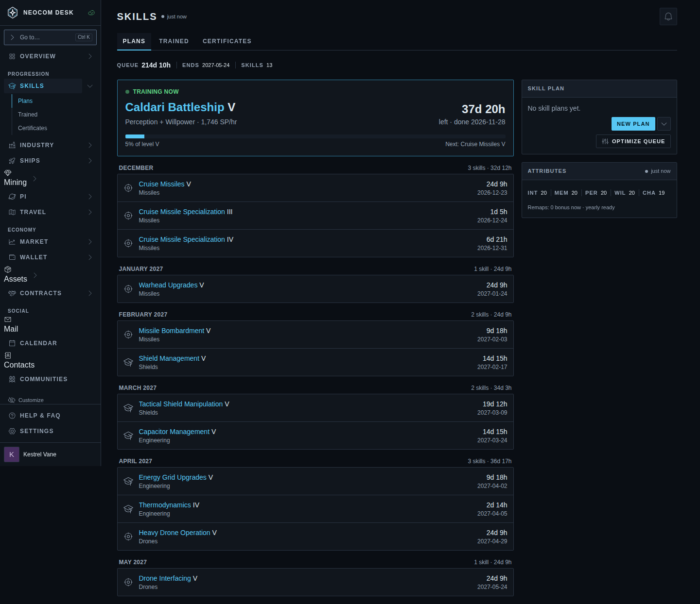 | 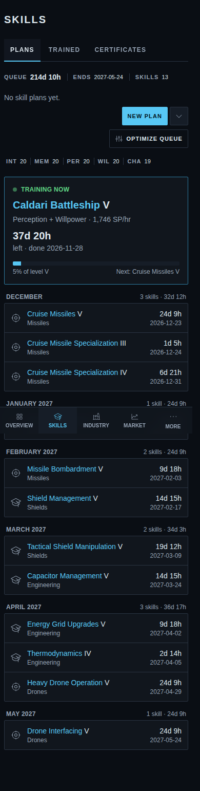 |
| `button-with-plans`: current plan and All plans… | 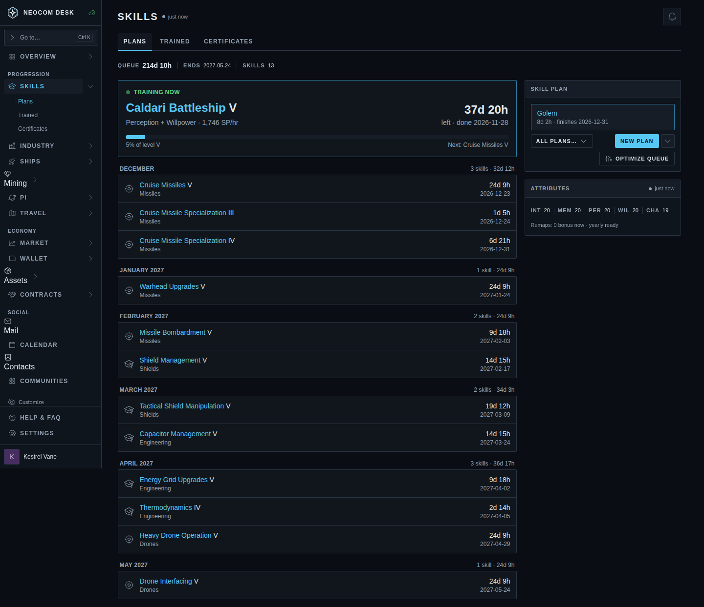 | 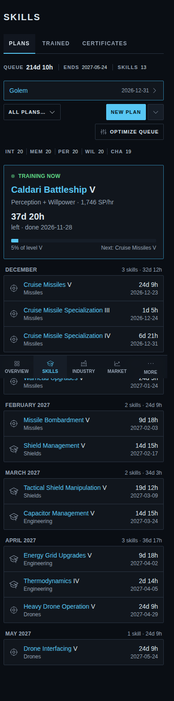 |
| `landing`: the new plan, marker before Shield Management V, Remap savings 15d 12h, Undo toast | 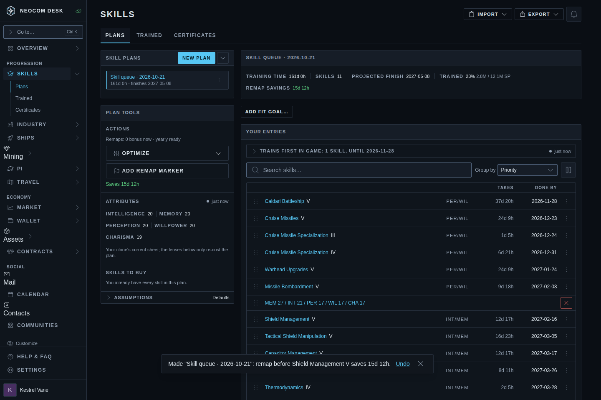 | 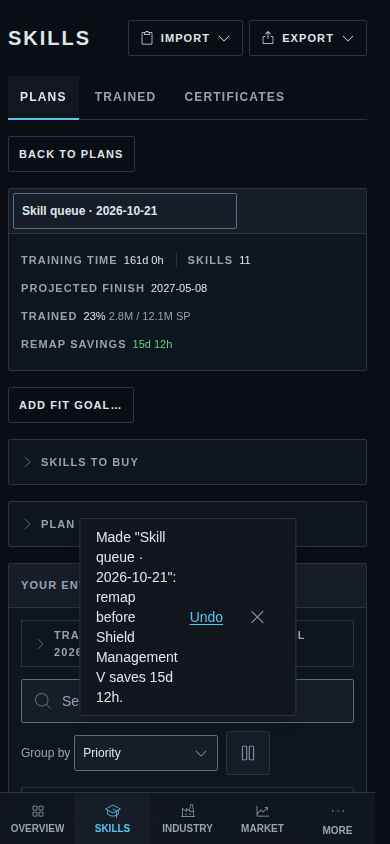 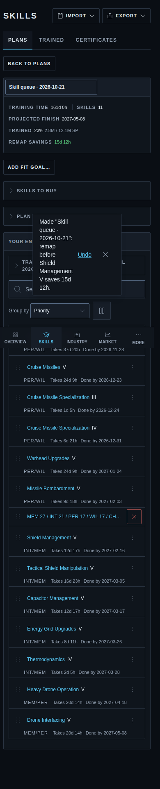 |
| `landing-cooldown`: the marker waits for the yearly remap | 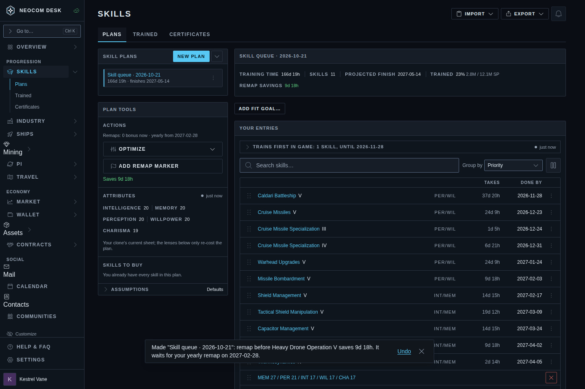 | |
| `landing-bonus`: two markers | 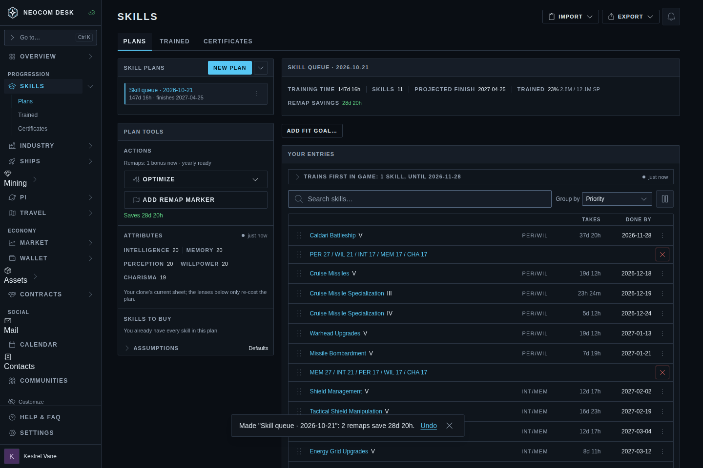 | |
| `empty-queue`: aria-disabled, reason in the tooltip | 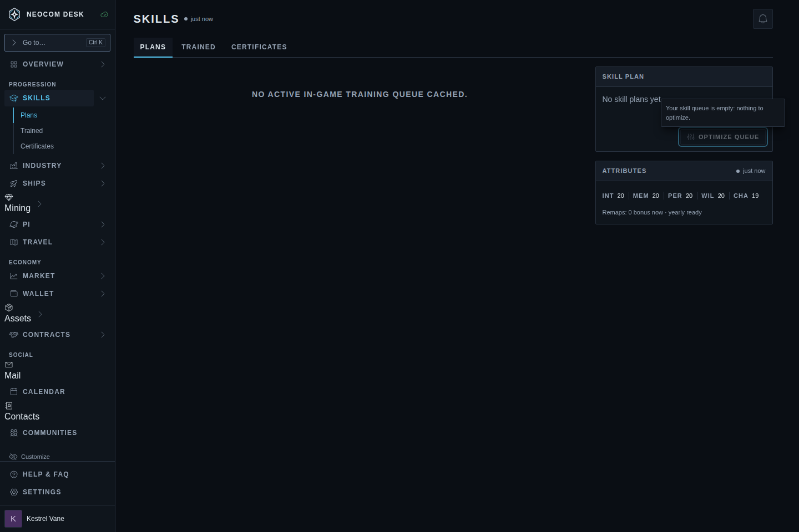 | |
| `already-optimal`: no plan made, plain toast | 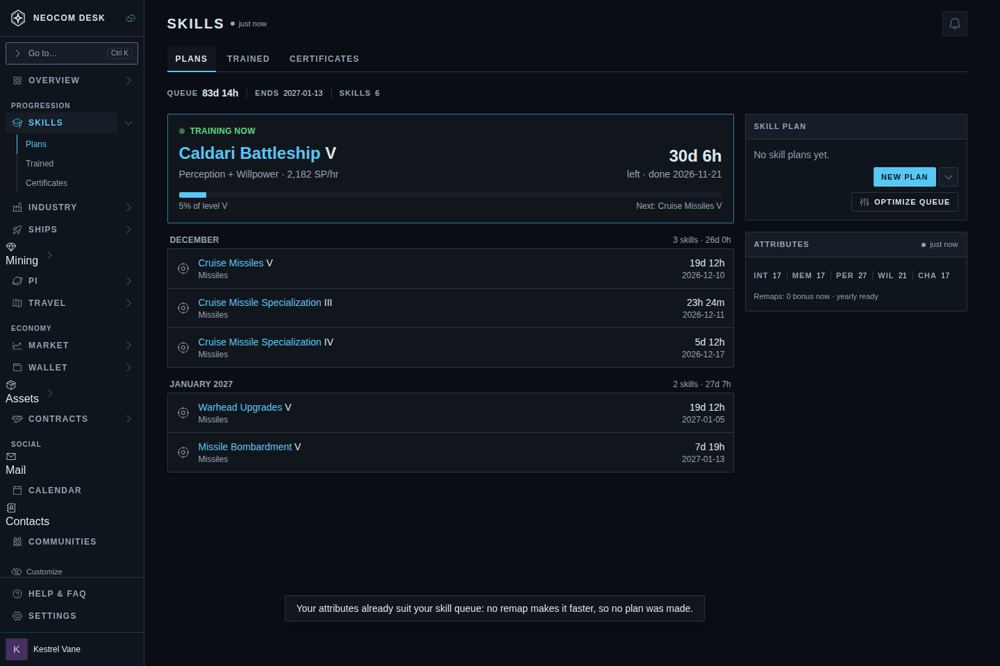 | |

## Notes for the build

- At 390 the existing `Toast` squeezes an Undo toast's message into a narrow column (see `landing-390`). Keep the message short. The `Toast` layout at phone width may deserve its own fix.
- The Plans page's broker-fee standings banner is dismissed in these shots; it's unrelated.
