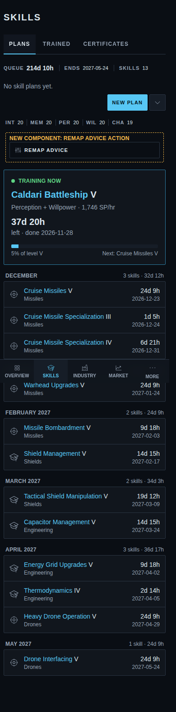
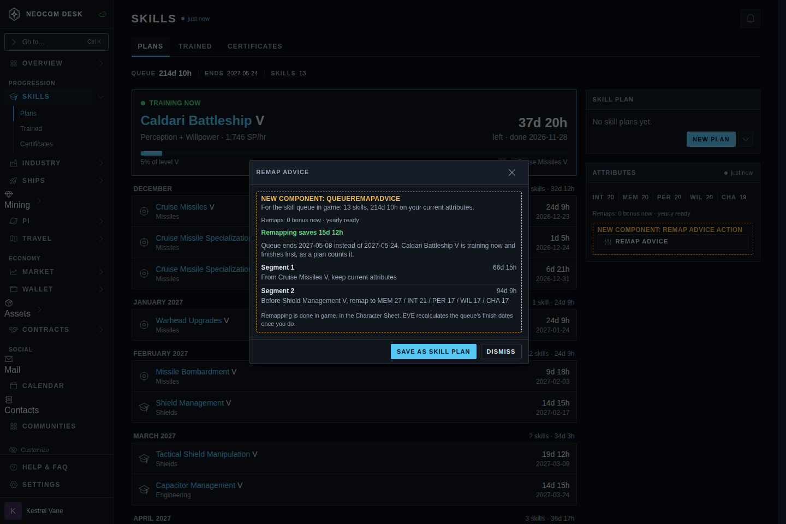
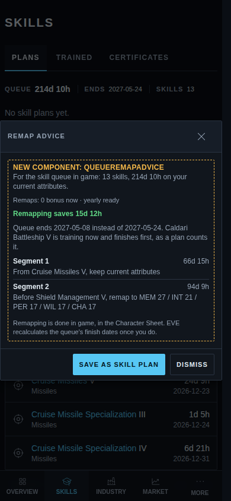
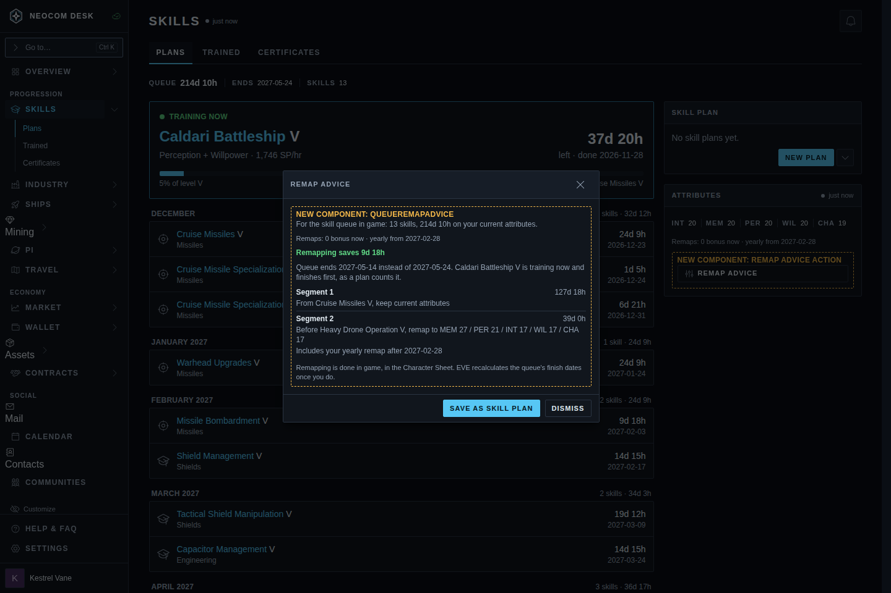
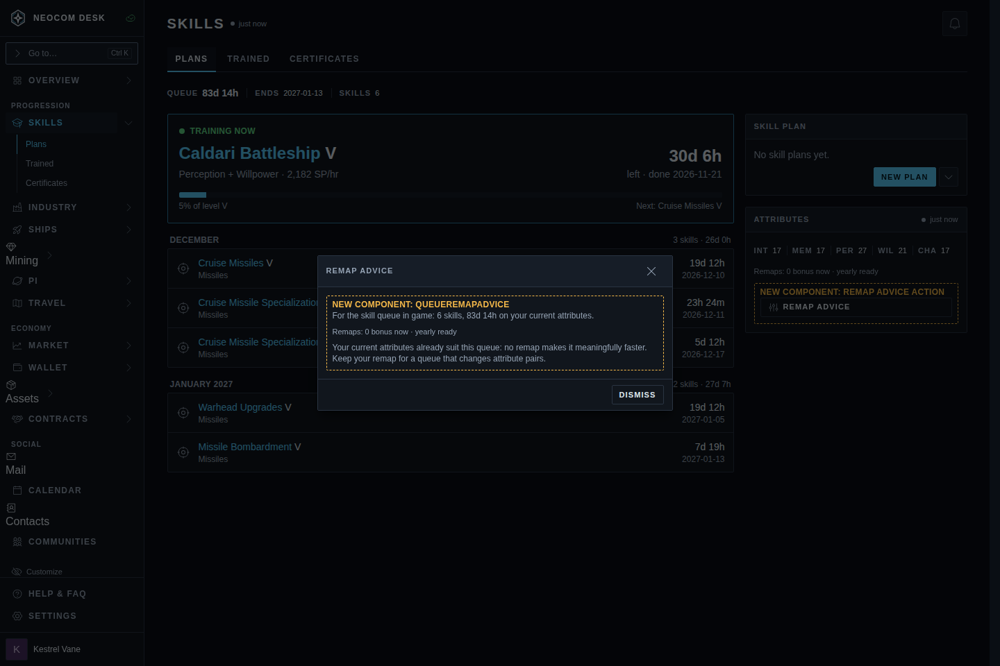
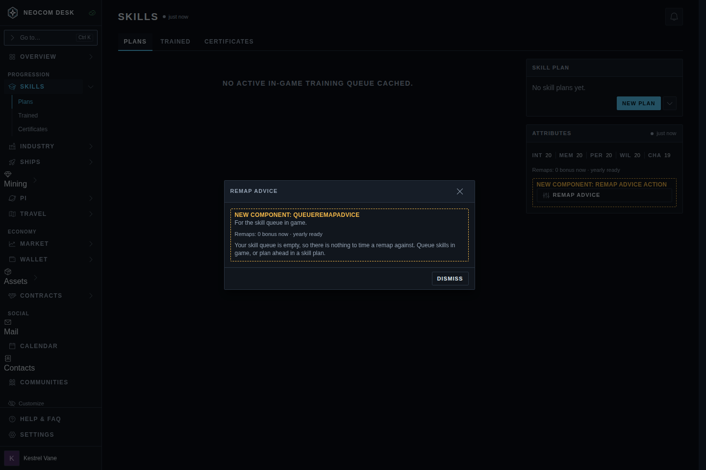
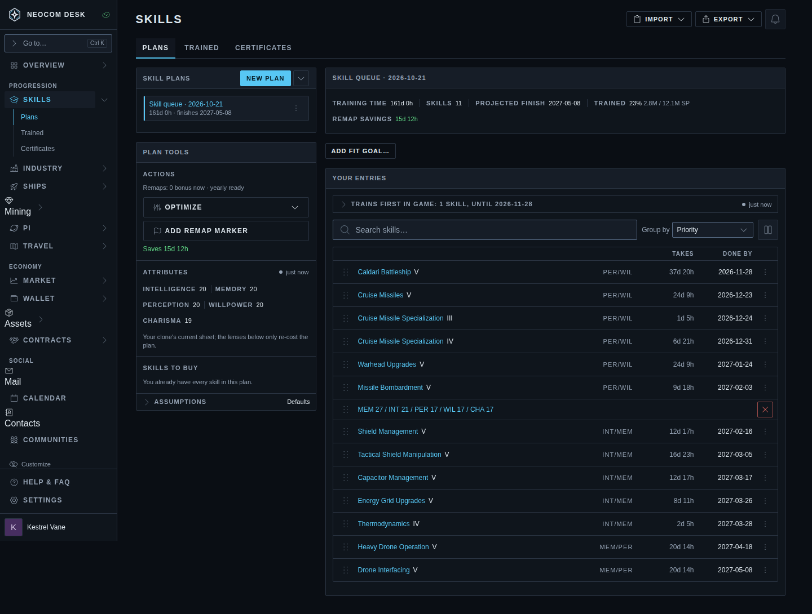
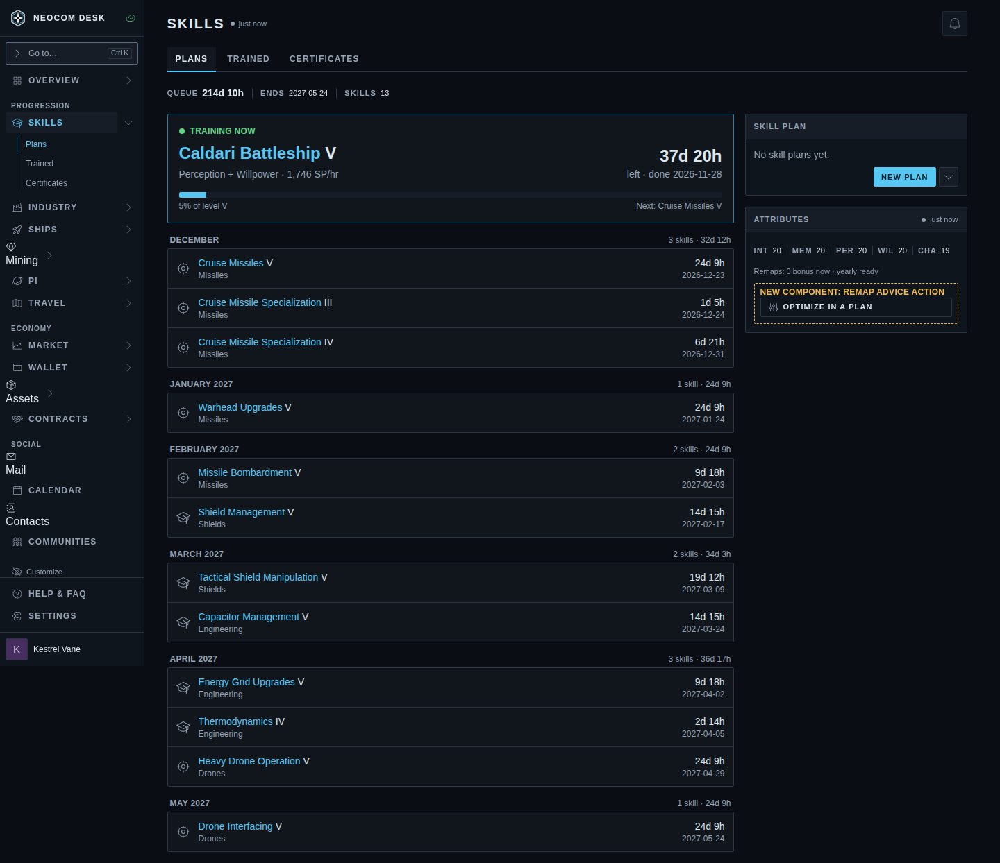

# Remap advice from the skill queue

Source: `src/mockups/QueueRemap.stories.tsx` (`mockups-queueremap--*`). Issue #4701. Sample data; the ticket text wins over the picture.

The real Skills › Plans page and Plan editor render against a sample missile pilot (`src/mockups/queueRemapFixtures.ts`): a Perception/Willpower block (Caldari Battleship V, cruise missiles), then Intelligence/Memory (shields, capacitor), then two Memory/Perception drone skills, on an even 20/20/20/20/19 sheet with no implants. Ranks and attributes come from the SDE. Every figure in the proposed modal is the planner's own `placeRemaps` run on that queue. As in the plan editor, it leaves out the level training now ("Trains first in game"), so the modal's savings match a saved plan's Remap savings to the hour.

New components:
- **Remap advice action**: an existing `Button` (the Optimize button's icon) in the Attributes panel, under the remap budget line it acts on. On a phone it sits under the attribute chips. The label has no "…", because the window only shows information (§6c).
- **QueueRemapAdvice**: the modal body. It uses `RemapPreviewModal`'s layout (savings line, then one row per segment with its remap instruction), framed for a queue. There is no Accept, because a remap is made in game. Its one action is **Save as skill plan**.

## Today

The optimizer exists only in the Plan editor: make a plan, Import › From skill queue, then Optimize.

| Story | 1440 | 390 |
|---|---|---|
| `today`: Skills › Plans, no remap entry |  |  |
| `today-plan-optimize`: the queue imported into a plan, Optimize open |  | |

## Option A: preview from the queue

| Story | 1440 | 390 |
|---|---|---|
| `advice-action`: Remap advice under the remap budget |  |  |
| `advice-ready`: yearly remap ready; keep current attributes through the missile block, then remap before Shield Management V |  |  |
| `advice-cooldown`: yearly remap ready on a date 130 days out; the remap waits for it (before Heavy Drone Operation V) |  | |
| `advice-bonus`: a bonus remap plus the yearly one, one remap per attribute block |  | |
| `advice-optimal`: the sheet already suits the queue; Dismiss only |  | |
| `advice-empty`: no queue |  | |
| `advice-saved-as-plan`: after Save as skill plan, a plan named "Skill queue · date" with the advice as a Remap Marker, its editor open |  | |

## Option B: shortcut into a plan

The same spot reads **Optimize in a plan**. It saves the queue as a plan and opens the editor with Optimize ready. It is less to build, but every press leaves a plan behind.

| Story | 1440 |
|---|---|
| `alt-action` |  |
| `alt-landing`: the new plan, Optimize open |  |

## Open questions

- With the yearly remap ready, the ready case's best single remap is *before Shield Management V*, not now: the current even sheet is already fine for the missile block. "Remap advice" can therefore mean "wait, then remap", and the modal says so through its segments.
- On cooldown, the optimizer holds the remap until the yearly date (`timedRemap`). The modal shows the date under the segment, using the plan editor's existing wording.
- An empty queue could hide or disable the action instead of opening a modal that says there's nothing to do. The mockup shows the modal.
- The Plans page's top banner (broker fees assume 0 standings) is dismissed in these shots; it's unrelated.
