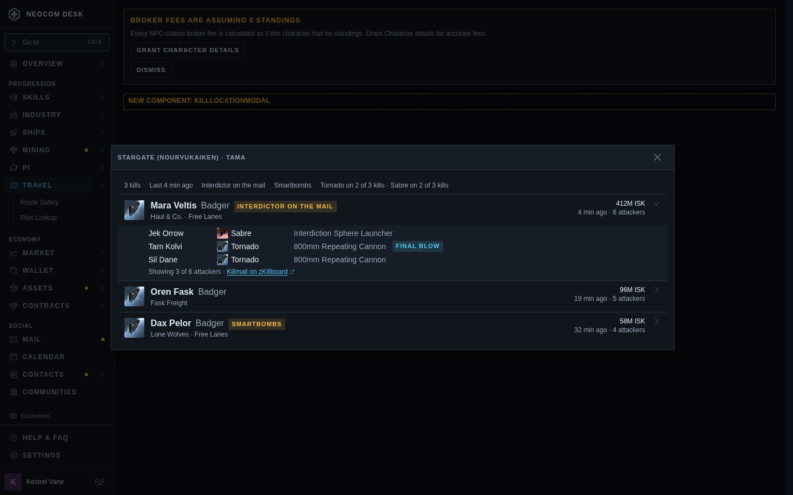
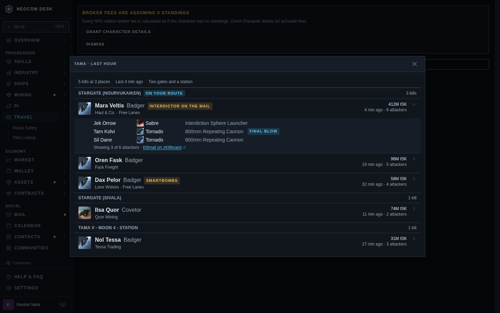
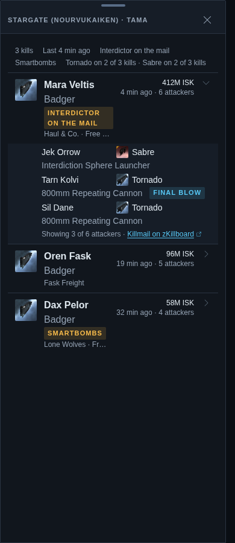

# Route Safety kill-location modal

Issue #5929. Story: `mockups-routesafetykills--location`, `--system`, `--location-phone`. The page behind the modal is the real Travel route with no route loaded; the open modal is the proposal. The row triggers (a location line, the kill count) are described in the ticket, not drawn.

| Proposed | Picture |
|---|---|
| One gate's kills: header chips (count, last kill, tags, hull summary), kill rows, first expanded to its attackers |  |
| Kill count opens the system: a sticky section per location, on-path gate first |  |
| Phone: full-height sheet |  |

Rough edges to settle in the build: on a phone the victim corporation truncates and the tag wraps tall; attacker rows stack weapon under ship. Sample data.
