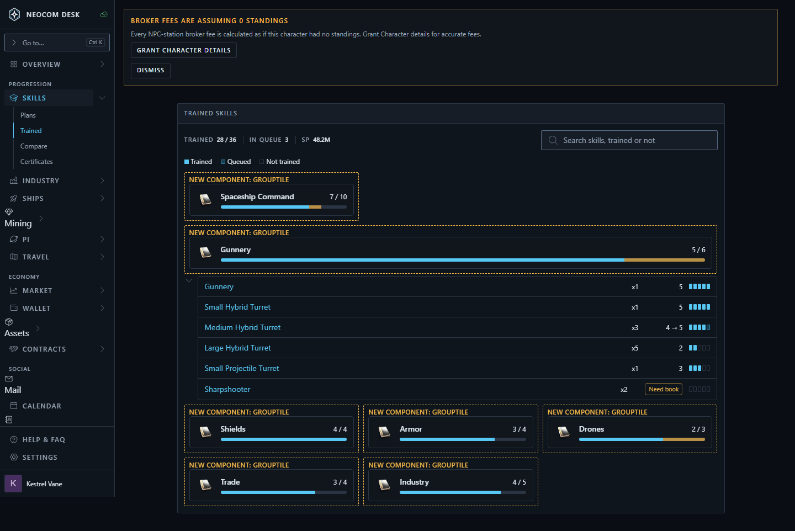
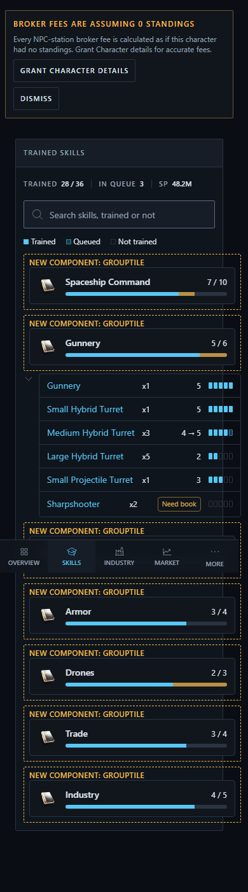

# Skills › Trained: group board

Source: `src/mockups/SkillsTrained.stories.tsx` (`mockups-skillstrained--proposed`, phone: `--proposed-phone`). Sample data; the ticket text wins over the picture.

Chosen layout: tiles expand in place (the drill-in variant was rejected).

New components: `GroupTile` (dashed label), `GroupSkillRow`, `NeedBookMarker` (the amber "Need book" chip). Pips are the existing `SkillBar` (`plannedLevel` = queued).

- One tile per skill group: icon, trained/queued bar, trained of total (total from the SDE, so untrained skills count).
- A tile expands its skills in place; each row has the name (a `SkillLink` opening the skill info modal), rank, level, pips, and "Need book" when the skill is not injected.
- One search box finds skills, trained or not; matching groups expand.
- Group icons: the flagship skill's `TypeIcon` (CCP image server), library `Skills` icon as fallback. The book glyph in the shots is Storybook having no network.
- Open: where the SP and attribute/implant header, CSV export and training chip land; whether "own the book, not injected" is in scope (needs assets).

| 1440 | 390 |
|---|---|
|  |  |
