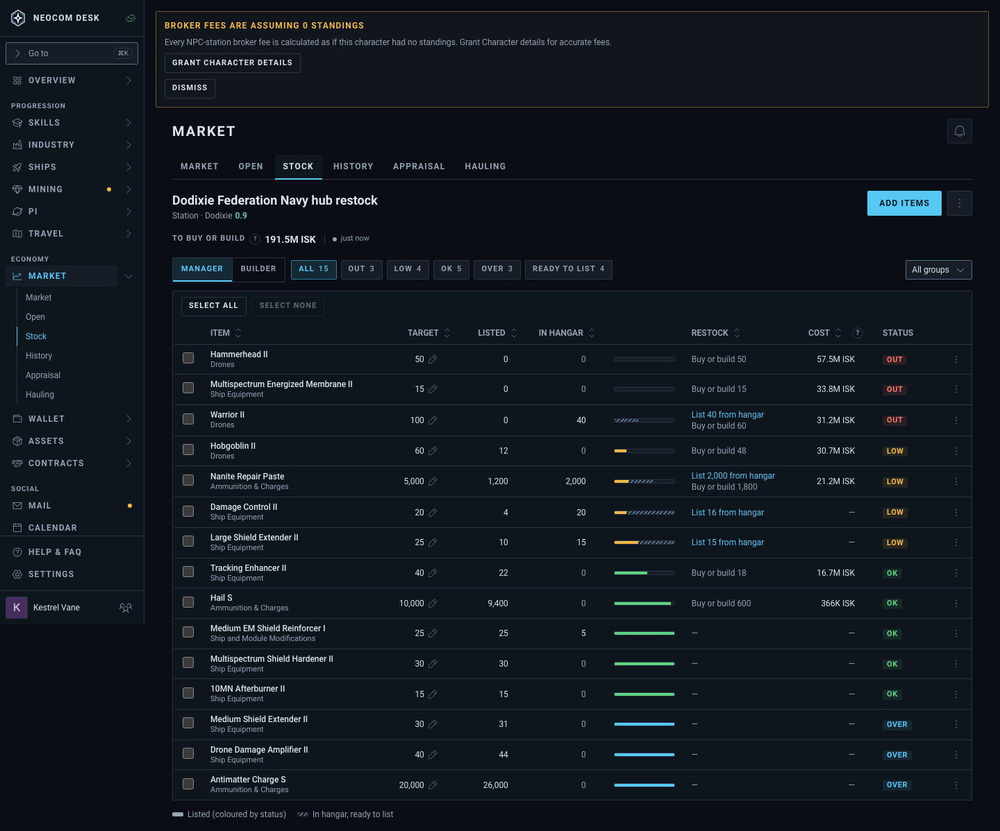
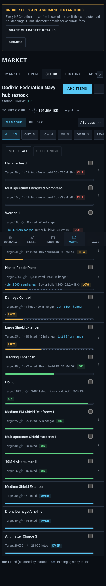
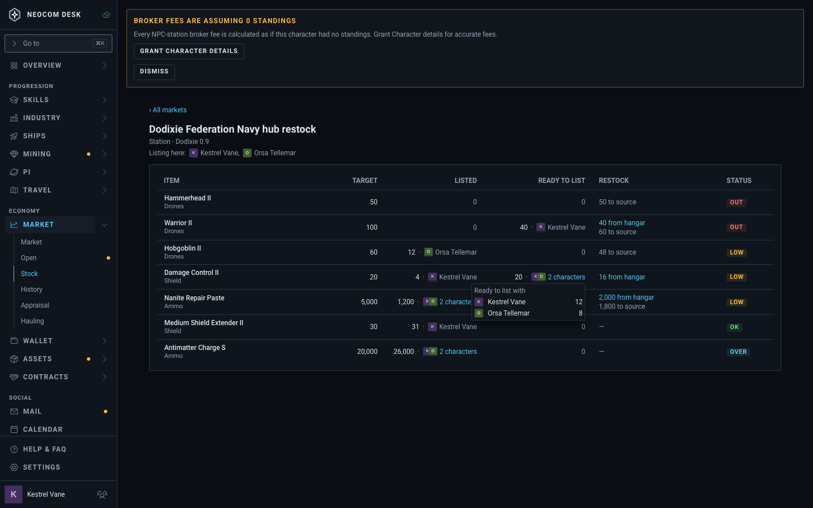
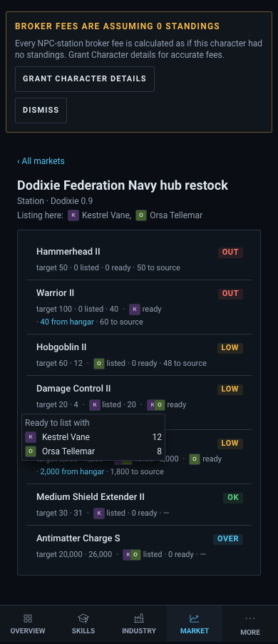
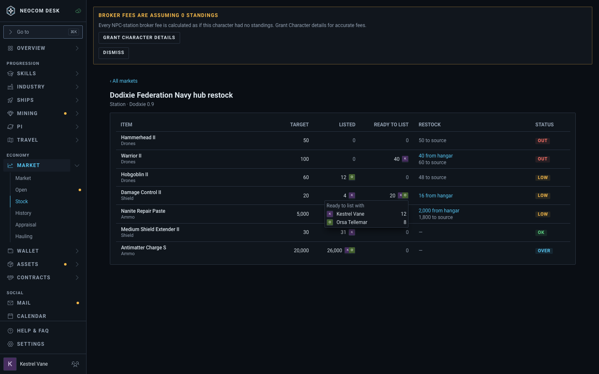
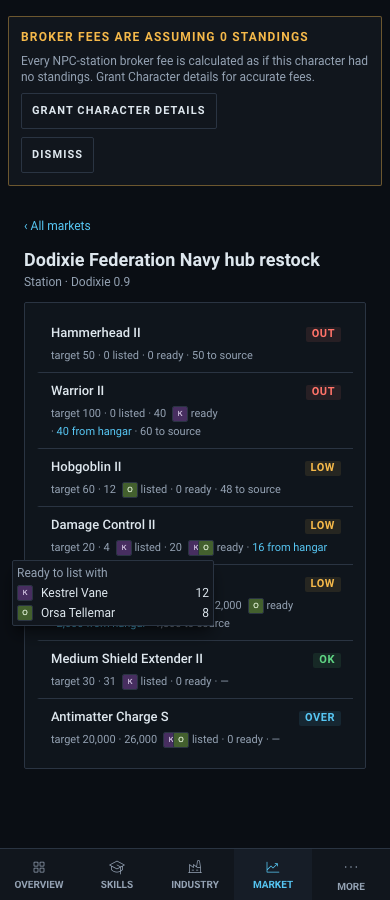
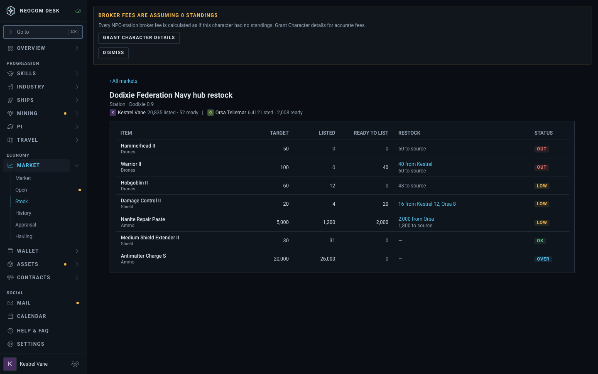
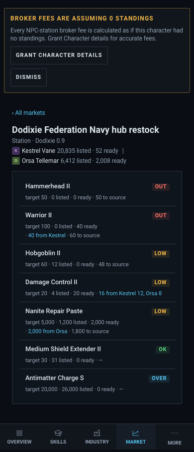

# Stock: which character holds Ready-to-list and Listed (#5594)

Story: `mockups/Stock holder` (`src/mockups/StockHolder.stories.tsx`, parts in `stockHolderParts.tsx`). Rows are mock data with single holders (Warrior II, Medium Shield Extender II) and several (Damage Control II ready, Nanite Repair Paste, Antimatter Charge S). The multi-holder popover is open on Damage Control II. New components: `HolderPortrait` (16px portrait), `ListingHereLine`, `HolderSummaryLine`.

| | Desktop 1440 | Phone 390 |
|---|---|---|
| Today |  |  |
| A: inline holder + "Listing here" |  |  |
| B: portrait stack, popover only |  |  |
| C: header summary + Restock names holder |  |  |

## A: inline portrait + name in the cell, "Listing here" header line
"40 · [K] Kestrel Vane"; several holders show "20 · [K][O] 2 characters" (popover). Header line lists the characters with orders here. Phone drops the name, keeps the portrait.
- Pro: answer visible without interaction; matches the ticket.
- Con: widest footprint; Listed and Ready columns grow ~60px; busiest.

## B: bare numbers, portrait stack after them, popover/tooltip only
Single holder: one 16px portrait (tooltip names it). Several: stacked portraits open the per-character split. No header line, no new text.
- Pro: smallest footprint; columns barely widen; phone nearly unchanged.
- Con: the name needs hover/tap; portraits alone are hard to tell apart for similar alts.

## C: no new cells; header summary per character + Restock cell names the lister
Header: "[K] Kestrel Vane 20,835 listed · 52 ready | [O] Orsa Tellemar ...". Restock cell becomes "40 from Kestrel" or "16 from Kestrel 12, Orsa 8" ("Kestrel can list all N" when one covers the shortfall).
- Pro: zero extra columns or popovers; holder shows exactly where the pilot acts (Restock).
- Con: Listed and Ready cells carry no attribution; the per-row split of Listed is lost.

## Recommendation
B for cells, plus C's Restock wording: bare numbers with a portrait stack (tooltip/popover for names), and the Restock cell naming who lists ("Kestrel can list all 40"). Skip the header line unless alts are many (C's summary is the cheaper form if kept). Smallest footprint that still answers "which alt do I log in to".

## Mobbin references used
- Deel Assets table: an inline icon + text identity inside a cell (A).
- Vanta Inventory: an owner as its own column, rejected as too wide (A/B keep it inside the number cell).
- Notion table: person chip = avatar + name (A single holder).
- Apple "Availability" per-location list: a short per-source breakdown as the overlay content (A/B popover).
