# Trade Hub per character (#5593)

Settings › Market defaults. Story: `mockups/TradeHubPerCharacter` (`src/mockups/TradeHubPerCharacter.stories.tsx`).
Sample data: four characters on mixed hubs (Jita, Hek, Amarr, Jita). Sibling Market defaults controls (refining, collateral, flags, LP value) are collapsed to one muted line in the variants; they are unchanged.

Common to all variants: default control relabelled "Default Trade Hub for new characters"; "Apply default to all" is the only bulk action; **one character = no per-character UI at all** and the label stays "Trade Hub" (see `single-character-*`).

| | Desktop | Phone |
|---|---|---|
| Today | 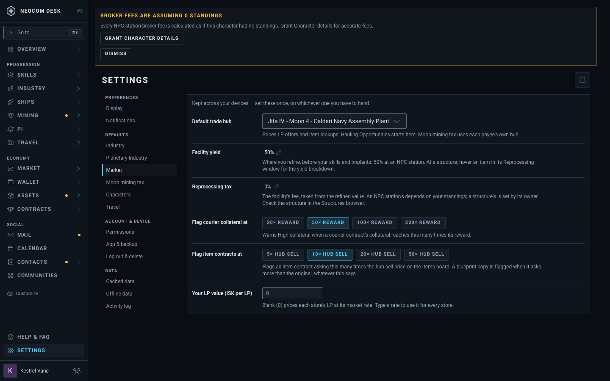 | 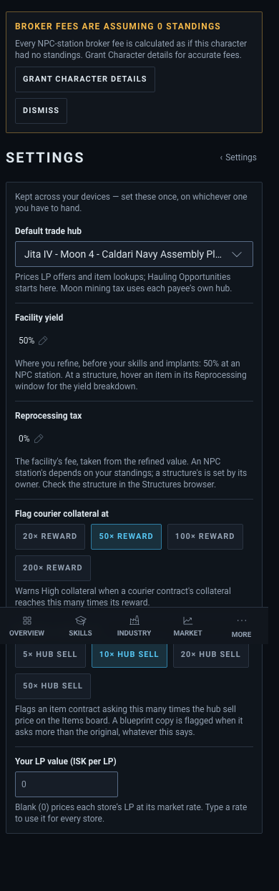 |
| A: inline list | 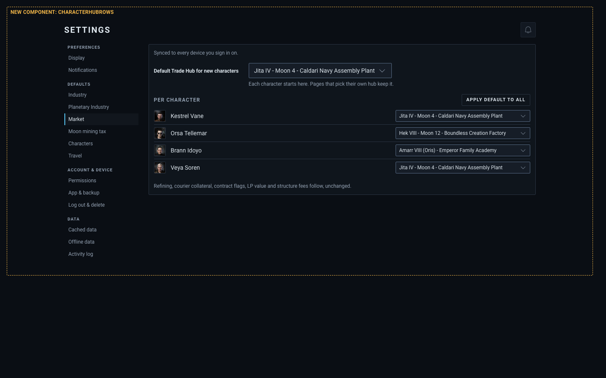 | 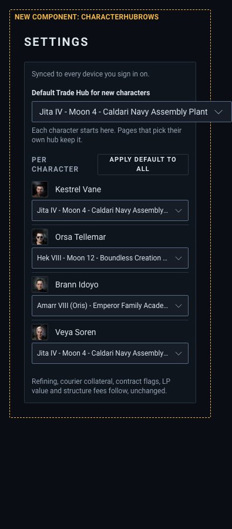 |
| B: collapsed (closed) | 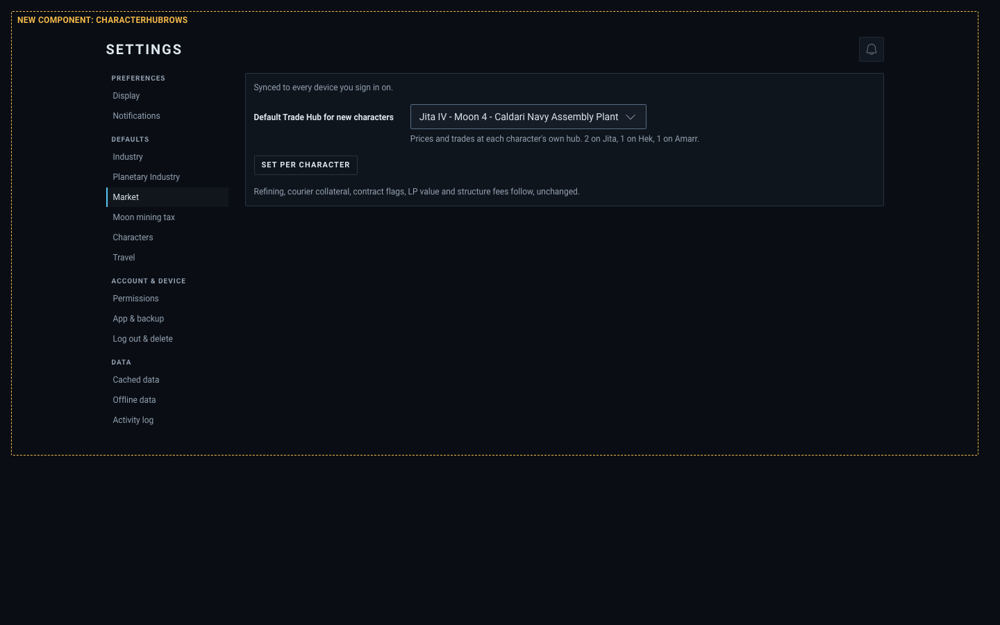 | 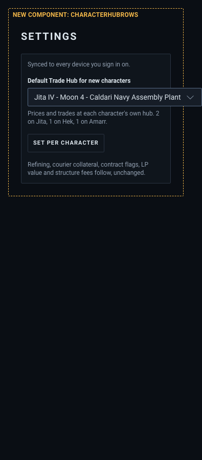 |
| B: collapsed (open) | 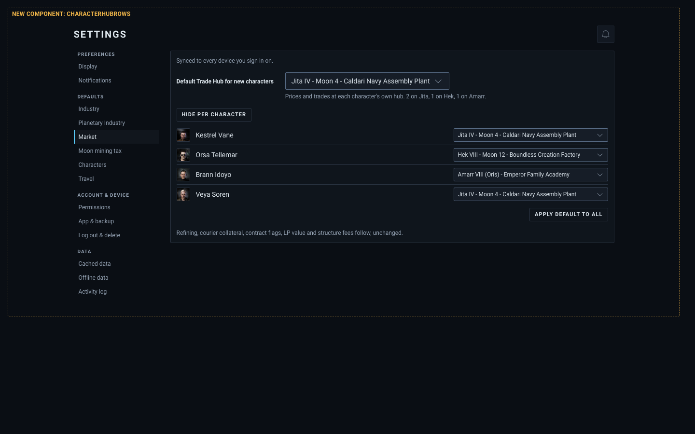 | 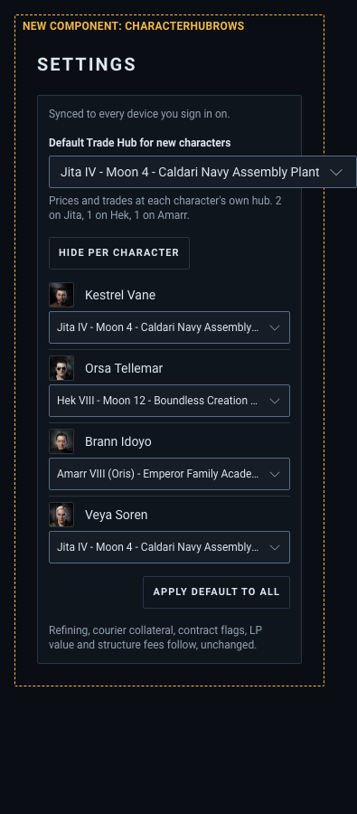 |
| C: dialog (open) | 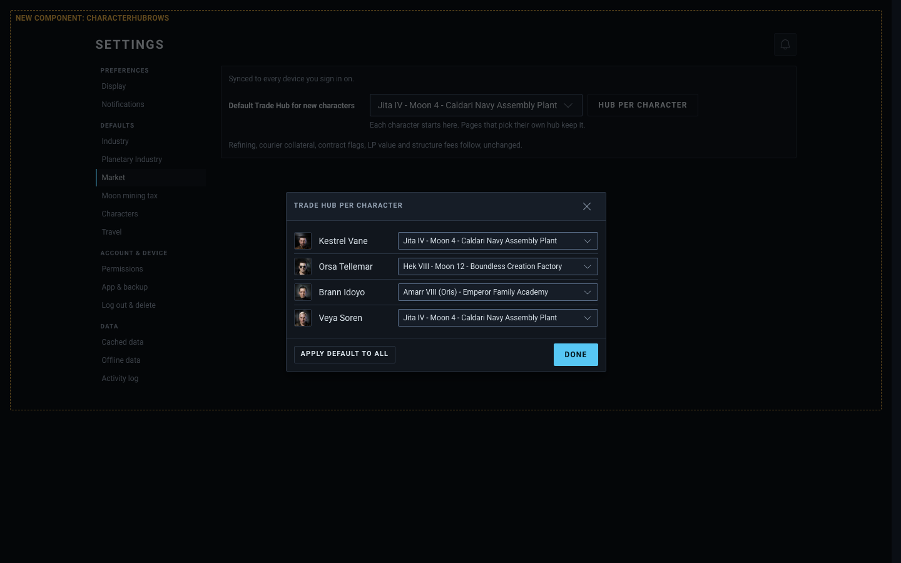 | 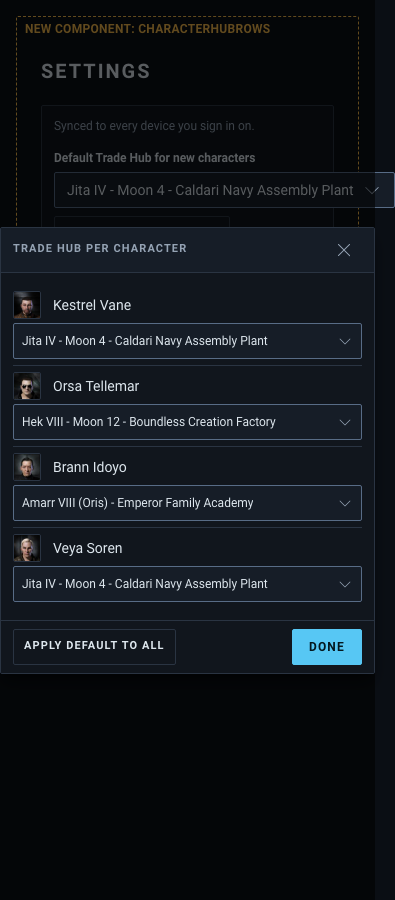 |
| C: dialog (closed) | 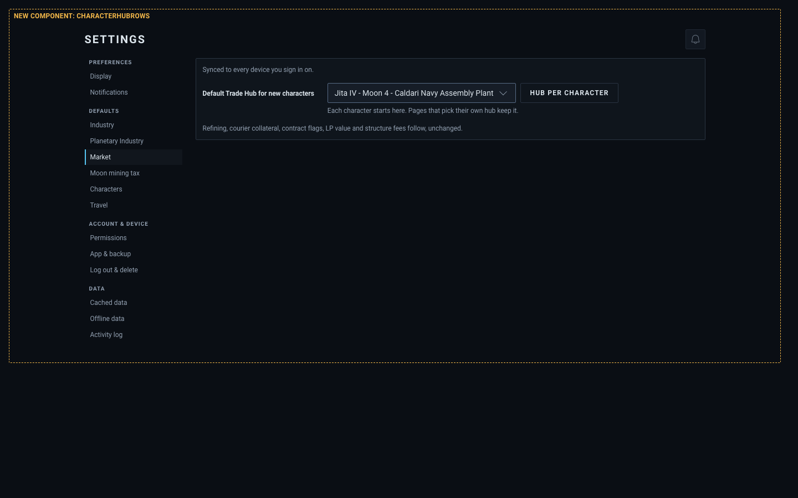 | 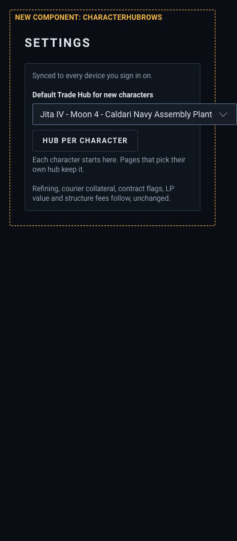 |
| One character | 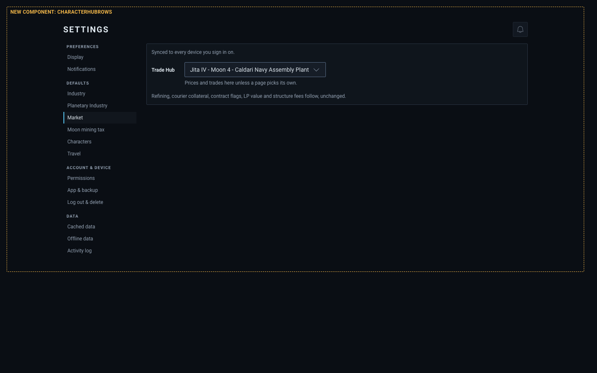 | 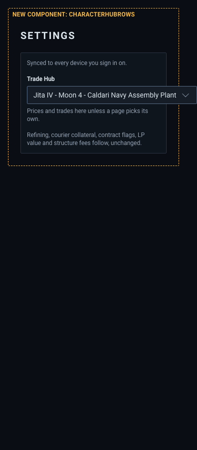 |

## Variants

- **A, inline list** (the ticket's layout). Always-visible "Per character" sub-list, Apply default to all in its header.
  - Pro: every hub visible and editable at once; no extra click; simplest to build.
  - Con: biggest footprint, grows with each alt; a rarely-changed set-and-forget setting permanently takes the card.
- **B, collapsed disclosure.** Default select plus a one-line summary ("2 on Jita, 1 on Hek, 1 on Amarr") and a "Set per character" toggle (`Collapse`). Closed by default.
  - Pro: card stays as small as today; the summary still answers "where is everyone". Same rows as A when opened, in place.
  - Con: one extra click to edit; the summary is prose in a field note, easy to miss.
- **C, dialog.** Default select gets one "Hub per character" button beside it; rows and Apply default to all live in a `Modal` with Done.
  - Pro: smallest resting footprint (one button); room for more per-character settings later.
  - Con: hub state hidden behind a dialog, no summary; modal on a phone for a plain list is heavy.

## Recommendation

**B.** Footprint is today's card plus one line and one small button, yet nothing is hidden from view (the summary) and editing stays in place, no dialog. Fall back to A if reviewers want zero clicks. Skip C unless more per-character settings are coming.

## Mobbin ideas used

- Cursor (Bugbot settings): per-row select at the right of a label, with the org default stated beside it, and a per-organisation list below. Basis for A's row shape (label left, select right).
- Luma (Notifications, iOS): grouped rows with the current value shown right-aligned, so state is readable without opening. Basis for B's one-line summary.
- Cash App / Lloyds (Notifications, iOS): a summary row ("On >") that drills into detail. Basis for C's single button that opens the list.
- Not adopted: Cursor's "Use installation default" option as a select value (inherit semantics). The ticket seeds a copy at add time instead, so changing the default never moves existing characters.

## Notes

- New component in the stories: `CharacterHubRows` (portrait, name, hub select). Everything else is existing primitives. Mockup frame is a copy of the Settings header and rail; "Today" is the real page.
- The `*Phone` stories exist for the workflow; `ui:shot` already captures 1440 and 390 for each story.
