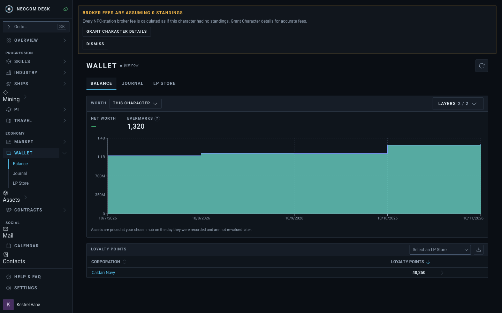
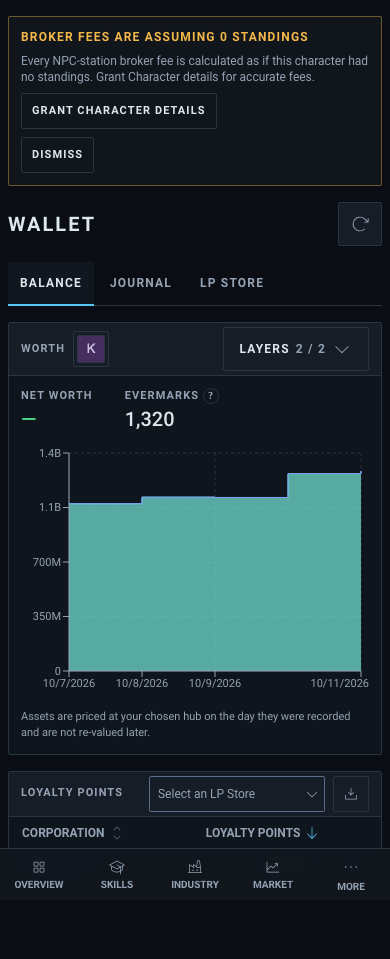
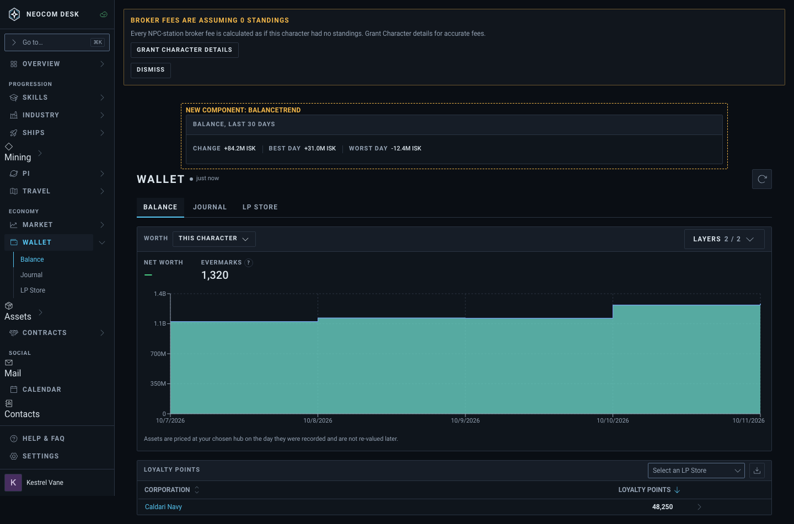
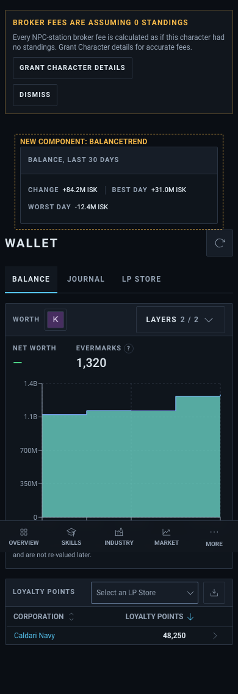

# Wallet › Balance: 30-day trend (worked example)

Source: `src/mockups/Wallet.stories.tsx` (`mockups-wallet--proposed`). Sample data; the ticket text wins over the picture.

New component: `BalanceTrend` (dashed, labelled panel). Everything else is the real Wallet page and `src/components/ui` primitives.

| | 1440 | 390 |
|---|---|---|
| Today (`pages-wallet--balance`) |  |  |
| Proposed |  |  |
