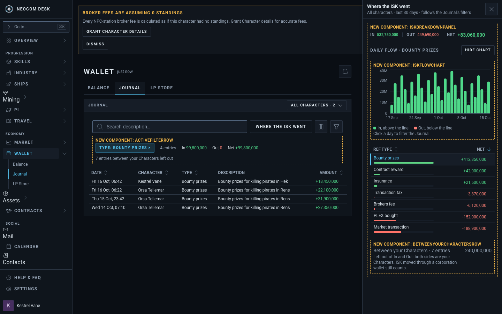
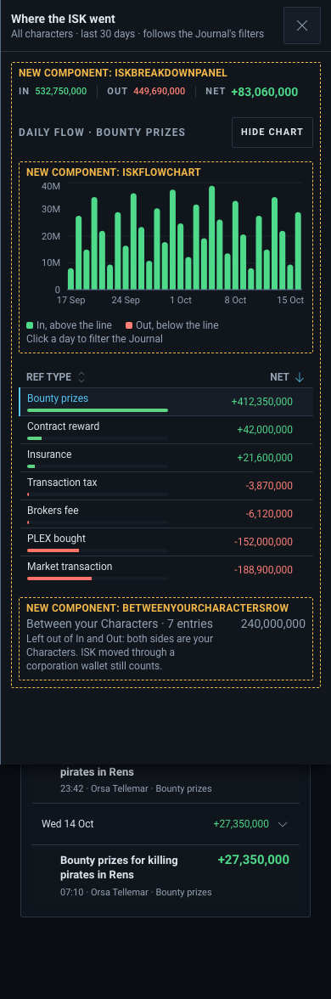
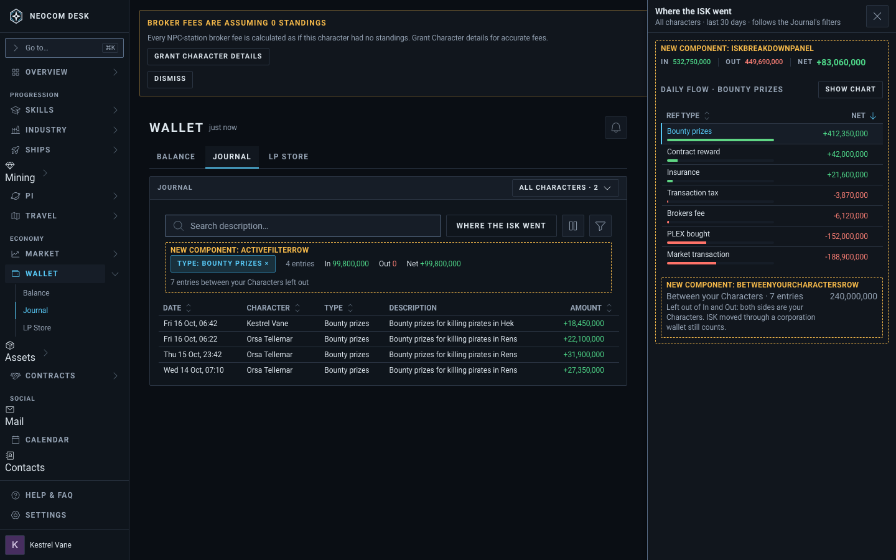
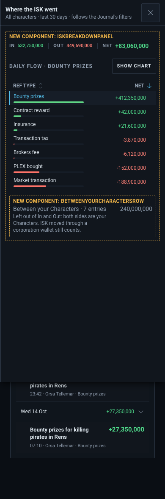
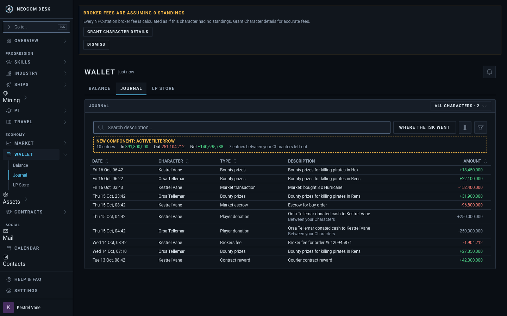
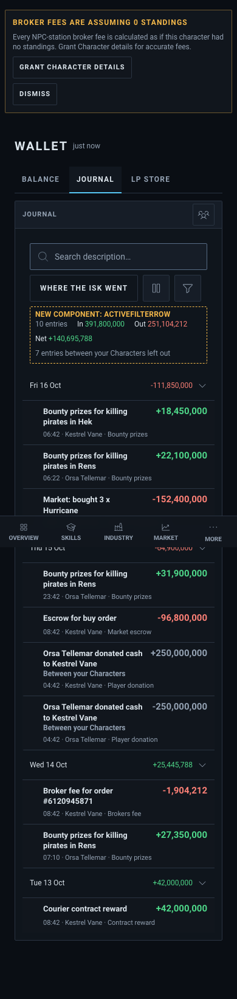

# Wallet › Journal: Where the ISK went side panel, all Characters, phone list

Issues: #3908 (side panel, Character filter, filter chips, netting), #3914 (daily chart, hideable), #3915 (phone day-grouped list). Source: `src/mockups/WalletJournalAllCharacters.stories.tsx`. Sample data; the ticket text wins over the picture.

New components: `IskBreakdownPanel` (side panel body), `IskFlowChart` (#3914), `ActiveFilterRow` (removable chips and the filtered In / Out / Net line), `BetweenYourCharactersRow`. Everything else is an existing primitive (`SlideOver`, `DataTable`, `FilterChip`, `ProgressBar`, `StatChip`, `CharacterFilterControl`).

Patterns from Mobbin: Origin and Copilot (side panel over the list), Vivid and Copilot (removable filter chip), Lloyds and Monzo (filtered totals), YNAB (category list with share bars), Copilot, Monzo and Starling (day-grouped phone list).

| | Desktop 1440 | Phone 390 |
|---|---|---|
| Panel open, Bounty prizes picked (story `--panel-open`, `--panel-phone`) |  |  |
| Chart hidden (`--chart-hidden`) |  |  |
| Journal, panel closed (`--journal-only`, `--journal-phone`) |  |  |
