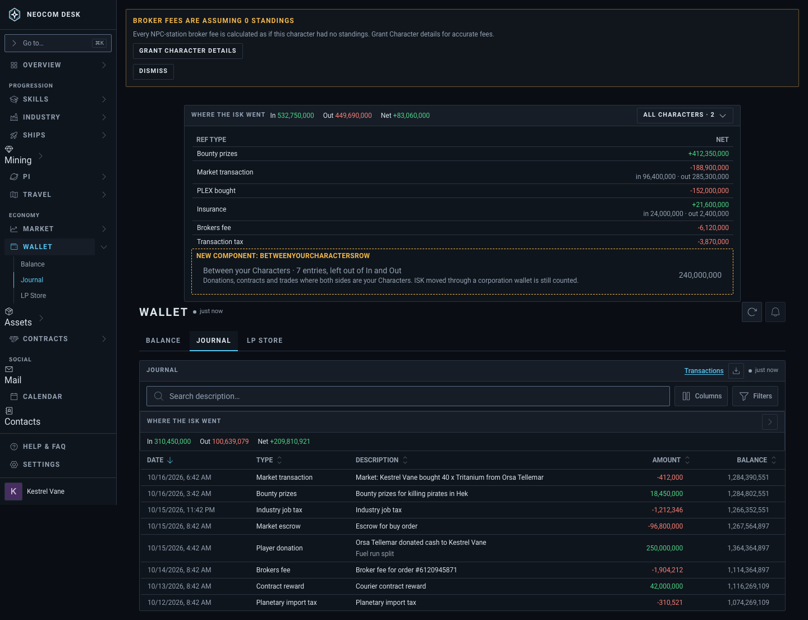
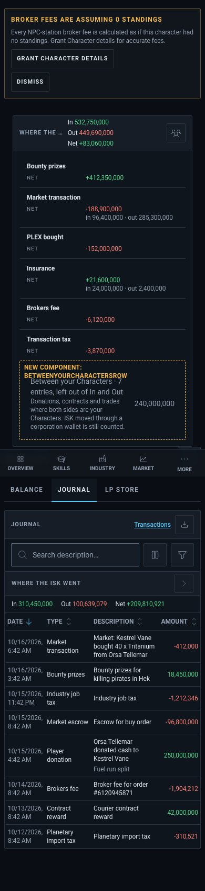
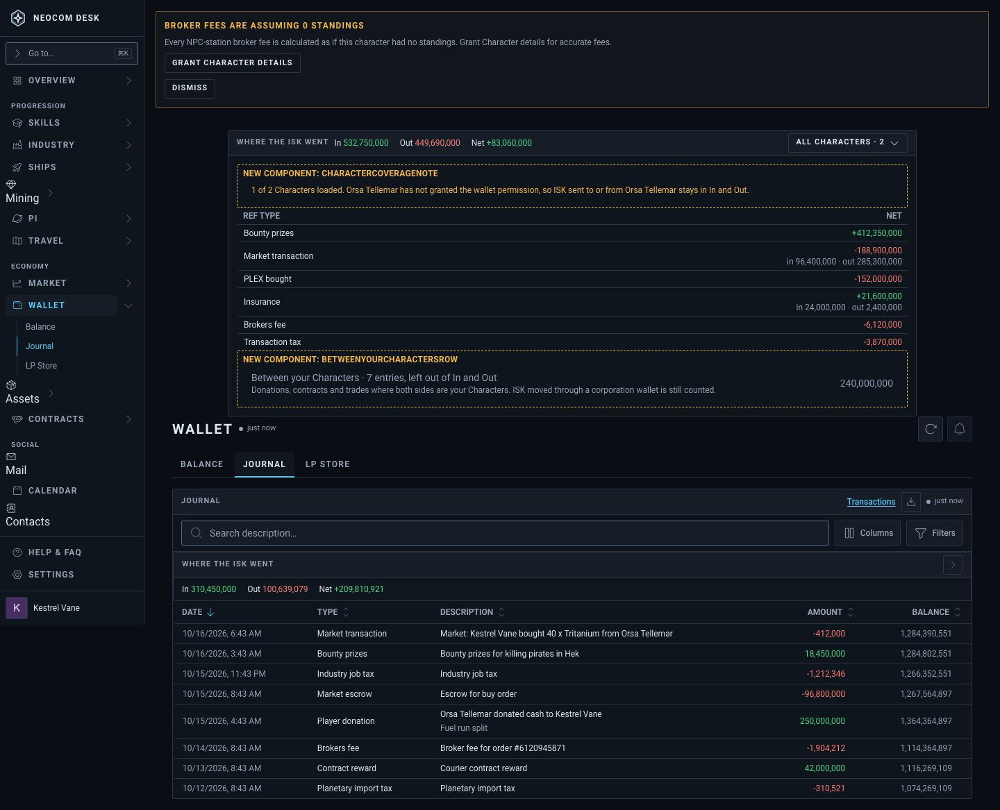
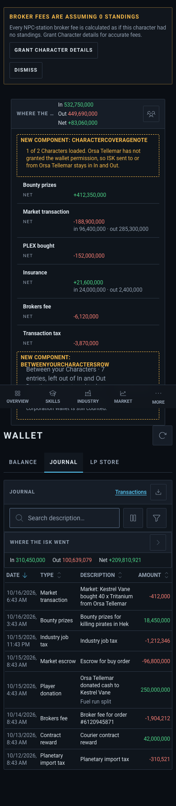

# Wallet › Journal: Where the ISK went across all Characters

Issue: #3908. Source: `src/mockups/WalletJournalAllCharacters.stories.tsx` (`mockups-walletjournalallcharacters--proposed`, `--partial-coverage`). Sample data; the ticket text wins over the picture.

New components: `BetweenYourCharactersRow` (the collapsed line under the table) and `CharacterCoverageNote` (the "1 of 2 loaded" readout). The Character filter is the existing `CharacterFilterControl`; the table is the existing breakdown with one new row, "PLEX bought". Today's page renders under the proposal in every shot.

| | 1440 | 390 |
|---|---|---|
| Proposed, All Characters |  |  |
| One Character without the wallet permission |  |  |
